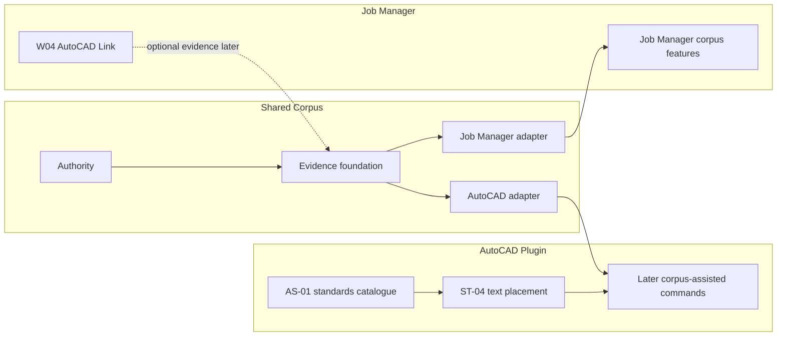

# AS-01 — CE standards assets and palette integration

**Planning:** approved
**Record:** complete — exact planning-task source recovered 2026-07-22
**Implementation:** not started
**AutoCAD verification:** not started
**Design rules enforced:** recorded in the approved decisions and Timothy's review below
**Source task:** `019f822e-367c-78a0-b780-25df7c1381bd`
**Source assistant item:** `item-121`

> The source card and approval text below are preserved verbatim. Approval is a planning decision only; it does not claim implementation or AutoCAD verification.

## Approved source card — verbatim

# AS-01 — CE standards assets and palette integration

I recommend inserting this shared card before ST-04.

## AS1-1 — One standards catalogue

Create one governed catalogue covering:

- blocks;
- notes;
- schedules;
- layers and linetypes;
- text/dimension styles;
- standard details;
- title blocks and templates.

Palettes and commands consume the catalogue; neither becomes a separate authority.

**Recommendation: Approve.**

## AS1-2 — Three asset zones

| Zone | Contents |
|---|---|
| Runtime standards | Small essential assets required by commands |
| Office library | Current approved standard-detail masters |
| Historical evidence | Superseded, recovery and corpus material |

Historical assets are never offered during normal drafting.

**Recommendation: Approve.**

## AS1-3 — Reconcile DWG/DXF authority

- DWG becomes the authored master.
- DXF becomes an inspection/export derivative.
- The current June/July mismatch must be reviewed before publishing.
- No automatic overwriting in either direction.

**Recommendation: Approve.**

## AS1-4 — Masters remain physically read-only

CE may inspect and copy from approved masters.

It must never:

- edit them;
- sync project data into them;
- upgrade them;
- repair/save them;
- replace blocks in them during ordinary commands.

**Recommendation: Approve.**

## AS1-5 — Every asset needs a catalogue identity

Record:

- stable CE asset ID;
- visible name;
- discipline/category;
- source master and version;
- approved status;
- insertion layer and scale;
- attributes/variable fields;
- intended explode behaviour;
- replacement/superseded relationship.

**Recommendation: Approve.**

## AS1-6 — Eliminate anonymous names as authority

Names such as `A$C7bc8e275` are temporary AutoCAD-generated identities.

Important assets receive stable names such as:

```text
CE_STR_SECTION_MARK
CE_STR_LEVEL_MARK
CE_STR_BRACING_A
CE_CVL_PIT_LABEL
CE_NOTE_FRAMING_GENERAL
```

Anonymous source geometry may be mined once, but commands never depend on its generated name afterward.

**Recommendation: Approve.**

## AS1-7 — Ship essential command assets with CE

Small runtime assets required by `SM`, level marks, supports, bracing and civil commands should ship in the approved CE bundle.

This removes personal-path dependence and allows commands to work consistently on staff machines.

Normal builds still use `-p:SkipDevBundle=true`.

**Recommendation: Approve.**

## AS1-8 — Keep the main detail library centrally maintained

Do not bundle all 183 historical DWGs.

CE resolves the approved office-library root through settings—not an exact Timothy path—and shows:

- connected;
- unavailable;
- version changed;
- superseded;
- approval unknown.

Missing library access must not freeze AutoCAD.

**Recommendation: Approve.**

## AS1-9 — Tool palettes become an optional front end

Keep the familiar palettes during transition, but make them another view of the catalogue.

The same asset should appear in:

- CE Manager/Library;
- optional AutoCAD tool palette;
- contextual command choices.

Do not maintain three separate definitions.

**Recommendation: Approve.**

## AS1-10 — Standard insertion workflow

```text
Select asset tile
→ show thumbnail/name/source version
→ complete block/detail follows cursor
→ choose rotation/flip/variant
→ click
→ one Undo
```

Esc leaves nothing. No hidden command strings or forced saves.

**Recommendation: Approve.**

## AS1-11 — Projects receive a fixed approved copy

When a detail is placed, copy that approved version into the project drawing.

Do not leave a live link that silently changes when the office master is later updated.

The placed detail records its source asset and version.

**Recommendation: Approve.**

## AS1-12 — Preserve intelligent objects

- Dynamic blocks remain dynamic.
- Schedules retain recognised fields.
- Section/level marks retain compound ownership.
- Hatches remain native hatches.
- Explode only when the catalogue explicitly says the result is intentionally loose drafting.

Supports, labels, schedules and marks must not be routinely exploded.

**Recommendation: Approve.**

## AS1-13 — Govern variable text and placeholders

Static standard notes retain their approved wording.

Project-specific fields become recognised values with provenance:

- section number;
- sheet reference;
- member mark;
- level;
- project-specific note;
- schedule entry.

Placeholders such as `____` or `x.xx` block Ready-to-Issue unless deliberately approved.

**Recommendation: Approve.**

## AS1-14 — Updates are explicit

For an existing project:

```text
New library version available
→ compare placed version with current standard
→ show differences
→ Preview Update
→ explicit approval
→ Apply
→ one Undo
```

Never silently replace details or notes in an existing project.

**Recommendation: Approve.**

## AS1-15 — Corpus comparison lane

Once the shared corpus is operating, compare:

```text
Approved master asset
→ where/how it was used in issued drawings
→ markup corrections
→ final accepted form
```

This identifies:

- commonly used assets;
- unused or obsolete assets;
- repeated manual modifications;
- missing variants;
- placement conventions;
- historical errors that should not be reproduced.

The master shows **intended CE drafting**; the corpus shows **how it performs in real projects**. Engineering authority remains separate.

Timothy reviews no more than 30 visual exceptions per batch.

**Recommendation: Approve.**

## Progress

| Stage | Status |
|---|---|
| ST-03 | ✅ Locked, with visual-source refinement |
| **AS-01 standards assets** | 🟠 Awaiting approval |
| ST-04 text placement | ⬜ Next |
| Shared corpus | Separate task |
| Files changed | None |
| AutoCAD testing required now | None |
| Implementation | 0% |

**Recommendation: approve AS-01 all, then continue to ST-04.**

## Timothy's approval and refinements — verbatim

### Approval source 1 — item-122

The attached audit is strong and should supersede my preliminary inventory where it uses the narrower **active CE palette** scope.

## Reconciled findings

The figures are not conflicting—they measure different things:

| My initial scan | Attached audit | Explanation |
|---|---|---|
| 44 palette files / 867 tools | 12 active CE palettes / 289 named tools | Mine included Autodesk stock and inactive palettes |
| 788 DXF block definitions | Same | Complete DXF block table |
| 430 preview metadata blocks | — | Only blocks represented in AutoCAD’s generated preview catalogue |
| 262 anonymous preview entries | 614 anonymous DXF definitions | Different subsets of the same drawing |

## Decision

**Approve AS-01 decisions 1–15**, with four clarifications:

1. The standards are **CE Baseline Candidate v0.1**, because they are useful but incomplete.
2. Only individually catalogued assets marked **Approved** become visual authority.
3. “CE Manager/Library” means the **AutoCAD Plugin’s standards browser**, not the independent Job Manager.
4. Runtime assets belong in the AutoCAD Plugin bundle—not W04’s read-only AutoCAD Link.

## Independent workstreams



### What this means

- **AS-01 and ST-04 do not need to wait for W04.**
- **Corpus planning does not need to wait for W04.**
- W04 can finish independently.
- The AutoCAD Plugin can build its standards catalogue before the full historical corpus exists.
- Corpus-assisted suggestions connect later through the AutoCAD adapter.
- Job Manager connects separately through its own adapter.

## Recommended sequence

### AutoCAD Plugin now

1. Approve AS-01.
2. Reconcile the June DWG against the July DXF.
3. Establish DWG as the future authored master.
4. Catalogue stable approved assets.
5. Replace anonymous palette dependencies.
6. Continue ST-04 using approved CE graphics.
7. Retain existing palettes during transition.

### Shared corpus now

1. Create its independent planning/code home.
2. Record the seven approved corpus cards.
3. Obtain narrow Director authority for real SharePoint extraction.
4. Build the evidence contract and standards-first pilot.
5. Add AutoCAD and Job Manager adapters independently.

### W04

Finish it on its existing synthetic-only branch. Do not add AS-01 or corpus implementation to W04.

## Important authority distinction

The master files show **intended CE appearance**. They do not make every current item approved:

| Status | Normal Plugin use |
|---|---|
| Approved | Search, preview and insert |
| Candidate | Review/Preview-only |
| Working | Hidden from ordinary users |
| Superseded | Corpus/reference only |
| Unknown | Hidden until classified |

No files were changed. To implement AS-01, I next need the actual AutoCAD Plugin repository path and current branch so its own `AGENTS.md` and project rules can be followed.

### Approval source 2 — item-127

✅ Approve AS-01 all — and inserting it before ST-04 is the right call
Asset governance is a prerequisite, not a detour. The annotation and text commands (ST-03/ST-04) all place blocks, marks and details — so they can't be built correctly until the catalogue, the stable names and the preserve-intelligence rules exist underneath them. Getting the asset foundation right before more command cards is proper sequencing. And your model — master → governed catalogue → {runtime / details / palettes / corpus} → commands — is the one-authority pattern applied to assets: the asset-layer twin of the Tool Register and the engineering map. One catalogue, everything consumes it, nothing else is an authority.

🏆 AS1-4 + AS1-6 cure two documented disasters
AS1-4 (masters physically read-only) is the single most important line on the card. The CDFALL 8-round saga — the worst bug in the whole audit — was caused by code that rewrote the shared FALL block definition on every insert (design rule #3, violated). "CE may inspect and copy from masters; it must never edit, sync, upgrade or replace blocks in them during ordinary commands" makes that entire class impossible. This is the root-cause cure for the mutating-shared-definitions disease.

AS1-6 (kill anonymous names as authority) is CT2 applied to blocks. Your audit is stark: 614 of 788 blocks carry volatile A$C… generated names, 194 tools reference them, and 2 references already broke. Generated names change when the block is edited — so every reference to one is a time bomb, and you've already seen two go off. Stable identities (CE_STR_SECTION_MARK) are the permanent fix. Same disease as CT2 (depending on a volatile name), same cure (a stable identity the name can't break).

🧩 AS1-12 fixes a widespread quiet damage
145 tools explode their block on insertion — nearly half — silently converting intelligent objects (dynamic blocks, schedules, compound marks) into dumb geometry that loses its attributes, its dynamic behaviour and its later editability. "Preserve intelligent objects; explode only when the catalogue explicitly says the result is intentionally loose drafting" reverses that default. Every one of those 145 was throwing away the intelligence you'd want the next time you touched the object.

🔒 AS1-11 keeps issued drawings stable
Placing a detail must copy a fixed approved version into the project — not a live link. A live link means updating the office master later would silently change a drawing you already issued — a genuine hazard (you issued one thing; the master moved; now it shows another). Fixed copy + recorded source/version is the correct model: the drawing is stable, but it knows its source, so you can adopt an update deliberately through AS1-14's explicit preview→approve flow — never behind your back.

✅ Two quick affirms
AS1-1 + AS1-9 end the three-competing-definitions mess (template vs palettes vs commands). The palettes stay for muscle memory but become a view of the catalogue — one definition, multiple front ends.
AS1-13's placeholder rule is a smart, specific QA hook: an unfilled ____ or x.xx blocks Ready-to-Issue unless deliberately approved. That's exactly the kind of thing that gets issued by accident today, caught at the gate.
🔗 On the ST-03 visual refinement
Agreed and consistent: ST3-7/ST3-9's intelligent behaviour stays approved, but the graphics come from the existing approved CE blocks (SECT MARK, RL LEVEL, Section Title Block) via the catalogue — not newly-approximated geometry. That's AS1-6 (stable-named source) + AS1-12 (preserve the dynamic fields) in action. And yes — the single-marker vs paired-cut-marker classification is genuinely a template/corpus question; right to defer it until the catalogue can answer it rather than guess now.

🔒 Approve — and one prerequisite flagged
Read-only masters, stable identities, preserved intelligence, fixed-copy issue stability, portable runtime assets, centrally-resolved library. One thing to action before publishing anything: the DWG/DXF June-vs-July mismatch (AS1-3) must be reconciled first — until then, neither is the approved standard, and building against an unreconciled master would bake in the wrong geometry. Continue to ST-04 whenever you're ready.
