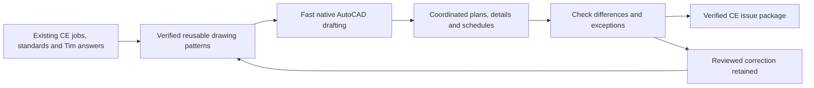

# CE Drawing Production Plan — established CE drawings, faster production

**Recorded:** 6 September 2026. **Status:** Tim approved adding the full drafting audit to the plan for Civil, Structural and Manager and requested deeper delivery detail. This is the shared production extension of [the master plan](CLEAN_SLATE_REBUILD.md), not a separate product, board or command registry.

**Product objective:** produce drawings that look and read like CE's established issued work, with better coordination, fewer repeated inputs, faster revisions and less checking/workflow burden on staff.



## 1. Authority, scope and destinations

Tim's instruction in this task:

> "can you add it all to our plan for all there modules and maybe go into more detail in the plan about what and how we should achieve it"

> "create a product that creates drawings that look and feel the same but faster, with better systems, with more quality and reducing workflows on end users"

**Approved now:** inclusion of all 44 audit findings/opportunities and the cross-discipline workflow in the product plan; evidence reuse, CE output fidelity, reduced user effort and the detailed delivery method below. Proposed engineering numbers, first connection families, exact unresolved screen interactions and runtime acceptance are not fabricated by this instruction. Existing command approvals remain valid; extend only the changed/previously undescribed workflow before code.

| Source/destination | Purpose |
|---|---|
| [Overall map](V3_OVERALL_PLAN.md) | Starting point for the whole product |
| [Complete 44-item delivery register](DRAFTING_DELIVERY_REGISTER.md) | Stable audit IDs, existing card/chunk destinations, build approach and acceptance |
| [Dated audit](evidence/DRAFTING_LEVEL3_AUDIT_2026-09-06.md) | Full rationale, source baselines and specific edge cases; historical observations, not live status |
| [Civil plan](V3_0_PLAN.md) | C0–C6 and Civil production outputs |
| [Structural Level 3](STRUCTURAL_LEVEL3_PLAN.md) | SL3-0–6, project context, connection/section/revision pilot |
| [Manager plan](MANAGER_PRODUCT_PLAN.md) | M1, standards readiness, staff support and recovery |
| [Existing roadmap](IMPLEMENTATION_ROADMAP.md), [#24](https://github.com/timbrand92/CE_ACAD_PLUGIN/issues/24) | Delivery dependencies and live implementation status |

The register adds **no new approved command cards** to the existing 39. DP-0–7 below are planning work packages mapped into existing owners. They are not new commands or an additional launch sequence.

Preserve Civil + Manager office delivery first, C5 before C6, M1 independent and required for S3, and existing S1–S3/SL3 scope. **R1 alongside C2** follows newer #58/#60; older wording delaying that ribbon contract is superseded, without authorising an unrelated host/installer merge. Claude retains behaviour/spine/deployment ownership and Codex windows under #24. One shared relationship authority, one schedule/QA authority per approved contract, one catalogue and one release lane remain mandatory.

## 2. Use what CE already knows

### Recorded evidence position — do not restart the study

The local Drawing Intelligence **00_Control/PROGRAMME_STATUS.md**, inspected 6 September, supersedes its old 12% panel. It records:

- 31 selected Structural projects with recovered review evidence: **8 whole-project gate passes and 23 targeted partial reviews**.
- A **300-project roster**, split into **240 Mining and 60 untouched Holdout** projects. Selection is not review completion.
- Earlier Tim answers indexed for reuse; first evidence families include shared-support scenes, cross-sheet member identity and markup-to-final changes.
- An overnight 60-project packet was prepared; its setup record says 0/60 source reviews. This plan does **not** infer a later completed batch or restart its expired automation.
- Current local read-only evidence-root access is recorded as cleared by Tim. The earlier blanket local-access-blocked summary must not override that newer recorded clearance.

These are **reported control-record facts**, not an independently re-audited project count. Do not copy client names, addresses, paths, source drawings or detailed private examples into this repository. Existing source/provider/history restrictions still apply to their respective operations; local read-only clearance does not equal external disclosure or production-default approval.

Useful existing inputs include EV-03 records, EV-04 Pattern Atlas, EV-05 engineering context, EV-06 benchmarks, AS-01 catalogue, approved questionnaire answers, Civil behaviour handoffs and bounded pump/council studies. The old [replication report](EVIDENCE_REPLICATION.md) is a **historical lead** for calculation/detail evidence, not fresh proof of current all-project drafting or universal compliance.

### Evidence-first implementation protocol

Before a builder asks Tim to explain a familiar drafting situation:

1. Read the relevant approved card and later refinements.
2. Search the existing governed evidence index and previous-answer index for this workflow; do not broadly rescan raw project folders.
3. Retrieve permitted source locators and exact revisions; distinguish what was observed, inferred, corrected and approved.
4. Identify the best relevant issued example, its inputs and an example where the same pattern does not apply.
5. Check the current runtime branch and existing implementations. Reuse the working path.
6. Prepare a short CE before/after example and proposed remaining decisions.
7. Ask Tim only where evidence conflicts, essential engineering meaning is missing or the proposed behaviour is new.

Bank unresolved evidence questions with workflow/impact and continue independent supported work. Search later sources and previous answers before putting a questionnaire in front of Tim. Do not promote ambiguous observations into defaults to avoid asking.

### From evidence record to usable product

```text
Source observation + source revision
      → applicability and drafting rule
      → approved native asset / parameterised recipe
      → existing command or editor consumes it
      → independent example comparison
      → reviewed version released
```

The evidence estate is the study location. A runtime-ready catalogue entry is a reviewed, client-free product dependency. Normal drafting must not parse a folder of old jobs, wait for OneDrive or send an AI request for every pick.

Each reusable record needs:

| Record field | Why the drawing system needs it |
|---|---|
| Permanent pattern/family ID and version | Reuse and update without confusing similarly named details |
| Source evidence IDs/revisions and review | Trace the decision without shipping private project material |
| Scope and applicability | Discipline, object family, view type, construction arrangement and exclusions |
| Required inputs, units and authority | Distinguish measured/derived/manual/approved and Unknown |
| Geometry and view relationships | Physical object versus its plan/detail/section/schedule representation |
| Presentation recipe | Approved block/style/layer, paper size, rotation, offset, hatch, lineweight and notes |
| Editable versus fixed parts | Know what can adapt and what requires engineering recheck |
| Manual-adjustment policy | Keep deliberate drawing positions and project exceptions |
| Dependencies and change effects | Know which views/calculations/sheets become stale |
| Positive, negative and independent cases | Test correct reuse and refusal/unknown behaviour |
| Adoption and rollback | Candidate → reviewed project use → approved office version, under existing EV rules |

These are logical fields to reconcile with existing EV/AS schemas, **not permission for another database or a duplicate extraction format**. Exact interfaces belong in the existing shared spine/catalogue.

## 3. Define “looks like CE” precisely

Preserve recognisable CE output while correcting known defects. Do not reproduce stale engineering, accidental overlaps or historic template errors merely because they appeared in an issued job. Current approved standards and explicit project exceptions govern; historical work establishes context and reference examples.

For each production family, create a **CE appearance and behaviour sheet** from existing approved evidence. This is a small feature specification, not a new end-user form:

- Approved source graphic and actual plotted reference at the intended scale.
- Layers, colours/plot styles, lineweights, linetypes, hatch patterns/origins, draw order and masking.
- Text font/height/width/justification, abbreviations, numeric format, symbols, leader landing and arrow.
- Dimension association, reference geometry, precision and display-override treatment.
- Object orientation, insertion point, permitted flips/mirroring and offsets.
- View/crop/space/scale rules and details/schedule/title-block relationships.
- What may legitimately differ between projects or views, and what must match.
- Explicit unacceptable cases: wrong subject, unreadable mark, hidden data, inaccurate dimension, missing note or stale source.

Use **three comparisons**, each with its own outcome:

1. **Meaning:** correct objects, values, relationships, source, units and scope.
2. **Editable DWG:** correct native geometry, associations, layers/assets and persistence.
3. **Plotted appearance:** readability, composition, lineweight, clipping, placement and complete sheets.

A screenshot match alone proves neither dimensional correctness nor native editing. A geometry match alone proves neither readable plotting nor a complete issue.

### Four separate evidence lanes

| Lane | Allowed inputs | What a pass means |
|---|---|---|
| Faithful reproduction | Approved reusable detail/template and its explicit adaptation inputs | Correctly reproduces that known asset, not generalisation |
| Independent drafting | Permitted project starting inputs; final held back from generation | Generalises to an unseen project/scene within the evaluated family |
| Revision | Declared prior baseline plus changed authoritative source | Finds the right affected set and produces the reviewed change |
| Native command lifecycle | Disposable synthetic/sanitised drawing and known operations | Selection/edit/copy/Cancel/Undo/reopen and protections behave correctly |

Holdout jobs and all their revisions remain outside mining, defaults, prompts and tuning. Repeated revisions of one project count as one project for evidence breadth. Evaluate false positive suggestions, missed dependencies and rejection/correction burden as well as attractive examples. R-49/R-50 apply where approved for Structural; do not silently reuse those thresholds as Civil rules or redefine EV-02 whole-program gates.

## 4. Reduce work for the end user

| Today’s avoidable work | Product behaviour to build | Measurement |
|---|---|---|
| Retype known project or member facts | Reuse confirmed drawing/project context; ask only for missing inputs | Repeated entries per job |
| Remember separate edit commands | Exact-part selection, context actions and one relevant editor | Actions to reach intended field |
| Correct labels after every change | One presentation resolver and persistent manual placement | Manual tidy-up minutes |
| Read several sources to check one member | Direct linked source/view/schedule navigation | Time to verify member |
| Recheck everything after a revision | Explain only affected dependencies; group related findings | Review minutes and missed changes |
| Manually build schedule/detail content | Approved parameterised outputs from authoritative records | Creation plus correction time |
| Guess whether a colleague is ready | Clear loaded/staged/asset/offline status | Support intervention time |
| Test dozens of edge cases personally | Automated evidence + bounded visual exception review | Tim acceptance minutes |

**No new compulsory authoring burden:** normal 2D work supplies geometry; approved context fills defaults. No full 3D model, extra wizard after each move, repeated consent for an already approved low-risk operation, compulsory tagging of every background line or daily evidence-administration task for staff.

Ask once at the appropriate project or object scope; show a quiet source or difference only where it affects a decision. Advanced detail stays available without occupying the everyday screen. Keep engineering review meaningful and visible; reducing clicks never means silently approving a design.

### Shared interaction contract

The U01–U10 register rows become the cross-module acceptance checklist. Before replacing a workflow, its card must state exact-part versus whole-item selection, permitted native edits, view-specific graphics, prompt/repeat behaviour, commit keys, drawing-switch handling, batch fields/exclusions, manual position/reset scope, protection, save/reopen, performance and discovery.

For single-DWG accepted edits, prove both **one Undo** and **failure recovery**. For multi-DWG changes use per-file operation groups, explicit scope, locks/currentness checks, durable recovery and an honest incomplete state. Do not claim a global AutoCAD Undo.

Do not impose a new universal engineering block. Preserve current warning/exception rulings, approved write permissions and native protections; an unavailable calculation is not a Pass. Separate invalid operation, missing evidence, engineering advisory and issue acceptance.

## 5. Delivery packages and sequence

**Planning forecast for this update:** 20–30 minutes sequential; no background workers. Parallel planning has low expected benefit. No inactive plugin materially improves this task.

The following are **initial focused-work allowances for the stated bounded outputs**, not new delivery commitments or a sum to add to existing module estimates. Runtime reuse, engineering scope, evidence availability and office testing determine actual dates. No overall percentage is claimed.

| Package | Purpose and scope | Dependencies / owner | Completion check | Initial allowance / status |
|---|---|---|---|---|
| DP-0 Evidence-to-workflow baseline | Recover existing evidence/answers, choose reusable examples, measure one Civil and one Structural workflow | EV/AS records; existing evidence owner with runtime owner input | Source/currentness/coverage table, appearance sheets and measured baseline; no repeated mining | 2–4 working days; planned, measurement not run |
| DP-1 Resolve concrete gaps | E01–E07 operation/commit/ranking/ownership specifications and proportional current-code corrections | Current C2–C6/M1/ST owners; inspect latest candidate first | No conflicting instructions; failed-write and large-table evidence | 1–3 days for specifications; fixes estimated per owning slice; planned |
| DP-2 Shared drafting finish | U01–U10 on the next Civil/Structural families being delivered | Approved family cards and current spine/asset interfaces | Native command/view/keyboard/Cancel/reopen tests and one representative Tim check | 3–5 days to baseline the matrix; implementation folded into module slices; planned |
| DP-3 Civil production completion | C01–C10 in priority order, extending C3–C5 and reviewed output workflows | Current C1–C5; shared finish; no broad C6 early start | Complete drainage-to-schedule/profile/detail/issue sequence and selected new outputs | 3–5 days to finish cards/examples; implementation estimate after reuse check; planned |
| DP-4 Staff-ready Manager | M01–M07 through M1 and existing release/standards services | Independent of C6; release authority and approved shell | Fresh colleague + offline + staged update + rollback/support journey | 2–3 days for full journey specification; M1 implementation sized from its five slices; planned |
| DP-5 Civil Level 3 families | Exact proposal/writer/evidence mappings and recoverable approved changes | C5 before C6; relevant approved family rules | Applicable alternatives and complete actual preview/apply/recovery | Existing C6 staged estimate re-baselined by owner; planned |
| DP-6 Structural production/Level 3 | S01–S10 through ST cards and SL3-0–6 | Civil+Manager delivery first; S1/spine and chosen families | Independent detail/framing/revision/issue results | Retain SL3 narrow-pilot 12–23-week preliminary sequential range; this added breadth needs re-estimation; planned |
| DP-7 Civil–Structural interface pilot | Drain/structure penetration and change propagation | Relevant Civil+Structural relationships and reviewed opening/detail workflow | Exact affected objects/views/sheets; unknown elevation and cross-DWG recovery | 1–2 days for card/example specification; runtime estimate after interface readiness; planned |

DP-0/1 planning may proceed around current delivery; do not freeze useful working tools until every long-tail feature is specified. Resolve actual correctness blockers in the touched release, then deliver small accepted increments. New set-out/quantity/detail scope does not automatically become a prerequisite for the already agreed Civil office pilot.

Fan-out is considered only after checking visible usage and genuinely separate ownership. Prefer one current runtime owner and at most one bounded evidence/test worker where beneficial; model/reasoning and allowed files must be explicit. Do not start more agents, evidence batches, new scripts or automations merely because this plan exists.

## 6. Three representative production journeys

### Civil — ordinary drainage job to revised issue

1. Continue the existing job; read confirmed units/datum, system, council and LPD. Show missing essentials only.
2. Draw from existing linework or familiar CD/PIT/source routes, using approved defaults and actual previews.
3. Edit in the relevant context; retain manual labels and real connections; resolve only ambiguous engineering.
4. Produce schedule/profile/applicable approved details from the same facts; highlight scoped differences.
5. Receive a source/level change; show affected network, details and outputs rather than rechecking unrelated work.
6. Preview one bounded proposal when its C6 family is available; apply/recover through the reviewed writer.
7. Check and publish the exact selected set; retain issue receipt and meaningful exceptions.

Measure total setup+draft+correction+check+issue time, not just insertion speed. The C01–C10 rows define incremental outputs.

### Structural — familiar framing to coordinated revision

1. Reuse actual job arrangement and approved source references; infer context only with evidence.
2. Select the member; show level, supports, calculation, views and schedule. Repeated marks remain distinct.
3. Draft the reviewed bay/support/section using familiar commands and approved CE graphics.
4. Reproduce/adapt one applicable connection family; preserve explicit editable limits and engineering source.
5. Introduce one architectural or calculation revision. Identify exactly which framing, detail and sheet evidence changes.
6. Review and apply the bounded corrections, keeping independent manual presentation.
7. Issue the agreed sheet set with correct title/revision/plot data.

Extend the existing four-sheet SL3 pilot before claiming broad house or whole-office coverage. Actual file arrangement and family selection must first be recovered from permitted existing evidence; ask only if still unresolved.

### Manager — colleague can work without Tim acting as installer/support desk

1. Identify what is actually loaded, available and required for this user's approved tools.
2. Make standards and offline Help available without personal machine paths.
3. Show approved update, intended recipients and activation timing.
4. Verify activation or keep an explicit recoverable failure; retain prior package.
5. Capture a previewable report, queue safely offline, record receipt and connect resolution to a specific build.
6. Feed current status into the existing support/release records, never into false engineering approval.

## 7. Cross-discipline pilot: drain through structure

**Outcome:** Civil and Structural represent the same reviewed penetration without silently redesigning each other.

Define the physical pipe/service, host wall/slab/footing, opening/sleeve, source dimensions/levels, discipline ownership and approval. Show affected plan, profile, section/detail, notes, schedule and sheet references.

Start with four cases: clear known passage; known conflict; unknown elevation; moved host after reviewed placement. A crossing in plan is not proof of clearance. A moved drain raises the structural review; a moved footing raises the Civil review. One discipline's writer cannot bypass the other's permissions or independently change its engineering.

Before code, extend EV-05/CV/ST/QA cards with actual source authority, proposed resolution, cross-file operation and recovery. This is added planning scope, not automatic approval to size openings, alter reinforcing or modify a foundation.

## 8. Acceptance, productivity and release

| Measure | Record before / after | Acceptance approach |
|---|---|---|
| CE output fidelity | Meaning + editable geometry + plotted comparisons | Match approved family conventions within stated tolerances; legitimate alternatives reviewed |
| End-user effort | Inputs repeated, clicks/picks, screen changes, corrections, checking minutes | Reduce whole-workflow effort; do not move work from drafter to engineer/support |
| Revision accuracy | Expected versus found affected set; false positives | Every seeded dependency found; unrelated work stays untouched |
| Engineering honesty | Source/assumptions/currentness/approval | No source-less value or unsupported Pass; approved exceptions retained |
| Native operation | Lifecycle/protection/Undo/reopen | Known automated cases pass, then Tim's representative actual AutoCAD acceptance |
| Issue reliability | Sheet/order/revision/settings/output content | Complete package verified; interruptions cannot create false success |
| Staff reliability | Fresh machine/offline/update/feedback/recovery | Exact state and usable recovery demonstrated |

The existing SL3 **30% total-time reduction** is a proposed pilot target, not a measured saving or an automatic universal threshold. DP-0 records the actual baseline and proposes per-family targets. Benchmark setup, corrections and exception review honestly. Repeated evidence mining and testing must show diminishing user work, not just increasing artifact counts.

Automate logic, drawing output, seeded failure and plotted comparisons first using existing approved tooling. Long suites follow the after-hours policy. Tim sees a small grouped exception report and the current build's representative workflow; historical pending checks are reconciled into that batch.

Report each slice as **plan recorded / card reviewed / implemented / automated-tested / installed / Tim-accepted / office pilot**. Do not count 44 recorded rows as 44 delivered features. The live board remains #24; named owners update the existing chunk issues with exact evidence.

## 9. Builder handoff and next action

Every work order derived from this plan must contain: audit IDs; canonical card/current chunk; relevant code and branch; reuse decision; exact allowed files; source/example IDs; current versus intended AutoCAD behaviour; unresolved decisions; dependencies; completion evidence; one consolidated acceptance; estimated effort and current stage.

**Next:** DP-0/DP-1 evidence and specification reconciliation within existing owners, alongside current Civil delivery. Preserve all prior answers. The final audit alternatives are now in the plan; do not make Tim repeatedly approve their inclusion. Ask only for actual unresolved workflow/engineering choices before dependent implementation.

Formal scope expansions such as full road corridors/earthworks, fabrication-grade schedules and arbitrary connection design remain a labelled later opportunity, not silently required for this release. Existing retired commands remain retired. All builds/tests keep CLAUDE.md's safety flags; only the authorised lane deploys after Tim's explicit closed-AutoCAD instruction.
