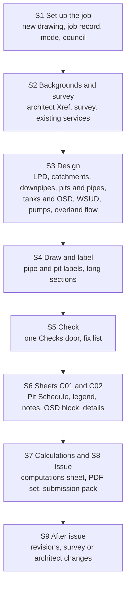

# The one V3 plan, CIVIL half, in job order (DRAFT for Tim's check, ruling F2)

**Drafted:** Sat 17 Oct 2026, Melbourne, by a read-only planning helper for `CE_ACAD / general / plan / 01`.
**Status:** DRAFT. Nothing here is a new ruling. Tim has not checked it yet (ruling F2: "i also would like to check
your plan before we execute"). Where this file says "(planner's reading)", it is an interpretation, not Tim's words.
**Newest wins:** a later ruling beats an earlier one; Tim's quoted words beat planner text. Superseded rulings are kept,
marked "superseded".

**Sources read (17 Oct):** `decisions\2026-10-17_V3_ALIGNMENT_RESET.md` (rulings A to F);
`04_REFERENCE\V3_ALIGNMENT_FINDINGS_2026-10-17.md` sections 1 to 4; `04_REFERENCE\ux-plan\V3_UX_PLAN.md`;
`decisions\2026-09-25_V3_PLAN_DISCUSSION_RULINGS.md` (Civil sections); `areas\civil-A` to `civil-M`;
`areas\release-v3-colleagues-PLAN_GAP_AUDIT_2026-10-17.md` (cited below as "GAP" with its section and item, e.g.
GAP 2.3-1); `04_REFERENCE\ux-plan\CIVIL_DRAWING_PRACTICE_2026-09-26.md` (cited "PRACTICE"); the 29 Sep pipe-ends
decision; the INT-0xx rulings in `decisions\2026-09-28_HOLIDAY_AUTONOMOUS_RUN.md`; the 16 Oct Codex bug triage
(cited "TRIAGE"); and the Civil command list read from the installed commit d36f9545 (Civil 3.0.50).

**The four words are kept apart (RULES 4):** Built · Wired (a command or button reaches it) · Installed (in Civil
3.0.50 on Tim's PC) · Accepted. "Switched OFF" means installed but its Settings switch defaults OFF, so a drafter
never sees it. Nothing in Civil is Tim-accepted or robot-accepted today (GAP 1b-6).

---

## Civil job in one picture

---

## Ground rules that apply to every Civil stage (from the 17 Oct rulings)

1. **D1, "looks like ours":** every drawing ELEMENT CE makes (schedule blocks, labels, symbols, text, layers,
   linetypes, exported PDF) must match CE's existing drawings. The sheet layout of a job is not compared.
2. **B2, all features ship:** the colleague release is not trimmed; every working feature ships, tidied first where
   possible (one CE tab, job-stage order, plain names, switched ON after a robot pass).
3. **B3 and F1:** Civil + Manager go to the pilot colleague, Max, on **Monday 9 November 2026**. Structural follows
   later.
4. **D7, robot acceptance:** "Robot-accepted" = every automatic gate green + a Codex or driver check in real AutoCAD
   with screenshots + 5 working days on Tim's PC with no new bug. Engineering values still go to Tim on Monday.
5. **Ruling A, pause:** no new items or engines until this plan is checked; bug fixes, reviews and testing carry on.
   Wiring an already-built engine to a command counts as NEW until Tim says otherwise (planning chat's reading,
   still open in the decisions file, item 2). So every "To do for 9 Nov" line below that wires something waits for
   Tim's check of this plan; every line that fixes a bug may run now.
6. **C4:** every item carries a speed budget and a robustness check (bad input, Escape, Undo, big drawings, locked
   layers) as part of "done".
7. **Standing house rules (V3_UX_PLAN section 1):** preview then one Undo; no "Are you sure?" after a preview; CE never
   saves the drawing; placing commands carry on until Enter or Escape with the window every time (UX-STD-01, 01b);
   plain names with the typed code in the tooltip and "Tidy labels (CDTIDYLABELS)" style during the transition
   (UX-NAMES-03, INT-075); old typed names work forever as silent shortcuts (UX-NAMES-01); colours gold, black and
   white/grey, no blue (INT-075 item 8).

---

## S1 — Set up the job

### 1. What the drafter does
1. Creates the job drawing from the office template in the job folder (A1 horizontal or A3 classic, INT-059 item 12).
2. Fills in the job once: number, address, client, people, council, rating report, land use (UX-JOB-01, INT 30 Sep).
3. Says what the job is worked from: an engineer's markup or supplied design, or "design from scratch" (UX-MODE-01).
4. Confirms the council, which sets the council values, notes and checks used later.
5. On a part-drawn job, opens straight on that job with its saved answers (UX-STD-07).

### 2. What CE gives them
1. **New job drawing (CDNEWDWG):** copies the right office template into the job folder with the office file name,
   fills the title block, opens it (UX-JOB-03, 04). Exists on the installed line (read from d36f9545); whether a
   ribbon button reaches it was not checked.
2. **Job set-up (CDDESIGN, opening on its Start tab):** job record, job mode, council, land use, outfall and
   "detention needed?" statements (UX-CR-07, UX-CR-13). CDSETUP opens the same window (planner's reading: one
   window, two typed names; the card is `UX-DES-01_CDSETUP_JOB_MODE_CARD`).
3. **Fold in or hide:** CDS (planner's reading: an older settings/council door, findings section 2) becomes a silent
   shortcut into Job set-up; CDDISCIPLINE stays as the CE panel switch, which follows the drawing (UX-PANEL-02).
4. **CE panel:** job name + mode with the last 10 jobs, health line, bell count, find box (UX-PANEL-01); job stages
   with a tick and one button, a guide, not compulsory (ruling B1, Q5).

### 3. Tim's rulings that apply
1. **UX-JOB-01:** one job record for both disciplines; each discipline adds only its own items.
2. **UX-JOB-02:** title blocks fill from the job record and stay in step, with preview.
3. **UX-JOB-03:** "New job drawing" from the office templates; templates never modified (UX-TPL-01).
4. **UX-JOB-04:** file names follow the learned office pattern, shown before saving, editable.
5. **INT-059 item 12:** no single default title block; ask A1 horizontal or A3 classic at creation.
6. **UX-MODE-01..04:** mode per job and discipline, suggested by CE, switchable, no person locks.
7. **UX-HELP-05 (superseded 26 Sep by UX-MODE-01):** "Engineer or Draftsperson?" is no longer asked.
8. **UX-DES-01 (superseded in part by UX-MODE-01):** "Confirm setup" returns to drafting in From-markup mode.
9. **UX-DES-03 + C4 (d) (30 Sep):** Start when no agreed design; During when one exists; Finish by tab only.
10. **INT-029:** Save Draft and Confirm on all five Design tabs.
11. **UX-STD-07:** a known drawing opens straight on its job; small "Different job?" link.
12. **30 Sep (land use):** one "Land use" field in job set-up; NOT SETTLED until set.
13. **UX-RULES-01:** a job adopts a newer council rulebook only when the user clicks; issued jobs keep theirs.
14. **UX-CR-06, CR-D1b:** council base plus overrides; unsourced council values used, marked "Assumed".
15. **UX-CR-07, UX-CR-13, UX-CR-14, UX-CR-16:** outfall rule, detention-needed, AS 3500.3 edition, Banyule rear fall at Design start.
16. **UX-CR-01:** "prepare enquiry" fills the council's discharge enquiry; user sends it.
17. **UX-TIME-01:** opening a job drawing starts that job's timer.
18. **UX-NOTES-01, UX-CHK-01/02:** job notes shown once then an icon; job checklist drafted by CE.
19. **INT-075 Set A 2:** File > New uses AutoCAD's regular `acadiso.dwt`.

### 4. Status today
1. **CDNEWDWG, CDSETUP, CDDESIGN:** on the installed line (command list read from d36f9545).
2. **UX-DES-01 / UX-MODE-01..04 per-discipline job mode:** merged to master as PR #348 (git log), but master is NOT
   the shipped line (findings 1-1), so it is not installed (planner's reading of git history; not checked in AutoCAD).
3. **UX-DES-01 "Not in markup":** `NotInMarkupChecker` installed, nothing calls it (GAP 2.2-5).
4. **CDSETUP slices 1 and 2 (V3 item 39.8):** built on PRs #210 and #212 (area A); later slices not built.
5. **UX-TITLEBLOCK-NEWJOB:** NOT BUILT, card questions waiting on Tim (GAP 2.1-18, GAP 3-13).
6. **Council enquiry (UX-CR-01):** no command (findings section 2).
7. **One-glance health line on the CE panel:** not checked in this read.

### 5. To do for 9 Nov vs after 9 Nov
**For 9 Nov (after Tim checks this plan):**
1. Prove CDNEWDWG end to end on a copy (A1 and A3 choice per INT-059 item 12); robot check in AutoCAD.
2. Put "New job drawing" and "Job set-up" first on the CE tab (UX-RIBBON-01, B1 Q5).
3. Train the job-mode work (PR #348 content) onto the shipped Civil line, behind its switch, then robot pass.
4. Wire `NotInMarkupChecker` into CDDESIGN Show (GAP 2.2-5).
5. Land use field read by CDCALC (30 Sep ruling) checked on a Kingston copy.

**After 9 Nov:**
1. UX-TITLEBLOCK-NEWJOB card (Tim's questions first).
2. UX-CR-01 discharge enquiry writer.
3. UX-JOB-02 title blocks kept in step across sheets; UX-JOB-05 shared-record changes shown per change.
4. UX-TIME-01..04 job timer to CE Project Manager.

### 6. Elements that must look like ours
1. Title block attributes as filled (job number, address, client, drawn/checked, council, revision).
2. Office layers created on first use with office colour and linetype (UX-LYR-01, INT-077 item 1).
3. The template's layouts C01 and C02 untouched apart from filled fields.

### 7. Contradictions / open questions
1. **Which door is "the" set-up command: CDNEWDWG, CDSETUP or CDDESIGN?** Not ruled in one sentence.
   **Recommend:** ribbon "New job" (CDNEWDWG) then "Job set-up" (CDDESIGN Start tab); CDSETUP and CDS silent
   shortcuts. Example: a colleague clicks New job, picks A1, the drawing opens, and the Job set-up window is next.
2. **UX-TITLEBLOCK-NEWJOB card questions** (GAP 3-13): still Tim's. Recommend answering with the card open on Monday.

---

## S2 — Backgrounds and survey

### 1. What the drafter does
1. Attaches the architect's background and sets its colours and visibility (UX-XREF-02).
2. Links the survey (DWG, LandXML or X-Civil) and confirms its AHD datum (UX-SURV-04).
3. Brings existing pits, sewer, services and easements across, greyed and labelled EX (UX-CPLAN-03, UX-CPLAN-11).
4. Reads tree zones from the arborist report (UX-SITE-01) and slab outlines from the background (UX-SITE-04).
5. With no survey yet, works on an assumed datum and fall, marked Assumed (UX-RL-04).

### 2. What CE gives them
1. **Survey (CDSURVEY):** the one Import window where survey, LandXML and X-Civil files are chosen and shown before
   anything goes in (UX-IMP-03). CDIMPORTLANDXML and CDIMPORTXCIVIL become routes inside it (planner's reading;
   PR #153 built the window, area B).
2. **Spot level (CDSL):** shows the survey level at the clicked point; you type the proposed (UX-SURV-03).
3. **Compare (CDIMPORTCOMPARE):** compare only, never writes (UX-IMP-01).
4. **Background tools:** CDXREFCOMPARE (what moved, UX-XREF-01) and CDXREFREPAIR (broken paths, UX-XREF-03), both on
   the installed line.
5. **Tree zones:** CDTPZ / CDSRZ (installed; planner's reading of the names).
6. **Fold in or hide:** CDIMPORTAUDIT and CDTRIAGE typed only (planner's reading: expert tools, UX-REP-01 pattern).

### 3. Tim's rulings that apply
1. **UX-SURV-01:** pit surface level filled from survey, marked "Survey"; no nearby level = Unknown.
2. **UX-SURV-02:** revised survey compared; changes listed with Show where; user picks, one U.
3. **UX-SURV-03:** CDSL shows existing; you type proposed.
4. **UX-SURV-04:** any user approves the survey and datum, recorded.
5. **UX-RL-01..03:** survey interpolated; small source tag; design levels win where set.
6. **UX-RL-04:** no survey = ask for assumed datum and fall, marked Assumed.
7. **UX-RL-05:** survey arrives later: fill in, rerun checks, list new failures.
8. **UX-RL-06:** a suspect spot level is flagged and skipped until confirmed.
9. **UX-CR-11:** survey contour interval and extent checked against the council on linking.
10. **UX-CPLAN-03:** existing pits, sewer, easements from survey, greyed, EX labels, confirmed.
11. **UX-CPLAN-11:** existing services labelled "Ex. SEWER DRAIN" with S/W/T codes; crossing clearance checked.
12. **UX-LYR-04, INT-077 item 3:** existing on EX layers grey; demolished STORMWATER DEMOLISH dashed "TO BE REMOVED".
13. **UX-SURF-06:** new sewer is not CE's job; existing sewer from survey only.
14. **UX-IMP-01..04:** compare only; summary + list; files chosen in the window; report kept as PDF.
15. **INT-069 item 8:** CDIMPORTXCIVIL on a locked layer skips and says so (BUG-417).
16. **29 Sep (plan/05 item 4.3):** X-Civil imported pipes keep imported levels; suspect ones flagged.
17. **INT-071 item 15b:** join same-size straight end-to-end imported pieces with no pit between (BUG-061).
18. **UX-XREF-01..03:** background change offered for compare; same background preparation as Structural; broken paths repaired.
19. **UX-SITE-01, UX-SITE-04:** arborist report read and confirmed; slab outlines offered from the background.
20. **UX-ARCH-01..03:** "what moved" review; "Replace background"; one-click office background layer preset.
21. **INT-077 item 7:** footing plan brought in read-only, easily (one command or button).

### 4. Status today
1. **CDSURVEY, CDSL, CDIMPORTLANDXML, CDIMPORTXCIVIL, CDIMPORTCOMPARE, CDXREFCOMPARE, CDXREFREPAIR, CDTPZ, CDSRZ:** on
   the installed line (command list, d36f9545).
2. **Import window (PR #153):** built and headless-tested; command wiring pending; not installed (area B).
3. **Batch 6 survey and long-section cards (UX-SURF-03/04, UX-LSEC-01/02):** have Codex native checks on 3.0.49, not on
   3.0.50 (GAP 1b-5).
4. **`ExistingItemStyleRule` (#1151) and service labels (#1148):** built on PRs, nothing to plug into (GAP 2.3-8).
5. **Existing/demolished status (#948, #1027, `PitStatusDrawingService`):** on PRs (GAP 2.3-9).
6. **Footing plan reader (#1061):** on a PR, no command (GAP 2.3-10).
7. **Known bugs:** BUG-605, 603, 604, 602 (LandXML levels blank, no preview; TRIAGE shared fix 4); BUG-061 (C-27 fix).
8. **UX-ARCH-01, UX-DWG-02:** NOT BUILT (GAP 2.2-19).

### 5. To do for 9 Nov vs after 9 Nov
**For 9 Nov:**
1. Bug fix now (ruling A allows): one LandXML-to-level mapper with preview (TRIAGE shared fix 4; BUG-605/603/604/602).
2. Bug fix now: Set C Q8, read LandXML "diameter" before "diamWidth" once Tim answers (or on the recommendation).
3. Wire the Import window (PR #153) to CDSURVEY after Tim's check; robot check that Cancel leaves the drawing as it was.
4. CDSURVEY's confirm step calls `ExistingItemStyleRule` and the service labels (GAP 2.3-8; no card needed per GAP).
5. Train existing/demolished status #948, #1027 (GAP 2.3-9).

**After 9 Nov:**
1. Footing plan Xref command + `FootingPlanReader` (GAP 2.3-10, INT-077 item 7).
2. UX-ARCH-01..03 background "what moved" and Replace background.
3. UX-SITE-01 arborist report reader; UX-SITE-04 slab outline offer.
4. UX-RL-04/05 assumed levels and the later fill-in.

### 6. Elements that must look like ours
1. "Ex. SEWER DRAIN" style service labels with single-letter line codes S, W, T (PRACTICE item 6).
2. Existing pits and pipes greyed on EX layers; EP / SEP tags for existing council pits (PRACTICE item 1).
3. Demolished items dashed on STORMWATER DEMOLISH with "TO BE REMOVED" (INT-077 item 3).
4. Spot levels "RL 43.60" style, 2 decimals (PRACTICE item 11).
5. TPZ / SRZ circles in the legend style (CIVIL WORKS LEGEND lists TPZ, PRACTICE item 10).

### 7. Contradictions / open questions
1. **Batch 6 Q1, how far CE reaches for a survey level past the survey edge** (TRIAGE 4-12): open. **Recommend:**
   no reach past the survey edge; Unknown, as UX-RL-01 already says. Example: a pit 2 m outside the survey reads
   "Unknown" not the nearest spot.
2. **Batch 6 Q5, one bad survey point stops the whole survey loading:** open in the list, but UX-RL-06 already
   answers the direction ("Flag, don't use"). **Recommend:** close it with UX-RL-06 named; load the survey, flag and
   skip the bad point.
3. **Set C Q8, LandXML "diameter":** recommend read "diameter" first, then "diamWidth" (engineering-free; a fix).

---

## S3 — Design

S3 runs in this order on a job (planner's reading of PRACTICE, UX-SRC-05 and the Level 3 order UX-L3-02):
LPD and outfall, catchments, downpipes and sources, pits and pipes, tanks and OSD, WSUD, pump stations, overland flow.

### 1. What the drafter does
1. Sets the legal point of discharge and its invert; on an off-property job, designs the outfall drain to the council
   pit (UX-CPLAN-10, UX-CPLAN-33).
2. Takes catchment areas from the rating report and confirms them once (UX-CALC-01, D-Q1).
3. Places downpipes, inspection openings, overflows and raingardens like pits, before pipes (UX-SRC-05); detects the
   architect's downpipes (UX-DP-01).
4. Places pits, then draws each pipe between them; draws each downpipe's connection pipe by hand (UX-DP-02).
5. Sizes tanks and detention (pipes, pits and tanks), the orifice and top water level (CDWT, CDCALC).
6. Adds WSUD (tanks, buffer strips, raingardens), a pump station where needed, and the overland flow path.

### 2. What CE gives them (one command per job step)
1. **LPD:** "Legal point of discharge" (CDLPD). Places the LPD and the CONNECTION TO LPD NOTE (UX-CPLAN-10). CDLPDRESET
   typed only.
2. **Outfall drain:** no command yet. `OutfallRunPlanner` (#1177) on a PR (GAP 2.2-14). Planner's reading: an
   "Outfall run" option inside CD, not a new command.
3. **Catchments:** "Calculations" (CDCALC), Catchments tab. Today catchments live in three places (findings section
   2: CDCALC tab, CDCATCHMENT, CDDESIGN). **Fold:** CDCATCHMENT becomes the "pick an area" helper launched from
   that tab; CDDESIGN shows the site area only (planner's reading).
4. **Downpipes and sources:** "Source" (CDSOURCE) window; the short codes DP, IO, OF, FO, GIO, TG, CDRG, CDFW (planner's
   reading: floor waste), CDSTRIP, CDAGI, CDPERIMETER stay as typed and ribbon shortcuts opening the same window
   with the type pre-picked (planner's reading of UX-SRC-01..05). CDTAG tags a source (UX-CDTAG-01). CDSOURCECHANGETYPE
   folds into the Source window.
5. **Pits:** "New Pit" (PIT); button arrow gives preset sizes CDPIT350..1200 (UX-RIBBON-02).
6. **Pipes:** "New Pipe" (CD), the one-page window. "Edit" (CDEDIT) opens the one-page Edit Pipe or Edit Pit window
   (BUG-173 Tim: "CDEDIT WINDOW FOR PIPES SHOULD LOOK SIMILAR OR THE SAME AS THE NEW PIPE"; #180, #184).
   **Fold:** PIPEEDIT and PITEDIT silent shortcuts; CDPIPEOBJ hidden now, retired once CD draws the one-piece pipe
   (UX-PIPE-08); CDTRIM/CDEXTEND/CDBREAK/CDJOIN hidden once AutoCAD's own work on pipes (UX-DI-02).
7. **Levels on a run:** "Solve run inverts" (CDRUNSOLVE) on the Review panel (UX-RIBBON-02); CDPROPAGATE folds into
   the Hold grade preview (E-HOLD-01, planner's reading).
8. **Tanks:** "Water Tank" (CDWT). **Detention pit:** "Detention pit" (CDPITDETENTION) beside PIT (DETENTION-PIT-ANNOTATE
   card). **Top water level and storage:** CDTWL and CDCALC Detention tab. **Rainfall:** CDRAINFALL (paste or file,
   UX-CALC-04 OPEN 4).
9. **WSUD:** tanks (CDWT), raingardens (CDRG), buffer strips (no command yet, UX-WSUD-03).
10. **Pump station:** "Pump Station" (one tool, UX-SPS-01); not built; a hidden CDPUMP duty-point step is proposed
    (GAP 2.2-12).
11. **Overland flow:** no command yet; Checks lists findings first (GAP 2.2-13).
12. **Level 3 proposals (all four, UX-L3-01):** one "Proposals" page in Project Review (INT-071 12c), not separate
    ribbon tools.
13. **Site and slab (used here or in S4):** CDSLAB, CDFALL, CDSPOON, CDKERB, CDPAVE, CDJOINT on the installed line.

### 3. Tim's rulings that apply
1. **LPD and outfall: UX-CPLAN-10, UX-SET-02:** LPD note auto at the connection with the actual IL; wording a Settings box.
2. **UX-CPLAN-33/34, UX-CR-07:** outfall = off-property run, own schedule, CP1/CP2, live long section; Boroondara rule at start.
3. **Catchments: D-Q1 (15 Sep), UX-CALC-01:** "do everything automatically and just ask the end user to confirm"; fix in place.
4. **UX-DP-03, UX-DES-02:** roof split between downpipes as an adjustable overlay; fixed area colours, preview only.
5. **CR-A1, D-Q3 + "hold the coefficients per job":** C 0.35 pre / 0.30 soft ground post; rainfall coefficients per job.
6. **Kingston (30 Sep, INT-071 16b-c, INT-075 Set A 3):** residential 5 yr, commercial 10 (K02); Tc 7 min under 1000 m²; 5 min and warn at 1000 m² and over.
7. **Sources: UX-SRC-05:** CDRG and DP placed like pits, before pipes ("not pipe dependent").
8. **UX-SRC-01..03, UX-CPLAN-14:** OF/FO one symbol, tag differs; strip drain own type; RG tags; DP/IO/OF unnumbered.
9. **UX-SURF-01 (supersedes UX-SRC-04, findings 4-4), UX-SURF-04:** trench drain by two points; AG/perimeter as CE runs.
10. **UX-DP-01, UX-DP-02, INT-059 items 5-6:** detect architect DPs (broad search), confirm; drafter draws each DP pipe; 12 m spacing.
11. **Pipes: UX-PIPE-01..06c:** keep separate / free end; auto-join 75 mm; Escape cancels at third point; recent buttons; Hide grade; several-pipe grade opens on "Only these pipes".
12. **UX-PIPE-07 (25 Sep, "Whole job") — superseded for now by 29 Sep Q8c:** "This drawing only"; whole-job not built now.
13. **29 Sep pipe ends + CD-BRANCH-01:** free end flagged; branch invert = main at chainage; marker on main section; crown-above warns; old DP splits left.
14. **29 Sep inside wall, INT-030, UX-PIT-02:** end snaps to inside wall face with a note; 17-degree landing at pit centre; catch = outline + 100 mm.
15. **UX-PIT-01 (26 Sep) — superseded 9 Oct by INT-074 item 1:** plastic pits labelled only "PP" in cover text.
16. **UX-CPLAN-18..20, INT-059 items 16-18:** P1 at outlet rising uphill, main line first; "p5" to P5; "8" beside P8 refused; "C 2" warns.
17. **INT-059 items 14, 23; E-HOLD-01; 29 Sep Q6:** cover level blank after restart; typed pit level never moves; move preview, Cancel undoes; Keep/Automatic also on MOVE/STRETCH.
18. **INT-059 item 4, INT-068 items 1-4, INT-070 items 2-4, UX-CR-08, UX-CR-12:** steep warns above 1 in 10; uPVC 3 m/s "unconfirmed"; concrete 6 m/s; min 0.6; pit-outlet 1.5/2.0 warning; council class and velocity win.
19. **UX-SURF-05, UX-LID-01/02, UX-CR-02, CR-A5, UX-CR-05:** charged/suspended as properties; lid from surface; step irons over 900 mm; short offcut warning.
20. **UX-SIZE-01..03, C4 (b), (c):** sizing line + Proposals; Accept all built, switched OFF until Tim signs; "Different" only where a size is stated.
21. **UX-EDIT-01..04, UX-DI-01..04:** ERASE leaves free ends, COPY renumbers, MIRROR readable, EXPLODE warns; quiet re-check; AutoCAD TRIM/EXTEND/BREAK/JOIN.
22. **INT-077 item 1, UX-MIX-03:** CD always sets office layer colours; pipe upgrade held on colleagues' PCs until the 2022-2024 enabler is proven.
23. **Tanks and OSD: UX-TANK-01..04b, DETENTION-PIT-ANNOTATE:** one-line callout without detention; R1/D1; CDPITDETENTION real record beside PIT; LidType "Standard" retired.
24. **CR-A2/2b, CR-A3, CR-C2, INT-070 item 1:** Co 0.6 + Darebin note; orifice rounded DOWN to whole mm (supersedes R-05/R-20); Whitehorse 90 mm "Assumed"; 12 L/s rule blank per council.
25. **INT-068 item 3, UX-CR-04, UX-CR-09/10/17:** detention pipe flatter than 1 in 200 warns; AGI own system; refused items warn; OSD shows required and provided; floor freeboard.
26. **UX-CALC-02:** Apply to drawing: you pick the block or spot; preview; one U.
27. **UX-L3-11..14, 21..23, INT-071 13a, INT-072 item 5:** 2-3 detention options; block beside orifice pit; split and fully underground side by side.
28. **WSUD, pumps, overland: UX-WSUD-01..04, UX-CALC-OLDER-01:** tanks, buffer strips, raingardens; checked against the report; older calculators read-only.
29. **UX-SPS-01..04, UX-CR-15:** one Pump Station tool; rising main a pipe; SPS detail filled; duty point only; council basement rule shown.
30. **UX-OLF-01..04:** route proposed from levels; neighbour warning; every overflow goes somewhere; floor freeboard.
31. **Level 3: UX-L3-01..20, INT-059 items 7-8, INT-071 12-14:** levels, sources, detention, layout; A fewest pits / B shortest pipe / C usual set-off; 5 networks first; place the rest and name the ones left out.
32. **UX-MODE-04:** in From-markup jobs every proposal shows, marked "differs from supplied design".

### 4. Status today
1. **Installed commands (d36f9545):** CD, CDEDIT, PIPEEDIT, PITEDIT, PIT, CDPIT350..1200, CDSOURCE, DP, IO, OF, FO, GIO,
   TG, CDRG, CDFW, CDSTRIP, CDAGI, CDPERIMETER, CDTAG, CDLPD, CDWT, CDTWL, CDCALC, CDCATCHMENT, CDRAINFALL, CDRUNSOLVE,
   CDPROPAGATE, CDPIPEOBJ, CDBREAK, CDSLAB, CDFALL, CDPAVE, CDKERB, CDSPOON, CDJOINT.
2. **Not installed:** CDPITDETENTION (on PR; #1031 keep, #1036 close, GAP 2.2-7); CDPUMP (not built, GAP 2.2-12);
   buffer strip tool (not built); outfall run (`OutfallRunPlanner` #1177 on PR).
3. **Switched OFF or engine-only:** OSD "Apply to drawing" not wired (#1123 + `OnSiteDetentionCriteriaService`, GAP
   2.2-8); `LevelsProposalEngine` installed, nothing calls it (GAP 2.3-5); L3 sources, detention, network on PRs
   (GAP 2.3-6); L3 detention writer NOT BUILT (GAP 2.3-7); Accept all sizing behind a switch OFF until Tim signs
   (C4 (b)); UX-CR-08/09, I-WSUD-02 findings on PRs #1046/#1048/#1054 (GAP 2.2-10); UX-OLF-01/04, UX-SITE-02,
   UX-POOL-01 findings on PRs (GAP 2.2-13); free-end ledger #1069/#1179 on PRs (GAP 2.3-12).
4. **Area E window work (on PRs, not installed):** one-page Edit Pipe #180, one-page Pit #184, Edit Pipe #144 (three tabs,
   superseded by #180 per findings 4-4), Inspector #141, New Pit #127; New Pit plan anchor and Edit Pit pending
   preview NOT BUILT (GAP 2.3-14).
5. **E-HOLD-01:** probe CDMOVETEST built PR #88, not installed; pieces 1-2 not started (area E).
6. **CD-BRANCH-01:** card treated as approved 29 Sep; build state not read in this pass.
7. **Known bugs (TRIAGE section 1):** BUG-650 cancelling CDFW or CDSOURCE blanks stored pit inverts (HIGH, lost data);
   BUG-574/290 Edit Pit bottom blank; BUG-649 rising AGI passes; BUG-643 CDCATCHMENT ignores arcs; BUG-592/593/597
   stale or zero results; BUG-647 CDFW refusal; BUG-160 grade-held drag; BUG-427 FLAT label; BUG-338 mixed units.
8. **Codex-checked:** none of S3's main commands is recorded as a whole-item pass on 3.0.50 (GAP 1b-5).

### 5. To do for 9 Nov vs after 9 Nov
**For 9 Nov (bug fixes may start now, ruling A):**
1. BUG-650 / 574 / 290: no full refresh before the first question; keep a stored invert (TRIAGE shared fix 1).
2. BUG-643: one polyline-area-with-arcs helper (TRIAGE shared fix 3) for CDCATCHMENT and CDPAVE.
3. BUG-592 / 593 / 597: one "Unknown, not zero or blank" state (TRIAGE shared fix 5).
4. BUG-649 / 648: direction-aware AGI grade (TRIAGE shared fix 7), after Tim's TRIAGE Q1/Q2 or on the recommendation.
5. BUG-647: "surface drain is not a pit" predicate (TRIAGE shared fix 6).
6. BUG-338 mixed-units guard (INT-025: some templates are metres with mm pits).

**For 9 Nov (wiring, after Tim checks this plan):**
7. Install the one-page Edit Pipe and Edit Pit windows (#180, #184) so CDEDIT has one look (BUG-173); robot check.
8. Train DETENTION-PIT-ANNOTATE (#1031) so CDPITDETENTION is on the ribbon beside PIT (GAP 2.2-7).
9. OSD "Apply to drawing" (UX-CALC-02, GAP 2.2-8): preview, one Undo; this unblocks the C01 OSD block in S6.
10. Fold catchments into the CDCALC Catchments tab (findings section 2) with UX-CALC-01's one confirmation.
11. CDCHECK findings for UX-CR-08/09 and I-WSUD-02 (#1046, #1048, #1054; GAP 2.2-10), each "not checked" until a
    council value is set.

**After 9 Nov:**
1. E-HOLD-01 pieces 1-2 (Hold grade preview) after the CDMOVETEST probe runs.
2. CD-BRANCH-01 branch junctions if not already shipped (29 Sep card).
3. Level 3 proposals: levels first (`LevelsProposalEngine`, #1059), then sources (#751, #755, #821, #1065), detention
   (#1050) and its writer (NOT BUILT), network (#754, #1067, #1181) (GAP 2.3-5..7).
4. Pump Station tool (UX-SPS-01..04), hidden CDPUMP duty point first (#1058).
5. Buffer strip tool (UX-WSUD-03) and WSUD details from the Library (UX-WSUD-04).
6. Overland flow route proposal (UX-OLF-01) after the Checks findings (#1137, #1140).
7. Outfall run (UX-CPLAN-33/34, #1177).
8. Free end for the whole job (UX-PIPE-07, #1069/#1179) if Tim confirms after Q8c.
9. UX-EDIT-03 ROTATE/MIRROR readable text (`ReadableTextRule`, GAP 2.3-4; high risk, REDO).

### 6. Elements that must look like ours
1. Pit symbols by size and type, on the office pit layer; plastic pits shown with "PP" in cover text (INT-074 item 1).
2. Pit tags P1, P2... downhill to uphill; EP / SEP; JP1; CP1, CP2 for outfall pits (PRACTICE item 1, UX-CPLAN-34).
3. Pipe linework per type and layer, charged and suspended in the legend's own linetypes (UX-SURF-05, UX-CPLAN-17).
4. Source symbols DP, IO, OF (one symbol for OF and FO), RG tags; trench drain "100/200 WIDE TRENCH WITH CLASS C
   GRATE" legend style (PRACTICE item 3).
5. Water tank callout: WT1, capacity, make, dimensions, detention/reuse split, R1/D1 riser and dropper notes
   (PRACTICE item 4, UX-CPLAN-09, UX-TANK-02); one-line callout when no detention (UX-TANK-01).
6. "DETENTION PIT" annotation on a detention pit (DETENTION-PIT-ANNOTATE card).
7. LPD marker and "CONNECTION TO LPD NOTE:" text (PRACTICE item 5).
8. Fall arrows (FALL SYMBOL 2 rule, 29 Sep CDSLAB follows CDFALL).
9. AG and perimeter drain linework in the legend AG style (UX-SURF-04).

### 7. Contradictions / open questions
1. **Minimum cover 300 or 600 mm** (Set C Q5; GAP 3-8; findings 4-6: R-04 450, colleague default 300 on 24 Sep).
   Engineering number, Tim's. **Recommend:** every tool reads one Settings value; Tim names it on Monday. Example:
   at 300, a 350 mm cover pipe passes; at 600 it is flagged shallow.
2. **Clearances in metres** (footing to storage, service to storage) and the **zone-of-influence angle**: still
   unanswered after INT-072, INT-075 item 7, INT-076 item 6, INT-078. Engineering numbers; no recommendation.
   Each check says "not set, not checked" until typed.
3. **Gap audit questions 4, 5, 6 are already answered; do not re-ask:** network options A/B/C (INT-059 item 7);
   OSD block beside the orifice pit (INT-071 13a); place the rest and name the ones left out (INT-071 12a).
4. **OSD criteria block: three rulings** (findings section 2: UX-CALC-02, UX-DET-08, UX-CPLAN-07). **Recommend
   (planner's reading, they fit together):** first placement where you pick (UX-CALC-02); after that it fills live
   from the design (UX-CPLAN-07) inside the edit's own preview; a hand-edited figure is kept and flagged (UX-DET-08).
   Example: change the orifice from 63 to 60 mm and the block shows 60 in the same preview; one U undoes both.
   Confirm on Monday.
5. **Free end, whole job or this drawing?** UX-PIPE-07 (25 Sep, whole job) vs 29 Sep Q8c ("This drawing only"; whole-
   job "not built now"). Newer wins for 9 Nov. Open only whether whole-job comes later. **Recommend:** drawing only for
   9 Nov; ask once after Max has used it.
6. **UX-SPS Q1, Q3** (where the SPS master detail lives; storage rule; GAP 3-12): open. **Recommend:** "detail not
   set" for now; duty-point working still runs.

---

## S4 — Draw and label

### 1. What the drafter does
1. Lets CE label each pipe ("100 DIA. UPVC PIPE AT 1 IN 100") mid-pipe and each pit (P1 with CL), then nudges any
   that clash.
2. Tidies all labels on a sheet before printing.
3. Adds IL text at each pipe end at the pit.
4. Draws a long section on request (outfall drains always; on-site runs when asked).
5. Adds level text (RL, FFL, CL, TWL) that follows its object.

### 2. What CE gives them
1. **Labels are placed by the commands themselves** (CD, PIT, CDSOURCE, CDWT); no separate label command for a normal job.
2. **"Tidy labels" (CDTIDYLABELS):** a sheet or selection, slide-then-flip, preview, one U (UX-LBL-03). Not installed.
3. **"Long section" (CDPROFILE):** pick a run, office outfall layout (UX-LSEC-01).
4. **Fold in or hide:** CDTEXTSEG, CDANNOTATIONEDIT, CDLABELSTYLE, CDUSEPLANLABEL, CDFIXTAGS, CDPITCOVERFLIP and CDTAG
   become right-click actions on the label or tabs of Edit (UX-RCLICK-01; planner's reading), typed names kept.
   CDLABELSTYLE belongs in Settings > Drawing Standards (UX-STDS-03, planner's reading).

### 3. Tim's rulings that apply
1. **UX-CPLAN-05 (supersedes the "MIN." wording of 26 Sep 11:44):** "AT 1 IN 100", never MIN./MAX. (BUG-027).
2. **INT-070 item 5:** a pipe with both ends typed equal reads FLAT with no grade.
3. **Set C Q1 (open):** FLAT follows the 5 mm Settings value (recommended, not yet answered).
4. **UX-CPLAN-21, 22:** pit label = number + cover level, at the learned office spot.
5. **INT-074 item 1:** plastic pits: "PP" in the cover level text only.
6. **UX-CPLAN-23, 24, 25:** pipe label mid-pipe along the line; leader out when short; every pipe labelled, no TYP.
7. **UX-CPLAN-26, 27:** one IL per pipe end at the pit with a short leader; equal ILs both shown.
8. **UX-CPLAN-13:** CE level text follows its object; hand-typed levels only flagged.
9. **UX-LBL-01..04:** hand-placed labels stay; CE labels re-tidy in the same U; avoid everything, move only CE.
10. **INT-074 items 4-13:** Tidy also moves pit labels and cover levels; avoid text, blocks, hatches, not plain lines.
11. **INT-074 item 12 (widened by Tim):** no clear spot = rearrange neighbours or move out with a leader; never on top.
12. **INT-074 item 10, UX-EDIT-03:** after ROTATE or MIRROR, labels turn to read the right way up.
13. **UX-LAY-04:** CE labels plot at the office text height at every viewport scale.
14. **INT-071 10a-c, INT-072 item 3, INT-075 Set A 5:** held-grade label warns when >10% off, non-plotting marker on plan; label not changed by itself.
15. **UX-LSEC-01, 02:** long section on request, outfall layout; crossing services with clearance, red under minimum.
16. **UX-PROFILE-05 / K-REQ-01:** long section Apply updates its Pit Schedule rows in one preview, one U.
17. **UX-CPLAN-34:** outfall long section H 1:100, V 1:50, office data rows.
18. **29 Sep CD-BRANCH-01 Q3:** branch shown as a marker on the main's long section.
19. **Set C Q2 (open):** long section reads the Settings roughness table (recommended).
20. **UX-SURF-02:** fall arrows suggested from levels; arrows pointing away from a pit flagged.

### 4. Status today
1. **CDTIDYLABELS:** NOT installed; #837/#847 open, then #1009 (pit labels) and #1017; `TidyLeaderOutRule` has no caller
   even on its branch; switches `linking.tidyMovesPitText` and `linking.tidyLeaderOut` OFF (GAP 2.3-1, GAP 4-7).
2. **CDPROFILE:** installed since 3.0.3 (area K); not Tim-accepted; Batch 6 long-section card has a Codex check on 3.0.49.
3. **K-REQ-01:** `ProfileScheduleRowPreview` installed, nothing calls it (GAP 2.2-1).
4. **Crossing services on the long section:** `CrossingServiceRule` installed, nothing calls it; reads "clearance not
   set" until Tim types a number (GAP 2.2-4).
5. **`ReadableTextRule`:** installed, nothing calls it (GAP 2.3-4).
6. **Grade-check plan marker (BUG-351B):** installed and ON (GAP 1b-4).
7. **Label bugs:** about 19 open (findings section 2).

### 5. To do for 9 Nov vs after 9 Nov
**For 9 Nov:**
1. Review and train CDTIDYLABELS (#837/#847, #1009, #1017); call `TidyLeaderOutRule` when the clear-spot planner
   fails (GAP 2.3-1); robot check on 3 real-job copies against the gold labels (D1).
2. Settle Set C Q1 (FLAT at 5 mm) and Q2 (one roughness table) on the recommendation unless Tim says otherwise
   (number differences, Tim's call).
3. Bug fixes on label placement from the label group (~19 bugs) through the shared fixes, ruling A.

**After 9 Nov:**
1. K-REQ-01 slices 2 and 3: CDPROFILE preview lists the Pit Schedule rows; one Undo (GAP 2.2-1).
2. Crossing services drawn on the long section (`CrossingServiceRule`, #1125) once Tim gives the clearance.
3. ROTATE/MIRROR keeps CE text readable (GAP 2.3-4; needs a driver window; REDO risk).
4. Fall arrow suggestions (UX-SURF-02).

### 6. Elements that must look like ours
1. Pipe label text and position: "100 DIA. UPVC PIPE AT 1 IN 100"; "225 DIA. RCP / RRJ PIPE AT 1 IN 200 - 21.5m
   DETENTION"; parallel at mid-length, reading left-to-right or bottom-to-top (PRACTICE item 2, UX-CPLAN-23).
2. FLAT label wording (INT-070 item 5).
3. Pit label: "P1" with "CL 43.60"; "PP" cover text on plastic pits (UX-CPLAN-21, INT-074 item 1).
4. IL text "IL 33.00" with a short leader, stacked either side of the pit (PRACTICE item 2, UX-CPLAN-26).
5. Level text prefixes IL / CL / TWL / RL / FFL, 2 decimals (PRACTICE item 11).
6. Text style and height at plot (UX-LAY-04); leaders in the office style.
7. Long section: "OUTFALL DRAIN LONGITUDINAL SECTION", H 1:100 V 1:50, rows DATUM LEVEL R.L., PIPE SIZE, PIPE GRADE,
   INVERT DEPTH, INVERT LEVEL, SURFACE LEVEL, CHAINAGE; pits as vertical-labelled bars (PRACTICE item 14).

### 7. Contradictions / open questions
1. **Set C Q1 and Q2:** open number differences. **Recommend** as in Set C (5 mm FLAT; one roughness table).
2. **Transition names default** (GAP 3-9): already answered by INT-075 ("defaulting ON"); the built PR #1040 has it
   OFF. Not a question; fix the PR (planner's reading).

---

## S5 — Check

### 1. What the drafter does
1. Opens one checks list for the drawing, sees "Network OK: 24 pipes, 11 pits checked" or what needs attention.
2. Clicks a finding to zoom to it (Show where), fixes it, or ignores it with a reason.
3. Ticks the safe drafting fixes (pre-ticked) and applies them in one U.
4. Checks the job checklist items CE could not prove.

### 2. What CE gives them
1. **"Checks" (one door):** ruling B1 Q6, "one Checks door (CDHUB, CDCHECKCURRENT fold in; CDCHECK/CDRULES typed only)".
   It is the Checks tab of the one Project Review (UX-REV-01, 02) and a palette that stays open (UX-WIN-04).
   The CE panel health line opens it (UX-PANEL-01).
2. **Fold in or hide:** CDHUB and CDCHECKCURRENT fold in; CDCHECK and CDRULES typed only; CDDASHBOARD, CDINSPECTOR
   (becomes Civil Properties), CDCHECKDWG (summary + list, UX-IMP-02), CDAUDIT, CDAUDITDETAIL, CDTRIAGE, CDLEGACYAUDIT,
   CDSTARTUPAUDIT, CDTRENCHGRATEAUDIT typed only (planner's reading of B1 Q6; findings section 2 counts seven doors).
3. **Repair:** "Drawing Repair" (CDREPAIR) with a "Decide later" tab (UX-REP-02); CDSYNC, CDREBUILD, CDREBUILDLINKS,
   CDRECOVERINVERTS, CDREFRESHLINKS, CDREFRESHBLOCKS, CDFIXPIPEENDS, CDFIXFLATPIPES, CDLINKDANGLINGPIPES typed only with
   a one-line warning (UX-REP-01).

### 3. Tim's rulings that apply
1. **B1 Q6 (17 Oct):** one Checks door; CDHUB, CDCHECKCURRENT fold in; CDCHECK/CDRULES typed only.
2. **UX-REV-01..05:** one Project Review; Proposals tab; confidence then size; PDF export; approver recorded.
3. **UX-STD-08:** one green line when nothing is wrong; passes folded.
4. **UX-STD-05:** safe drafting fixes pre-ticked; levels, sizes, links never pre-ticked.
5. **UX-DI-03, 04:** ignored until something changes; Show where zooms and glows, list stays open.
6. **UX-LYR-02, INT-077 item 2:** wrong layer listed, pre-ticked Fix, one U.
7. **UX-CPLAN-12:** "Used but not in legend" with one-click Add row; legend never changes itself.
8. **UX-CPLAN-20:** "Renumber downhill to uphill" offered before issue, previewed.
9. **UX-XDISC-01:** pipe in a footing's zone of influence flagged with suggestion (angle a Settings value).
10. **UX-OLF-02, 03, 04; UX-CR-09, 12, 17; UX-WSUD-02; UX-CPLAN-11:** council and site checks, warnings only.
11. **UX-AI-02:** an "Explain" button on every finding.
12. **UX-CHK-01..03:** checklist auto-ticks what CE can prove; unticked items listed at issue, never a block.
13. **UX-PERF-01, 02; INT-075 Batches 2+3 item 6:** progress with Cancel; pause a slow feature and report it.
14. **UX-STD-09, 10, 11:** hidden Inspector stays hidden; non-CE object says what it is; "Highlight warnings" retired.
15. **UX-IMP-02:** CDCHECKDWG ends with a summary and opens the list.
16. **UX-REP-01..03, UX-WORD-03b:** repair typed with warning; "Decide later" tab; admin-only delete.
17. **INT-027:** cancelling CDRUNSOLVE/CDPROPAGATE rolls back palette edits.
18. **UX-NAV-01..05:** find box, row click zooms, arrows walk the network with a gentle guide.

### 4. Status today
1. **Installed:** CDCHECK, CDRULES, CDCHECKCURRENT, CDDASHBOARD, CDHUB, CDINSPECTOR, CDCHECKDWG, CDREPAIR and the typed
   repair commands (d36f9545). Seven doors with different counts (findings section 2).
2. **CDCHECKS palette:** NOT installed (#1034); progress line #1020; `SlowWorkProgressRule` installed, nothing calls it
   (GAP 2.3-2).
3. **Wrong-layer finding:** `WrongLayerRule` installed, nothing calls it (GAP 2.3-3).
4. **Ignore a finding:** `WriteIgnoredChecksInDrawing` nothing calls it; pipe ends off pit recorder needs a MOVE hook;
   switches OFF (GAP 2.2-2).
5. **Slow feature pause:** `SlowdownMonitor` installed, nothing calls it (GAP 2.2-3).
6. **Decide later:** `RepairDecideLaterBook.Park` on PR #1035 (GAP 2.2-11).
7. **Footing zone of influence:** `FootingInfluenceCheck` on PR #1038, needs the angle (GAP 2.3-10).
8. **Checks Explain / checklist at issue:** #1190, #1309 on PRs (GAP 2.2-15).
9. **Message bell:** host installed with no producer at all; #1053 (GAP 2.3-11).

### 5. To do for 9 Nov vs after 9 Nov
**For 9 Nov:**
1. Train CDCHECKS (#1034) and its progress line (#1020); make it the one ribbon door; fold CDHUB and CDCHECKCURRENT
   into it; hide the rest from the ribbon (B1 Q6). The palette list is Codex's window (GAP 2.4-2).
2. Wrong-layer rows with Fix through `WrongLayerRule` (GAP 2.3-3).
3. Ignore with reason (`WriteIgnoredChecksInDrawing`), switch ON only after the robot pass (GAP 2.2-2).
4. "Used but not in legend" (#1141; GAP 2.3-8 says no card needed).
5. One read-only loader for "no record loaded yet" (TRIAGE shared fix 2; BUG-589, 572), a bug fix.

**After 9 Nov:**
1. Footing zone of influence (#1038) once the angle is set.
2. Slow feature pause (`SlowdownMonitor`, #1064) and the report to admin.
3. Explain button (UX-AI-02, #1190).
4. Message bell producers (#1053; colleague holds the drawing and update-ready are NOT BUILT).
5. Drawing Repair "Decide later" tab (#1035).
6. UX-NAV-03/05 network walk guide.

### 6. Elements that must look like ours
1. Nothing printed: Checks markers are non-plotting (INT-071 10c, INT-072 item 3). The robot check is that NO CE
   marker plots on an issued sheet.
2. "Used but not in legend" Add row writes a legend row in the office CIVIL WORKS LEGEND style (UX-CPLAN-12).

### 7. Contradictions / open questions
1. **Which typed name is the one door:** B1 Q6 names CDHUB as folding in, and the built palette is CDCHECKS.
   **Recommend (planner's reading):** the ribbon button "Checks" runs CDCHECKS (the Project Review Checks palette);
   CDHUB and CDCHECKCURRENT open the same palette; CDCHECK keeps its typed command-line report. Confirm on Monday.

---

## S6 — Sheets, schedules, notes and details

### 1. What the drafter does
1. Lays out C01: drainage plan, Pit Schedule beside it, the fixed CIVIL WORKS LEGEND, the four standard note blocks
   plus the council block or LPD note, the ON SITE DETENTION CRITERIA block (UX-SHEETS-04, UX-CPLAN-02, 08).
2. Lays out C02: the details C01 uses (pits, tank, orifice pit, bedding, penetration, sawcut, charged system),
   titled by description, packed in a grid (UX-DET-07, UX-DET-09, UX-CPLAN-16).
3. On an outfall job, C02 becomes "OUTFALL DRAIN PLAN AND DETAILS" with its own schedule and long section.
4. Exports the Pit Schedule to Excel with a checking sheet (UX-SCHED-02).

### 2. What CE gives them
1. **"Pit Schedule" (PITSCHEDULE):** places and keeps the STORMWATER PIT SCHEDULE; typing in a cell edits the pit.
2. **"Set up C01 and C02" (one command, recommended; not built):** places legend, note blocks, LPD note, OSD block, C02
   details and title on the existing layouts from the CE A1 template, preview then Apply, one U (GAP 3-3).
3. **"New sheet":** layout, title block, viewport at office scale, plan title (UX-LAY-01); for Civil, C01 then C02.
4. **Details:** from the CE Library palette (UX-DET-01; Structural first).

### 3. Tim's rulings that apply
1. **UX-SHEETS-03, 04:** C01 plan, C02 details; notes, OSD block and LPD note on C01 beside the plan.
2. **UX-CPLAN-01:** fixed legend block, always the same (not auto-built like Structural).
3. **UX-CPLAN-02:** Pit Schedule on C01 beside the plan.
4. **UX-CPLAN-06:** Pit Schedule copies the office layout exactly ("Copy exactly").
5. **UX-CPLAN-04:** three standard remarks under every Pit Schedule (Settings text).
6. **UX-SCHED-01 / 01b:** typed engineering values update the pit, with preview, one U; "display only" on right-click.
7. **INT-069 item 5, INT-075 Set A 4 (newer):** a typed pit number or level WAITS until Stop overriding (see 7.1).
8. **INT-069 item 6:** colleagues renumber pits only in Edit Pit until the window fix is installed (in 3.0.35).
9. **UX-SCHED-02, 03:** Excel with a checking sheet; detention grated size inside PIT SIZE / LID TYPE as printed.
10. **UX-SCHED-04, 05, 06:** continue on next sheet with headers; cell edits the object; natural order P1..P10.
11. **29 Sep (Pit Schedule and junctions):** never show a junction; FROM "DPs" when more than one downpipe.
12. **29 Sep plan/05 4.2:** "Unknown" in FROM where CE cannot tell.
13. **INT-077 item 4:** existing council pits that are part of the system go in the Pit Schedule.
14. **INT-059 item 3:** old Pit Schedule tables: accept the first edit.
15. **INT-071 11a, b (BUG-246):** Refresh may change out-of-date cells on locked layers, with Undo; checked on open.
16. **UX-CPLAN-07:** OSD criteria block filled live; Unknown never guessed.
17. **UX-CR-10:** OSD block always shows required and provided volume, from the comps-sheet record.
18. **CR-A2b:** Darebin note under the drawn OSD table on Darebin jobs.
19. **UX-CPLAN-08:** GENERAL, CIVIL WORKS, STORMWATER DRAINAGE, SITE PREPARATION blocks always; council block else LPD note.
20. **UX-NOTES-05, 06:** full Civil notes template every time; council-required notes added from the profile.
21. **UX-CPLAN-09:** water tank callout automatic in office wording.
22. **UX-CPLAN-15 (clarified by UX-CPLAN-33):** C02 title by content; outfall title only for off-property outfalls.
23. **UX-CPLAN-16:** C02 details auto-packed, then draggable, arrangement remembered.
24. **UX-CPLAN-17:** charged line adds the charged system detail and the charged linetype; no council warning.
25. **UX-DET-07, 08, 09:** offer the set; details update after preview, hand edits kept and flagged; titled, not numbered.
26. **UX-CPLAN-28..32:** orifice pit detail live; one tank detail per tank type; detention split dimensioned; bedding per material; penetration and sawcut when needed.
27. **UX-CPLAN-33, 34:** separate OUTFALL DRAIN pit schedule and quantity list; CP1, CP2.
28. **UX-LAY-01..04:** New sheet; office scales locked; titles linked; labels read the same on paper.
29. **TRIAGE Q5 (open, recommended):** custom remark and "With Step Irons" kept as two parts.

### 4. Status today
1. **PITSCHEDULE:** installed; about 16 open Pit Schedule bugs (findings section 2), incl. BUG-637/586 remarks lost.
2. **C01/C02 assembly:** ten engines built with nothing to plug into: legend #1141, notes #1143, LPD note, sheet rule
   #1153, C02 title #1155, packing #1158, charged pipes #1160, details needed #1163, existing grey #1151, service
   labels #1148 (GAP 2.3-8). No "Set up C01 and C02" command (findings section 2).
3. **OSD criteria block:** `OnSiteDetentionCriteriaService` exists; Apply not wired (GAP 2.2-8).
4. **Outfall schedule:** not built (planner's reading: only `OutfallRunPlanner` #1177 exists).
5. **K-REQ-01 (long section + schedule):** engine only (GAP 2.2-1).
6. **New sheet (UX-LAY-01):** not found in the Civil command list (planner's reading; Structural has CESHEETS).
7. **C02 detail packing:** engine #1158 only.

### 5. To do for 9 Nov vs after 9 Nov
**For 9 Nov (bug fixes now):**
1. One canonical remark model (TRIAGE shared fix 8; BUG-586, 637, 587).
2. One schedule cell formatter for placement, Changes and Excel (TRIAGE shared fix 9; BUG-573, 571).
3. Excel numbers as numbers (TRIAGE Q6).

**For 9 Nov (wiring, after Tim's check):**
4. CDLPD places the LPD note (GAP 2.3-8 "no card needed").
5. OSD criteria block placed and filled through Apply to drawing (S3 "For 9 Nov" item 9); robot compares it with the gold block.
6. Gold check of the Pit Schedule block against 3 real C01s, column for column (UX-CPLAN-06, D1, EV-06).

**After 9 Nov:**
1. "Set up C01 and C02" command (GAP 3-3 card first) using the ten engines.
2. Outfall drain schedule, C02 outfall plan and long section (UX-CPLAN-33, 34).
3. C02 details offered, filled and kept live (UX-DET-07, 08; UX-CPLAN-28..32).
4. Pit Schedule continues on the next sheet (UX-SCHED-04).
5. New sheet for Civil (UX-LAY-01..03).

### 6. Elements that must look like ours
1. **STORMWATER PIT SCHEDULE block:** PIT No. | PIT SIZE | INLET (FROM, DIA, INVERT LEVEL) | OUTLET (DIA, INVERT
   LEVEL) | COVER LEVEL | DEPTH TO OUTLET | TYPE OF LID AND REMARKS; one row per inlet; FROM uses source codes (PP,
   TG, DPs); double pits on two lines with "+" lids; levels 2 decimals; three standard remarks below (PRACTICE item 7).
2. **CIVIL WORKS LEGEND:** the template's fixed full list (PRACTICE item 10, UX-CPLAN-01).
3. **C01 note blocks:** GENERAL, CIVIL WORKS, STORMWATER DRAINAGE, SITE PREPARATION; council block (e.g. Kingston) or LPD
   note (PRACTICE item 8).
4. **ON SITE DETENTION CRITERIA block:** PSD, head, orifice dia, TWL, volume required per storage element, total;
   required and provided (PRACTICE item 8, UX-CR-10).
5. **Water tank callout** (PRACTICE item 4).
6. **C02 title:** "STORMWATER DRAINAGE DETAIL SHEET" or "OUTFALL DRAIN PLAN AND DETAILS" (PRACTICE item 9).
7. **C02 detail titles:** "ORIFICE PIT P1 DETAIL", "WATER TANK WT1 & WT2 DETAIL"; no numbers (UX-DET-09, UX-CPLAN-29).
8. **Charged pipe linetype and charged system detail** (UX-CPLAN-17).
9. **OUTFALL DRAIN schedule** (new to CE drawings; no gold example yet, see 7.3).

### 7. Contradictions / open questions
1. **Pit Schedule typed value: update straight away, or wait?** UX-SCHED-01b (26 Sep, Tim: "Update the pit, all
   values") vs INT-075 Set A 4 (9 Oct, "as recommended": a typed level waits until right-click > Stop overriding).
   Newest wins on paper, but the 9 Oct item was framed as "keep, clearer wording" of today's build.
   **Recommend:** treat the "waiting" row as the preview step of UX-SCHED-01b: typed value shows in amber as pending,
   one click "Update pit" writes pit, plan text and schedule in one U. Example: type DEPTH 1.20, row turns amber, click
   Update, P3's bottom level changes and the plan text follows. Ask Tim on Monday.
2. **Existing council pits in the Pit Schedule vs the separate outfall schedule:** INT-077 item 4 (existing council pits
   part of the system go in) vs UX-CPLAN-34 (outfall pits CP1, CP2 in their own schedule). **Recommend (planner's
   reading):** on-site connected existing council pits stay in the main Pit Schedule; off-property outfall pits go in
   the OUTFALL DRAIN schedule.
3. **Outfall schedule has no gold example** (Tim chose a change from past practice). **Recommend:** robot compares its
   columns with the main Pit Schedule's; Tim glances once at the first one.
4. **"Set up C01 and C02" one command or many** (GAP 3-3): open. **Recommend:** one command, preview, one U.

---

## S7 — Calculations (computations sheet)

### 1. What the drafter does
1. Opens CDCALC; catchments, rainfall, PSD/SSR, storage and orifice are worked out from the rating report and drawing.
2. Checks the storage drawn agrees with the storage calculated.
3. Approves the calculation (any CE user, recorded) and exports the computations sheet PDF/XLSX.
4. Issues it, naming the responsible engineer.

### 2. What CE gives them
1. **"Calculations" (CDCALC):** one window: Catchments, Detention, Pipe flow, Longitudinal, Print tabs (#139 window).
   Older pump and WSUD calculators under "Older calculators", read-only (UX-CALC-OLDER-01).
2. **"Rainfall" (CDRAINFALL):** paste or file route, coefficients held per job.
3. **Issue (Print tab "Issue..."):** not wired (GAP 2.2-9).

### 3. Tim's rulings that apply
1. **D-Q1, UX-CALC-01:** automatic from the rating report, one confirmation, fix in place.
2. **D-Q2 (15 Sep):** "Figure out how the calculations are done so we can design using this."
3. **F-Q1 (15 Sep):** clean V3 sheet with Creative Engineering branding and a logical layout.
4. **F-Q2 (15 Sep):** issued directly through CDCALC.
5. **F-Q3 (15 Sep), UX-CALC-04 OPEN 3:** storage drawn vs issued sheet: warn, show both and the difference.
6. **UX-CALC-APPROVE-01:** any CE user approves; name, time, source on the sheet.
7. **UX-CALC-03:** anyone issues, picking the responsible engineer; DRAFT until issued.
8. **C4 (a) (30 Sep):** engineer names from an office list in Settings; typed name marked "typed".
9. **30 Sep item 16:** storm frequency from the council profile with source; else NOT SETTLED.
10. **UX-CALC-04 OPEN 4:** CDRAINFALL paste/file route; no automatic fitting.
11. **CR-A1, CR-A2, CR-A3:** the coefficients and orifice rules (S3 rulings 5 and 24).
12. **Set C Q3, Q4 (open):** Detention tab and Pipe flow tab start from Settings values (recommended).
13. **TRIAGE Q7 (open, recommended):** DRAFT line and job name on every PDF page and Excel tab.

### 4. Status today
1. **CDCALC, CDRAINFALL, CDTWL:** installed. Window rebuild #139 built, not installed (area D-F section 9).
2. **Issue from CDCALC:** #1042 record built; window not wired; "unknown ARI becomes 10 years" fault named (GAP 2.2-9).
3. **Whole-set catchment review:** #1121 built, not wired (GAP 2.2-9).
4. **Known bugs:** BUG-590/591 export drops DRAFT on pages 2+ and numbers saved as text; BUG-249 rainfall curve and
   critical duration not on the sheet (TRIAGE shared fixes 10, 11).
5. **Calcs bugs:** about 13 open (findings section 2).

### 5. To do for 9 Nov vs after 9 Nov
**For 9 Nov (bug fixes now):**
1. One calc-export writer: DRAFT and job on every page and tab, typed cells (TRIAGE shared fix 10; BUG-590/591).
2. Boyd's-to-sheet transfer: the rainfall curve used and critical duration printed (TRIAGE shared fix 11; BUG-249).
3. Fix "unknown ARI becomes 10 years" (GAP 2.2-9): Unknown stays NOT SETTLED.

**For 9 Nov (wiring, after Tim's check):**
4. Install the CDCALC window (#139) if its robot pass is clean.
5. Print tab "Issue..." writes the #1042 record with the engineer from the Settings list (Codex window).

**After 9 Nov:**
1. Whole-set catchment review "Add from rating report" (#1121).
2. Designed-vs-drawn storage compare across issued revisions (F3, F-Q3).
3. Pump and WSUD calculators signed and moved out of "Older calculators".

### 6. Elements that must look like ours
1. The computations sheet is a document, not a drawing element; F-Q1 chose a clean V3 sheet, so it is NOT compared
   with old sheets (planner's reading; see 7.1). What must match: the figures, the council named beside PSD and SSR,
   and the pipe and pit volume tables (area D-F section F1).
2. The OSD criteria block on C01 must show the same numbers as the sheet (UX-CR-10).

### 7. Contradictions / open questions
1. **F-Q1 "clean V3 sheet" vs D1 "looks like ours":** D1 speaks of drawing elements. **Recommend:** F-Q1 stands for the
   PDF computations sheet; D1 governs the OSD block on the drawing. Confirm in one line on Monday.
2. **F-Q2 "issue through CDCALC" vs UX-REG-09/10 (shared issue and submission pack)** (findings section 2).
   **Recommend (planner's reading, both fit):** the computations sheet gets its revision and engineer in CDCALC; the
   drawing Issue and the council submission pack pick up the latest issued computations PDF. Example: issue the comps
   at Rev A in CDCALC, then "Council pack" collects C01, C02, comps Rev A, rating report and LPD letter.
3. **Set C Q3, Q4:** recommend start values from Settings (0.35; uPVC 0.010).

---

## S8 — Issue

### 1. What the drafter does
1. Checks the set (check plot, optionally "For engineer mark-up").
2. Picks the sheets that changed, the next revision letter, the status words; clouds the changes.
3. Plots the PDF set with the office plot settings into a dated issue folder, with a DWG snapshot.
4. For council: builds the submission folder (drawings, comps, rating report, LPD letter) and sends it themselves.

### 2. What CE gives them
1. **No Civil issue command today** (findings section 2).
2. **Target: the shared "Issue" from the one register and sheet list** (UX-REG-09), the same as Structural's
   CESHEETS publish route; Civil sets have no register table or notes page of their own.
3. **"Check plot":** same button, "For engineer" option (UX-REG-13..15).
4. **"Council pack"** (UX-REG-10).

### 3. Tim's rulings that apply
1. **UX-REG-09 (refined 26 Sep):** same workflow as Structural; no Civil register or notes page; Civil sheets listed in
   the Structural register on combined jobs; separate revision sequences.
2. **UX-REG-10:** one-click dated council submission folder, reviewed before it is made; CE never sends it.
3. **26 Sep (release L3 cards item 3):** a missing pack document listed in amber; pack still built.
4. **UX-REG-11, 12:** office plot style and page setup; locked DWG snapshot in the issue folder.
5. **UX-REG-13..15:** Check plot with stamp; optional review marks; "For engineer" version.
6. **UX-REG-01..08 (via UX-REG-09):** changed sheets suggested; next revision pre-picked; clouds after A; status words.
7. **UX-STDS-01, 02:** off-standard layers, styles, pens listed in the issue preview; optional clean-up.
8. **UX-CHK-03:** unticked checklist items listed in the issue preview, never a block.
9. **UX-SHARE-01:** a drawing open by a colleague: Issue waits with "Notify me when free".
10. **INT-059 items 2, 11, 22:** same-day re-issue replaces the earlier set; warn on any print difference; issue allowed with no sheet ticked.
11. **UX-STD-03:** CE never saves the drawing.
12. **UX-CPLAN-20:** renumber offered before issue.

### 4. Status today
1. **Civil issue:** NOT BUILT. UX-REG Civil half needs build/02's #1074, #1083, #1088 moved into Shared (GAP 2.2-19);
   slice 10 (Civil and Structural issue state apart) NOT BUILT (GAP 2.1-6).
2. **Standards at issue:** #1186, #1190, #1309 on PRs; UX-STDS-03 NOT BUILT (GAP 2.2-15).
3. **Check plot:** not found for Civil (planner's reading).
4. **UX-REG-01..15:** most named in no commit (GAP 1c-3).

### 5. To do for 9 Nov vs after 9 Nov
**For 9 Nov:**
1. Nothing new. Colleagues keep issuing with AutoCAD's own PUBLISH/PLOT as today (planner's reading: Civil issue is a
   new item, ruling A; B2 ships what works).
2. Robot check that no CE marker or preview colour plots (UX-LYR-03, INT-072 item 3) on a PUBLISH of a gold copy.

**After 9 Nov:**
1. Move the issue engines into Shared and give Civil the same Issue (GAP 2.2-19).
2. Check plot (UX-REG-13..15).
3. Council pack (UX-REG-10).
4. Standards at issue (UX-STDS-01..03).

### 6. Elements that must look like ours
1. Exported PDF: office plot style and pen weights (UX-REG-11); the gold PDF compare (EV-06, findings 6-7).
2. Folder and file names: "CVL_REV B FOR COUNCIL" style; "STR+CVL_REV A" on combined jobs (26 Sep register study).
3. CHECK PLOT stamp on every sheet; FOR ENGINEER REVIEW stamp (UX-REG-13, 15).

### 7. Contradictions / open questions
1. **Does 9 Nov need a Civil Issue button?** B2 says all features ship; Civil issue is not built. **Recommend:** no;
   9 Nov keeps AutoCAD's own publish; the shared Issue follows. Example: Max plots C01 and C02 the way he does today.

---

## S9 — After issue (revisions, changes)

### 1. What the drafter does
1. Receives a revised architectural background or survey and sees what moved.
2. Receives a council RFI and works through each item.
3. Revises the design, re-tidies, renumbers if pits were added, and re-issues the changed sheets at the next revision.
4. Moves or copies the job; repairs broken Xref paths.

### 2. What CE gives them
1. **"Compare background" (CDXREFCOMPARE)** and **"Repair Xref paths" (CDXREFREPAIR):** installed.
2. **"Compare survey" (CDIMPORTCOMPARE):** compare only (UX-IMP-01); revised survey effects listed (UX-SURV-02).
3. **"Council RFI" tab in Project Review** (UX-RFI-01..03): not built.
4. **Renumber (CDRENUMBER):** installed; offered from Checks before issue (UX-CPLAN-20).

### 3. Tim's rulings that apply
1. **UX-XREF-01:** background change offered for compare; nothing moves on its own.
2. **UX-SURV-02, UX-RL-05:** revised or late survey: list effects, user picks, one U.
3. **UX-RFI-01..03:** RFI found in the job folder; to-do list; CE checks what it can; tab in Project Review.
4. **UX-XDISC-03:** FFL or slab change from Structural gives Civil a quiet heads-up.
5. **UX-CALC-04 OPEN 3, F-Q3:** drawn storage compared with the last issued revision; warn.
6. **UX-DWG-02 (supersedes D2, with UX-MIX-03 hold):** older CE drawings upgrade quietly on open with one line and one U.
7. **UX-DWG-01, 03:** foreign pits/pipes get a quiet Review offer; recipients without CE see clean linework.
8. **UX-MIX-01..02:** V3 drawings stay visible to colleagues without V3; 2027-only tools greyed.
9. **UX-REG-01..08:** revisions, clouds, status words (via UX-REG-09).
10. **UX-L3-22:** "best" layouts = council approved first time, least pipe and depth, no later redraws.

### 4. Status today
1. **CDXREFCOMPARE, CDXREFREPAIR, CDIMPORTCOMPARE, CDRENUMBER:** installed (d36f9545); not robot-checked in this read.
2. **Council RFI reader:** UX-RFI-01..03 named only on an uninstalled open PR (GAP 1c-2); not installed.
3. **UX-DWG-02, UX-ARCH-01:** NOT BUILT (GAP 2.2-19).
4. **Revision clouds (register slice 5):** Structural cloud step not built (GAP 2.1-14).

### 5. To do for 9 Nov vs after 9 Nov
**For 9 Nov:**
1. UX-MIX-01 proof: a V3 Civil drawing opened on AutoCAD without CE shows pipes, pits and labels (PROXYGRAPHICS=1),
   on Max's AutoCAD year, before he shares drawings.
2. Keep the UX-MIX-03 hold on Max's PC (no automatic pipe upgrade) unless the 2022-2024 enabler is proven and Max is on 2027.

**After 9 Nov:**
1. Council RFI reader (UX-RFI-01..03).
2. Revision clouds and the shared register (UX-REG-01..08 via UX-REG-09).
3. Quiet upgrade of older drawings (UX-DWG-02).
4. FFL heads-up from Structural (UX-XDISC-03).

### 6. Elements that must look like ours
1. Revision table rows in the title block and revision clouds in the office style (UX-REG-01..08; gold from issued sets).
2. Pipes as seen by a colleague without CE: clean plain linework, no proxy box (UX-DWG-03).

### 7. Contradictions / open questions
1. None found that the decisions files leave open for Civil at this stage.

---

## Built but nothing calls it, ranked by daily value (Civil)

Ranked by how often a CE drafter would meet it on an ordinary job (planner's reading of PRACTICE and the rulings).
"Installed" = on Civil 3.0.50; "PR" = on an open PR only. Source: GAP sections 2.2 and 2.3.

1. **Tidy labels (CDTIDYLABELS) + `TidyLeaderOutRule`** (PR #837/#847, #1009, #1017): every job, every sheet.
2. **C01/C02 assembly engines** (PR #1141 legend, #1143 notes, LPD note, #1153, #1155, #1158, #1160, #1163): every job.
3. **OSD criteria block Apply** (#1123 plan + `OnSiteDetentionCriteriaService`): most jobs have detention.
4. **`WrongLayerRule`** (installed): every Checks run.
5. **`SlowWorkProgressRule`** (installed) + CDCHECKS palette (#1034): every Checks run.
6. **`WriteIgnoredChecksInDrawing`** (installed, no caller): every Checks run with a known exception.
7. **`ProfileScheduleRowPreview`** (installed): every long section with a schedule (K-REQ-01).
8. **`ExistingItemStyleRule`** (#1151) and **service labels** (#1148): every job with a survey.
9. **`CrossingServiceRule`** (installed): long sections with services; needs Tim's clearance.
10. **Detention pit record, slice 3** (#1031): jobs with pit detention.
11. **`PitStatusDrawingService`** existing/demolished (#948, #1027): renovation jobs.
12. **`NotInMarkupChecker`** (installed): every From-markup job.
13. **`ReadableTextRule`** (installed): any ROTATE or MIRROR of CE work.
14. **`LevelsProposalEngine`** (installed): Level 3 levels proposal.
15. **`OutfallRunPlanner`** (#1177): outfall jobs only.
16. **`FreeEndLedger`** (#1069, #1179): open-ended pipes.
17. **`SlowdownMonitor`** (installed): big drawings.
18. **Message bell host** (installed, no producer; #1053): every failure message.
19. **Council findings** (#1046, #1048, #1054, #1137, #1140, #1180, #1185, #1183): per council, each "not checked" until set.
20. **`FootingPlanReader` / `FootingInfluenceCheck`** (#1061, #1038): needs the angle.
21. **`RepairDecideLaterBook`** (#1035): Drawing Repair only.
22. **Pump duty point** (#1058): pump-station jobs only (rare in the 2024-2026 sample, PRACTICE header).

---

## What this draft did NOT read

1. `BUG_CARPARK.md` (1.34 MB): only the bug IDs quoted in the gap audit, the triage and the findings were used.
2. `decisions\DECISIONS_LOG_DRAWING_INTELLIGENCE.md` beyond the D-Q/F-Q answer lines.
3. `areas\civil-stage1-foundation-status-log.md` (804 lines) and most of `areas\civil-D-F-catchments-cdcalc-osd.md`
   (headings, section 6 and 9 only).
4. The rulings file sections on Structural, Manager, help, AI, retaining walls, pools, basements, subfloors (lines
   ~634-834, 1366-1406, 1428-1470, 1491-1565, 1591-1705, 1875-2012, 2070-2199, 2298-2412) except where quoted.
5. Most UX cards in `04_REFERENCE\ux-plan\cards\` (only Set A item 4, Set C and the Batch 8/9 question list headings).
6. `MASTER_PLAN.md`, `V3_OVERALL_PLAN.md`, `DRAWING_PRODUCTION_PLAN.md`, the release QUEUE, REVIEWLANE_LOG, PENDING_TESTS,
   REGRESSION_LOG and any PR body.
7. The ribbon definition: which installed commands have a ribbon button, and which switches are ON, were not read.
8. Nothing was opened in AutoCAD; no window or drawing was looked at; no client folder or `C:\CE_DrawingIntelligence`
   was opened.
