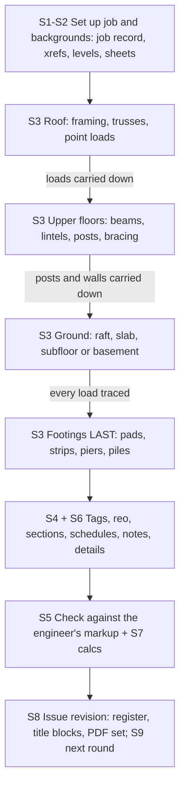

# One V3 plan, job order: the STRUCTURAL half (draft for Tim's check, 17 Oct 2026)

**What this is.** The Structural side of the single, job-ordered V3 plan (ruling B1, 17 Oct). It files every
Structural ruling at the job stage where a drafter or engineer meets it. Nothing here is a new ruling.
Drafted by the planning chat from documents only: no code read, nothing built, nothing opened in AutoCAD.

**How to read the marks.**
1. **Tim's words** are in quotes with their ruling ID.
2. **"(planner's reading)"** marks anything inferred, not ruled.
3. **"Reading of files"** means the 4 Oct six-job study (`04_REFERENCE\structural\JOBS_PROCESS_STUDY_2026-10-04.md`),
   not Tim's ruling.
4. **Status words, kept apart (RULES 4):** Built (an engine exists somewhere) · Reachable (a command or button calls
   it) · Installed (in Structural 1.0.117, line rel-20261010d, read 17 Oct 02:40 by the gap audit) · OFF (installed
   but its Settings switch defaults off) · Engine-only (built, nothing calls it). **Tim-accepted: 0. Robot-accepted
   (D7): 0.**

**Ground rules already set (do not re-ask).**
1. **Release order (B3, 17 Oct):** Civil + Manager go to colleagues first (Max, Mon 9 Nov, F1). Structural follows
   "when ready" and installs on Tim's PC only until then (B4: Tim's PC always gets the newest passing build).
2. **Drafting order (UX-STRUC-13, 26 Sep; repeated 4 Oct INT-051):** "WE NORMALLY DRAFT AND DESIGN FROM ROOF
   DOWNWARDS". Roof, upper floors, ground/slab, footings LAST. Sheets still print bottom-up (UX-SHEETS-01).
3. **Looks like ours (C3 + D1, 17 Oct):** the drawing ELEMENTS (schedule blocks, labels, symbols, text, layers,
   linetypes, exported PDF) match CE's existing drawings. Sheet layout per job is not compared.
4. **Acceptance (D7, 17 Oct):** by computer/AI, not Tim: every automatic gate green + Codex/driver check in real
   AutoCAD with screenshots + 5 working days on Tim's PC with no new bug. Engineering judgement still goes to the
   Monday question session.
5. **Pause (A, 17 Oct):** no new items until the one plan replaces the five; bug fixes and testing continue. Wiring
   an already-built engine counts as new (planning chat's reading, still open item 2 in the reset record).
6. **The boring-end boundary (INT-054, 4 Oct):** AI or a robot may drive only the mechanical, repeatable,
   reversible end, "and never the design decisions".

---

## The Structural job in one picture

---

## Where the six-job study puts the time (reading of files, 4 Oct)

1. **Issues per job:** 4 to about 20; markup to next revision 1-4 days. Every re-issue repeats tags, schedules,
   notes, register, title blocks, PDF folder and Superseded by hand (6 of 6).
2. **Planner's reading:** the biggest daily win is S8 (issue) and S6 (schedules), not new drawing tools.

---

## S1 Set up the job

### 1. What the drafter/engineer does
1. Architectural PDFs arrive for the quote, then CADs in a dated "CADs" folder (6 of 6, reading of files).
2. The office folder template is used every time: Admin, Architectural, Engineering (Comps, Markups, Soil Report),
   Electronic Issue, Superseded, Xref (6 of 6, reading of files).
3. The drafter copies an office template into the job folder, names it job-"STR"-site-revision, fills the title
   block (project, client, design, drawn, checked, approved) and runs LU for layers (14 Sep journey rulings 1, 3, 4).
4. Two title blocks are in use: A3 classic and A1 horizontal plotted to A3 (3 of 6 each, reading of files).
5. The soil report lands in Engineering\Soil Report and later feeds the Geotechnical Note (6 of 6).

### 2. What CE gives them
1. **The one tool Tim ruled:** "New job drawing" (UX-JOB-03): pick discipline and sheet size, CE copies the office
   template into the job folder with the learned file name (UX-JOB-04), fills the title block from the one job
   record (UX-JOB-01/02). It asks which title block each time (INT-059 item 12, "both options are needed").
2. **Today's commands to fold in:** CEPROPS (Project Drawing Properties) becomes the job record's Structural page;
   LU stays as the layer step inside set-up (14 Sep: "LU adds all the required layers"); CSWINDCLASS and
   CSSOILREPORT move here as job-record fields (UX-SOIL-01/03).
3. **Hide (typed only):** CEDEBUG, JOBTIMERDEBUG and other diagnostics (25 Sep front door, item 5).

### 3. Tim's rulings that apply
1. **UX-JOB-01/02:** one job record for Civil, Structural and every title block; title blocks stay in step.
2. **UX-JOB-03/04, UX-TPL-01:** "New job drawing" from office templates (never modified); learned file names.
3. **INT-059 item 12:** no single default title block; ask A1 horizontal or A3 classic.
4. **UX-MODE-01:** job mode per job, per discipline: "From markup" or "Design from scratch".
5. **UX-SOIL-01/03, UX-SCALC-06/07:** CE reads the soil report and proposes wind class; user confirms.
6. **UX-UNIT-02, UX-TIME-01:** tag prefix asked once; opening a job drawing starts its timer.

### 4. Status today
1. **CEPROPS:** installed, reachable.
2. **New job drawing (UX-JOB-03) and UX-TITLEBLOCK-NEWJOB:** not built (card DRAFT, 5 Oct; gap audit 2.1 item 18).
3. **Job record kept with the drawing:** wind class, soil class and required bracing are stored per PC, not per job
   (BUG-496, BUG-533). Fix built on PR #1024, switch OFF, not installed.
4. **Soil report reader (CSSOILREPORT):** installed, reachable (roof-down card 2.3).
5. **One job record shared with Civil:** not built. Structural keeps its own settings file and project store
   (findings §3).

### 5. To reach "ready" (Structural release) vs Later
1. **Ready:** job record travels with the drawing (BUG-496, BUG-533; PR #1024 reviewed, installed, switched ON).
2. **Ready:** "New job drawing" asks A1 or A3 and fills the title block (UX-JOB-03, INT-059 item 12).
3. **Ready:** wind class and site class set once per job and shown in the general notes (UX-SOIL-03/04).
4. **Later:** one job record shared with Civil across disciplines (UX-JOB-01) — needs the one code line first
   (findings §7 item 3).
5. **Later:** learned file-name pattern (UX-JOB-04); job timer to CE Project Manager (UX-TIME-03).

### 6. Elements that must look like ours
1. **Title blocks:** the A3 classic and the A1 horizontal exactly as in the office Drawing Templates folder, every
   attribute name unchanged (planner's reading: attribute names are still unread, study §5 item 8).
2. **Layers from LU:** the office layer names, colours and linetypes, ByLayer always (UX-LYR-01/03).
3. **File names:** job-"STR"-site-revision in the job root (4 of 6, reading of files).

### 7. Where Structural differs from Civil today and must align
1. **Set-up command:** neither has one; Civil has CDDESIGN/CDSETUP job mode (UX-DES-01, PR #348 on master). Both
   should share "New job drawing" and one job record (UX-JOB-01).
2. **Settings home:** Structural has its own `CS_Settings.json` and CESETTINGS window, rewritten at every AutoCAD
   start when rows are added (audit 9 Oct item 1). Civil has `CD_Settings.json`. One Settings home with search,
   history and "This job" tags (UX-SET-03..06) is the target.
3. **Australian Standards editions:** Civil names its standard and edition as a Settings value (R-24: AS/NZS 3500.3,
   "2021 today", issued jobs keep their edition; UX-RULES-01). Structural uses AS 3600 cover and bar-spacing tables
   with no edition named (BUG-534, five tables). Structural needs the same pattern: one Settings value per standard
   with its edition and source, shown on calc sheets and checks.

### 8. Open questions
1. **Which Australian Standard editions does CE Structural design to?** (BUG-534; not in any decisions file.)
   **Recommend:** one Settings row per standard (AS 1170.1/.2/.4, AS 1684.2/.3, AS 1720.1, AS 2870, AS 3600, AS 3700,
   AS 4055, AS 4100, AS/NZS 4600), each seeded with the edition your current general notes cite, marked "Assumed
   until confirmed". Example: the cover table says "AS 3600-2018 Table 4.10.3.2" beside each value.

---

## S2 Backgrounds (architectural xrefs, clean-up, levels, sheets)

### 1. What the drafter/engineer does
1. Prepares the architect's DWG in an Xref template: removes what engineering does not need, keeps walls, stairs,
   shower bases, bathtubs, landscaping, fences, windows and doors (14 Sep batch 2, Tim's words).
2. Inserts the one background several times as clipped "uses" (Site, Ground Under, First Over, Roof...) with
   per-use layer colours (e.g. A-WALL 47, or 6 on Ground Under and Roof) (14 Sep DWG read, one job).
3. Lines the levels up on a building corner, grid or boundary (14 Sep follow-up 1).
4. Sets up sheets; plots a "STR set up" PDF for the engineer (6 of 6, reading of files).
5. When revised architecturals arrive: overlay and compare, or rebuild, depending on the change (14 Sep batch 2 item 7).

### 2. What CE gives them
1. **The one tool Tim ruled:** "Replace background" (UX-ARCH-02) plus the office "background" preset
   (UX-ARCH-03), with "Show what moved" on a revised Xref (UX-ARCH-01 / UX-XREF-01).
2. **Plan level once per plan:** CSPLANLEVEL ("this plan is the Roof") (UX-LEVEL-01).
3. **Sheets:** CESHEETS stays the one sheet window; "New sheet" makes the layout with title block, viewport at the
   office scale, plan title and north point (UX-LAY-01), numbered next in its group (UX-REG-07).
4. **Today's commands to fold into a "Backgrounds" family:** XRL, XRLFAST, XRLCONFIG, XRLINFO, CXREF, PXREF,
   CEARCHREVIEW. Keep XRL as the typed shortcut; the ribbon shows one "Background" drop-down (UX-STRUC-02/03).

### 3. Tim's rulings that apply
1. **UX-XREF-01 / UX-ARCH-01:** a changed Xref offers compare; highlights what moved; nothing moves itself.
2. **UX-ARCH-02/03:** "Replace background" keeps position, layers and clip; one-click learned office preset.
3. **UX-XREF-02/03:** Civil uses the same workflow, own preset; broken paths offered for repair.
6. **14 Sep follow-ups 1-3:** any alignment reference; offer whole-plan move; preview a replaced background.
7. **UX-LEVEL-01:** each plan given its level once; shown on the CE panel.
8. **UX-SHEETS-01/02:** sheet order notes, footings up, roof, details after each plan.
9. **UX-LAY-02/04:** office scale list, locked viewports; labels plot at office height.
10. **UX-STRUC-12:** 2022 users get full Structural; CEARCHREVIEW greyed "needs AutoCAD 2027".

### 4. Status today
1. **XRL / CXREF / PXREF, CESHEETS, CSPLANLEVEL:** installed, reachable.
2. **CEARCHREVIEW:** installed, reachable on 2027 only.
3. **Background clean-up and presets (STRUC-ARCH-BACKGROUND card):** not built; card is PLANNING ONLY behind an
   evidence gate (2-3 more real prepared Xrefs to be read; only one read so far, 14 Sep).
4. **Replace background, Xref path repair:** not built (not found built in what I read).
5. **"New sheet" with viewport (UX-LAY-01):** not found built in what I read.

### 5. To reach "ready" vs Later
1. **Ready:** CSPLANLEVEL set and shown on the CE panel for every plan (needed by the roof-down markers in S3).
2. **Ready:** the evidence gate met: headless read of 6-10 copied Structural jobs (B1 Q7 "yes", 17 Oct), results
   local only. It feeds this stage, the element catalogue and S4 tag placement.
3. **Later:** Replace background, office preset, Xref repair (UX-ARCH-02/03, UX-XREF-03) — needs the evidence read
   first. **(Planner's reading: these help Civil equally; build once, shared.)**
4. **Later:** "New sheet" with viewport and linked titles (UX-LAY-01..03).

### 6. Elements that must look like ours
1. **Background colours per use** (A-WALL 47 or 6, window/door 9, wall hatch 11, roof hatch 41 frozen on First Over),
   kept as the office preset, never normalised automatically (14 Sep DWG read).
2. **Sheet numbering and order** S01 notes, S03 footing plan, framing plans up, roof, bracing details (13 of 17
   registers, reading of files).
3. **Plan titles and scale text** under each viewport, 1:100 plans, 1:20 or 1:10 details (6 of 6).

### 7. Where Structural differs from Civil today and must align
1. **Same workflow both sides (UX-XREF-02):** Civil has survey import commands but no background tool; Structural has
   XRL. One shared "Background" family for both (planner's reading).
2. **Undo:** Structural has its own redo-window guard (`RedoWindowGuard.cs`, audit 9 Oct); Civil has its own. One
   Undo rule for both: one action, one U, named (UX-UNDO names ruling 27 Sep).

### 8. Open questions
1. None new (evidence read approved: B1 Q7; 25 Sep "Pick recent completed jobs").

---

## S3 Design and framing, roof down

### 1. What the drafter/engineer does
1. **Roof first:** roof beams RB, roof lintels RL, rafters R, girder trusses RT, columns C, studs DS/TS; truss note
   "to the manufacturer's design" (6 of 6, reading of files). Trusses are by others; CE shows layout (UX-SUB-03).
2. **Upper floors:** floor beams FB, lintels L, posts C/P/PC/SC, DS/TS, outriggers OR, pergola PB, joists FJ, bracing
   truss BT; bracing walls Type A (strap) and Type B (ply) on the framing plan (5 of 6; UX-FRM-03).
3. **Ground:** raft (EB/IB/TH), infill slab (100 mm, top mesh, IB/EB ribs), timber subfloor (BR/GFJ/DB/DJ), or
   basement with suspended slab and band beams BB (26 Sep confirmations).
4. **Footings last:** pads PF, strips SF, bored piers BP, screw piles SP; footing plan usually the same sheet as the
   raft plan (6 of 6).
5. **Loads carried down:** "yes we already do somewhat but i want to formalise it better" (UX-LOAD-01). Roof and
   floors are separate drawings from the start (INT-062 item 2).
6. **The engineer** decides sizes, spans, loads, footing type, pier depth, slab and mesh (6 of 6). In "From markup"
   jobs the drafter draws what the markup says.

### 2. What CE gives them
1. **The one tool per step Tim ruled:**
   1. **Roof:** "Roof area setout" by picked area, direction marker and tag (UX-FRM-05, CSROOFSETOUT); point load
      marker CSPOINTLOAD with kN typed or Unknown (INT-062 item 1).
   2. **Every level:** markers from the level above, grey, non-printing (UX-LOAD-01); "nothing under it" as a quiet
      QA line (UX-LOAD-02 / UX-LOADP-01); (O) and (U) items copied in red from the level above/below (UX-LEVEL-02).
   3. **Framing:** Beam family (Regular / Lower / Special / Offset) (UX-STRUC-02); floor span arrow + tag
      (UX-FRM-11, CSFLOORSETOUT); Bracing pick-a-wall Type A/B with running totals (UX-FRM-08/14); tie-down symbol +
      schedule (UX-FRM-15); lintel and stud-support proposals (UX-FRM-04/06).
   4. **Ground:** raft beams (REB, RIB, FTHC), infill slab as a tracked area hatched 11IH (UX-RAFT-02), slab step
      with the magenta SLAB STEP line (UX-SYM-02), subfloor grid proposal or engineer-placed bearers (UX-SUB-01).
   5. **Footings last:** "Propose footings" from the full load path, sizes Unknown until the calc (UX-LOAD-03,
      UX-FDN-01, CSFDNPROPOSE); post on slab offered a thickening or pad (UX-LOADP-02).
2. **Today's commands to fold into families (UX-STRUC-02..05):**
   1. **Beam ▾:** 1, 2, 4, 5, BDL, BEXT/BEXTEND, LBW (shortest code wins, UX-STRUC-03 / 25 Sep card ruling).
   2. **Supports ▾:** C1, C2, DS1, TS1, SDS/SDS1/STS1/SC1 (the S names win over TDS/TDS1/TTS1/TC1, holiday Q5).
   3. **Roof and joists ▾:** R1, FJ1, RJSET, CSROOFSETOUT, CSFLOORSETOUT, CSPOINTLOAD.
   4. **Bracing ▾:** AB, BB, BT1, CSBRACINGPANEL, CSBRACINGREQUIRED, CSTIEDOWN, CSTIEDOWNTYPES, CSWINDCLASS.
   5. **Slab ▾:** REB, RIB, FTHC, CSINFILL, RCBEAM, RCRECTCOL, CSBSMTWALL, CSPUMPPIT, CE_SSL, CE_LEVELMARK.
   6. **Foundations ▾:** FPFC, PFC, FSF, BP, CSPIER, SCREWPILE, STUMPFOOTING, FEDIT, FST, FREGENALL, CSFDNPROPOSE,
      CSLOADPATH ("Legacy" piers move here, UX-STRUC-05).
   7. **Levels:** CSPLANLEVEL, CSLEVELCARRY.
   8. **Renamed to CS names on the ribbon, old names typed forever** (UX-NAMES-05, UX-NAMES-01).

### 3. Tim's rulings that apply
1. **UX-STRUC-13, UX-LOAD-01..03, UX-LOADP-01/02:** roof down; markers from above; nothing-under flagged; footings
   proposed from the full load path; pad or thickening offered under a post.
2. **INT-059 item 15:** markers "Trial 1 week" on Tim's PC after CSPLANLEVEL is set.
3. **INT-062, UX-SUB-03/04:** CSPOINTLOAD; separate roof and floor drawings; today's symbol; trusses by others.
4. **UX-LEVEL-01/02:** level once per plan; (O) over and (U) under auto from the next level, office style.
5. **D1 choices 1-12, UX-D2-01..06, INT-078:** beams follow supports; Edit together; one U; beam linking ON.
6. **UX-BEAM-01..03:** plain reason when a beam is not placed; STRUCDEBUG; one beam engine.
7. **UX-FRM-03..08, 11..15:** bracing on framing plan; lintels and stud supports proposed; span arrows; hover line.
8. **UX-FRM-13:** "at level on layer beams, beams lower on beams lower layer thats it".
9. **UX-RAFT-01..04, UX-FDN-01..05, UX-SUB-01/02, UX-BSMT-01..06:** raft, infill, foundation, subfloor, basement tools.
10. **UX-MODE-02/03:** "Not in markup" extras listed; offer to switch mode when a markup arrives.
11. **INT-026 / INT-051, INT-076 item 3:** non-mm drawings convert with one line; BT1 any width.
12. **UX-D2-05b; holiday ruling:** CE's own beam object later; CSLOADPATH's assumed pad never feeds proposals.

### 4. Status today
1. **Beam, support, bracing, raft, footing commands:** installed, reachable (roof-down card §2).
2. **D2 slice 1 beams follow supports:** built, headless-proven 13/13 (26 Sep); beam linking ON (INT-078); in the
   installed line per the gap audit (planner's reading: "beam linking (ON, INT-078)" is listed as installed).
3. **CSPLANLEVEL:** installed, reachable. **CSLOADPATH:** installed, reachable, live.
4. **Markers from the level above (UX-LOAD-01/02):** installed, OFF (`LoadPath.TraceFromLevelAbove = false`). The
   one-week trial on Tim's PC (INT-059 item 15) is not recorded as started (planner's reading).
5. **CSROOFSETOUT (UX-FRM-05), CSFLOORSETOUT (UX-FRM-11), bracing panel (UX-FRM-14):** installed, wired, Codex-checked
   on 1.0.116 or earlier; mostly OFF; not re-checked on 1.0.117.
6. **CSPOINTLOAD:** built (Batch 13 card); the arrow on the member below (UX-SUB-04) NOT BUILT; carry-down across
   separate drawings is a build prerequisite (INT-062 item 2). `RoofPointLoadCarryDown`: engine-only, one drawing.
7. **Footing proposal (UX-LOAD-03, CSFDNPROPOSE):** engine installed, command hidden, no window.
8. **(O)/(U) items (UX-LEVEL-02):** engine and record built, no command draws them (engine-only).
9. **S4 tools (retaining wall CSRW #1102, fences #1106, waffle #1105, screw piles #1103):** engine-only on open PRs.
10. **Per-wall-line bracing totals:** `BuildWallLineSnapshot` (#999) installed, no caller; CSBRACINGLINES on #1078.
11. **CSSLABSTEP offering the step (UX-SYM-02):** NOT BUILT; no slab-level record exists.
12. **Hard blocks against R-27:** footing size or depth over 10 000 refused with no way on (BUG-529), plus two more.

### 5. To reach "ready" vs Later
1. **Ready:** remove the three hard blocks (BUG-529) and move the hard-coded footing, pad, pile and support sizes to
   Settings (BUG-530, BUG-535, BUG-536, BUG-537). R-00 "nothing hard-coded", R-27 "warn, never block".
2. **Ready:** one layer per object (BUG-532): bored piers, joists, stump footings, pads and strips each on one layer
   from Settings (10 Oct lane Q3 still open, see §8).
3. **Ready:** markers from the level above switched ON after the one-week trial passes on Tim's PC (INT-059 item 15).
4. **Ready:** point loads carried across separate roof and floor drawings (INT-062 item 2), drawn with today's
   point-load symbol (INT-062 item 3), arrow on the member below (UX-SUB-04).
5. **Ready:** "Propose footings" reachable from the Foundations family, preview, Accept all, one U, sizes Unknown
   (UX-LOAD-03, UX-FDN-01).
6. **Ready:** the ~10 open Structural Undo bugs and ~5 Escape/prompt bugs closed (findings §3 counts).
7. **Later:** (O)/(U) items drawn automatically (UX-LEVEL-02); bracing totals per wall line; lintel and stud proposals
   (UX-FRM-04/06); slab step (UX-SYM-02); subfloor grid proposal (UX-SUB-01); S4 tools; multi-unit copy (UX-UNIT-01).
8. **Later:** beams and columns as CE's own object with a safe hover menu (UX-D2-05b, 2027 first).

### 6. Elements that must look like ours
1. **Beam lines:** layer BEAMS at the plan level, BEAM LOWER for lower beams, "thats it" (UX-FRM-13); block
   "BEAM LOWER" already in the typical file.
2. **DS/DS1/TS1/C1 support symbols:** the office blocks and their colours as drawn today (sizes 90x90, 135x90, 89 SHS
   are hard-coded today, BUG-537 item 8; planner's reading: colours to be read from real drawings, not invented).
3. **(O) items:** small red square with red "C1(O)" / "GC1(O)" text; walls "(U)" e.g. BW1(U) (UX-LEVEL-02 read).
4. **Hatches:** office codes "its colour then type then h" (21H, 21DH, 11CH; infill 11IH) (UX-STRUC-07, UX-RAFT-02).
5. **Slab step:** STEP symbol, SSL/FFL tags, magenta line on SLAB STEP (UX-SYM-02).
6. **Bracing symbols:** Type A and Type B in the legend (5 of 6, reading of files).
7. **Point loads:** today's symbol, not a new arrow (INT-062 item 3).

### 7. Where Structural differs from Civil today and must align
1. **Object identity:** Civil pits and pipes carry spine names and Civil's pipe is a CE object (C7). Structural beams
   are ordinary lines with their own link store; D1 choice 1 ruled "One system with Civil", but `Shared/CE.Spine` is
   not on the Structural line (areas\structural.md item 3).
2. **Proposals:** Civil has a Proposals page plan (L3); Structural proposals (footings, lintels) have no shared home.
   One Project Review > Proposals for both (UX-REV-01, UX-SL3-01) (planner's reading).
3. **Prompts:** Civil follows UX-STD-01..08 (repeat placing, no "Are you sure?" after a preview); Structural prompts
   still carry hard refusals (BUG-529) and waiting prompts (CSMARKSRENUMBER, roof-down card §3.3 item 4).

### 8. Open questions
1. **One layer name per object (10 Oct lane Q3, BUG-532).** **Recommend:** BORED PIER UNDER, FLOOR JOISTS, STUMP
   FOOTING, pads and strips together on STRIP FOOTINGS, each a Settings value. Example: one layer freeze hides every
   bored pier whichever command drew it.
2. **Beam shorten distances (10 Oct lane Q6).** **Recommend:** keep 45 and 100 mm as a Settings list.
3. **Floor arrow order and legend words (10 Oct lane Q7; Set A Q10 answered "idk what this means").** **Recommend:**
   joists on top, then bearers, then subfloor; legend "DENOTES POST UNDER".
4. **Retaining wall and fence footing sizes (10 Oct lane Q1, Q2).** **Recommend:** stay "Unknown, engineer to fill"
   until you type the table in Settings on your next sleeper wall.

---

## S4 Draw and label (member tags, reo, sections, details)

### 1. What the drafter/engineer does
1. Tags every member: FB1-FB15, L1-L6, RB, RL, LRB, PB, C, P, DS1, TS1, EB, IB, TH, BB; modifiers CANT, CONT, UNDER,
   (O); leading number for level or unit (1FB5) (26 Sep confirmations, UX-FRM-10).
2. Renumbers after design changes, by hand (6 of 6, reading of files).
3. Draws reo extents and bar notes, e.g. "3-N16-100 CTS x 5500 LG, TOP & BOTTOM" (UX-BSMT-04).
4. Places section marks and draws footing and beam sections at 1:20 or 1:10 (6 of 6).
5. Places standard details from Standard Details (footing, raft, waffle, subfloor, remedial, base plates...).

### 2. What CE gives them
1. **The one tool Tim ruled:**
   1. **Tag:** one smart Tag tool: click a beam, column or footing, CE places the right tag at the learned office
      spot; picker as backup (UX-STRUC-04/09/09b, UX-MARK-03). The 56 text/tag codes stay typed.
   2. **Text:** one Text button, 1.8 or 2.5 mm plus a compass pad; the 11 codes stay typed (UX-STRUC-08).
   3. **Reo:** reo bar tool (CSREOBAR) with automatic bar marks and bar schedule (UX-BSMT-04, UX-FDN-04).
   4. **Sections:** section mark creates the linked, numbered section frame (UX-SEC-01, UX-SYM-03); simple member
      sections generated from member data (UX-SEC-02); steel connections from the library (UX-SEC-03).
   5. **Details:** one CE Library palette, Blocks | Details (UX-DET-01); offer the standard details a plan uses, in
      a neat learned grid (UX-DET-05/06).
2. **Today's commands to fold in:** the 56 tag codes behind the Tag button; CE_MEMBERLABEL; Hatch gallery for the
   38 hatch commands (UX-STRUC-07); SBEAM and section marks into "Sections ▾"; CL/CENTRELINE/CLINE, FFL/FFLMARKER/FLMK,
   RB/REBAR, SCAB/SCABBLE, COPYM/CEMCOPY into Annotate and Rebar (UX-STRUC-03/05).

### 3. Tim's rulings that apply
1. **UX-MARK-01:** gaps stay after deletes; renumber offered before issue, previewed, one Undo.
2. **UX-MARK-03:** tags at the learned office spot, sliding clear (PLACE-01).
3. **UX-MARK-04/05:** column and footing tags show the mark only; sizes in the schedule.
4. **UX-MARK-06:** columns and footings share marks by size, most common is 1.
5. **UX-MARK-07:** every beam, lintel or rafter its own mark, even when sizes match.
6. **UX-MARK-08:** raft and footing beams (EB, IB) share by size, like footings.
7. **UX-SSCHED-02:** prefixes per type, numbering restarts per prefix; list in Settings.
8. **UX-NOTES-07/09:** learned leader-note picker; "(O)" over, "Ex." existing.
9. **INT-074 Q9:** P1 for purlins and timber posts both; warn if both on one job.
10. **UX-STRUC-09b:** "a smart text tagger ... based off historical data would be great".
11. **UX-DET-02..04:** any engineer approves details; PDF details marked reference; numbers and callouts tracked.
12. **D1 choice 5:** typing over a label changes the text; QA notes the mismatch.

### 4. Status today
1. **The 56 tag codes, text codes, CSREOBAR, SBEAM, CSMARKSRENUMBER:** installed, reachable.
2. **Tag drop-down and Beam drop-down on the ribbon:** installed, OFF (gap audit 2.1 item 15).
3. **Text family, Hatch gallery, Legacy sort:** NOT BUILT (Text family next; Hatch gallery and Legacy sort not built).
4. **Smart tagger learning placement (UX-STRUC-09b):** NOT BUILT; needs the headless read of past jobs first.
5. **CSMARKSRENUMBER:** preview, Yes/No, one U (UX-MARK-01) — installed; non-interactive report form NOT BUILT.
6. **"(O)" mark reader `PlanMarkSuffix`:** installed, no caller (engine-only).
7. **Section frames, member sections, detail library (UX-SEC-01..03, UX-DET-01..06):** not found built in what I
   read; the 14 Sep plan notes "placeholder command registration is not functionality".
8. **Text heights:** "2.5 mm x DIMSCALE" written in 23 places; only two commands read the Settings value (BUG-531);
   EBT text measured at 250 mm on DIMSCALE 50 (15 Oct native evidence).

### 5. To reach "ready" vs Later
1. **Ready:** every CE label plots at the office height on every sheet (BUG-531, UX-LAY-04) — one Settings value read
   by every command.
2. **Ready:** one Tag tool and one Text button on the ribbon (UX-STRUC-04/08); typed codes unchanged.
3. **Ready:** marks follow UX-MARK-01/04..08 (renumber only as an offer before issue).
4. **Later:** smart tagger learned from past drawings (UX-STRUC-09b, UX-MARK-03) — after the element catalogue.
5. **Later:** linked section frames, generated member sections, CE Library palette, details offered per plan
   (UX-SEC, UX-DET). Priority after QA, issue and backgrounds (UX-STRUC-06: detail browser "later").

### 6. Elements that must look like ours
1. **Tags:** office tag text (FB1, 1FB5, RB2 CANT), text style, 2.5 mm plotted, offset and side as on past drawings
   (offsets still unread, study §5 item 3).
2. **Reo notes:** office format "3-N16-100 CTS x 5500 LG, TOP & BOTTOM" with extent arrows (UX-BSMT-04); office
   block REINFORCEMENT ADDITIONAL (UX-BSMT-05); re-entrant trimmers NOT shown on plan (UX-BSMT-05).
3. **Section marks and callouts:** "5/S20" style, office section-mark block (UX-DET-04).
4. **Details:** the Standard Details DWGs unchanged; PDF-only details carry "REFERENCE ONLY - not editable" (UX-DET-03).

### 7. Where Structural differs from Civil today and must align
1. **Label placement:** Civil labels follow UX-LBL-01..04 (hand-placed stays put, tidy offered, avoid Xref text) and
   CDTIDYLABELS (built, not installed). Structural tags have no tidy and no hand-placed memory. Same rules both sides
   (planner's reading).
2. **Text height:** Civil labels read their plot height from Settings; Structural mostly does not (BUG-531).

### 8. Open questions
1. None new (tag placement comes from the approved headless read, B1 Q7, then short questions).

---

## S5 Check (markup check)

### 1. What the drafter/engineer does
1. Plots the set (or a "check plot") for the engineer (3 of 6 had check plots, reading of files).
2. The engineer returns marked-up PDFs, sometimes marked-up DWGs, sometimes drafts their own changes (14 Sep batch 2
   item 6; 4 of 6 with markup folders).
3. Markups come from more than one person (4 of 6). The drafter works through each item, then re-issues in 1-4 days.

### 2. What CE gives them
1. **The one tool Tim ruled:** "Check against markup" (UX-QA-03): CE reads the handwriting and proposes each item
   (UX-QA-01), faded markup under the plan with a side list (UX-QA-02), four states To do / Drafted / Needs
   clarification / Checked (UX-QA-04), one list across rounds (UX-QA-06), clarification PDF (UX-QA-07),
   engineer-drafted changes compared (UX-QA-08).
2. **Today's commands to fold in:** CEMARKUP and its menu become the one "Markup check" button; CECHECKLIST joins
   the issue preview (UX-CHK-03); CEMARKUPBENCH hidden (card recommendation, not yet put to Tim).
3. **One Checks door (B1 Q6, 17 Oct):** Structural checks (CSLOADPATH, QA list, standards deviations) sit in the same
   Checks door as Civil (planner's reading of B1 Q6 applied to Structural).

### 3. Tim's rulings that apply
1. **UX-QA-01..04:** CE proposes, you correct; faded overlay + side list; on demand and at issue; four states.
2. **UX-QA-05:** "Yes, Claude only, page only"; title block blanked or the page not sent.
3. **UX-QA-06..08, INT-059 items 9-11:** rounds in one list; clarification PDF; compare with latest saved copy.
4. **UX-REG-14/15, UX-MODE-02, UX-AI-01:** review marks on check plots; "Not in markup"; "Draw these" as a preview.

### 4. Status today
1. **CEMARKUP, CECHECKLIST:** installed, reachable.
2. **Markup compare `CeMarkupCompare` (#995), clarification engine (#1006):** installed, no caller (engine-only).
   CEMARKUPCOMPARE wired on #1071, not installed; CEMARKUPCLARIFY needs #1172 + #1057.
3. **Warn before issue (#1060):** engine only; switch `MarkupAI.WarnBeforeIssue` planned OFF.
4. **Faded markup underlay (UX-QA-02):** NOT BUILT; high risk (plot path).
5. **Markup belongs to its drawing (#1068):** built, OFF, not installed.
6. Gap audit: UX-QA-01..08 named in no commit.

### 5. To reach "ready" vs Later
1. **Ready:** the markup list with four states, rounds and the clarification PDF reachable from one button
   (UX-QA-03/04/06/07; #1006, #1071, #1172, #1057).
2. **Ready:** open items listed in the issue preview, never a block (UX-QA-03, UX-CHK-03, #1060).
3. **Later:** AI reading of the handwriting (UX-QA-01/05) and the faded underlay (UX-QA-02); "Draw these" (UX-AI-01).
4. **Later:** standards deviations learned from past drawings as quiet QA lines (roof-down card §4.3).

### 6. Elements that must look like ours
1. **Review highlights never print** (14 Sep rulings) except on a check plot with the tick (UX-REG-14).
2. **Check plot stamp:** "CHECK PLOT" and "FOR ENGINEER REVIEW" wording as Settings values (UX-REG-13/15).
3. **Clarification PDF:** CE-branded page, same look as the Civil calc sheet (planner's reading of UX-SCALC-02).

### 7. Where Structural differs from Civil today and must align
1. **Checks:** Civil has seven check doors (findings §2); Structural has CSLOADPATH, CECHECKLIST and CEMARKUP
   separately. One Checks door for both (B1 Q6).
2. **Messages:** Civil's bell (UX-MSG) has no producer yet; Structural has none. Both feed the one bell.

### 8. Open questions
1. **Markup "same place" distance between rounds, in mm on the printed sheet (Batch 15).** **Recommend:** 15 mm.
   Example: "B1 to 300PFC" within 15 mm of last round's "B1 250PFC" is tagged "replaces".
2. **Hide CEMARKUPBENCH?** (STRUC-RIBBON card, not put to Tim.) **Recommend:** yes, typed only.

---

## S6 Sheets, schedules, notes and details

### 1. What the drafter/engineer does
1. Builds member schedules per floor (MARK | SIZE, grouped) on the framing sheet or a separate sheet (4 of 6).
2. Builds the footing schedule sideways (one column per mark) and keeps it matched to the tags (6 of 6).
3. Edits office boilerplate notes per job: site class, soil report date, slab note; copies the Geotechnical Note from
   the soil report by hand (6 of 6).
4. Keeps the legend bottom-left on the footing plan (raft note + symbol keys) and on framing plans (6 of 6).
5. Uses XCLMTXT to bring the engineer's Excel member list into the office MEMBER SCHEDULE block (UX-SSCHED-06).

### 2. What CE gives them
1. **The one tool Tim ruled:**
   1. **Member schedule from the plan** (CSMEMBERSCHEDULE): fills the office MEMBER SCHEDULE block from what is
      drawn, grouped Structural Supports / First Floor Members / Common Members, ordered by mark, title from the
      plan level (ROOF MEMBER SCHEDULE) (UX-FRM-07, UX-SSCHED-05..08, INT-062 items 5-7). Excel route kept
      (INT-062 item 8 "Keep both").
   2. **Footing schedule:** automatic, office columns, sideways, f'c band (UX-SSCHED-01, UX-RAFT-04), bored piers
      inside the footing schedule (INT-077 item 12).
   3. **Legends:** footing-plan legend and framing legend built from what is drawn (UX-RAFT-03, UX-FRM-01), slab
      legend boxes per slab type (UX-SSCHED-10).
   4. **General notes S01:** assembled from the office notes library, only sections the job uses, fixed text
      (UX-NOTES-02/10/11); Geotechnical Note from the report (UX-NOTES-03, UX-SOIL-02); full cover table
      (UX-NOTES-04); masonry lintel table copied from S01 (INT-077 item 10).
2. **Today's commands to fold into "Schedules ▾":** XCLMTXT, STRSCHEDCREATE, STRSCHEDREFRESH, STRSCHEDSYNC, FSTEXPORT,
   STRUCEXPORTCSV, CSMEMBERSCHED, CSFOOTINGLEGEND, CSFRAMINGLEGEND. CENOTES (shared notes browser) is a CETOOLS
   palette function, not a general-notes builder (UX-RIBBON-04 card).

### 3. Tim's rulings that apply
1. **UX-SSCHED-01:** footing and pier schedules "Copy exactly", sideways, f'c band, "U.N.O.".
2. **UX-SSCHED-05:** member schedule "Copy exactly": per floor, MARK | SIZE blocks, group subheadings.
3. **UX-SSCHED-06..08:** keep the office MEMBER SCHEDULE block; second block beside it; plain single-column title.
4. **UX-SSCHED-03/09/11..13, INT-077 items 9, 11:** office RC beam and wall schedules; no separate beam table.
5. **UX-FRM-02 / INT-074 Q10:** position "depends on project and layouts": ask per layout, remember.
6. **UX-FRM-09, UX-SCHED-04/04b/06, UX-UNIT-03:** full names, grouped; blocks side by side; natural order; by unit.
7. **Holiday Q3, UX-STEEL-04:** text "No, keep 300 and 200"; substitution note on the schedule sheet only.
8. **UX-NOTES-02..04, 10, 11; UX-SOIL-02/04:** general notes assembled, fixed text; criteria line from the job.

### 4. Status today
1. **XCLMTXT, STRSCHEDCREATE/REFRESH/SYNC, FSTEXPORT, STRUCEXPORTCSV:** installed, reachable.
2. **CSMEMBERSCHED:** exists, lists to the command line only; placement rule `MemberSchedulePlacementRule` (#860)
   installed, no caller; no CSMEMBERSCHEDULE command (gap audit 2.1 item 1).
3. **Strength band heading row ("40 MPa CONCRETE"):** on #1055/#1164, not installed.
4. **Block Wall Schedule fill (UX-SSCHED-12):** NOT BUILT.
5. **Footing legend CSFOOTINGLEGEND, framing legend CSFRAMINGLEGEND, infill CSINFILL:** built on PRs; installed state
   not confirmed in what I read.
6. **Bracing schedule rows:** can print an AutoCAD handle in the Mark column (BUG-503); fix engine #1205.
7. **General notes assembly (UX-NOTES-02/10):** Structural notes on PR #405 (holiday queue item 15); not confirmed
   installed. Gap audit: UX-SSCHED-01..13 mostly named in no commit.
8. ~7 open schedule bugs (findings §3).

### 5. To reach "ready" vs Later
1. **Ready:** member schedule from the plan into the office block, per floor, grouped, Excel route kept
   (UX-SSCHED-05..08, INT-062; #860 + XCLMTXT block writer).
2. **Ready:** footing schedule copies the office block exactly, bored piers inside it, f'c band (UX-SSCHED-01,
   INT-077 item 12, #1055/#1164).
3. **Ready:** bracing schedule never prints a handle (BUG-503) on the answer to §8 Q1.
4. **Ready:** footing-plan legend from what is drawn (UX-RAFT-03).
5. **Later:** general notes assembled with Geotechnical Note from the report (UX-NOTES-02/03, UX-SOIL-02); wall
   schedule fill (UX-SSCHED-12); framing legend (UX-FRM-01); slab legend boxes (UX-SSCHED-10); RC beam schedule
   (UX-SSCHED-09, read from the live typical file first).

### 6. Elements that must look like ours
1. **MEMBER SCHEDULE block:** the office dynamic block with 1/2/3 COLUMNS states, ~31 rows a column, 300 and 200 text
   (UX-SSCHED-06, holiday Q3); size and description in one cell, e.g. "140 x 45 MGP10 TRIMMER BEAM".
2. **Footing schedule:** rows FOOTING TYPE, WIDTH MINIMUM, DEPTH MINIMUM, REINFORCEMENT, COMMENTS; f'c band; "A3
   Footing Schedule" on A3 sheets, "Footing Schedule - Added Comments" when any comment (UX-SSCHED-01/11).
3. **RC BEAM SCHEDULE, Block Wall Schedule, masonry lintel table:** the blocks in CE_TYPICAL BLOCKS-LAYERS-SCHEDULES-
   NOTES.dwg, unchanged (UX-SSCHED-09/12, INT-077 item 10).
4. **SCREW PILE SCHEDULE (SAFE WORKING LOADS):** type and load kN, supplier note (26 Sep confirmations).
5. **Legends:** "DENOTES ..." wording, bottom-left, raft slab note; Civil keeps its fixed legend block instead
   (UX-CPLAN-01).
6. **General notes:** G1-G11, C1-C19, F1-F12, SG1-SG10, W1-W5 office text unchanged (UX-NOTES-11 "Fixed text").

### 7. Where Structural differs from Civil today and must align
1. **Schedule editing:** Civil's Pit Schedule "Edits the object" when a value is typed (UX-SCHED-05). Structural
   schedules are refreshed or synced one way. Same rule both sides (planner's reading of UX-SCHED-05, which is
   written plugin-wide).
2. **Sheet set-up:** Civil has no "Set up C01 and C02" command yet (gap audit Q3); Structural has no S01 assembly.
   Planner's reading: one "Set up sheet" pattern serves both.

### 8. Open questions
1. **Bracing schedule rows when a bracing block has no mark (10 Oct lane Q4, BUG-503).** **Recommend:** one row per
   wall line and type with a count, e.g. "Wall line 3, Type A, 2 panels"; never a handle.

---

## S7 Calculations (comps, "Design this member", sizes from Excel today)

### 1. What the drafter/engineer does
1. The engineer designs in Engineering\Comps and marks sizes on the SD prints (6 of 6, reading of files).
2. Sizes reach the drawing through the engineer's Excel member list and XCLMTXT (D1 choice 11).
3. A design certificate (Reg 126, planner's reading of the study: probably the Victorian compliance certificate,
   unverified) is made per construction revision in Admin (4 of 6).

### 2. What CE gives them
1. **The one tool Tim ruled:** "Design this member" (UX-SCALC-01): select a beam or footing; span, supports,
   tributary width and levels from the drawing; loads traced (UX-SCALC-08); wind class and geotech confirmed
   (UX-SCALC-06/07); result previewed then applied to beam, label and schedule row, one U (UX-SCALC-04); the same CE
   computations sheet as Civil (UX-SCALC-02).
2. **Today:** XCLMTXT stays the size source: "ideally xclmtxt and then it gets phased out as the comps are done
   easier and better within autocad as the plugin" (D1 choice 11).
3. **Steel and timber pickers:** catalogue picker "250 PFC", timber "240x45 MGP10" (UX-STEEL-01/03).

### 3. Tim's rulings that apply
1. **D1 choice 11, INT-062 items 4, 8:** XCLMTXT now, phased out later; point loads "List now, calc later".
2. **UX-SCALC-01..08:** from the drawing; same sheet as Civil; order timber, footings, steel, bracing.
3. **UX-STEEL-01..04, UX-FRM-14:** catalogue picker; galvanised by location; bracing totals from the calc.
4. **UX-REG-06 / UX-CALC-03:** anyone issues, naming the approving engineer.

### 4. Status today
1. **XCLMTXT:** installed, reachable; the only size route.
2. **"Design this member" and the CE computations sheet for Structural:** NOT BUILT. STRUC-COMPS card is a DRAFT
   PLAN; numerical methods and clauses need engineer sign-off.
3. **Steel catalogue picker (UX-STEEL-01/02):** NOT BUILT; edition "not set" (gap audit 2.1 item 19).
4. **Standards tables in code without editions:** AS 3600 cover and bar spacing "Simplified" (BUG-534).
5. **CE_COMPSHEET:** retired source at `C:\TimOS\retired\CE_COMPSHEET`, parked idea to fold in (areas\structural.md).

### 5. To reach "ready" vs Later
1. **Ready:** XCLMTXT keeps working exactly, linked by mark to the member schedule (D1 choice 11, INT-062 item 8).
2. **Ready:** every standards table names its standard and edition, with source, in Settings (BUG-534).
3. **Later:** "Design this member", timber beams and lintels first (UX-SCALC-01/05), after Tim signs off the
   numerical methods (STRUC-COMPS card).
4. **Later:** steel and timber pickers (UX-STEEL-01/03); bracing totals from the calc (UX-FRM-14).

### 6. Elements that must look like ours
1. **Computations sheet:** "Same CE sheet as Civil" (UX-SCALC-02), CE-branded, Civil's layout.
2. **Size text in schedules:** "250 x 90 PFC", "240x45 MGP10", "2 No" as on office drawings (UX-STEEL-03).

### 7. Where Structural differs from Civil today and must align
1. **Calc engine:** Civil's CDCALC and its sheet exist; Structural has none. Same sheet, same issue record (UX-CALC-03).
2. **Standards editions with source:** Civil has R-24; Structural has none (BUG-534).

### 8. Open questions
1. **Numerical methods and clauses for "Design this member", timber first (STRUC-COMPS card, open since 26 Sep).**
   **Recommend:** start with AS 1684 span tables as the check (no new design maths), engineer sign-off before any
   size is proposed. Example: a 3.6 m lintel shows "AS 1684.2 Table 7.x: 240x45 MGP10 passes" beside the drawn size.

---

## S8 Issue (revision, register, PDF)

### 1. What the drafter/engineer does
1. Bumps the revision letter and status on every changed sheet: P PRELIMINARY, T TENDER, A onwards CONSTRUCTION
   (6 of 6, reading of files). One job's Rev C still said PRELIMINARY (one job only).
2. Updates the S01 register by hand (6 of 6).
3. Plots every layout to PDF into "YYYY-MM-DD_STR_REV X" with a plot log (6 of 6).
4. Moves the old DWG to Superseded and renames the live one (4 of 6).
5. Civil drawings often go out in the same folder ("STR+CVL REV A", 4 of 6).

### 2. What CE gives them
1. **The one tool Tim ruled:** one Issue preview from the Sheets window or Project Review (UX-REG-08): changed sheets
   suggested from the last issue (UX-REG-01), next revision pre-picked (UX-REG-02), status words from the revision
   (UX-REG-05), clouds proposed after A (UX-REG-03), register on S01 updated plus an Excel copy (UX-REG-04), one PDF
   in register order (25 Sep card ruling), DWG snapshot in the issue folder (UX-REG-12), office plot settings
   (UX-REG-11), standards and clean-up offered (UX-STDS-01/02). Check plot button (UX-REG-13..15).
2. **Today's commands to fold in:** CESHEETS (publish), STRUCEXPORTPDF, CECHECKLIST (into the issue preview). One
   "Issue" button; STRUCEXPORTPDF typed only (planner's reading).

### 3. Tim's rulings that apply
1. **UX-REG-01..08:** compare with last issue; suggest stage; clouds proposed; register auto; anyone issues.
2. **UX-REG-09, 11..15:** Civil same workflow; office plot settings; DWG snapshot; check plot options.
3. **25 Sep card ruling; INT-059 items 2, 22:** "One PDF, register order"; same-day "Replace earlier set"; "Allow".
4. **UX-STDS-01..03, UX-CHK-03, UX-STD-03:** standards and checklist listed in the preview, never a block; CE never saves.
5. **INT-059 items 1, 13 / INT-054:** overnight boring end on copies: refresh + checks + PDF set, one report.

### 4. Status today
1. **CESHEETS scan, register, closed-sheet writes, publish:** installed, reachable; "a mature, mostly-working system"
   (STRUC-REGISTER-ISSUE card). Closed-drawing wording ON (UX-STRUC-01).
2. **Same-day replace (#700), one PDF order (#702):** built; installed state not confirmed in what I read.
3. **Suggest changed sheets (#1074), check plot (#1085), interrupted issue "incomplete" (#1182):** engines built,
   not called by Publish Issue; switches planned OFF.
4. **Revision clouds:** planner #1083 built; the drawing step NOT BUILT.
5. **Civil and Structural issue state kept apart (slice 10):** NOT BUILT.
6. **Overnight boring-end assistant:** NOT BUILT (card DRAFT; prerequisite: a non-interactive renumber).
7. Gap audit: UX-REG-01..15 mostly named in no commit.

### 5. To reach "ready" vs Later
1. **Ready:** one Issue preview that bumps letter and status together, updates the S01 register, plots every layout
   to the dated folder and saves the DWG snapshot (UX-REG-01/02/04/05/12; #1074, #1182). This alone removes the
   "Rev C still PRELIMINARY" slip.
2. **Ready:** check plot button (UX-REG-13; #1085).
3. **Ready:** open markup and checklist items listed in the preview, never a block (UX-QA-03, UX-CHK-03).
4. **Later:** revision clouds drawn (UX-REG-03); combined Civil + Structural register (UX-REG-09, slice 10);
   standards check and clean-up (UX-STDS-01/02); council pack (UX-REG-10, Civil).
5. **Later:** overnight assistant on copies with a morning report (INT-059 items 1, 13; roof-down card §3).

### 6. Elements that must look like ours
1. **Title block revision fields:** one revision letter (A3 classic) or the revision table row (A1 horizontal),
   status words PRELIMINARY ISSUE / FOR TENDER / CONSTRUCTION ISSUE, "NOT TO BE USED FOR PRICING PURPOSES" on P
   (6 of 6, reading of files; wording a Settings value, UX-REG-05).
2. **S01 drawing register:** sheet number, revision, title, as today.
3. **Issue folder name:** "YYYY-MM-DD_STR_REV X" (6 of 6).
4. **PDF output:** office plot style and page setup; A1 reduced to A3 "2 x Scale" where used (3 of 6).
5. **Revision clouds and triangles:** office cloud layer and triangle block (planner's reading: still to be read
   from real drawings).

### 7. Where Structural differs from Civil today and must align
1. **Issue command:** Civil has none (findings §2); UX-REG-09 makes Structural's the shared one. Build once in
   Shared, not twice (gap audit 2.2 item 19: move #1074, #1083, #1088 into Shared).
2. **Register:** Civil sets have no register or notes page; the Structural S01 register lists Civil sheets on
   combined jobs, separate revision letters per discipline (areas\structural.md item 7).

### 8. Open questions
1. None new ("differently set up" sheet answered by INT-059 item 11, "Warn on any departure").

---

## S9 After issue

### 1. What the drafter/engineer does
1. Updated architecturals arrive (3 rounds on one job); the backgrounds are compared or rebuilt (14 Sep).
2. Builder's comments and RFIs arrive (2 of 6); markups for the next round arrive in dated folders.
3. Revisions after construction issue are common (A to Rev C, F to Rev E) (4 of 6).
4. A design certificate per construction revision (4 of 6, reading of files).

### 2. What CE gives them
1. **The one tool Tim ruled:** "Show what moved" when a background changes (UX-ARCH-01), then the markup check for
   the new round (UX-QA-06), then Issue again (S8).
2. **Cross-discipline heads-up:** an FFL or slab change gives Civil a quiet note (UX-XDISC-03); pipe near a footing
   warned (UX-XDISC-01).
3. **Manager (for Structural, on Tim's PC):** version, Report a problem, roll back (UX-MGR-05/06/12).

### 3. Tim's rulings that apply
1. **UX-ARCH-01 / UX-XREF-01, UX-QA-06:** bell message, what moved; new markup round joins the one list.
2. **UX-XDISC-01..04, INT-077 item 7:** pipe near footing; footing plan readable from Civil; Civil owns DPs.
3. **B4:** Tim's PC gets every passing build; Manager runs both lanes.

### 4. Status today
1. **CEARCHREVIEW:** installed on 2027.
2. **Footing plan reader (#1061) and footing influence check (#1038):** engine-only; zone-of-influence angle not set.
3. **Cross-discipline reading via the job folder:** NOT BUILT (not found in what I read).

### 5. To reach "ready" vs Later
1. **Ready:** nothing beyond S2 and S5 (planner's reading). **Later:** UX-XDISC-01..04 (needs Tim's angle).

### 6. Elements that must look like ours
1. **Superseded drawings:** office naming and folder (4 of 6); CE never moves files itself (reading of UX-STD-03).

### 7. Where Structural differs from Civil today and must align
1. **Update lane:** not in the colleague lane until ready (B3); Manager still shows its version on Tim's PC (UX-MGR-03).

### 8. Open questions
1. None new.

---

## The front door and house rules, Structural side (all stages)

1. **One CE tab (UX-RIBBON-01, B1):** Structural's separate "CE Structural" tab (built automatically from the command
   list, up to 313 visible commands, older ribbon code) becomes the Structural middle panels of the one CE tab,
   following the drawing's discipline (UX-PANEL-02). Open: when (findings §4 item 2).
2. **About 40 tools in families** (UX-STRUC-02), listed in job-stage order S1 to S8 above, not by object type.
3. **Names:** ribbon shows plain words with the code in the tooltip (UX-NAMES-03); CS names (UX-NAMES-05); during
   the transition "Plain name (CODE)" with "Show AutoCAD command names" default ON (INT-075; PR #1040 defaults OFF,
   gap audit Q9).
4. **CESTRUC retired as a launcher** (UX-STRUC-10, "cestruc does a lot more than search commands, retire the search
   as ribbon will cover it"); every function it alone reaches gets a home first; all but "Create schedule template"
   already have one (cards README).
5. **Look:** gold, black and white/grey, "ideally no blue please" (INT-074 Batch 3 Q8, UX-LOOK-01). No Structural
   window has the New Pipe look yet (findings §3).
6. **Workspace/system commands** automated, the rest moved into Manager (UX-RIBBON-04); CETOOLS stays on the ribbon.
7. **2022-2026:** same Structural, 2027-only tools greyed with the reason (UX-STRUC-12, UX-MIX-02); net48 builds and
   loads every batch (memory, 15 Sep).
8. **Settings first (R-00) and no hard blocks (R-27):** 65 hard-coded Structural values, three hard blocks
   (BUG-529..537).
9. **Start-up:** Structural wakes by itself on any Structural command in a Civil drawing (holiday item, PERF-
   DISCIPLINE-01); StrucPlus LISP no longer loaded at start (INT-059 item 21).

---

## Built but nothing calls it, ranked by daily value (Structural)

Ranked by how often a CE job pays for the step (study: 4 to 20 issues a job; schedules and tags on every set).
"Engine-only" = built, nothing in AutoCAD calls it. Locations from the 17 Oct gap audit.

1. **Issue helpers: suggest changed sheets (#1074), interrupted issue "incomplete" (#1182), check plot (#1085).**
   Every issue, 4-20 times a job. Next step: Publish Issue calls them.
2. **Member schedule placement (`MemberSchedulePlacementRule`, #860, installed).** Every framing set (4 of 6 jobs).
   Next step: CSMEMBERSCHEDULE "Place it [Here/Last place/Sheet]" into the office block.
3. **Markup compare (`CeMarkupCompare`, #995, installed) and clarification list (#1006, installed).** Every markup
   round. Next step: #1071 and CEMARKUPCLARIFY.
4. **Warn before issue with open markup items (#1060).** Every issue. Next step: one line in the issue preview.
5. **Footing proposal (`FootingProposalEngine`, installed, command CSFDNPROPOSE hidden).** Every job with footings
   (6 of 6). Next step: reachable from Foundations with preview and one U.
6. **Roof point-load carry-down (`RoofPointLoadCarryDown`, installed, one drawing only).** Every multi-level job.
   Next step: work across separate drawings (INT-062 item 2).
7. **(O)/(U) items from the level above/below (UX-LEVEL-02 engine and record).** Every multi-level job. Next step:
   a command that draws them in the office red style.
8. **"(O)" mark reader (`PlanMarkSuffix`, installed).** Every XCLMTXT run with over-level marks. Next step: route the
   XCLMTXT reader through it (#1184 guards).
9. **Per-wall-line bracing totals (`BuildWallLineSnapshot`, #999, installed) and bracing schedule words (#1205).**
   Every framing plan with bracing (5 of 6). Next step: bracing panel and STRSCHEDCREATE call them.
10. **Revision cloud planner (#1083).** Every issue after Rev A. Next step: the drawing step.
11. **S4 tools: retaining wall (#1102), fences (#1106), waffle pods (#1105), screw piles (#1103).** Some jobs only.
    Next step: one hidden command each; sizes Unknown until Tim's tables.
12. **Footing plan reader (#1061) and footing influence check (#1038).** Civil benefit; needs Tim's angle.

**Also installed but OFF (not "nothing calls it", but invisible):** markers from the level above (UX-LOAD-01/02),
CSROOFSETOUT, CSFLOORSETOUT, the bracing panel, the Beam and Tag drop-downs. The Structural Settings rows that switch
them on are on uninstalled PRs (#1063, #1248, #1250).

---

## Definition of "Structural ready" (PROPOSAL by the planning chat, for Tim to check)

1. Ships from the one code line with Civil and Manager, one CE tab, Structural panels in job order (S1-S8).
2. Every job stage S1-S8 has its one ruled tool reachable from the ribbon, ON by default once robot-accepted (D7).
3. The roof-down chain works across separate drawings: level set, markers from above, point loads, footings proposed.
4. Member, footing/pier and RC beam schedules and title blocks pass the element compare against 3 real CE jobs (EV-06).
5. One Issue preview: revision + status + S01 register + dated PDF folder + DWG snapshot, on 3 real-job copies.
6. Zero hard blocks; every engineering value and standard edition (with source) on the Settings page (BUG-529..537).
7. No open Structural bug rated high; Undo and Escape bugs closed; one U per action proven in full AutoCAD.
8. Speed: no Structural command over its speed budget on the robustness drawings (C4).
9. Five working days on Tim's PC with no new Structural bug, on both 2027 and 2024 (net48).
10. Tim says the words "Structural is ready" (B3 "when ready" is his call, not the robot's).

---

## All genuinely open questions, in one batch (for a Monday session)

1. **Australian Standard editions** for Structural (BUG-534). Recommend: one Settings row per standard with edition and
   source, seeded from today's general notes, "Assumed until confirmed".
2. **One layer per object** (10 Oct lane Q3, BUG-532). Recommend: BORED PIER UNDER, FLOOR JOISTS, STUMP FOOTING,
   STRIP FOOTINGS for pads and strips.
3. **Bracing schedule rows** (10 Oct lane Q4, BUG-503). Recommend: wall line + type + count, never a handle.
4. **Beam shorten distances** (10 Oct lane Q6). Recommend: 45 and 100 mm as a Settings list.
5. **Floor arrow order and "DENOTES POST UNDER"** (10 Oct lane Q7). Recommend: joists, bearers, subfloor; wording as is.
6. **Retaining wall and fence footing tables** (10 Oct lane Q1, Q2). Recommend: Unknown until typed in Settings.
7. **Markup same-place distance** (Batch 15). Recommend: 15 mm.
8. **Hide CEMARKUPBENCH; the "over" and left/right duplicate groups** (STRUC-RIBBON card, not put to Tim).
   Recommend: hide CEMARKUPBENCH; keep the over and left/right groups separate until a detailer confirms.
9. **Comps numerical methods, timber first** (STRUC-COMPS card). Recommend: AS 1684 span tables as a check first.
10. **When Structural joins the one CE tab** (findings §4 item 2). Recommend: with the first Structural build from
    the one code line, on Tim's PC only.
11. **The Excel pair name** (holiday Q5 residue: keep EXCELCAPTURE long names or the shortest). Recommend: shortest
    code wins, as UX-STRUC-03 / the 25 Sep card ruling, long names typed forever.

**Checked and NOT open (do not re-ask):** roof-down card Q1-Q9 of 4 Oct (answered by INT-059 items 1, 2, 12, 13, 15,
B1 Q7 and UX-MARK-01 / UX-REG rulings); struct questions 4 Oct Q1-Q6 (INT-059 items 2, 9, 10, 11; 25 Sep card
ruling; UX-QA-05); 10 Oct lane Q5 tie-down names (INT-074 Batch 13 Q13: placeholders TD1-TD3); beam linking default
(INT-078); beam layers (UX-FRM-13); title block default (INT-059 item 12); beam table (INT-077 item 9).

---

## What I did not read

1. No plugin code, no PR body, no installed DLL; statuses come from the 17 Oct gap audit, the 17 Oct findings and
   the 4-9 Oct cards (which read code at 1.0.99-1.0.110). Installed state of CSFOOTINGLEGEND, CSFRAMINGLEGEND,
   CSINFILL, #700, #702 and #405 is not confirmed.
2. Not opened: STRUCTURAL_LEVEL3_PLAN, the D1 card, BUILD_AREAS, Sep PROGRESS/READINESS, line-style, steel and weld
   cards, the practice studies, the bodies of the Batch 14/15, S4, UX-SUB-04, UX-SSCHED-05, TITLEBLOCK and
   RIBBON-04 cards, the 14 Sep journey after "Xref placement", TIM_BATCH_QUESTIONS_8_9 and TIM_SET_C.
3. BUG_CARPARK read only for BUG-529..537; theme counts taken from the findings (§3), not recounted.
4. Nothing was opened in AutoCAD; no real job drawing, client folder or `C:\CE_DrawingIntelligence` was opened.
5. The colours of DS/DS1, tag offsets, title block attribute names and cloud blocks are unread (study §5); they
   come from the approved headless read of copied jobs (B1 Q7).
