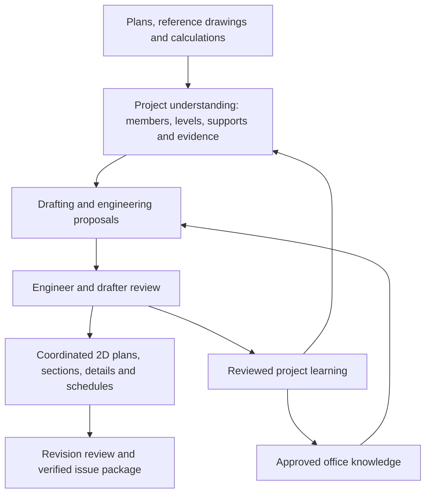

# Structural Level 3 — project understanding with the speed of 2D

**6 September 2026 — expanded Structural production scope:** Tim approved the full audit's inclusion. [Shared production plan](DRAWING_PRODUCTION_PLAN.md), [44-item register](DRAFTING_DELIVERY_REGISTER.md) and section 12 below add S01–S10 and shared finish to the SL3 route. Retrieve actual project setup, CE appearance and prior answers from governed evidence first. Newer reported coverage is 31 reviewed projects and a 300-project roster, not 300 reviewed jobs. Older context/access summaries are superseded only as described in the shared plan.

**Owner:** Structural Level 3 - Control Room. **Recorded:** 5 September 2026.
**Status:** Tim approved proceeding with planning and GitHub publication. This is the first detailed plan;
its proposed defaults, targets and implementation slices remain distinguishable from his explicit decisions.
**Delivery:** future Structural extension; Civil + Manager office delivery remains first under [#24](https://github.com/timbrand92/CE_ACAD_PLUGIN/issues/24).
**Runtime:** no Level 3 implementation, deployment or AutoCAD acceptance is claimed by this document.

**SL3-0 continuation:** after publication of PR #65, Tim again said **"proceed with full approval"**.
Proceed with this plan and its stated pilot defaults. The [concrete pilot review](workflows/SL3_0_PILOT_REVIEW.md)
now defines five related workflows, an invented four-sheet evaluation project, exact revision-impact checks
and a baseline worksheet. Actual DWG/Sheet Set arrangement and first connection families still need factual
answers; the new workflow pack is prepared for review, not claimed as AutoCAD-approved or implemented.

## 1. The result

**Draft in familiar 2D AutoCAD. CE understands the project well enough to coordinate the engineering,
connections, sections, drawing presentation, revisions and issued sheets.**



Example: an architectural revision moves a wall supporting B4. CE identifies the changed reference,
shows the affected beam/support relationship, finds the associated connection, section, schedule and
sheets, and prepares a coordinated change proposal. It shows any engineering that requires rechecking.
After review, CE updates the approved drawing content and prepares the correct revised sheet package.

Staff should not have to model every wall, bolt and finish in 3D or enter the same fact in several places.
Capture information from existing drawing work; ask once where the missing fact matters; reuse the answer.
Ordinary drafting and plotting remain usable with CE or AI unavailable.

## 2. Tim's instruction and authority

### Explicit direction, 5 September 2026

Tim asked that Structural Level 3:

- Take substantial inspiration from Revit's project handling while retaining fast 2D production.
- Understand drawings as if they carried 3D context, without adding the work of full 3D authoring.
- Learn connections from both engineering and drafting perspectives, and learn sections.
- Work towards replicating almost any drawing situation and understanding office and reference drawings.
- Help drafting, engineering, design and presentation together.
- Make revisioning and plotting faster and more reliable.
- Develop the plan through questions and publish it to GitHub for chat continuity.

His subsequent instruction was **"proceed with full approval"**. At that point the proposed connection
between 2D plans, members/connections, sections/details and sheets/revisions had been explained, together
with the existing engineering boundary and Civil-first delivery order. This authorises completing and
publishing the plan. It is not a fabricated answer to the unanswered questions in section 10, or acceptance
of detailed workflows and engineering values that had not yet been presented.

### Existing decisions retained

| Existing authority | How Level 3 uses it |
|---|---|
| [ST-01](CARDS/ST-01_BEAMS_LINKS.md), [ST-02](CARDS/ST-02_SUPPORTS_BRACING_JOISTS.md), [ST-06](CARDS/ST-06_FOUNDATIONS_REBAR.md) | Preserve working placement, stable identities, shared supports, foundation hosts and explicit relationships. |
| [ST-03](CARDS/ST-03_ANNOTATION_DIMENSIONS.md), [ST-04](CARDS/ST-04_TEXT_PLACEMENT.md), [ST-05](CARDS/ST-05_HATCHING_UTILITIES_XREFS.md) | Keep native dimensions, CE annotation conventions, hatches and protected reference handling. |
| [ST-07](CARDS/ST-07_SCHEDULES_SHEETS_EXCEL.md) | Reuse CESHEETS, calculation provenance, the single schedule authority and verified publishing. |
| [ST-08](CARDS/ST-08_SECTIONS_DETAILS.md) | Reuse sound section geometry and governed details. Current approval does not design members, reinforcement or connections. |
| [ST-09](CARDS/ST-09_MARKUP_CHECKLIST_NOTES_TIME.md) | Reuse governed markup intake, project notes and coordinated QA. |
| [AS-01](CARDS/AS-01_STANDARDS_ASSET_CATALOGUE.md), [SH-04](CARDS/SH-04_SETTINGS_STANDARDS.md) | Approved graphics and versioned project standards; immutable office masters. |
| [QA-01](CARDS/QA-01_READY_TO_ISSUE.md), [AI-01](CARDS/AI-01_ASK_CE_MCP_AUTOMATION.md), [DATA-01](CARDS/DATA-01_CORPUS_PRIVACY.md) | One QA authority, controlled AI proposals, source-specific privacy clearance and truthful evidence. |

**Scope extension:** Level 3 may eventually propose and calculate connection/design options through
separately reviewed engineering services. ST-07 schedules and ST-08 detail writers continue to display
the engineering authority's results; they do not become competing calculators. Historical frequency
can suggest an example; it cannot prove capacity, applicability or compliance.

This extends the long-term automation ambition already recorded in Tim's ST-02 approval. It does not
reopen approved cards, rename Civil C6, imply that Structural pilot S1–S3 delivers Level 3, or create
a second shared relationship engine, learning store, sheet manager or delivery board.

## 3. What to take from Revit

These are researched product patterns; the CE adaptations are proposals, not claims about current CE features.

| Revit inspiration | Proposed CE experience |
|---|---|
| Project Browser groups project views, schedules and sheets. [Autodesk](https://help.autodesk.com/cloudhelp/2025/ENU/Revit-GetStarted/files/GUID-C8D3E5A6-02A5-43A9-AFFC-D49DD27398B1.htm) | One project tree: levels, plans, members, connections, sections/details, calculations, sheets, references and issues. Select B4 and see everywhere it is represented. |
| View templates coordinate view appearance. [Autodesk](https://help.autodesk.com/cloudhelp/2026/ENU/Revit-HaveYouTried/files/GUID-DD1AF833-EAA0-4C91-8CF3-EA8BB8B5C3D5.htm) | Approved plan/section/detail/presentation presets for layers, scales, text, dimensions and plotting; preview updates and retain recorded project exceptions. |
| Reusable 2D detail components and saved detail views. [Autodesk components](https://help.autodesk.com/cloudhelp/2026/ENU/Revit-DocumentPresent/files/GUID-40A09EB9-C28D-43D0-815D-18519042845D.htm), [saved views](https://help.autodesk.com/cloudhelp/2026/ENU/Revit-DocumentPresent/files/GUID-246707F0-6ECB-42F3-9044-511067569C2E.htm) | Searchable illustrated detail families, fixed project versions, explicit applicable conditions and controlled adaptation. Revit 2D detail components themselves are view-specific and not associated with building model elements; CE's proposed member/evidence links are an additional requirement. |
| Revision tracking and revision information on construction sheets. [Autodesk](https://help.autodesk.com/cloudhelp/2026/ENU/Revit-DocumentPresent/files/GUID-312CD63E-12FD-4CA7-A05B-CD7DADBAACA7.htm) | One recorded issue baseline, change-impact list, revision/cloud review, sheet register and reproducible issue package. |

No Revit installation, proprietary project format or compulsory 3D modelling is proposed as a prerequisite.
Any later RVT/IFC intake would need its own evidence and workflow decision; first support actual office inputs.

## 4. How 2D acquires project context

### One set of facts, several drawing views

Native DWG geometry remains the geometry authority. Embedded CE records hold stable identity and
approved meaning. The shared project index is rebuildable from the authoritative drawings and source
records; it does not quietly override geometry. Project decisions, office standards, calculations and
issue receipts each have one explicit owner. Exact storage/interfaces must be reviewed against the
current shared spine before implementation; this plan does not prescribe a parallel database.

| CE needs to understand | Examples |
|---|---|
| Project organisation | Buildings, wings, levels, stages, current drawings, superseded references and sheets. |
| Member identity | B4 as one real member, with plan, section and schedule representations; repeated marks on different levels stay distinct. |
| Spatial relationships | Above/below, bearing, span direction, orientation, offsets, openings, grids and level datum. |
| Structural relationships | What supports what; member ends; connection role; declared load path; existing/new/demolished status. |
| Representation | Where a plan fragment or detail sits in model space, its scale/rotation, section cut direction and source member. |
| Evidence | Exact DWG entity/view, reference revision, PDF page/region, workbook cell/result, engineering rule and reviewer. |
| Change impact | Which calculations, views, labels, notes, schedules and sheets depend on a changed fact. |

Each fact carries **source, revision, units, scope and status**. Keep three dimensions separate:

- Evidence: observed, inferred, conflicting, missing or stale.
- Review: proposed, checked or approved, with reviewer and scope.
- Freshness: current against the named source revisions, or awaiting recheck.

Confidence does not equal engineering approval. A recognised "B4" label does not prove which nearby
line is B4, and a support footprint does not prove fixity or design capacity.

### Recover context without extra authoring

Read geometry, block attributes, labels, levels, grids, dimensions, section references and known CE
relationships first. Use approved visual interpretation for ambiguous PDFs/scans only where permitted.
Reconcile plans, sections, schedules and calculations; identify disagreements instead of choosing silently.
Keep a compact coverage panel: files/views considered, missing references, unresolved objects, source age.

For separated/rotated plans and Xrefs, retain explicit level, units, datum and coordinate mappings.
Never treat vertically separated members as connected because their plan lines cross. A section cut
needs cut position, direction, depth and sufficient level/geometry evidence. If these cannot be recovered,
ask a focused question or leave a visible gap. Optional inferred spatial sketches may aid review later;
they must identify unconfirmed geometry and remain derived views, not required modelling work.

Opening a project review is read-only. Ordinary edits invalidate only affected evidence; background work
uses safe snapshots, is cancellable and must not scan the whole project while the cursor moves. A changed
reference or closed drawing invalidates a pending proposal before Apply. Offline work preserves the last
known evidence with an honest timestamp. Native COPY, Undo, WBLOCK, file rename/repath and save/reopen
need explicit identity/recovery checks. Concurrent edits and cloud-sync conflicts cannot use last-write-wins.

## 5. Learning connections, sections and drafting

### One illustrated family with distinct knowledge

| Knowledge | What is stored |
|---|---|
| Engineering | Connection function, force directions, restraint assumptions, materials, geometry limits, member/host conditions, loads, approved calculations, rule versions, applicability and exclusions. |
| Drafting | Plan/section/elevation representations, visible/hidden lines, approved symbols, hatch, dimensions, leaders, notes, scales, lineweights and sheet composition. |
| Project adaptation | Which dimensions and notes may change, fixed requirements, interfaces, mirror/rotation rules, and effects on linked views/calculations. |
| Evidence and review | Approved source/version, permitted reuse, reviewer, correction history, rejected examples, superseded variants and known failure cases. |

Initial candidates include timber-to-timber, timber-to-steel, steel beam-to-column, base plates/anchors
and RC/reinforcement details. **The first families are not selected yet.** Start with a small approved
set and expand using measured accuracy and office frequency, not a promise to support every connection.

### Proposed learning loop

```text
Approved example -> identify meaning and graphics -> compare with current project
       -> propose reuse/adaptation -> engineer/drafter correct -> save project decision
       -> nominate office knowledge -> review/version -> reuse within stated limits
```

Start with retrieval and governed reusable examples. "Learning" does not require retraining a model.
Model training or a new provider adds separate evidence, privacy, cost and approval requirements.
Record why suggestions were rejected. A moved label is not automatically an engineering rule; a one-off
site concession is not an office default. Training/retrieval examples and evaluation jobs must be separated
at project level, including revisions of the same job, to avoid testing on remembered answers.

### Replication ladder

1. **Reproduce:** place an approved detail faithfully as editable native CAD, retaining its source/version.
2. **Adapt:** change permitted dimensions, members, orientation and annotations with an actual drawing preview.
3. **Derive:** prepare a section from linked project evidence and ask for missing spatial facts.
4. **Compose:** propose coordinated plan/detail/schedule/sheet content from reviewed families.
5. **Expand:** support unfamiliar situations through explicit review and new evidence-backed families.

Scanned references require scale and dimensions to be checked; pixel similarity is not dimensional proof.
Vector geometry and plotted appearance are both evaluated. Missing approved assets cannot be replaced
by invented approximations. Reference documents are evidence, never instructions to execute commands.
Respect permitted reuse of consultant/manufacturer material and existing DATA-01 provider boundaries.

## 6. Drafting, design and presentation in one workflow

Proposed everyday doorway: select a member, connection, section or sheet and ask CE what is known,
what is affected and what can be done next. Extend the approved CE surfaces rather than adding another home screen.

| Task | Expected experience |
|---|---|
| Draft | Suggest placement/orientation, labels, dimensions and matching details using actual surrounding geometry and approved office conventions. |
| Engineer | Show load-path relationships, missing design inputs, calculation links and conflicts; propose options through validated engineering services when that family is approved. |
| Design | Compare viable arrangements, assumptions and consequences across affected members and connections. Unsupported checks remain Unknown. |
| Present | Coordinate scale, lineweights, text size, crop, detail spacing and sheet layout; preserve deliberate manual placement and project exceptions. |
| Review | Explain each suggestion with source links, highlight its drawing scope, show the actual result, and allow accept/reject/adjust. |

Example proposal: "B4 changed in the current calculation. Its plan label, schedule row and section disagree.
Review these three updates. The connection needs a fresh engineering check before its approval can carry forward."

Writes use the one reviewed tool path. Ordinary single-DWG operations have a clean Cancel and one Undo.
Multiple DWGs require per-DWG Undo plus a durable operation journal, locks, conflict checks and resumable
recovery; there is no global native AutoCAD Undo across files. Do not write through Xrefs, locked layers,
REFEDIT or unsupported objects. Manual overrides retain their reasons and become review items when affected.

## 7. Revisioning and plotting


Compare against the exact prior issued/working baseline chosen for the review; timestamps alone are
insufficient. Distinguish geometry, engineering, annotation, presentation and administrative changes.
Revision clouds and sheet inclusion are proposed from actual changes and confirmed by the user;
not every changed timestamp requires a cloud, and a change can affect a sheet with no direct geometry edit.

Extend ST-07/CESHEETS and QA-01 to cover:

- Correct sheet selection/order, title blocks, sheet/detail numbers, callouts and revision register.
- Current loaded Xrefs and calculation/detail sources; missing, stale and ambiguous evidence visible.
- Page size/orientation, page setup, plot area/scale, viewport state, CTB/STB, fonts, lineweights and clipping.
- Exact output filenames, per-sheet and combined PDFs where chosen, bookmarks and issue manifest.
- Isolated publishing that preserves the active drawing/layout/view/UCS, following AutoCAD thread rules.
- Temporary outputs, page count/size/content checks, failure recovery and a final complete/incomplete result.
- Immutable prior issue packages; no silent overwrite. Store exact source fingerprints and selected settings
  so the issued package can be traced and reproduced. Transmittal generation may be proposed; sending is separate.

Keep Draft/Review outputs distinct from Checked/Issued status. A user may record a permitted exception,
but missing evidence never becomes a green engineering check. The Civil R-27 warning policy does not
silently rewrite Structural ST-07/QA-01 issue rules; reconcile exact exception/issue behaviour in the later card.
Automatic technical failures must never be reported as a successful complete issue.

## 8. Delivery plan and forecast

**Planning forecast:** 20–30 minutes for the first written pass plus Tim's answer/review time.
Sequential is recommended; zero background workers. Parallel planning has little benefit here.
No additional plugin is required. Existing Civil runtime ownership, deployment authority and S1–S3 remain intact.

The following are **rough effort allowances, not a booked delivery date or approved budget**. They assume
reusable shared foundations, one bounded building type and a small detail library. Engineering family breadth,
data clearance and acceptance can dominate elapsed time. Confidence is low until SL3-0 finishes.

| Slice | Purpose / result | Dependencies | Completion check | Initial effort | Current status |
|---|---|---|---|---|---|
| SL3-0 — scope and baseline | Confirm pilot, file arrangement, first families, limits and baseline timings; prepare workflow cards. | Tim's answers; existing card/branch evidence. | Approved examples, authority map and measured current workflow. | 2–5 working days | Five-workflow pilot pack prepared; actual examples/answers/review and baseline pending. |
| SL3-1 — project context | Project tree, reference register, identities/levels/mappings and evidence coverage. | SL3-0, accepted shared spine/S1 interfaces, data gates for chosen inputs. | Trace one member across two views; expose missing/conflicting references; reopen without losing identity. | 2–4 weeks | Not started. |
| SL3-2 — coordinated views | Connect plan/member/detail/schedule/calculation; identify change impact. | SL3-1; ST-07/08 integration and approved slice. | A source revision marks every seeded dependent item stale; unrelated items remain untouched. | 2–3 weeks | Not started. |
| SL3-3 — learned details | Governed example retrieval, faithful reproduction and bounded adaptation. | SL3-1; AS-01, DATA-01; chosen families and approved examples. | Unseen examples meet dimensional/graphic checks; invalid applicability is refused or flagged. | 2–4 weeks | Not started. |
| SL3-4 — sections and proposals | Evidence-derived sections; coordinated drafting; bounded engineering proposal family if separately approved. | SL3-2/3; validated calculations and reviewed command cards. | Plan/section consistency, visible Unknowns, actual preview and reversible writes. | 3–6 weeks | Not started. |
| SL3-5 — revision and issue | Extend CESHEETS/QA for dependency-aware change review and verified packages. | SL3-2; current ST-07/QA release evidence. | Seeded affected-sheet set is exact; interrupted publish cannot create a false complete issue. | 2–3 weeks | Not started. |
| SL3-6 — office pilot | Time a whole representative job, correct exceptions and prove recovery. | SL3-1–5; existing release gates and Tim acceptance. | Faster total production including setup/checking; no unresolved critical coordination failures. | 1–2 weeks plus pilot availability | Not started. |

Sequential narrow pilot allowance: approximately **12–23 working weeks after prerequisites**, excluding
waiting and any substantial new engineering solver. This is not an estimate for "replicate anything".
Full connection-design breadth and whole drawing sets cannot be responsibly dated before pilot evidence.

Possible later overlap: SL3-3 evidence/catalogue work alongside SL3-2 relationships, and SL3-5 after its
interfaces settle. A two-worker scenario might reduce the narrow pilot to roughly 10–20 working weeks,
with additional usage and integration cost; this is a tentative comparison, not a fan-out recommendation.
Before dispatch, inspect available usage and explicitly select each worker's model/reasoning and file scope.
Prefer one runtime owner and one bounded evidence/test worker only when independence is proved.

Planning publication may complete while requirements remain open. Product completion percentage is not
measured; nothing in this table counts as implemented or AutoCAD accepted. Update forecasts from actual
slice durations and hold-points rather than repeating these preliminary ranges as commitments.

## 9. Evidence and the shortest useful AutoCAD test

Build a cleared, representative evaluation set: ordinary and unusual projects, good and rejected details,
missing information, repeated marks, multi-level/rotated views, stale references and contradictory sources.
Use synthetic examples until actual sources have specific clearance; do not broadly scan the existing corpus.

Proposed success targets, to confirm in SL3-0:

| Measure | Proposed acceptance |
|---|---|
| End-to-end productivity | At least 30% less total time for the agreed change-to-issue workflow, including setup, corrections and review. |
| Truthful understanding | Every reported fact names its source/status; every seeded ambiguity stays unresolved until supported. |
| Dependency coverage | All seeded affected members/views/sheets found; false positives measured and reviewed. |
| Detail fidelity | Dimensions exact within agreed unit tolerances; approved graphics and printed-scale appearance verified per family. |
| Engineering | Every check identifies inputs, assumptions, authority/version and applicability; no unsupported Pass. |
| Issue reliability | Exact selected sheet set/order/revisions/page settings; no false complete package on seeded failures. |
| Drafting performance | No cursor-path AI/network work; existing PD-01 budgets apply; large scans cancellable and measured. |

Automate logic, source freshness, mapping, geometry, plotted-output comparisons and recovery before Tim's
acceptance. Use project-held-out cases, not only the detail examples used to configure the system. Run long
suites after 5:30 pm Sydney where practical; never run a live bundle or close AutoCAD from this planning task.

One final representative AutoCAD sequence per approved pilot build, target **15–20 minutes**:

1. Open the pilot and select B4; verify linked views and evidence. Inspect one deliberately missing level.
2. Preview/adapt one approved connection and generate/check its section against the plan.
3. Cancel one proposal; Apply another; Undo it; verify manual annotation and protected references remain correct.
4. Load a nominated reference/calculation revision; verify the affected detail/schedule/sheet list.
5. Save/reopen, review revisions and plot the small issue set; compare the PDF with the exact preview.

Cross-DWG recovery and broader failure cases must already have automated/disposable evidence. Tim confirms
the representative visual result and engineering intent; he is not asked to test a historical command backlog.
No AutoCAD testing is required for this documentation change itself.

## 10. Questions and provisional defaults

Six questions were sent before the approval to proceed. **No individual answers have yet been recorded.**
Defaults below are Codex's stated planning assumptions, not quotations or separately approved decisions.

| ID | Question | Proposed default / pending answer |
|---|---|---|
| SL3-Q1 | Which first complete workflow proves the idea? | Typical house: plans → connections → sections → issued set. Alternative: revision-first or understanding-first. |
| SL3-Q2 | How should corrections become reusable knowledge? | Project learning first; explicit review/version before office-wide reuse. |
| SL3-Q3 | How far should engineering assistance go? | Propose and calculate bounded designs with visible assumptions for engineer approval, through separately approved services. |
| SL3-Q4 | One DWG/multiple layouts, several DWGs/Xrefs, or mixed? Are Sheet Sets already used? | **Unanswered; do not commit to a file-management migration.** |
| SL3-Q5 | Which connection families first? | **Unanswered; candidate list in section 5 is not selected scope.** |
| SL3-Q6 | Detail reproduction/adaptation, whole sets, or both? | Both as the direction; accurate detail adaptation first, whole drawing sets later. |

Next small question batch after those answers: preferred project type/complexity; approved source examples
and provider clearance; calculation tools and rule ownership; how to handle engineering exceptions;
project revision conventions; required PDF/naming/transmittal outputs; acceptable setup time and savings.
Ask only what the next slice needs. Record exact answers and changes here; do not repeatedly ask settled items.

## 11. Every-chat handoff

Read [#24](https://github.com/timbrand92/CE_ACAD_PLUGIN/issues/24) for current delivery, then this document,
[the overall plan](V3_OVERALL_PLAN.md), relevant original ST cards and current owning branches.
The linked GitHub publication/PR is the review record; this file is the durable Structural Level 3 plan.

- Preserve Civil + Manager first, existing Structural S1/S2/S3 scope and shared runtime ownership.
- Planning permission is recorded; unasked engineering rules and proposed targets remain proposals.
- Resolve SL3-Q4/Q5 before selecting implementation scope; confirm the remaining defaults at SL3-0.
- Expand/reconcile the affected workflow card before a new command, section engine or engineering writer starts.
- Reuse existing working tools and the shared spine; inventory actual functionality before replacing surfaces.
- DATA-01 source/provider/history restrictions remain in force; no client drawings were examined for this plan.
- Separate planned, built, automated-tested, installed and Tim-accepted evidence; no deployment is authorised here.
- This plan was prepared from `master` **b5cfb351863454d5cd6e352108b90486f2e4fdb5** on
  `codex/structural-level3-project-plan`, apart from the preserved active Civil planning checkout.
- Update this file and the existing status page when answers/scope change. Do not establish another master board.

**Next action:** capture the actual project arrangement and first connection families; review the
[prepared SL3-0 pack](workflows/SL3_0_PILOT_REVIEW.md), nominate cleared examples and measure the baseline.
Build timing follows current delivery priorities.

## 12. CE drawing-production extension — approved for planning 6 September 2026

Tim approved incorporating the full drafting audit across all three modules. **Match established CE drawing appearance and meaning, improve coordination and reduce user effort.** [Shared method](DRAWING_PRODUCTION_PLAN.md) and [delivery register](DRAFTING_DELIVERY_REGISTER.md) make this a concrete extension of SL3-0–6 and ST-01–09.

### Existing evidence is the starting point

The 6 September reading of the local Drawing Intelligence control status records 31 reviewed projects (8 whole-project gate passes, 23 targeted partial), a 300-project roster (240 Mining/60 untouched Holdout), and recovered prior answers. These are reported counts; do not infer all projects are understood or repeat previous mining. The old 12% panel is historical. Newer recorded local read-only access clearance applies within its source boundaries; it does not grant provider disclosure or office-default promotion.

First recover actual file/Sheet Set arrangement, family frequency, drawing conventions and the selected-member examples from the existing permitted records. Ask SL3-Q4/Q5 only where those records cannot settle the factual question or Tim must choose between valid priorities. Do not treat choosing a project from a roster as completing its evidence review.

### Structural outcomes and how to deliver them

| Audit item | Existing destination | Build approach | Completion evidence |
|---|---|---|---|
| **S01 — Grids and setting-out** | ST-03 / SL3-1/2 | Use real CE grid/bubble/datum examples; link grid identities, intersections and intended dimension references with explicit update scope. | Rotated/skew grids, split bubbles and duplicate names by building work without guessed member movement. |
| **S02 — Member marks across views** | ST-01/07 / SL3-1/2 | Define physical member, type mark and representation separately; preview renumbering/reservations and linked callouts/schedules. | Ground B4 renumber does not alter upper B4; repeated view counts once. |
| **S03 — Whole framing bays** | ST-02 / SL3-2/4 | Extend reviewed picks with whole member/support extents, openings, trimmers and bay boundaries; show missing engineering before compound proposals. | L bay, skew wall, opening, beam+wall support and cantilever retain intended framing. |
| **S04 — Construction-state graphics** | ST-01/06/07 / SH-04 / SL3-2 | Define existing/new/demolished/temporary state, view rules and quantity inclusion using current office examples. | Demolition and new-work views differ correctly; retained work is not new supply. |
| **S05 — Connection drafting recipes** | ST-08 / AS-01 / SL3-3/4 | Nominate first families from existing evidence; specify required views, adjustable dimensions, symbols, notes, exclusions and engineering sources. | Mirror/member-size change preserves or flags applicability; no invented connection values. |
| **S06 — Section-cut behaviour** | ST-03/08 / SL3-2/4 | Represent cut path/direction/depth, levels, visible/hidden content and scale; start with pilot cuts, then qualify offset/partial cuts. | Moving cut updates correct contents, preserves authored notes and surfaces missing spatial facts. |
| **S07 — Reinforcement zones** | ST-06/08 / SL3-3/4 | Define zone/face/layer/extent/opening/cover/mark links around existing RBL/RBC and RC geometry; keep fabrication expansion separate. | An opening revision flags affected reinforcement and details; retired STR/BWT stay retired. |
| **S08 — Foundation/site interfaces** | ST-06 / SL3-2/4 | Add reviewed corner/intersection/step/level behaviour and column-pad-slab relationships; reuse geotechnical/calculation authority. | Move linked column with preview of dependencies; shared raft remains protected. |
| **S09 — Dimensions, keynotes and quantities** | ST-03/07 / AS-01 / SL3-2/5 | Create approved dimension/legend outputs from physical identities and note records; flag display overrides. | Plan+section copies do not double-count; dimensions and relevant keynotes update coherently. |
| **S10 — Revision to issued set** | ST-07/09 / QA-01 / SL3-5 | Use exact prior baseline, change categories, sheet/revision identities, cloud rules, exception records and verified publish outputs. | Calculation-only and title-only changes produce correct distinct affected-sheet sets. |

### Bounded delivery within SL3

- **SL3-0:** create appearance/behaviour sheets and measured existing workflow from reused evidence. Resolve exact member-mark, file/view and first-family scope; preserve previous answers.
- **SL3-1/2:** distinguish member, type mark, view representation, support, host and level. Extend grids/construction-state context incrementally; show direct navigation and exact revision effects.
- **SL3-3:** ship a small approved catalogue of native detail recipes with applicable conditions, fixed/adjustable fields and client-free source references. Reproduction of an approved detail is useful independently of universal learned placement.
- **SL3-4:** integrate sections and bounded proposals through existing writers. No inferred continuity/load path or span-only support choice becomes approved engineering. R-32–51 source rulings remain relevant even while their documentation PRs are separate.
- **SL3-5:** carry physical identity into schedules/keynotes/quantities; calculate exact affected sheets, revisions and verified issue output using CESHEETS/QA.
- **SL3-6:** measure total production/revision time including setup, corrections, checking and support; compare independent projects and retain rolled-back or rejected outcomes.

E06 is an explicit current-path reconciliation task. U01–U10 apply per family, including normal native grips on the exact picked part, correct shared-support movement, view-specific annotation, manual-position preservation and one Undo for an accepted single-DWG operation.

### First useful demonstration

Retain the existing four-sheet/two-level pilot. Show the same beam in plan/section/schedule, adapt one reviewed detail, change one known architectural source, review the exact affected set and issue the sheets. Add a second unfamiliar example and a negative applicability example before promoting the family. Do not use the held-out final drawing as generation input.

All S01–S10 are now included as planned scope. This is not a promise to complete them all in the initial narrow pilot; the earlier 12–23-week allowance must be re-estimated against actual selected breadth. Fabrication-grade output, universal connection design and retired STR/BWT are not silently introduced.

**Status:** planning expansion recorded; specific new workflow/engineering choices and exact-build acceptance remain distinguishable from this scope approval.
