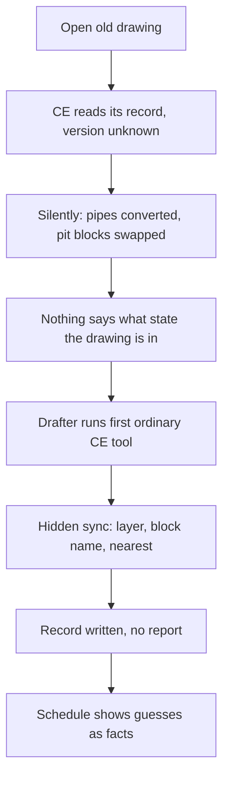
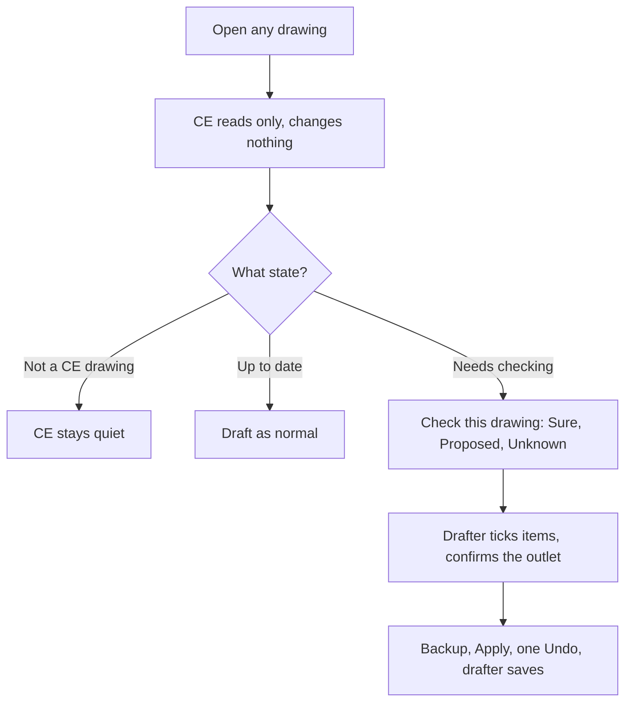

# Civil foundations audit: opening old drawings, sync, start point (written overnight 5 to 6 Nov 2026)

Read-only study. Nothing built, run, installed or changed. Code read: Civil 3.0.90 at commit cf059dcf (installed on Tim's PC). Candidate C-80 read at a6809594 (not installed, on HOLD). Colleagues run 3.0.89, which I did not read separately.

## FOR TIM

1. **Verdict.** You are about half right. The foundations are not rotten, but the front door is missing: nothing checks a drawing when it opens and tells you what state it is in.
2. **It does sync, just not when you think.** Opening an old job does not sync it. The sync then runs silently inside the first ordinary tool you use, such as Edit Pit or New Pit, and reports nothing.
3. **Real example.** On an old job, a polyline sitting on the pipe layer with no size becomes a 100 dia UPVC pipe in the schedule the first time you run Edit Pit. It joins whichever pit its end touches. A pit with no label gets the next free number. Nobody is told.
4. **"Old versions" is not quite the cause.** CE has no idea what version made a drawing. Wherever a pit or pipe has no CE identity, it falls back on layer, block name and what is nearest.
5. **Two things do run by themselves on open:** pipes are converted and pit blocks are swapped. On 4 Nov at 13:30 a real job had 6 of its 46 pipes converted on opening, with no question.
6. **Why it differs between people:** which tool was run first, each person's remembered last values, build and AutoCAD year, then personal settings and layer names.
7. **Start point: you are right.** There is none. Four separate places hold pieces of it, and CDRENUMBER asks for the outlet every time and then forgets it.
8. **The command family:** 16 commands are really 5 jobs. One "Check this drawing" door can replace most of them. A few stay separate because of risk.
9. **C-80 helps but does not fix this.** It asks on opening, but its Upgrade uses the same guessing, and a drawing with no CE record (old LISP work) is never asked.
10. **Best first step:** a line on opening that only reads: "Up to date", "Needs checking" or "Not a CE drawing". It changes nothing in the drawing. It needs your OK on a card first.

---

## What happens now on opening an old drawing

## The proposal

Labels used below: **[code]** read in code; **[log]** seen in a log; **[hypothesis]** my reasoning, not proven. Paths are under `Modules/Drainage` unless stated. Nothing here was run in AutoCAD.

---

## Testing the diagnoses before answering

1. **"It doesn't automatically sync and rebuild": half wrong.** Open does not run a full sync at default settings. The sync runs later and silently, inside about 36 places in ordinary commands and windows. An automatic sync on open would be the wrong cure: it would run the same guessing on every drawing, at open, with no report.
2. **"Wildly guess because of the old versions": the guessing is real, the cause is different.** No code at 3.0.90 reads a CE build from the drawing. The record holds only a format number (card open point B). The trigger is a missing CE identity, not an age.
3. **"Doesn't make clear where the start point is": correct.** See question 4.
4. **"Foundations aren't set properly": partly.** See question 5.
5. **Older documents that no longer match the code:**
   1. **REPAIR-DECIDE-LATER card section 2.2** says CDSYNC and CDREBUILD write the repair quarantine. At cf059dcf they do not; only the exact-link Apply does (`Services/LinkService.RepairAudit.Apply.cs:17`, and `Commands/LinkCommands.cs:118-322` never touches it). [code]
   2. **CV-08** says CDAUDIT calls sync, and that CDRECOVERINVERTS has a 150 mm fallback. Both are fixed: CDAUDIT reads a snapshot (`LinkCommands.cs:405`), and an unknown size stays unknown (`LinkCommands.cs:2336`). [code] CDRECOVERINVERTS still runs a full sync first (`LinkCommands.cs:2227`). [code]
   3. **UX-REP-01 (25 Sep)** says CDSYNC and CDREBUILD have "No button". The Repair window has both as buttons, reached from the ribbon's Repair & Upgrade (`Dialogs/CdRepairDialog.xaml:75,85`, `Services/CeCvlRibbonContributor.cs:107`). [code] He may have meant the ribbon only; that is his to say.
   4. **FOUNDATIONS_AUDIT_31OCT** covers storage and backups, not this question. Nothing in it conflicts.
6. **The brief's example, a test pipe going from 225 to 100 through CD_RecentValues:** I did not find that record in what I searched. I found a neighbour: build 3.0.86 replaced Tim's saved grade of 1 in 100 with the DN225 grade of 1 in 200 (desk log). The mechanism in the brief is plausible, and question 2 covers it.

---

## 1. Opening an old drawing, step by step (3.0.90, default settings)

1. **Civil registers the drawing.** It reads the discipline tag, the file name and whether Civil content exists. It writes nothing. `Services/LinkService.cs:1576-1628`. [code]
2. **The Civil/quiet decision.** Awake if tagged Civil, named `_CVL_` or C01, or holding record content (`Services/DrawingDisciplinePolicy.cs:153`). With an empty record, one CE pit in model space also wakes it (`ProjectDataService.Persistence.cs:831`, switch `civilWakesForPitsWithoutRecord`, ON). So content beats a Structural name. [code]
3. **Pipe conversion at the first idle moment, on AutoCAD 2027.** Skipped for read-only drawings and templates. [code] `Services/NativeObjects/PipeObjectUpgradeOnOpenService.cs:95-124`, `PipeObjectUpgradeService.cs:51-146`. It:
   1. copies the file to `_PRE_C7_` the first time;
   2. converts each pipe on the stored record;
   3. gives each pipe a CE identity;
   4. turns PROXYGRAPHICS on;
   5. writes one line on the command line. A colleague's held case says nothing.
4. **This step asks nothing.** Tim's words on 16 Sep: "IT NEEDS TO BE IMPLEMENTED EVERYTIME YOU OPEN AN EXISTING JOB"; "defualt on for everyone" (29 Oct, B-046). So it is not a bug, it is a ruling, and his 4 Nov answer "ASK USER WHEN OPENS" replaces it for older projects from C-80 on.
5. **It only sees pipes already on the record.** With no record the list is empty and nothing converts. Seen in the log as "0 pipe(s)" on most work-hours opens on 4 Nov. [log]
6. **Pit block swap, separately, at the first idle after activation.** `Services/PitBlockMigrationService.cs:126-176`. It redefines PIT BLOCK, PIT BLOCK 2 and PIT BLOCK 3 from this PC's bundle and renames the old one, then regenerates. **It has no Civil or discipline check at all** (no match in the file for discipline or quiet), so it also runs in a drawing Civil has decided is quiet. [code] It says nothing on the command line; only the log records it. [code]
7. **The Inspector's whole-drawing scan is OFF by default.** `Services/InspectorPaletteService.cs:515,1360` skip it when the Workshop layout flag is on, and that flag defaults true (`ViewModels/Shell/CeEditorShellStateStore.cs:40`). With the flag off, a full sync runs at open and on every selection refresh. [code]
8. **Nothing else at open tells the drafter the state.** No status, no count of unlinked items. [code]
9. **The first ordinary CE tool triggers the sync.** `PitEditCommand.cs:64`, `PipeEditCommand.cs:59`, `PitCommand.cs:111`, `FallCommand.cs:51`, `SpotLevelCommand.cs:43` and others. About 36 call sites in commands and windows. Steps inside `Services/ProjectDataService.cs:600-718`:
   1. **Re-attach by position.** A pit record whose object is gone takes any free pit block within 50 mm (`:413-499`), with its typed values and saved schedule order. Unit-safe since C-4. Writes.
   2. **Drop what is gone.** Records with no object are deleted, with their pipes (`:277-398`). User fields are snapshotted first and restored by ID, handle, then 200 mm position.
   3. **Add what is missing.** Every pit block and every polyline on a pipe layer is added (`:795-879`).
   4. **Clear and rebuild every pit's pipe list** if anything was added (`:870`, `LinkService.RepairAudit.Relink.cs:520-598`). Pipe ends are joined by touching.
   5. **Read levels back from the drawing.** Pit cover text can overwrite the stored cover level (`:881-1019`). Pipe inverts are re-read (`:1021`).
   6. **Fill blanks.** A blank pit invert takes the lowest connected pipe invert (`:513-575`).
   7. **Save into the drawing,** with no report line.
10. **Result.** A drafter who opens Edit Pit to change one remark can change the whole record. [code]

**How each thing is identified, and where the guess comes from:**

1. **Pit:** block name only: PIT BLOCK, PIT BLOCK 2, PIT BLOCK 3 (`Services/BlockService.cs:349`). A pit block under any other name is invisible. [code]
2. **Pipe:** CE data on the polyline if present; otherwise, any polyline on a layer named in this user's settings (`ProjectDataService.Recovery.cs:355-386`). Construction lines on that layer become pipes. CV8-10 ruled against this; it is not built. [code]
3. **Pipe size:** recorded size, then drawn width, then **"100"** as text (`ProjectDataService.Recovery.cs:400-403`). That breaks "Unknown stays Unknown". [code]
4. **Pipe material:** default by type, "UPVC" (`:191-203`). [code]
5. **Pit lid:** "Class C" from this user's settings. **Plastic** if 351 or smaller, which also takes the pit out of the schedule (`:115-124,148`). [code]
6. **Pit number:** the label block, explicit link first, then the nearest within pit width plus 2000 (`:315`); otherwise the next free number. [code] **That 2000 is hard-coded and not converted to drawing units**, so in a metre drawing it reaches 2 km. BUG-663 fixed the same fault in a different routine only. It is unchanged in C-80. It also breaks Settings-first (R-00). [code]
7. **Cover and invert (CDUPGRADE only):** nearest text starting CL or IL within pit width plus 2500 (`LinkCommands.cs:2005-2043`). Same hard-coded, unit-blind reach. [code]
8. **Pipe text and labels (CDREBUILDLINKS):** nearest pit within 5,000 mm. If two are close, it picks the nearest and only writes to the log (`LinkService.RepairAudit.Relink.cs:197-205`). CV8-7 says ambiguity should stop. [code]
9. **Flow direction:** recorded names decide; with no record, the order the polyline was drawn decides (`LinkService.RepairAudit.Linking.cs:174-177`). [code]
10. **Stored ID:** used first where it exists. So identity does outrank proximity for current drawings. The fallback is the problem, and its result looks identical to a fact in the schedule. [code]

**Written into the drawing without the user asking (3.0.90):**

1. Pipes converted, and outline MLINEs removed (2027).
2. CE identities on pipes.
3. PROXYGRAPHICS on.
4. Pit block definitions replaced and renamed, plus a stamp.
5. The whole record, at the first sync, and at every switch of drawing through `ProjectDataService.Mutations.cs:184-185`.
6. Link records on every pit and pipe, during relinks.
7. A `_PRE_C7_` file beside the drawing.

**Real job, 4 Nov 13:30:04.** "46 pipe(s)", then "converted=6 ... already=40 ... identities=0". [log] I read this as a job part-drawn on a PC where pipes stayed ordinary. [hypothesis] Which of those changes Tim called "messing stuff up" is still his to say.

**Robot noise, separated out.** The repeated "converted=49" and "Merged missing ... pits=11, pipes=49" lines come from the same fixture. They fall at 00:00 to 00:56 on 4 Nov, about 04:10 on 1 Nov, and 11:27 to 11:30 on 3 Nov. I did not use them as field evidence. The 3 Nov pair falls in work hours but has identical counts, so I treat it as a robot run too. [hypothesis]

**Compared with C-80 (a6809594) [code]:**

1. **Better:**
   1. A question before anything changes, on no stamp or a stamp before 3.0.89 (`OldProjectPolicy.ShouldAsk`).
   2. A per-drawing Civil OFF tag and a refusal for every CE command (`CivilOffCommandGate`).
   3. The pit swap waits for the answer.
   4. Backup first, and a stamp at the end (`CDUPGRADEDRAWING`).
2. **Gap 1, the oldest drawings are not covered.** The question needs a CE project dictionary (`OldProjectOpenPrompt.cs` line 117, `IsDrawingActive`). A LISP-era drawing with pits and no record is "not an older project and is never asked" (`OldProjectPolicy` header), yet it still wakes Civil and still gets the hidden sync.
3. **Gap 2, Upgrade still guesses.** `CDUPGRADEDRAWING` calls `CdUpgrade`, the same nearest-text path with Merge or Replace. Its preview counts conversions and identities. It does not show the guessed numbers, levels or joins. Tim's answer 16 ("YEP") asked for "what will change".
4. **Gap 3, the hidden sync is unchanged** in any drawing that is ON or stamped.
5. **Gap 4, the stamp means "last saved by", not "upgraded".** It rides on every record write unless the drawing is OFF (`OldProjectStampStore.StampInRecordWrite`). With the question switched off, a never-upgraded drawing gets a current stamp. [code]
6. **Consequence of ruling B, not a contradiction of it.** No drawing has a stamp today, so every live job, including ones made yesterday, is asked once. Enter, Escape or the close button all mean Civil OFF. [code] Expect "why is the ribbon grey?" on the first day. [hypothesis]
7. **Status.** C-80 is nine pull requests in one train, against "one tool at a time", and the 5 Nov plan says trains are not installed whole. It stays on HOLD.

---

## 2. Why results differ between people, ranked by how random it looks

Ranked on my judgement of frequency and how invisible it is.

1. **What was run first, and in what order.** The first CE tool after opening decides when the hidden sync lands. Two people doing the same job in a different order see different moments of change. No line reports it. [code]
2. **Remembered values, `CD_RecentValues.json`, per Windows user.** About 60 fields (`Services/SettingsService.RememberedValues.cs:34-62`): pipe size, material, type, inverts, grade, tick boxes, quick mode, Pit Schedule filters, and last pit settings. BUG-743: pressing Enter reused a cover level from another job. The same keystrokes give different results per person. [code]
3. **Build and AutoCAD year.** Tim 3.0.90, colleagues 3.0.89. Pipe objects exist only with the 2027 enabler. On 2022 to 2024, CDSYNC and CDUPGRADE refuse when they meet pipe objects (`LinkCommands.cs:135-141`), and pipes stay ordinary. That gives mixed jobs like the 46/6 above. [code, log]
4. **Personal settings, `CD_Settings.json`, per user.** 574 settings, 255 of them on/off (`Models/UserSettings.cs`, text count). A fresh login gets `colleague-defaults.json`; an existing login never does (`Services/ColleagueDefaultsService.cs` header). So two colleagues on one build can differ. [code] Tim's own file has no entry for switches added after its 4 Oct write, so those take built-in defaults. [code, file read]
5. **Layer names, in those settings.** Recognising a pipe depends on them (`Services/LayerService.cs:350,367`). Two recognisers also disagree: CDSYNC knows previous layer names (`LinkCommands.cs:2160`), the hidden sync does not (`ProjectDataService.Recovery.cs:205-215`). So one command sees a pipe the other misses. [code]
6. **Drawing units (INSUNITS).** Reaches at `ProjectDataService.Recovery.cs:315` and `LinkCommands.cs:2014` ignore units. Metre drawings behave differently from millimetre ones. Many fixes (BUG-270, 663, 871) show this is a repeating class. [code]
7. **Which drawing was open before.** CE holds one record in memory for all open drawings and rebinds it (`ProjectDataService.cs:135-142`, `ProjectDataService.Mutations.cs:151-212`). Bugs BUG-378, 385 and 1225 were this class, and each was patched separately. Any path that misses a bind can write across drawings. [code]
8. **File name.** `_STR_`, `_CVL_`, C01 or S01 decide quiet or awake (`DrawingDisciplinePolicy.cs:51-109`). A renamed copy behaves differently. Content beats name, so it matters less once pits exist. [code]
9. **Inspector flag `editors.workshopLayout`.** If anyone has it off, a full sync fires at open and on selection. Default on; Tim's file has no entry. Colleagues' files not read. [code]
10. **Pit block master in the bundle.** Each build's PIT BLOCK file can differ. When the stamp differs the definition is replaced on open. Different builds repaint the same pits. [code]
11. **Old PC project file.** With no readable record, CE reads `TIM_CE_CADTOOLS\projects\CD_ProjectData_<name>_<hash>.json`, keyed by file path, so only on the PC that made it (`ProjectDataService.Persistence.cs:228-276,1655`). Tim has 15 such files, mostly January and February 2026. [file read] A drawing with a readable record ignores it (BUG-988, ON). The log shows it read four times on 4 and 5 Nov, all "0 pits, 0 pipes" during work hours. [log] Rare but very hard to explain when it hits.
12. **Redo window.** Open-time work waits if a U is still fresh (`PipeObjectUpgradeOnOpenService.cs:108`). It can land after the next command. [code]
13. **Drawing-stored choices.** Rulebook, paused features, split at crossings, source numbering, and ignored checks travel with the drawing (`Models/ProjectData.cs`). That is correct, but nothing displays them. [code]
14. **UCS.** BUG-035 is still open. [carpark]
15. **Windows sign-in.** Only if `pipeObjectAutomaticIsOnForEveryone` is OFF; then the upgrade runs for Tim's account alone (`PipeObjectUpgradeGate.cs:72-83`). Default ON. [code]
16. **Civil and Manager shared assembly.** Each bundle ships CE_SHARED, and the first loaded wins (memory note `ce-shared-one-assembly-identity`, not re-tested). Dangerous if out of step. It is held in step by hand, so low frequency. [hypothesis]
17. **Developer switches.** `LinkService.DiagnosticEnabled` turns all link handling off for the session (`LinkService.Reactors.cs:549`), only through a performance test command. Lowest. [code]

---

## 3. The command family

Rulings read first: UX-REP-01 (typed-only, direct writes with a warning line); UX-REP-02 and 03 (Decide later tab, admin delete); CV-08 CV8-1 to 15 (one repair engine behind CDREPAIR, Plan then Preview then Apply, approved as planning); Tim's 4 Nov card answer 15 ("ONE ACTION - PROMPT ON OPENING OF DRAWING").

**What each really does:**

1. **CDSYNC:** clears every pit's pipe list, re-registers every pit and pipe-layer polyline, then runs the full sync. Direct write. Can rejoin pipes differently. Model space only.
2. **CDREBUILD:** fixes copied items that carry another item's link, runs the sync, corrects pit sizes, saves the record. Direct write. Overlaps CDSYNC by about three-quarters.
3. **CDREBUILDLINKS:** re-attaches labels and text to the nearest pit or pipe and rebuilds every pit's pipe list. Direct write. **Can move ownership to the wrong pit.** Its own tip says to run it again after CDSYNC.
4. **CDREFRESHLINKS:** puts linked pit cover text back at its stored offset after MIRROR. Moves text only. Low risk.
5. **CDREFRESHBLOCKS:** force-redefines the pit symbols from the bundle. Changes how every pit looks. Same engine as the automatic swap.
6. **CDREPAIR:** opens the old Repair window of buttons (`HubCommands.cs:624`). Not the Manager Drawing Repair page, and CV8-2 is still not routed.
7. **CDUPGRADE:** Merge or Replace; scans text and labels by nearness, then re-registers and relinks everything. **Replace wipes the record** (`LinkCommands.cs:935`). The riskiest command here.
8. **CDC7UPGRADE:** the manual form of the open-time pipe conversion. Backup first.
9. **CDSPINEUPGRADE:** gives pits and pipes permanent identities. Dry run by default, with a rollback file. A good pattern. Overlaps the open pass for pipes.
10. **CDUPGRADEDRAWING:** C-80 only, not in 3.0.90. Backup, then CDC7UPGRADE's step, then CDUPGRADE, then stamp.
11. **CDRECOVERINVERTS:** full sync, then rebuilds missing invert text from stored levels. Safer since CV8-13. Creates text.
12. **CDFIXTAGS:** lists repeated source names, renames on Yes. Preview first.
13. **CDFIXFLATPIPES:** lists pipes flattened by an old metre-drawing bug, default No. One U.
14. **CDFIXPIPEENDS:** lists pipes with From and To proven swapped, changes on Yes. Builds its preview from a copy of the record.
15. **CDLINKDANGLINGPIPES:** registers every polyline on a pipe layer with no record, at size 0. Direct write. CV8-10 says layer alone is not proof.
16. **CDXREFREPAIR:** finds broken Xref paths in the job folder, preview then one click. Unrelated to the network.
17. **CDSTARTUPAUDIT:** another name for CDLEGACYAUDIT. It lists PC folders and old files. Touches no drawing.
18. **Also in the family:**
    1. **CDAUDIT** reads only now.
    2. **CDCHECK** and **CDCHECKCURRENT** read only.
    3. **CDGRAPH, CEHEALTH, CDDIAG, CDDASHBOARD** are listed as "commands that only read" (`DrawingSafetyService.cs:33`), **yet each runs the sync, which can write** (`LinkCommands.cs:471`, `HealthCheckCommand.cs:37`, `DiagnosticsCommand.cs:35`, `DashboardCommands.cs:32`). They look safe and are not. [code]
    4. The Pit Schedule's relink button does the same as CDSYNC (`PitScheduleViewModel.Data.cs:987-1000`).

**The 5 real jobs:** (a) make the record match the drawing; (b) reconnect pipes to pits; (c) re-own labels; (d) bring an old drawing up to date; (e) fix one known old fault.

**What can lose or overwrite work:**

1. CDUPGRADE Replace.
2. Any sync where a stale record gets dropped. Snapshots soften it but match by ID, handle, then 200 mm.
3. Cover text overwriting a stored cover level.
4. CDREBUILDLINKS's wrong-nearest label.

BUG-796 already records four of these writing with no preview.

**Could they be one?** Yes for the record and links group. Five separate scanners exist (`CdSync`, `CdUpgrade`, `RebuildCompoundLinks`, `MergeMissing`, `TryRecover`). That goes against design rule 1, and it is why results differ by command.

1. **Fold into one "Check this drawing":** CDSYNC, CDREBUILD, CDREBUILDLINKS, CDLINKDANGLINGPIPES, CDUPGRADE Merge, CDC7UPGRADE, CDSPINEUPGRADE Apply, CDUPGRADEDRAWING, plus CDFIXTAGS, CDFIXFLATPIPES and CDFIXPIPEENDS as finding rows (each already previews).
2. **Keep separate because of risk or subject:**
   1. **CDUPGRADE Replace:** hidden, administrator, backup required.
   2. **CDREFRESHBLOCKS:** a visual change to the whole drawing.
   3. **CDRECOVERINVERTS:** creates text. A separate optional row.
   4. **CDSPINEUPGRADE Rollback:** the only way back.
   5. **CDXREFREPAIR:** different subject, already offered on opening.
   6. **CDREFRESHLINKS:** a quick MIRROR tidy.
   7. **CDLEGACYAUDIT:** about the PC.
3. **Rulings this touches.** UX-REP-01 keeps the typed commands as direct writes. My proposal leaves them typed and working as hidden expert commands (CV8-1), so it does not overturn it. Moving them to preview-first (CV8-5) would change UX-REP-01 and **needs Tim's word**. Answer 15's "one action" fits. The Civil OFF card's "the two old commands stay for now" also holds.

---

## 4. The start point

**Is there one place that says "this is a CE job, this is its data, this is its start"? No.** [code]

1. **"This is a CE drawing" has several tests:**
   1. the discipline tag `CE_CVL_DISCIPLINE`;
   2. the file name;
   3. record content;
   4. pits in model space;
   5. a project dictionary existing (the C-80 test, `IsDrawingActive`).

   They can disagree, and an empty dictionary counts as active for one and not another.
2. **"This is its project data" lives in up to eight places:**
   1. the record, as text in `CE_CVL_SUITE_PROJECT`;
   2. link records on each pit and pipe in `CE_CVL_SUITE_LINKS`;
   3. pipe data on the polyline or object;
   4. permanent identities in `CE_CVL_SUITE_SPINE`;
   5. drawn labels and text (read back at sync, `ProjectDataService.cs:881`);
   6. the block attributes;
   7. the one copy in memory;
   8. the old PC file.

   Slabs and survey have their own dictionaries.
3. **They can disagree and do.** One is drawing text vs record (BUG-650, BUG-290). Another is pit list vs pipe record (BUG-268). A third is memory vs drawing (BUG-385, 1225). Sync decides which wins with fixed rules and tells nobody.
4. **There is no job-level identity.** Each DWG is its own island. `DrawingPath` is stored but only as a path; SAVEAS copies the identities too. MULTIPLAN holds cross-sheet links for a later upgrade (`MultiPlanNetworkStorageContract.cs`). CESTARTHERE is a picture tour, not a start point.
5. **"The outlet or start of the network" has four partial homes and no master:**
   1. **LPD marker,** optional, in `CE_CVL_SUITE_LPD`.
   2. **Redesign outlet role,** `NetworkRedesignOutletRoleService`, written only after a redesign Apply.
   3. **Pit outlet overrides,** in the record, per pit (`PitOutletOverrideData`).
   4. **Worked out each time** from inverts, pit by pit (`PipeTruthLogic.cs:578-627`). With no inverts it says only "not available".
6. **Plain proof.** CDRENUMBER's own note: "Nothing is remembered between runs — no existing field/store for a CDRENUMBER outlet nomination was found, so this asks fresh every time" (`PitRenumberCommand.cs:130-136`). Its default is the lowest invert. So the same drawing can get a different answer on a different day.
7. **Against the settled rules (START_HERE section 3):**
   1. **D9, DWG geometry is the model:** respected. Geometry is the base and the PC file only fills an empty gap.
   2. **Stable identity outranks proximity:** respected where identity exists. Broken in the fallback paths above, where nearness writes as if proven.
   3. **Unknown stays Unknown:** broken by "100", "UPVC", "Class C", the plastic rule and the 2 km reach.
   4. **One operation = one Undo:** open-time writes happen outside any command. I could not establish how U treats them.

---

## 5. Is it the foundations?

**Verdict: partly. The structure below ground is reasonable. Two things are genuinely missing at the base: a gate at the door, and one owner for "what is true". Most of the bug list is not caused by that.**

**Evidence for:**

1. A hidden, writing sync lives inside everyday tools and even inside tools labelled read-only.
2. Five scanners and three pit recognisers do one job.
3. No version knowledge, no state, no start point.
4. One shared memory record for many drawings, repaired bug by bug.
5. Hard-coded reaches in unit-blind places, in the exact routine that handles old drawings.

**Counter-evidence (what is sound):**

1. The drawing beats the PC file (BUG-988).
2. Sync snapshots and restores typed values, and keeps manual rows.
3. An exact-repair engine exists, forbids proximity, and quarantines (`ExactStoredLinkRepairPlanningService`, CV-08 boundary).
4. Read-only checks exist that truly do not write (`CurrentDrawingCheckService.cs:17-21`, CDCHECK).
5. CDSPINEUPGRADE, CDFIXTAGS, CDFIXFLATPIPES and CDFIXPIPEENDS already follow preview, then default No, then one Undo.
6. Unknown fields in a newer record are kept (`ProjectData.ExtensionData`).
7. Locked layers are left alone with a plain line.
8. Pit rename keeps identities.

So the good pattern is already in the building. It is just not the front door.

**How many open bugs trace here? (BUG_CARPARK.md, read 5 Nov)**

1. **Size of the list.** 1,228 entries, 1,110 open or in progress by status text, of which 334 say a fix is installed but not accepted. About 633 are Civil-looking on a rough filter.
2. **Keyword count rejected.** A word search hit 738 of 1,110, but words like "colleague" and "stale" are everywhere, so it proves nothing. I do not rely on it.
3. **Hand sample.** One in every 15 Civil-looking open bugs, 42 read by hand:
   1. **6 of 42 clearly this cause** (BUG-796, 743, 663, 290, 213, 605).
   2. **4 of 42 probably** (BUG-765, 713, 1001, 035).
   3. **3 of 42 units,** a related common cause (BUG-321, 871, 695).
   4. **29 of 42 individual tools,** wording or calculation (BUG-982, 1115, 941, 959 and others).
4. **Estimate.** About 14% clearly, about 24% with the probables, about 31% with units. Across 633 that is roughly 90 to 195 bugs. Small sample, so treat it as plus or minus 14 points. My classification, not tested.
5. **What that means.** Fixing the foundations will not clear the carpark: about two-thirds of it is ordinary tool work. It will remove most of what feels random, and that part does the damage to trust. The everyday-tools core Tim chose on 5 Nov deals with the two-thirds separately.

---

## 6. A better way

**In drafter's terms:**

1. **Open any drawing.** CE reads and changes nothing. No save question appears on close because of CE.
2. **One visible state,** on the Civil panel and one command line:
   1. **Not a CE drawing.** CE stays quiet.
   2. **Up to date.** Every pit and pipe is linked and proven, the outlet is set, and the version is current.
   3. **Needs checking: 12 items.** One button.
3. **One door: "Check this drawing"** (the existing CDREPAIR route, CV8-1 and 2). It lists three groups:
   1. **Sure:** proved by stored identity. Example: "P4 label belongs to P4".
   2. **Proposed:** a guess with its reason. Example: "Polyline on the Stormwater layer, no size. Proposed pipe from P3 to P4, size Unknown".
   3. **Unknown:** left as Unknown, parked in Decide later (UX-REP-02).
4. **One start point.** A step in that door: "Which pit is the outlet?" CE offers the lowest invert with its reason, and the drafter confirms. Stored once, in the existing LPD record, with one per system for multi-LPD jobs. CDRENUMBER, the schedule, CDDESIGN and long sections read it from there. The point shows as a marker. Moving it is a named command.
5. **Apply.** Backup, then one command, one Undo, then "Upgraded, not saved yet". **CE never saves** (UX-STD-03, and the 25 Sep "AutoCAD's own + reminder" ruling, which stands after the CLEAN loss).
6. **While drafting.** Tools stop syncing silently. If the drawing has drifted they use what they know and the state changes to "Needs checking: 3". No hard block (R-27). Civil OFF stays exactly as Tim ruled in answers 2 and A.

**How it meets the fixed rules:**

1. **Nothing silently changes a drawing:** open is read-only, and even the status writes nothing.
2. **One operation = one Undo:** Apply is one command.
3. **Unknown stays Unknown:** no "100", no "Class C" fill-in; those become Proposed.
4. **No hard blocks:** warnings only.
5. **Every value on Settings:** the 2000 and 2500 reaches move there, in millimetres.
6. **Locked layers and Xrefs:** listed and left alone.

**Reuses (already in the code):**

1. `CurrentDrawingCheckService` and the CDCHECK states.
2. Exact-link plan and quarantine (`LinkService.RepairAudit.*`).
3. Manager Drawing Repair page with its Preview/Apply contract (`ICeDrawingRepairContributor`).
4. The C-80 stamp, Civil OFF tag, banner and Upgrade window.
5. LPD storage.
6. The preview pattern from CDFIXPIPEENDS and CDSPINEUPGRADE.
7. Backup code.

**Needs building:**

1. The status decision and display.
2. One scanner in place of five.
3. Proposed-with-reason rows, and per-row ticks, which the Drawing Repair contract does not have (REPAIR-DECIDE-LATER section 2.1).
4. The outlet confirm step, and pointing readers at one store.
5. Turning the hidden sync into detect-only, behind a Settings switch.
6. A proper "upgraded" stamp, separate from "last saved by".
7. Handling for no-record LISP drawings.

**Smallest safe first step:** the read-only status line at open.

1. **What it does.** At the first idle after opening, it counts what `CurrentDrawingCheckService` already reads, and prints one line and nothing else.
2. **Why first.** It cannot harm a drawing, it fits "one tool at a time" and the core plan, and it gives Tim real numbers for his own jobs before any repair is designed.
3. **Gate.** It needs a card and Tim's approval (review gate), and it waits for the HOLD. On a large drawing the scan cost needs measuring first (CV8-15).
4. **Undo.** One Settings switch off. Nothing to restore, because nothing was written.

**Later steps, smallest risk first, each its own card:**

1. Stop the sync in the tools labelled read-only.
2. Report what the sync did, as one line.
3. Replace "100", "UPVC" and the raw reaches.
4. Confirm-and-store the outlet.
5. Bring CDSYNC and CDREBUILD behind the door. Tim's word needed on UX-REP-01.

**Decisions this report needs from Tim, for the questions chat, not made here:**

1. Does the read-only line go in the core build?
2. Should no-record LISP drawings get the older-project question?
3. Should the LPD record be the single start point?
4. How should C-80's slices be lifted, given the HOLD?

---

## What I did not check

1. **Nothing was run.** No AutoCAD, no build, no test. Every behaviour above is read from code or a log.
2. **Colleagues' PCs.** I did not read Silvia's or any colleague's settings, logs or remembered values. Their section is inferred from code. 3.0.89 was not read separately.
3. **Undo.** How AutoCAD's U treats open-time writes made outside a command is not established. CDSYNC's printed "One U undoes it" is not verified here. Insufficient information; a probe on a copy would settle it.
4. **Real old drawings.** I opened none, including LISP-era ones. What the LISP tools stored comes only from what this code recognises. The old LISP source was not read.
5. **Field frequency.** Log evidence is Tim's PC only, last 5 days of the 7 kept. I cannot say how often each path fires for others. The ranking in question 2 is judgement.
6. **Bug sample.** 42 entries, hand-classified by me from their first lines, with no second reviewer.
7. **Not read in full:** `LinkService.Reactors.cs` end-of-command relinking (about 2,300 lines; only the entry and gates), `LinkService.RepairAudit.Apply.cs`, the Workshop Inspector's own refresh, the Manager Drawing Repair page, and Xref or block-nested pits.
8. **Saved-settings freezing.** Whether a Settings save writes every key, which would freeze later defaults for that user, was not confirmed.
9. **The CE_SHARED order** comes from a memory note, not a fresh test.
10. **Counts** (36 call sites, 574 settings, 60 remembered fields) are text searches, so treat them as approximate.
