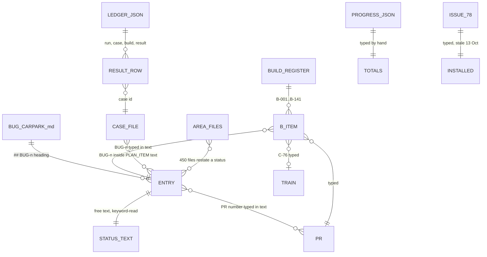
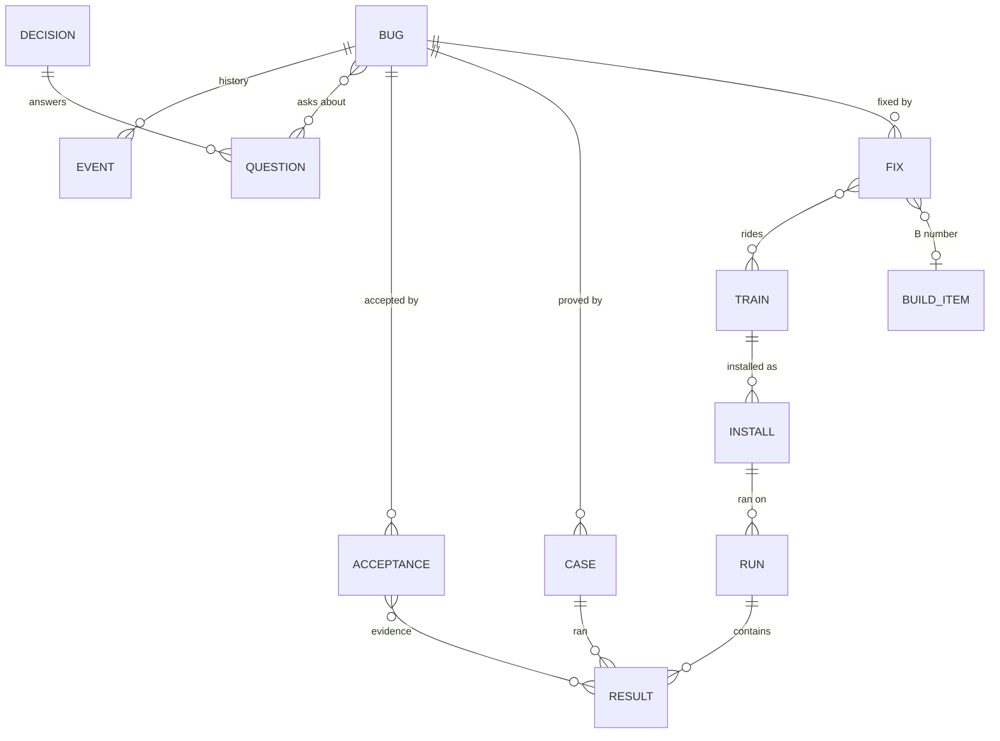

# Data system design: one record for bugs, fixes, trains, tests and decisions (1 Nov 2026)

Written Sun 1 Nov 2026, about 04:00 Melbourne, by the rv16 read-only research job (Opus, Team), for CE 05 and CE 00.
Authority: Tim's "as you recommend for all" (decisions\2026-11-01_TIM_TESTING_AND_DATA_PILOTS.md, item 3).
**This is a design only. Nothing was built, changed, committed or pushed. Tim approves it before any build.**

## FOR TIM

1. **The problem:** the same bug fact is typed by hand into 6 or more places, so the bug count has been given as 1,205, 1,215, 1,216 and 1,217, and "649" got mixed in.
2. **None of those counts is wrong. Each measured something different:** 1,205 was the file at midday Fri 30 Oct; 1,216 is the file now; 1,217 also counted one bug heading that has no number; 649 was only the open bugs left after taking out the ones already planned.
3. **Example of the bigger risk:** one counting script read "not yet Codex-accepted" as accepted. That makes 61 bugs look accepted instead of 27.
4. **What I recommend:** one database kept as plain files inside C:\CE_PLAN. Git keeps every change (who, when, what). It works with no internet, and there is nothing to pay for.
5. **You never type into it.** The pages you read (the dashboard, the bug list) are made from it automatically, so every page shows the same number.
6. **Chats write through one small command.** It refuses a wrong status word, a bug number already taken, or "fixed" with no proof attached.
7. **"Fixed" can no longer be typed in.** A bug shows as fixed only when a recorded robot, Codex or Tim result is linked to it.
8. **I compared two other options:** GitHub Issues (free, but needs internet, 1,216 issues to manage, and your two GitHub status pages are already a month out of date). Notion (online only, data leaves the PC, and anything paid breaks your 29 Oct "no paid tools" rule).
9. **The first step is safe:** copy the bug file into the database without changing the bug file at all. Then rebuild the bug file from the database. If the rebuilt copy matches the original byte for byte, nothing was lost.
10. **What you will see:** one dashboard page, laid out in section 6 below. It shows the installed version, how many bugs are open, installed, accepted and closed, what is being tested now, and the questions waiting for you.
11. **Undo:** the first step only adds two new folders. Removing them puts everything back exactly as it is today.
12. **Your call:** reply "approve the data design" and CE 05 builds step 1 (import plus one dashboard page), outside your AutoCAD hours. Nothing else changes until you approve the switch.

---

Everything below this line is technical detail for the chats. Tim does not need to read it.

## 0. What I read and what I did not check

1. **Read:** RULES.md, the foundations skill, the 1 Nov decision, BUG_CARPARK.md (17,946 lines, SHA-256 `2551F79A09C4E2138E08AAEBCA5CDD61C003B6F259963E37EBB0827BD7FC19CF`, last commit c7c7a5f8 31 Oct 18:10), PROGRESS.json, USAGE.json, areas\runner-reports\ledger.json, the BUILD_REGISTER and DESK_LOG, BUG_PIPELINE_STATE.md, SESSION_STATE_CE05.md, BUG_PROOF_LANES_31OCT.md, NEXT_TRANCHE_31OCT.md, BUG_REGISTER_TRIAGE_2026-10-24.md, the decisions folder, the case files in C:\Lisp Files\_ACAD_DRIVER\cases, GitHub issues #24 and #78 (read only), and the open PR count.
2. **Scripts (read-only, in C:\CE_WORK\scratch\rv16):** `count_carpark.ps1` (output `count_out.txt`, per-entry list `carpark_entries.csv` with a 16-character checksum per entry) and `count_other.ps1` (output `other_out.txt`). They wrote only to that folder.
3. **Not checked:** which of the bundle folders on disk is the live one (I saw that the newest copy of Civil is 3.0.88+3fbb9da5, dated 31 Oct 03:50, but I did not confirm that AutoCAD loads it). The 965 area files were counted and keyword-scanned, not read one by one. I did not test a restore of CE_PLAN from GitHub. I could not find the numbered list that "decision 178" of 31 Oct belongs to (see 1.4, item 6).

## 1. TODAY: where the facts live

### 1.1 The stores

1. **BUG_CARPARK.md:** 1,222 level-2 headings. 1,216 are `## BUG-<number>` (BUG-1 to BUG-1267; 51 numbers in that range have no heading; no number is used twice). 1 is `## BUG-CDCHECKIGNORE-UNDO-C60` (the renamed second BUG-866). 2 are `## AUDIT-XCLMTXT-...` findings with no BUG number. 3 are summaries (Status Summary, Round 5, Round 6). Plus a long preamble of rules and run notes. Status is free text on a `**Status:**` line.
2. **Status-line quirks found by the script:** 1,165 entries have exactly one Status line at the start of a line. 50 (mostly BUG-394 to BUG-424) carry the Status inside another paragraph. 1 (BUG-865) has no Status at all. 3 (BUG-402, 421, 562) carry two Status mentions, which carpark rule 5 forbids. 23 statuses are free text that no keyword rule can sort. 129 entries are over the 3 KB limit of rule 9 (the largest is 20,484 bytes). 22 BUG numbers are mentioned but have no heading (one of them, BUG-4251, looks like a typing slip).
3. **areas\ (965 top-level files, 3,015 counting sub-folders, about 27 MB):** reports, briefs, ledgers and state files. 784 of the .md files name a BUG number; 450 put a status word (FIXED, OPEN, installed, accepted) within 80 characters of a BUG number. Each of those is a second copy of a status that can go stale.
4. **BUILD_REGISTER (areas\release-v3-colleagues-BUILD_REGISTER.md):** 646 lines, B-001 to B-141. Each B line carries a BUG number, a PR number, a train, and hand-typed "Built yes; tested unit only; installed no; Tim-accepted no". 233 lines name a BUG.
5. **DESK_LOG (areas\release-v3-colleagues-DESK_LOG.md):** 1,348 lines of dated notes. 294 lines name a BUG and 254 name a PR.
6. **PROGRESS.json:** hand-written totals. `allBugs.total` is 1,205 (countedAt 30 Oct 21:43) while its own `waiting` text says "1,215 entries". `installed` says Civil 3.0.87, but a 3.0.88 copy dated 31 Oct 03:50 is on disk.
7. **USAGE.json:** three account readings (percentages of the week and the five-hour window, with read times). No money in it.
8. **Acceptance ledger (areas\runner-reports\ledger.json):** 1,955 result rows (1,326 PASS, 628 FAIL, 1 FLAKY), 330 cases, 719 runs, 19 build strings, 23 Oct 17:55 to 1 Nov 02:48. The fields are run, session_id, case, build, result, variant_of, at, case_sha256 and from_check. **There is no bug field: only 3 of 1,955 rows name a BUG.** The link from a result to a bug exists only inside the case file text (382 of 780 case files mention a BUG number; 268 have it in their PLAN_ITEM line).
9. **Runner reports:** 1,991 files. 276 RUN json files are not in ledger.json. Every ledger run has its file.
10. **Three more acceptance files:** ACCEPTANCE_LEDGER_CLAUDE_2026-10-24.md, _W_SERIES_, _X_SERIES_ (Markdown, separate from ledger.json).
11. **Other bug-bearing pages:** TIM_DESK.md (147 lines name a BUG), QUESTIONS_FOR_MONDAY.md (124), PENDING_TESTS.md (64), IDEAS_INBOX.md (9).
12. **GitHub:** 1,565 open PRs (1,947 PRs in all) and 31 issues. Issue #24 "WHERE WE ARE" was last updated 23 Sep 2026; issue #78 "DEPLOY REGISTER" was last updated 13 Oct and its LIVE RIGHT NOW block still names commit 10ac480d of 15 Sep.
13. **Not in git at all, right now:** ledger.json has uncommitted changes, and 1,007 files are untracked (most are runner reports, plus NEXT_TRANCHE_31OCT.md, two CASE_WRITING reports and two LOG_OUTCOMES files). "History in git" is not true for those today.
14. **Frozen copy:** C:\Lisp Files\BUG_CARPARK.md (frozen 19 Sep, per the root CLAUDE.md) is a second bug file, kept on purpose. The new design keeps it frozen and never reads it.

### 1.2 Diagram of today (from the files, not the docs)



### 1.3 Facts stored twice (or six times)

1. **Bug status:** the carpark Status line; B lines in the BUILD_REGISTER; the DESK_LOG; TIM_DESK; QUESTIONS_FOR_MONDAY; PENDING_TESTS; up to 450 area files; PROGRESS.json totals. **Why:** each chat writes its own summary because there is no shared place to look the answer up.
2. **Installed version:** PROGRESS.json (3.0.87), issue #78 (10ac480d, 15 Sep), issue #24 (23 Sep), the BUILD_REGISTER, the DESK_LOG, and the DLL itself (3.0.88 newest on disk). Only the DLL is the truth (RULES 8.4).
3. **Accepted or not:** ledger.json, three Markdown acceptance ledgers, the carpark Status words, and PROGRESS.json `dailyTools`.
4. **Bug counts:** PROGRESS.json, BUG_PIPELINE_STATE.md, SESSION_STATE_CE05.md, BUG_REGISTER_TRIAGE, BUG_PROOF_LANES, NEXT_TRANCHE. Each was worked out by a different script.
5. **Bug to fix link:** the PR number typed in the carpark, the B line, the PR title or branch name, and the desk log.
6. **Numbers reused for different things:** "#1205" is a PR, and "BUG-1205" is a bug. "Decision 178" (31 Oct, closing 29 C5 entries) is not item 178 of areas\release-v3-colleagues.md (a 26 Sep answer on column grips). I could not find the list the 31 Oct number belongs to.

### 1.4 Why the counts disagree (each one traced)

1. **1,205:** the number of `## BUG-<number>` headings at the 30 Oct 12:03 commit. CE 05 used it at 19:50 (BUG_PIPELINE_STATE.md) and it went into PROGRESS.json `allBugs.total` (countedAt 21:43), but by then the file had grown. Heading count by commit: 1,205 at 12:03, 1,206 at 19:59, 1,207 at 20:32, 1,208 at 20:48, 1,210 at 20:52, 1,211 at 21:07, 1,215 at 21:30, 1,216 at 23:20 (all 30 Oct).
2. **1,215:** the same measure at 21:30 30 Oct (PROGRESS.json `waiting` text).
3. **1,216:** the same measure at 23:20 30 Oct, still true now (SESSION_STATE_CE05.md; my count today). The 11 entries added after 1,205 were BUG-1257 to BUG-1267, all open, which turned 664 "open, no fix" into 675.
4. **1,217:** BUG_PROOF_LANES_31OCT.md (07:52 31 Oct) counted every heading starting `## BUG-`, which includes `BUG-CDCHECKIGNORE-UNDO-C60`. I checked that commit: 1,216 numbered plus 1 = 1,217.
5. **649:** not a total. NEXT_TRANCHE_31OCT.md counted open entries (by last Status line) outside the exclusion list in its brief. The brief's own 675 was the open-no-fix class of 1,216. That file is not committed to git.
6. **The classes disagree too:** each script has its own keyword rule. My own simple rule today gives accepted 61; a strict rule ("Status: FIXED ... Codex-accepted, Claude-accepted or TIM-CONFIRMED") gives 27. The 34 extra are statuses like "OPEN (fix installed ... not yet Codex-accepted)". CE 05's 34 accepted (30 Oct) adds Tim-confirmed entries written in other words. On 31 Oct, 29 C5 entries were closed (decision 178 of that day), so every class split before 18:10 31 Oct is out of date anyway.

### 1.5 Foundations scorecard (Phase 0, RULES 15.8)

1. **Data schema: GAP.** Free-text status read by keywords; ids taken by hand ("highest plus one", carpark rule 2); no schemaVersion; the same fact in up to 8 places (1.3). Evidence: 1.1 items 2 and 3, 1.4 item 6. Fix size L.
2. **Proven restore: UNKNOWN.** CE_PLAN is pushed to GitHub, but I found no recorded test of restoring it, and 1,007 files are not in git at all (1.1 item 13). Fix size S.
3. **Platform watch: UNKNOWN.** Plain files need only PowerShell 7 and git; no end-of-life dates are recorded for either. Fix size S.
4. **Tight access: GAP.** "CE 05 is the only writer of BUG_CARPARK.md" is a rule by agreement only; any chat can edit any file. Fix size M.
5. **Alerts: GAP.** PROGRESS.json, #24 and #78 went stale with no alert (1.1 items 6 and 12). Fix size M.
6. **No dead data: GAP.** #24 and #78 have no live writer; 276 run files are not in the ledger; the frozen root carpark copy stays (on purpose). Fix size M.

## 2. TARGET: one database in plain files

### 2.1 Shape

1. **Where:** `C:\CE_PLAN\db\` (records) and `C:\CE_PLAN\pages\` (generated pages). Both in git, so every change has a date, an author and an undo, and everything works with no internet.
2. **One file per record** (for example `db\bugs\BUG-0855.json`), so two chats changing two bugs never clash in git. High-volume rows (results) go one file per run (`db\results\RUN-20261101-0248-....jsonl`), which is how the runner already writes.
3. **One append-only change list:** `db\events\2026-11.jsonl`. Every write adds one line (who, when, what changed, why, old value, new value). Nothing is ever deleted from it.
4. **Pages are generated, never typed:** `pages\DASHBOARD.md`, `pages\BUGS.md` (the carpark view), `pages\INSTALLED.md`, `pages\QUESTIONS_FOR_TIM.md`. Each page starts with a line naming the database commit it was made from and its own checksum. The check (2.4) fails if a page was edited by hand.
5. **Totals are worked out in one place:** the `count` function inside the command. No count is ever stored as a fact. PROGRESS.json becomes a generated file once Tim approves the switch.
6. **Built, Tested, Installed and Accepted are never typed.** They are worked out from links: Built = a fix has a built commit; Tested = a result row exists for a case linked to the bug; Installed = the fix's train has an install record matching the DLL read from disk; Accepted = an acceptance record exists. A bug cannot be shown as fixed without an acceptance record (carpark rules 5 and 7, RULES 13.3 and its amendments).

### 2.2 Table layout (the links: Bug to Fix (PR) to Train to Installed; Bug to Case to Run to Acceptance; Decision; Question)

```text
Every record has: id, schemaVersion, createdAt, updatedAt, source (which chat or script wrote it).
Dates: local-day text "2026-11-01" (Melbourne). Times: "2026-11-01T03:10:00+11:00" (Melbourne offset written out).
Money: integer cents, AUD, field names end in _cents. (No money is stored today; USAGE readings are whole percentages.)
Outside ids (GitHub PR number, commit hash, Autodesk version) are stored as references, never as our id.

bug            id "BUG-855" (existing numbers kept for ever; new ones issued by the command, never typed)
               title, command_area, symptom, expected, steps_to_confirm, severity (LOW|MEDIUM|HIGH|CRASH),
               kind (WRONG ANSWER|CRASH|WORDING|LOOK), lane (2022-2024|2025-2026|2027|all), pilot_blocker (yes/no),
               state (open|on_hold|in_progress|closed_duplicate|closed_wontfix|closed_not_a_fault|closed_fixed),
               state_reason, duplicate_of -> bug.id, needs_tim_judgement (yes/no),
               tim_words [ {said_on, quote} ], body_md (the full original entry text, kept word for word)

fix            id "FIX-0001"   bug_ids -> bug.id (one or more), github_pr (reference, e.g. 1834),
               branch, head_commit, switch_name, built_on, unit_tests ("passed 20,853" as text + count), state (draft|merged|rejected)
build_item     id "B-001" (existing BUILD_REGISTER numbers kept)  fix_id -> fix.id
train          id "C-76"   fix_ids -> fix.id, assembled_at, payload_commit, class (FULL|...)
install        id "INS-20261031-0350"  train_id -> train.id, product (Civil|Manager|Structural), version "3.0.88",
               commit "3fbb9da5", dll_sha256, read_from_disk_at, backup_folder (the undo), installed_by
case           id "N42s" (existing case ids kept)  bug_ids -> bug.id, case_file_path, case_sha256, kind,
               needs_seeing (yes/no), broken_twin_id -> case.id, reviewed_against (who, when, bug or card)
run            id "RUN-20261023-1731-C3.0.71-a2" (existing)  install_id -> install.id, started_at, report_path
result         id "<run>|<session>|<case>"  run_id, case_id, result (PASS|FAIL|FLAKY|BLOCKED), at, variant_of, from_check
acceptance     id "ACC-0001"  bug_id, kind (Claude-accepted|Codex-accepted|TIM-CONFIRMED), install_id,
               evidence (result ids, report path, screenshot path), covers (whole|part: which part), accepted_on,
               audit_of -> acceptance.id (for the 1-in-10 Codex audit), rejected_by_tim (date, words) if any
decision       id "DEC-2026-11-01-a"  said_on, tim_words (verbatim), reading, scope, record_path,
               supersedes -> decision.id, superseded_on
question       id "Q-0001"  asked_on, context, recommendation, choices, for_chat (CE 04), bug_ids,
               answered_by -> decision.id (empty until Tim answers; never filled in by a chat)
event          (append-only) at, who, record_id, field, old, new, why
```

Links in one picture:



### 2.3 The one write command

1. **What it is:** one PowerShell 7 script, `C:\CE_PLAN\tools\cedb.ps1` (PowerShell 7 is already on the PC; Python and Node are not). **It is a new script, so it needs Tim's approval** (RULES 10.5); approving this design is that approval, for this script only.
2. **Verbs:** `add-bug`, `set-state`, `add-words` (Tim's quote), `link-fix`, `add-train`, `record-install` (reads the DLL version and hash from disk itself, never typed), `import-results` (reads the runner's json), `accept` (refuses without result ids or a report path, and refuses `TIM-CONFIRMED` unless the chat gives Tim's quote), `add-decision`, `add-question`, `count`, `pages`, `check`.
3. **Every write:** take a lock file, `git pull`, validate (allowed words only; the id exists; no second number; no "fixed" without acceptance), write the record and one event line, regenerate the pages, commit with a plain message, push, release the lock. CE 05 pushes during the pilot.
4. **Ids:** issued by the command from the highest existing id plus one, inside the lock, so two chats can never take the same BUG number (carpark rule 2's race on 29 Oct goes away).

### 2.4 The check (runs on every write and every hour)

1. Every record matches its schema version.
2. Every link points at a record that exists.
3. No page was edited by hand (page checksum matches).
4. **The same figure shows the same value on every page** (RULES 15.6): the open count on DASHBOARD equals the open count on BUGS, and so on.
5. Installed on the page equals the DLL read from disk; if not, say so on the dashboard in red words ("the page says 3.0.87, the PC has 3.0.88").
6. Any failure, or a check that has not run for 2 hours, is written to the top of the dashboard and to the desk log (foundation 5).

## 3. COMPARE: three ways to hold it

### 3.1 Files in C:\CE_PLAN (recommended)

1. **Cost:** nothing to buy. About 2 to 3 builder sessions for the command, the import and the pages, plus a review.
2. **Risk:** two chats writing at once (handled by one file per record, the lock and the pull before write); the command is new code that must be kept up (small: one script); Tim cannot click to edit (he does not edit these files today either).
3. **What breaks:** any script or job that reads BUG_CARPARK.md by keyword keeps working during the pilot (the file is unchanged). At the switch, BUG_CARPARK.md becomes a generated page in the same layout, so readers keep working, but **writers** must change: chats that edit the carpark directly must call the command. Desk prompts and briefs (CHAT_PROMPT_*, BUILDER_BRIEF_COMMON.md) need one line changed.
4. **Fits the rules:** offline, history in git, no paid tool, private data stays on the PC and in the private repo (as today).

### 3.2 GitHub Issues and Projects

1. **Cost:** no new money that I know of (the private repo exists; whether the current GitHub plan covers Projects fields is UNKNOWN). About the same build effort, plus a one-off import of 1,216 issues.
2. **Risk:** needs internet for every read and write; GitHub's request limits for 1,216 issues and about 200 results a day; gh is not on the robots' PATH (memory note of 24 Oct); edits to an issue body keep only limited history; 1,565 open PRs and the stale #24 and #78 show that GitHub piles already rot here.
3. **What breaks:** every chat that reads the carpark file; offline work; the plain-file history. The 1 Nov ruling says moving anything to GitHub Issues is not covered, so it would need a new ruling from Tim.

### 3.3 Notion database

1. **Cost:** Tim ruled on 29 Oct, "im not paying for anything else". A free Notion plan exists, but whether its limits fit 1,216 bugs plus about 2,000 results is UNKNOWN; any paid tier is parked by that ruling.
2. **Risk:** online only; bug text (drawing names, which carpark BUG-853 shows can carry client-style names) leaves the PC for a third party (RULES 11); every chat needs a Notion key; the Notion connector is not even authorised in this session; history and export depend on the plan.
3. **What breaks:** everything that reads files today, offline work, git history, and the private-data zone rule. The 1 Nov ruling also excludes Notion without a new ruling.

## 4. IMPORT PLAN (read-only pilot; BUG_CARPARK.md untouched)

1. **Freeze a snapshot:** note the carpark commit and SHA-256 (today `2551F79A...19CF` at c7c7a5f8). The import reads only that commit's text, so other chats can keep writing the live file meanwhile.
2. **Split:** preamble, 1,216 numbered entries, 1 unnumbered entry (BUG-CDCHECKIGNORE-UNDO-C60, imported as `BUG-866b` with its original heading kept), 2 AUDIT entries (imported as bugs with ids issued by the command and the original heading kept), 3 summary sections (kept as "notes", not bugs).
3. **Keep every word:** each record stores its full original entry text (`body_md`), its line number and its own checksum. Parsed fields (title, area, status) are extra, never instead.
4. **Status:** parsed by one strict rule into `state`; the 50 inline, 1 missing, 3 double and 23 free-text statuses go on a "needs a human" list for CE 05, never guessed (RULES 12.2). The acceptance words are NOT turned into acceptance records in the pilot; that is step 2, after Tim approves.
5. **Generate one page:** `pages\DASHBOARD.md` (section 6) from the imported records.
6. **Proof that nothing was lost:**
   1. **Round trip:** rebuild BUG_CARPARK.md from the records and compare its SHA-256 with the snapshot. They must match byte for byte. This is the strongest proof.
   2. **Every id present:** the 1,216 numbers from the file equal the 1,216 numbers in `db\bugs`; the 51 gap numbers stay gaps; the 22 mentioned-but-missing numbers are listed, not invented.
   3. **Checksum list:** one line per entry (id, line, bytes, checksum) from the file and from the records; the two lists must be identical (the rv16 list `carpark_entries.csv` is the first baseline).
   4. **Counts per state, compared with the old numbers:** a reconciliation page listing 1,205, 1,215, 1,216, 1,217, 649, 664 and 675, what each measured (1.4), and the new count beside it. Any difference is explained line by line.
7. **What the pilot writes:** only `C:\CE_PLAN\db\`, `C:\CE_PLAN\pages\` and the command script. Nothing else in CE_PLAN changes.

## 5. TEST PLAN and ROLLBACK

### 5.1 Test plan (made-up data only, RULES 15.5)

1. **Parser tests:** a small made-up carpark with each known quirk (inline Status, no Status, two Status lines, unnumbered heading, AUDIT heading, a 20 KB entry, a summary section) imports correctly and the quirks land on the "needs a human" list.
2. **Round-trip test:** made-up file in, records out, file rebuilt, checksums equal. Then the same on the real snapshot (read-only).
3. **Same import twice gives the same records** (no new ids, no new events).
4. **Two writers at once:** two copies of the command adding a bug at the same moment get two different numbers and two commits, and nothing is lost.
5. **The command refuses:** an unknown status word; "fixed" with no acceptance; TIM-CONFIRMED with no quote; a link to a bug that does not exist.
6. **Same figure on every page** (2.4 item 4).
7. **Hand-edit guard:** change one character in a generated page; the check fails and names the page.
8. **Installed check:** fake a page saying 3.0.87 while the made-up DLL says 3.0.88; the dashboard shows the warning.
9. **Count tests:** zero records give "Unknown", never 0 (RULES 12.2).

### 5.2 Rollback

1. **Pilot:** delete `db\`, `pages\` and `tools\cedb.ps1` in one git revert of the pilot commit. BUG_CARPARK.md was never touched, so there is nothing to restore. One line: `git revert <pilot commit>`.
2. **After a switch (later, only on Tim's word):** the switch commit makes BUG_CARPARK.md generated. Undo is `git revert <switch commit>`, which brings back the last hand-written carpark; the database stays as a read-only copy. Any bug added through the command after the switch is in the event list, so it can be copied back by hand.
3. **Backup before the switch:** a dated copy of BUG_CARPARK.md, PROGRESS.json and ledger.json in `C:\CE_PLAN\archive\pre-db-switch-<date>\`, plus a restore test into a scratch folder, recorded with its date (foundation 2).

## 6. WHAT TIM SEES: the one-page dashboard (drawn with today's real numbers where I have them)

```text
CE PLUGIN: WHERE WE ARE                                   made Sun 1 Nov 2026 04:00 Melbourne
-----------------------------------------------------------------------------------------------
ON YOUR PC NOW
  Civil 3.0.88   Manager 1.1.88   Structural 1.0.125      (read from the files on disk)
  Undo for the last install: rename the 31 Oct backup folders back

BUGS (1,216 in the bug file, each counted once)
  Waiting for a fix ............... [open]
  Fix built, not on your PC yet ... [drafted]
  Fix on your PC, not yet proven .. [installed]
  Proven fixed (robot / Codex / you) [accepted: Claude-accepted, Codex-accepted, Tim-confirmed]
  Closed (duplicate, not a fault) . [closed]
  Needs a person to sort .......... 77   (statuses no rule can read; CE 05 is clearing them)

BEING TESTED NOW
  Train C-79b1: robot cases running; Codex looks queued; 1 in 10 audit due

WAITING FOR YOU (most important first)
  1. [question, one line, with the recommended answer]
  2. ...

WARNINGS
  None   (or: "The progress page says 3.0.87 but your PC has 3.0.88")
-----------------------------------------------------------------------------------------------
```

The bracketed numbers are filled in by the command from the records. I have left them blank on purpose: today they depend on which keyword rule is used (1.4 item 6), and the pilot's job is to give one answer. "Needs a person to sort": 50 + 1 + 3 + 23 = 77 is the upper bound of today's quirk list; some entries may be in two groups.

## 7. Recommended first step

1. **Step 1 (pilot, read-only on the carpark):** build `tools\cedb.ps1` with only `import`, `count`, `pages` and `check`; import the frozen snapshot; prove the round trip (4.6); generate DASHBOARD.md and the reconciliation page. Goal: one agreed count. What changes: three new things in CE_PLAN, nothing else. Undo: one git revert. Proof: identical checksums and every id present.
2. **Step 2 (after Tim approves step 1):** link the 1,955 ledger rows and the 780 case files to bugs; add acceptance records from the strict FIXED statuses (27 today), each checked against its evidence.
3. **Step 3 (after Tim approves step 2):** the write verbs; chats start writing through the command; BUG_CARPARK.md becomes a generated page. Old and new side by side for one week, then the switch on Tim's word.
4. **Before step 1, separately:** commit or archive the 1,007 untracked files and the uncommitted ledger.json in CE_PLAN (owner: CE 05), because the import should read committed history only.
