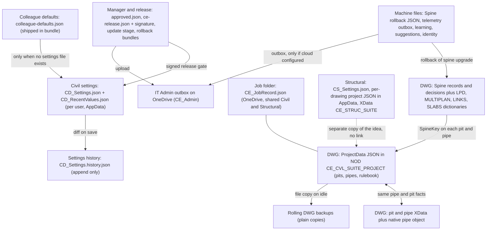

# FOUNDATIONS AUDIT (Phase 0, read-only) - 31 Oct 2026

Audited lines: Civil + Manager at installed commit 3fbb9da5 (origin/claude/rel-20261102a); Structural at installed commit 204dfad2 (origin/claude/rel-20261026s). Everything read with `git grep` / `git show` against those commits. No build, no test, no checkout, nothing written in any repo.

## FOR TIM

1. **Data schema: GAP (size L).** Civil settings carry a version label ("5.0") that nothing ever reads; Structural settings have none. Risk: an older CE opening a newer settings file silently drops the new settings the next time it saves.
2. **Proven restore: GAP (size M).** Settings saves are safe and a damaged file is copied aside (tested), and Manager rollback is well tested. Risk: the rolling drawing backups are plain file copies that nobody has proven will open, and no restore drill is recorded.
3. **Platform watch: GAP (size S to write, M to keep running).** CE builds for three platforms (net48, net8, net10) with no end-of-life list and no recurring check. Risk: a Windows, .NET, AutoCAD or package end date passes unnoticed until a drafter's AutoCAD stops loading CE.
4. **Access rules: GAP (size S to M).** Strong on release signing and the live bundle (a normal build can no longer overwrite it). Risk: any CE process can write any settings or project file, and one of the two hard blocks (deleting spine IDs) I could not find enforced.
5. **Alerts: GAP (size M).** A damaged settings file does warn on the command line. Risk: a failed drawing backup shows only in a hover tooltip, a failed Structural project-data load starts blank with only a trace line, and the fleet outbox fills with no one reading it.
6. **No dead data: GAP (size M).** About 13 of 534 Civil settings and 6 of 490 Structural settings have no live reader; the Structural XData upgrade path is written but never called. Risk: a drafter changes a setting on the Settings page that does nothing.
7. **My own mistakes:** the local branch name rel-20261102a points at 636d4a4d, not the installed 3fbb9da5, so I audited the installed commits directly; my first settings-name script returned nothing and was redone; all counts are text searches (not compiler-checked) and can be off by a few per cent.
8. **Fix first (S):** stamp CD_Settings.json and CS_Settings.json with a schema version, make both loaders compare it and keep unknown keys.
9. **Fix next (M):** one restore drill per store (settings, ProjectData, backup DWG, Spine rollback) with a written result.
10. **Fix next (S):** a one-page platform watch with dates and a monthly check (my memory says .NET 8 support ends 10 Nov 2026; not verified, no network).
11. **Fix next (M):** one "CE health" line covering backup failed, outbox unsent, project data failed to load.
12. **Fix (S each):** retire or wire the dead settings, the dead XData migrator and the unread fleet outbox.

## What exists today (diagram)

## 0. My own mistakes and limits (first, as asked)

1. **Branch name.** Local `claude/rel-20261102a` is 636d4a4d; the installed commit is `origin/claude/rel-20261102a` = 3fbb9da5. I used 3fbb9da5 and 204dfad2 throughout. Local `claude/rel-20261026s` is 90f2688e; installed is 204dfad2.
2. **First script wrong.** My first extraction of settings names returned 0 (bad pattern). Redone with awk; the numbers below come from the redone run.
3. **All counts are text searches.** The "empty catch" and "dead setting" counts are heuristics (see section 3), not compiler results. A setting read only by reflection or by a dotted string path would look dead; I checked case-insensitive names to reduce that.
4. **Scratch files.** I wrote helper scripts and line-count lists only in the session scratchpad, nothing in any repo.
5. **Not checked:** whether the CE Cloud environment variables are set on any PC; what is actually on Tim's disk; whether the Net8 lane builds; Autodesk and Microsoft support dates (no network); the Release Authority and signing code beyond headers and grep; every file's full content.
6. **Both shipping lines differ a lot.** Between 3fbb9da5 and 204dfad2: Shared/CE_SHARED has 58 .cs files on the Civil line and 13 on the Structural line; 1377 Drainage .cs files and 595 Structural .cs files differ. So "one fact in one place" already fails at repo level: each line carries a stale copy of the other product.

## 1. Inventory: what the plugin stores today

Each entry: writer, reader, key fields and units, schema version, points to.

1. **Civil settings file** `%APPDATA%\TIM_CE_CADTOOLS\CD_Settings.json` (SettingsService.cs:46-82). Writer: SettingsService (saved via a temp file then swapped in, SettingsService.cs:724, RememberedValues.cs:109). Readers: SettingsService; Manager's CommandOutcomeSetting.cs:14-45 reads it a second way (private field by reflection, then the file). 542 properties in UserSettings.cs; mm for plan sizes, 1-in-N for grades, mixed naming. Version: `Version = "5.0"` (UserSettings.cs:13) is written and never compared. It also holds office-folder paths that belong to one PC (SettingsService.FolderPaths.cs:8-14).
2. **Remembered values** `CD_RecentValues.json` (RememberedValues.cs). Same recent values are also written into CD_Settings.json on a Settings save or Reset (RememberedValues.cs:12-24): a deliberate second copy.
3. **Settings history** `CD_Settings.history.json` (SettingsHistoryService.cs:26). Writer: SettingsHistoryService on each save; reader: Settings window history. Fields: valueName, label, oldValue and newValue as text with units, who, whenUtc (SettingsHistoryEntry.cs). Append only. No id, no schema version; no size cap.
4. **Colleague defaults** `Assets/Config/colleague-defaults.json` (ColleagueDefaultsService.cs:55-100). Written by the build; read only when a PC has no settings file. Same shape as CD_Settings.json, no version. A mistyped key is silently ignored.
5. **Settings "bad" copies** `CD_Settings.bad-<stamp>.json` (SettingsService.cs:538-566). Written when a file cannot be read; never read back by CE; never pruned.
6. **ProjectData (the job record in the DWG)** NOD dictionary `CE_CVL_SUITE_PROJECT`, key PROJECT_DATA (ProjectDataStorageContract.cs:12-15). Writer/reader: ProjectDataService (many partial files). Pits, pipes, rulebook settings, ignored checks, approvals. Version "2.3" string, really checked (see 3.6). Unknown fields kept (ProjectData.cs ExtensionData).
7. **Pit and pipe XData + native pipe object** (PipeOverruleService.cs:376-400 PipeXData: Diameter, Material, FirstInvert, SecondInvert, Grade). Overlaps PipeData in item 6 (PitData.cs:310+).
8. **Spine records and decisions** NOD `CE_CVL_SUITE_SPINE`, keys RECORDS_V1 / DECISIONS_V1 (SpineRecordStore.cs:17-19). Own GUID key (SpineKey.cs), recordVersion, per-field provenance and authority, JSON schemaVersion int = 1 (SpineRecordJson.cs:75-87). Best-designed store in the repo.
9. **Other drawing dictionaries:** CE_CVL_SUITE_MULTIPLAN, _LINKS, _LPD, _MACROS, CE_CVL_SLABS, CE_CVL_SURVEY, CE_CVL_REPAIR_QUARANTINE, CE_CVL_NETWORK_REDESIGN. 49 files in Civil/Manager/Shared carry a schema marker (newer records mostly do).
10. **Spine rollback** `%APPDATA%\CE_CVL_SUITE\spine-rollback\*.json` (SpineRollbackStore.cs:44,87). File named from the drawing NAME and time. No cap.
11. **Telemetry outbox** `%APPDATA%\CE_CVL_SUITE\telemetry\outbox.jsonl` (TelemetryQueueService.cs:80). Writer: startup heartbeat (FleetTelemetryStartupService.cs). Reader: only a flush that needs CE_CLOUD_URL and CE_CLOUD_AUTH (TelemetryQueueService.cs:42-43, 131-160). Capped at 5 MB with 2 backups.
12. **Machine files:** learning (`what-ce-learned.json`), suggestions (`suggestions.jsonl`), install identity (`identity.json`), AI egress log (`ai-egress.ndjson`), messages, label styles, tank library, parts catalogue, job-time cache. Mostly no version, no created/updated stamps.
13. **Rolling drawing backups** (DrawingBackupService.cs:296-312). Plain `File.Copy` of the saved DWG, local-time name stamp, pruned by count and days. Not verified after copy.
14. **Job record** `<job folder>\CE_JobRecord.json` (Shared/CE_SHARED/Services/JobRecordService.cs). Shared by Civil and Structural; lives in the OneDrive job folder.
15. **Structural settings** `CS_Settings.json` (Structural SettingsService.cs:194-203, 623), legacy folder TIM_CE_CADTOOLS and a registry key as fallback (SettingsService.cs:68-72). No version. Unknown newer keys carried across by SettingsUnknownMembers.cs. Bad copies written (SettingsService.cs:397).
16. **Structural project data** JSON in AppData `projects\CS_ProjectData_<name>_<path hash>.json` (Structural ProjectDataService.cs:441-457). Not in the drawing. Bracing, bored piers, tie-downs. Dates as text ("PlacedUtc", "ChangedUtc"). Records point to drawing objects by AutoCAD handle (ProjectData.cs:131).
17. **Structural XData** app name CE_STRUC_SUITE, schema tag short = 1 (XDataSchemaService.cs:14-17, 54-58). Written in 5 places; the reader and migrator have zero callers (3.6).
18. **Manager / release:** `approved.json`, `ce-release.json` + `.sig` + summary, `ce-update-stage.json`, `install-metadata.json`, `manager-switches.json`, `manager-menu-state.json`, `ce-blocks-settings.xml`. Release files carry an int schemaVersion and an RSA signature (OfficialReleaseGate.cs:111-154). Rollback fields are signed (CeApprovedReleaseService.cs:123-148).
19. **Admin outbox** `%APPDATA%\CE_CADTOOLS\CE_Admin\...` (CeAppDataPaths.cs:12-35) and the OneDrive IT Admin folder (FeedbackService.cs). A second, separate telemetry path from item 11.

## 2. Facts stored twice, dead records, mixed units, ids, totals

### 2.1 Stored twice
1. **Pipe diameter, material, inverts** live in the pipe XData (PipeXData), in PipeData in the job record (PitData.cs:362-425), in the native pipe object, and on the label text. Design rule 2 says XData is truth and JSON is a rebuildable cache; the code treats the NOD JSON as the main store (ProjectData.cs summary of `slabs`: "authoritative store is the drawing NOD").
2. **Remembered values** in CD_RecentValues.json and CD_Settings.json (item 2).
3. **Telemetry** in two stores (item 11 and 19) plus OneDrive feedback.
4. **Job time** code exists as same-named files in Civil and Structural (JobTimeSession, JobTimeTracker, JobTimeStatusBarService), each with its own resume cache.
5. **Same-named files in two modules:** 27 file names appear in more than one of Drainage, Manager, Structural, Shared on the Civil line (SettingsService, LoggingService, ProjectDataService, UserSettings, LogFolderRedirect, ...).
6. **Settings read two ways:** Manager parses CD_Settings.json itself and reflects into Civil's private `_currentSettings` (CommandOutcomeSetting.cs:14-45). Rename either and the switch silently reverts to default.
7. **Tank facts:** a per-tank copy of the library figures (PitData.cs WaterTankFactsData, by design, so the drawing keeps its figures).
8. **Machine paths inside the transferable settings file** (SettingsService.FolderPaths.cs): papered over at load by moving paths onto this PC's profile.

### 2.2 Records with no live writer or no live reader
1. **Civil settings with no reader** (name found nowhere outside UserSettings.cs except tests; accessors checked): RememberSettings, PitScheduleWindowWidth/Height/Left/Top, PitScheduleColumnLayout, MeshSize, StorageMatchToleranceLitres, and the whole groups JobChecklist, CrossingServices, CouncilRfi, AnnotationOffsets, WindowPlacement. About 13.
2. **Explicitly retired and handled well:** MinDetentionPipeGradeRatio (UserSettings.cs:3059): "stays so an older settings file still loads".
3. **Structural settings with no reader:** A3TemplateDrawingPath, DrafterMovedToleranceMm, NearestPitTieToleranceMm, UsageCount, XrefScanColorIndex, XrefScanLinetypeContains (6 of 490).
4. **Structural XData upgrade:** `TryMigrate`, `NeedsMigration`, `ReadSchemaVersion` have 0 callers; `MigrationRegistry` is empty (XDataSchemaService.cs:20-24).
5. **Fleet heartbeat outbox:** written each start, read only if CE Cloud variables are set; source comment calls it "harmless dead weight" (FleetTelemetryStartupService.cs:20-23). Whether any PC has them set: UNKNOWN.
6. **`.bad-` copies, spine-rollback files, history file:** written, no reader that prunes, no cap.

### 2.3 Mixed units and styles
1. **Grade "1 in N" has three names:** MinimumPipeGrade = 200 (UserSettings.cs:2336), MinDetentionPipeGradeRatio = 200, LargeGravityMinGradeN. None says "1 in".
2. **29 of 118 numeric Civil settings have no unit in the name** (PipeTextHeight, TextOffset, InvertInwardDistance, MinimumPipeGrade, ...).
3. **Percent/fraction:** 5 "Percent", 2 "Ratio", 1 "Fraction" settings; StorageMatchTolerancePercent has a separate Fraction accessor (UserSettings.cs:3088-3099).
4. **Angles:** PitData has RotationRadians (double, :46) and DetentionRotation as text "0 deg" (:43); settings use "Degrees".
5. **Levels and dimensions as text:** CoverLevel, InvertLevel, FromInvert, ToInvert, Diameter, DetentionRequiredLength are strings (PitData.cs:52,142,422-425); plan dimensions are numbers in mm.
6. **Dates:** Civil non-test: DateTime.UtcNow 88, DateTime.Now 53, DateTimeOffset.UtcNow 32; ISO "O" 21; "yyyy-MM-dd" 45; day-first styles 4. A stored export date is local time with no offset (LinkCommands.ImportXcivil.cs:658). Pit cover-level date is a text field (PitData.cs:64).
7. **Units conversion:** 276 literal `* 1000` / `/ 1000` sites in 113 files versus 56 uses of named converters in 34 files. No single units policy class (units rules exist in Rules/SurveyDrawingUnitsRule.cs and MixedUnitsUserHoldRule.cs; INSUNITS appears 351 times).

### 2.4 Ids that are names or outside ids
1. **Pit and pipe Id are the visible label** ("P3"; PitData.cs:13). By Tim's rule the plan label is authority, so this is intended; the permanent id is the optional SpineKey (PitData.cs:205, PipeData SpineKey/FromSpineKey/ToSpineKey), which is a nullable string.
2. **EntityHandle** (PitData.cs:198) points at an AutoCAD handle that changes on copy or Xref.
3. **Spine rollback and Structural project data** are keyed by drawing NAME or a hash of the drawing PATH. Move, rename or SAVEAS a drawing and Structural's off-drawing record is not found; all unsaved Structural drawings share one file (`CS_ProjectData_unsaved.json`, ProjectDataService.cs:451).
4. **Outside ids:** ImportBatch, DesignFlowSource, CoverLevelSource are free text, not references.

### 2.5 Totals stored as facts
Mostly avoided: re-use litres "is total minus this, and is never stored (T-02)" (PitData.cs WaterTankFactsData). TotalLitres and DetentionLitres are library copies, not computed totals. LastPitNumber is a counter. I did not find stored schedule totals; not exhaustively checked.

### 2.6 Import versus user choice
Separated properly only in Spine (Observed / Human decision layers, SpineProvenance.cs, SpineAuthority.cs). In ProjectData it is by convention: Source text fields, "...OverrideActive" flags, "...AutomaticSeen / ...TypedSeen" fields (PipeData).

### 2.7 Append-only history
1. **Yes:** settings history, Spine decisions, Project Review approvals (ProjectData.cs), ignored checks with reason.
2. **No:** edits to pits and pipes overwrite in place; no change history for engineering records.

## 3. Measurements (commands and numbers)

Method: `git grep` / `git show` at 3fbb9da5 and 204dfad2, non-test files only unless stated. Scratch outputs were in the session scratchpad.

1. **Files over 800 lines.** Command: `git grep -c "" <ref> -- "*.cs"`, then keep counts above 800, drop paths containing "test". Civil line: 146 of 2122 source files (Drainage 99, Manager 4, Shared 2, the Structural copy 37); 30 test files also over. Structural line: 124 of 1513 (Structural 48, Drainage 68, Manager 3); 50 test files. Over 3000 lines: 11 on the Civil line. Largest: ExcelMTextService.cs 6177 (6509 on Structural line), UserSettings.cs 3838, ScheduleLinkService.cs 3903, OfficialReleaseGate.cs 3242. No CI file exists to enforce 800 (no `.github` at either commit).
2. **Swallowed or bare catches.** Command: `git grep -n -A3 catch <ref> -- "<module>/*.cs"` piped through a small awk that finds a catch followed by an empty block or only a comment. Civil line: Drainage 361 empty (204 one-line, 157 multi-line) of 2623 catches; Manager 97 of 314; Shared 34 of 139. Structural line: Structural 402 of 1868. Typeless `catch {` blocks (any body): 817 / 179 / 96 / 568. Heuristic, plus or minus a few per cent. Storage core is cleaner: Civil ProjectDataService 4 empty of 53, SettingsService 3 of 25, Spine 0 of 10, DrawingBackupService 0 of 9; Structural XDataSchemaService 3 of 3.
3. **Settings keys read but not defined / defined but not read.** Property names from UserSettings.cs (542 properties, 534 distinct); token counts of all other non-test Civil, Manager, Shared source. 25 names have zero references; after checking accessors about 13 are truly unread (2.2); 151 names are referenced exactly once. Structural: 490 names, 6 unread. Read but not defined: by-string reflection reads: Manager 3 in 1 file, Drainage 5; colleague-defaults.json keys not checked against the class (unknown keys silently ignored): count UNKNOWN. Settings page catalog (search and history labels) covers 114 of 542 values; history still records the rest with a fallback label (SettingsService.cs ~530).
4. **Hard-coded engineering numbers outside Settings.** Command: `git grep -E "(const|static readonly) (double|int|decimal) \w+ *= *-?[0-9.]+"`. Civil Drainage: 815, of which 719 in Services/Rules/Commands/Helpers (most are caps and tolerances; "Default..." ones such as DetentionPipeLimitsRule 40 m, 225, 600 and DetentionTwlSolver freeboard 150 mm probably back a setting: not traced). Structural: 476 outside Models. Clear settings-first breaks: Structural DesignCore MinedDefaults (pad spacing 1140 mm, column spacing 1450 mm, beam-end bearing 300 mm, MinedDefaults.cs:15-41) and BeamProposalEngine span limits 1000 to 9000 mm (BeamProposalEngine.cs:74-77): no matching Structural setting.
5. **Rounding.** Civil: 155 `Math.Round(` calls; 65 name AwayFromZero, 90 use the .NET default (banker's); 51 Floor/Ceiling; 101 `ToString("F/N#")`. The only helper, `MathHelper.RoundTo` (MathHelper.cs:236-239), is itself `Math.Round(value, decimals)` (banker's) and has 1 caller. Structural: 40 calls, 10 with a stated midpoint. Manager and Shared: 0.
6. **Where a schema version is checked, and what happens.**
   1. **Civil settings:** nowhere. `Version "5.0"` written, never read (zero hits for `.Version` on settings). Upgrades are once-only flags (OldStartingValuesMoved) and "value still equals old default" rules (SettingsService.cs:152-330). Newer file: unknown keys are dropped at the next save (no JsonExtensionData in UserSettings.cs; 0 matches). Older file: loads, missing keys take defaults; a bad value costs only itself (SettingsService.cs:760-860).
   2. **Structural settings:** no version; newer keys are carried across on save (SettingsUnknownMembers.cs).
   3. **Civil ProjectData:** string "2.3" (ProjectDataStorageContract.cs:15). Older: upgraded on next save, one log line. Newer: command-line warning plus log, higher marker kept, unknown fields kept (ProjectDataService.Persistence.cs:612-631, Mutations.cs:1977-1987, tests Bug1135JobRecordKeepsNewerFieldsTests).
   4. **Spine records:** int 1; newer is refused with a plain-English error (SpineRecordJson.cs:147-152). Only one version exists so no upgrade path has run.
   5. **Structural XData:** short 1; stored on 5 writers; checked nowhere (3 callers zero).
   6. **Release records:** int schemaVersion, signed (OfficialReleaseGate.cs:111).

## 4. Scores with evidence

1. **Data schema: GAP, size L.**
   - **Good:** Spine (own GUID id, recordVersion, provenance: SpineKey.cs, SpineRecordJson.cs:75-87); Civil ProjectData version check and unknown-field keeping (3.6); history is append only with whenUtc (SettingsHistoryEntry.cs).
   - **Missing:** schema version check for settings (3.6); id, createdAt, updatedAt, source on almost every record; units and rounding policy (2.3, 3.5); engineering records overwritten with no change history.
   - **Risk for a drafter:** a colleague on an older CE saves and quietly erases the newer settings.
2. **Proven restore: GAP, size M.**
   - **Good:** atomic save and bad-file copy are tested (Bug827Bug831SettingsFileSafetyTests, SettingsLoadRobustnessTests); Manager rollback has dozens of tests (CePairedRollbackTests 27 hits, CeRollbackReachesPcsTests 24); Spine upgrade atomicity tested (SpineUpgradeAtomicityTests).
   - **Missing:** drawing rolling backup is `File.Copy` with no check that it opens and no restore command or test found (DrawingBackupService.cs:302); no recorded restore drill for settings, ProjectData or old-drawing upgrade that I could find (CE_PLAN record: UNKNOWN).
   - **Risk:** the backup you need after a crash may be the one that was never opened.
3. **Platform watch: GAP, size S then M.**
   - **Facts:** three build lanes net48 / net8.0-windows / net10.0-windows (CE_CVL_SUITE.csproj:4); packages pinned exactly (ClosedXML 0.102.3 :194, System.Net.Http 4.3.4 :147, Newtonsoft.Json 13.0.4); no `NuGetAudit`, no dependabot, no `.github`, no end-of-life list in the repo. A 2022 crash was caused by AutoCAD loading the wrong lane (Installer/PackageContents.xml:3-8).
   - **UNKNOWN:** support end dates for AutoCAD 2022 to 2027, Windows, net48; signing key expiry (no expiry or rotation logic found in the release code). From memory, not verified: .NET 8 support ends 10 Nov 2026.
   - **Risk:** an end-of-life date passes and nobody notices.
4. **Access rules: GAP, size S to M.**
   - **Good:** a normal build can no longer overwrite the live bundle: direct deploy is an error target (CE_CVL_SUITE.csproj:379-385) and Structural errors if the staging folder is inside ApplicationPlugins (CE_STRUC_SUITE.csproj:334,348-353). Release is RSA-signed and verified (OfficialReleaseGate.cs), Release Authority checks file permissions (ReleaseCheckMatrix.cs imports AccessControl), Manager pins the CE_SHARED hash per lane (CE_SUITE_MANAGER.csproj:172-216). Tests redirect AppData (LogFolderRedirect in Civil, Manager and Structural; CE_STRUC_SUITE_APPDATA_ROOT).
   - **Gaps:** repo text (AGENTS.md) still says an ordinary build overwrites the live bundle; that is stale on both lines. No map of who may write which settings file; Manager reaches into Civil's private field (CommandOutcomeSetting.cs:24). Test redirect exists in three copies and one test run did truncate a real log (memory record). Hard block 1 (deleting spine IDs): enforcement UNKNOWN, I did not find it. Hard block 2 (update on failed build): Release Authority runs a build and test matrix before signing (ReleaseCheckMatrix.cs), read at header level only.
   - **Risk:** a tester or a stray process changes Tim's real settings without anything noticing.
5. **Alerts: GAP, size M.**
   - **Good:** a damaged Civil settings file queues a plain-English command-line warning (SettingsService.cs:315-330, 568-590); newer-schema drawing warns on the command line; Manager has a three-light status page (CeOneGlanceStatus.cs).
   - **Gaps:** backup failure goes to a log and a hover tooltip (DrawingBackupService.cs:313-315, PluginInitialization.cs:736); outbox failures go to a diagnostic line only (TelemetryQueueService.cs:154-160); Structural project data that fails to load starts blank with a Trace line (ProjectDataService.cs:47-52); Structural XData migration swallows its own errors (XDataSchemaService.cs:104-123); status page has no light for backups, outbox or stale data.
   - **Risk:** work looks saved and protected when it is not.
6. **No dead data: GAP, size M.** Evidence in 2.2. **Risk:** a drafter changes a Settings value and nothing in CE reads it. Positive: the retired detention grade value is documented and kept for old files.

## 5. Enforcement of the 12 design rules

Enforced today by a test that fails: only the module dependency rules (Arch01_Shared_DependsOnNoModule, Arch02_Manager_DoesNotUseCivilOrStructural, Arch03_Civil_DoesNotUseManagerOrStructural in ArchitectureRulesTests.cs:28-44) and the command-registry tests (CivilRegistryCompletenessTests, CrossRuntimeCommandParityTests in Tests/CE.CommandTruth.Tests). No CI file exists at either commit (UNKNOWN whether the desk runs a gate outside the repo).

1. **One code path:** partly (command registry tests). Otherwise prose; 27 duplicated file names, two telemetry stores.
2. **XData is truth, JSON a cache:** prose only; no test found.
3. **Immutable block masters:** partly; PitBlockMigrationService records a master SHA256, but I found no test that fails if a master is rewritten.
4. **Reactors never read DBObjects:** prose; no test found.
5. **Fail loud / no bare catch:** prose; roughly 890 empty catches (3.2).
6. **Cleanup mirrors creation:** prose; per-bug tests only; UNKNOWN in general.
7. **Convert units once:** prose; 276 literal sites.
8. **One rounding helper:** prose; the helper is not used and is banker's (3.5).
9. **UI-thread discipline:** partly; CeUiThreadTests tests the helper; no scan for resource lookups at construction.
10. **800-line limit in CI:** not enforced; 146 and 124 files over.
11. **A test must fail when the bug exists:** partly; ArchitectureCanaryTests prove the dependency rule fails loudly (DependencyRule_CatchesABadReference, DependencyRule_ThatMatchesNothing_FailsLoudly, :24,34); the Claude-accepted rule in RULES.md adds a broken-variant check as process.
12. **Nothing done until driven in AutoCAD:** process rule (RULES.md 4.5 and 13.3, robot plus Codex ledger), not a CI check.
