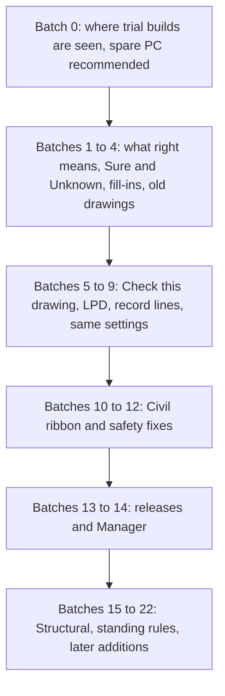

# Questions for Tim: every open decision in the trust plan, in one place

**Status: QUESTIONS ONLY, none answered.** Written Fri 13 Nov 2026 from 00:45 PC clock by chat CE_ACAD / trust plan / plan / 02 (lane trust-struc-mgr-plan). Nothing here is a decision. Where a builder has already built something on the recommended answer, the question says so; your answer replaces that draft.

**Gathered from:** `areas\TRUST_PLAN_INTERVIEW_12NOV.md` (sections B, C to J), every "Decisions for Tim" in the cards UX-OPEN-01, TRUST-02 to TRUST-08, TRUST-S1 to S3, TRUST-M2 and TRUST-M4, the Civil and Structural sorts, the Structural and Manager plans, the release process draft, the reader design, the "defaults taken for Tim" in every lane file in `areas\trust-run\`, and the questions raised in `areas\trust-run\reviews\`. Repeats were merged; each question names where it came from.

**Already answered, so not asked:** A1 to A4, B1, B4 (the LPD is the start point), B5 (nothing changes on open), the opening line's three decisions, the save reminder and backup copies (your decision 223), where the old blocks are ("on my work pc").

---

# FOR TIM

**87 questions in 23 batches. Batch 0 is the one the run is waiting on now: where trial builds may be seen in real AutoCAD (recommended: the spare work PC). Then the batches that change the most about what gets built; layout and wording come later, and batches 18 to 20 were added on 13 Nov. Each has the recommended answer first, so ticking the first box on every question is the "go with the recommendations" route.**

**How each question reads:**

1. **Context:** one line.
2. **Recommended:** the answer, and why.
3. **On a job:** what it means on a real drawing.
4. **Options:** two to four boxes; the first is the recommendation.
5. **Draft built:** whether a builder has already built the recommended answer as a DRAFT (switch off, nothing installed).

---

## Batch 0: the one question the run is waiting on now (added 13 Nov, 01:50 PC clock)

**Q0. Where may trial builds be seen in real AutoCAD?** (Controller, 13 Nov; evidence `trust-run\EVIDENCE_BRANCHES.md` FOR TIM item 5 and `trust-run\HOW_TO_SEE_TRIAL_BUILDS.md`.) Draft built: not applicable. **Recommendation changed 13 Nov, about 02:50:** the controller first recommended overnight installs on your PC, then changed its mind on the evidence in `HOW_TO_SEE_TRIAL_BUILDS.md`.
1. **Context:** the trial builds are built and unit-tested, but the opening line, Edit Pit's line, every window, the ribbon, what one U does on the new builds and all the Structural fixes can only be seen with the build loaded in real AutoCAD. On your own login that means installing it, because AutoCAD loads your installed CE first. The AutoCAD core console already loads trial builds safely, but it has no ribbon, no windows and nothing that happens when a drawing opens. The virtual machine test station never got past set-up (last entry 24 Sep).
2. **Recommended:** (a), the spare work PC. It is your own ruling D5 of 17 Oct (`decisions\2026-10-17_V3_ALIGNMENT_RESET.md`: "a separate work PC (no purchase) for AutoCAD testing") and your 29 Oct words, "on the other one testing all day". It gives a real AutoCAD with windows and the ribbon, all day, and your own PC is never touched.
3. **What each costs you:**
   1. **(a) The spare work PC:** about 30 minutes of yours, once, pasting `04_REFERENCE\TEST_PC_START_PROMPT.md` into Claude on that PC, and the PC left on and awake at work. You said on 29 Oct you could not do it then.
   2. **(b) Your own PC overnight:** the robot installs a trial build only between 5:30pm and 8:10am, tests on copies, and puts back exactly Civil 3.0.90, Manager 1.1.89 and Structural 1.0.126, checked file by file, before 8:10am. Nothing from you. Cost: it is the one choice that touches your bundle, and a mistake costs you a morning. It also needs your word again, because of the 5 Nov HOLD, although your 30 Oct ruling said "you can install anything on my pc at your free will as long as im not at my desk".
   3. **(c) The AutoCAD 2026 laptop you offered on 29 Oct:** whose laptop, its login and Autodesk sign-in, and when it can stay on; nobody has assessed it, and it is a different AutoCAD year, so a first look, not the 2027 proof.
   4. **(d) Not yet:** no risk. Cost: nothing that needs real AutoCAD can be offered to you for a trial.
4. **On a job:** under (a), you open AutoCAD at 8:30am exactly as always; the spare PC has already shown the trial opening line on copies overnight and through the day.
5. **Options:** [ ] (a) The spare work PC; I give it 30 minutes once (Recommended) [ ] (b) My own PC, 5:30pm to 8:10am, put back and checked [ ] (c) The 2026 laptop [ ] (d) Not yet

## Batch 1: what "right" means for the test jobs

**Q1. How many Unknowns may one test job have before the reader has failed it?** (Interview B3.) Draft built: no.
1. **Context:** you ruled zero wrong values on all 10 jobs, Unknowns allowed; the limit is not set.
2. **Recommended:** no fixed number; every Unknown must be one you agree the drawing really does not show. Because a number can be met by hiding the hard items.
3. **On a job:** a job with 40 pipes and 6 Unknown sizes passes if those 6 pipes have no size written anywhere on the drawing.
4. **Options:** [ ] Only Unknowns I agree with (Recommended) [ ] At most 5 per job [ ] At most 10% of items

**Q2. Which 10 past jobs make the test set?** (Interview B2.) Draft built: five made-up jobs only.
1. **Context:** the plan needs about 10 real past jobs, messy ones included; no client name or address goes in any file.
2. **Recommended:** you pick them at your PC from a short list the plan chat prepares by type (old LISP-era, early plugin, hand-drawn, current, a revision). Because only you know which ones were trouble.
3. **On a job:** a hand-drawn job with no CE tools at all is one of the ten.
4. **Options:** [ ] I pick from a prepared list by type (Recommended) [ ] I name ten job numbers myself [ ] Start with five, add five later

**Q3. Where do the right answers for each test job come from?** (Interview J2.) Draft built: no.
1. **Context:** each test job needs an answer sheet the robot compares against.
2. **Recommended:** the labels on the plan, or a print you mark up; not the old Pit Schedule. Because the old schedule may carry the same guesses being tested.
3. **On a job:** pit P4's invert is taken from its plan label, even if the old schedule says something else.
4. **Options:** [ ] Plan labels or my marked print (Recommended) [ ] The old Pit Schedule [ ] Both, and differences flagged

**Q4. Which steps need your own three-day trial?** (Interview J4.) Draft built: no.
1. **Context:** the steps add up to about ten three-day trials of your drafting time.
2. **Recommended:** your trials for steps 4, 6 and 8 only (safety fixes, guesses removed, Check this drawing); robot and Codex accept the rest. Because those three change drawings; the others change what you see.
3. **On a job:** the opening line (step 1) goes in on the robot and Codex alone.
4. **Options:** [ ] Steps 4, 6 and 8 only (Recommended) [ ] Every step [ ] Grouped as now: steps 1 to 3 share one trial, 4 to 8 one each

## Batch 2: what counts as Sure, Proposed and Unknown

**Q5. What makes an item "Sure" in Check this drawing?** (Review of TRUST-08, FIX FIRST 1.) Draft built: no.
1. **Context:** the card calls an item Sure when CE's stored identity matches; copied and Save-As pits also carry that identity.
2. **Recommended:** Sure only when the identity is found, used once in the drawing, and the stored values agree with the drawn label. Anything else is Proposed. Because otherwise a pit copied from another job looks Sure.
3. **On a job:** pit P3 copied from last year's job, with a different label, shows as Proposed, not Sure.
4. **Options:** [ ] Identity once, values agree (Recommended) [ ] Identity alone, as the card says

**Q6. What may be ticked all at once on an old job?** (Interview J1, review of TRUST-08.) Draft built: no.
1. **Context:** Check this drawing lists proposals; one Apply could turn many guesses into facts.
2. **Recommended:** tick-all for links only; sizes, levels and pit numbers ticked one by one, and nothing pre-ticked. Because a wrong size or level is the fault that reaches council.
3. **On a job:** 30 proposed pipe-to-pit links ticked in one click; 12 proposed sizes ticked one at a time.
4. **Options:** [ ] Links all at once; sizes, levels, numbers one by one (Recommended) [ ] Everything may be ticked at once [ ] Everything one by one

**Q7. How does Unknown look?** (TRUST-06 decision 2, review of TRUST-06 item 5.) Draft built: no.
1. **Context:** a value CE does not know shows as Unknown; the question is where the "?" appears.
2. **Recommended:** nothing drawn on the plan; "?" in the schedule window and the check list; before a schedule is placed, CE warns "3 pipes have no size; the schedule will show ?" and lets you carry on. Because a "?" should never reach a council print by accident.
3. **On a job:** a pipe with no size has no size label on the plan until you give it one.
4. **Options:** [ ] Nothing on the plan, "?" in windows, warn before placing (Recommended) [ ] A visible "?" label on the plan too

**Q8. Two labels or two pits within reach: which one?** (TRUST-06 decision 4, earlier ruling CV8-7.) Draft built: yes, in the reader (draft pull request 2040).
1. **Context:** today CE takes the nearer of two.
2. **Recommended:** Unknown, listing both, rather than the nearer. Because "nearer" was how labels ended up on the wrong pit.
3. **On a job:** an invert label halfway between P2 and P3 shows "Unknown: could be P2 or P3".
4. **Options:** [ ] Unknown, show both (Recommended) [ ] The nearer one

## Batch 3: values CE fills in today (engineering, your word)

**Q9. A pipe with no size or material.** (TRUST-06 decision 1, review of TRUST-06 item 1, code facts A.) Draft built: yes, behind a "Show Unknown" switch that ships OFF (draft pull request 2049, step 6); with it off nothing changes. Same for Q10 to Q12.
1. **Context:** today CE fills "100" and "UPVC", CDPROPAGATE assumes 225 (which feeds invert levels), Edit Pipe saves 100 and UPVC when you press OK, and the flow calculator keeps 300 or the last size.
2. **Recommended:** Unknown everywhere; CDPROPAGATE asks for the size instead of assuming 225; Edit Pipe opens with the boxes blank. Because each of these can turn into a wrong level or size on a sheet.
3. **On a job:** a line on the pipe layer with no text reads "size Unknown" and CDPROPAGATE stops at it and asks.
4. **Options:** [ ] Unknown everywhere (Recommended) [ ] Keep 100 and UPVC but mark them "assumed" [ ] Keep today's fill-ins

**Q10. A pit's lid class and pit type when CE did not place the pit.** (TRUST-06 decision 1.) Draft built: no.
1. **Context:** today the lid becomes "Class C" from the Settings of whoever opens the drawing, and the type becomes "grated pit".
2. **Recommended:** both Unknown for a pit CE did not place; Edit Pit leaves a blank lid blank. Because the same drawing should not change with who opens it.
3. **On a job:** an old hand-drawn pit shows lid "?" until you set it.
4. **Options:** [ ] Unknown (Recommended) [ ] Keep Class C and grated pit as defaults

**Q11. A pit with no number, and a pipe with no proven flow direction.** (TRUST-06 decision 1.) Draft built: no.
1. **Context:** today a pit with no label gets the next free number (or an internal code), and the order a line was drawn decides which end is upstream.
2. **Recommended:** pit number Unknown and never drawn until you give one; flow direction Unknown, with the drawn order offered as a proposal and its reason. Because a made-up number or a reversed pipe changes the whole schedule.
3. **On a job:** a pit with no label shows as "?" in the check list, and the pipe into it shows "direction proposed from drawing order".
4. **Options:** [ ] Both Unknown, drawn order as a proposal (Recommended) [ ] Number Unknown, keep drawn order for direction [ ] Keep today's behaviour

**Q12. A blank pit invert taken from the lowest connected pipe.** (TRUST-06 decision 3.) Draft built: no.
1. **Context:** today a blank pit invert silently takes the lowest pipe invert.
2. **Recommended:** keep it, but marked "worked out from the pipes" and reported in the record line. Because it is usually right and is a sound drafting rule, as long as it is visible.
3. **On a job:** P5 shows "IL 1.20 (worked out from pipe P5-P6)".
4. **Options:** [ ] Keep, marked as worked out (Recommended) [ ] Unknown until I confirm

## Batch 4: reading old and hand-drawn drawings

**Q13. A plain line on a pipe layer with no CE data.** (TRUST-06 decision 5, reader design decision 1, earlier ruling CV8-10.) Draft built: two drafts disagree. The reader (draft pull request 2040) offers it as "possible pipe, Proposed"; the step 6 draft (pull request 2049, switch off) still adds it to the record with Unknown size and material. Your answer settles both.
1. **Context:** old LISP-era and hand-drawn jobs have pipes that are just lines on a layer.
2. **Recommended:** listed as "possible pipe" in Check this drawing, not added to the record until you tick it. Because a layer alone is not proof (your earlier ruling).
3. **On a job:** a hand-drawn job shows "22 possible pipes" for you to confirm.
4. **Options:** [ ] Possible pipe, ticked by me (Recommended) [ ] A pipe with Unknown size straight away [ ] Ignored

**Q14. A pipe's drawn width used as its size.** (Reader design decision 2.) Draft built: yes, 0.5 mm match (draft pull request 2040).
1. **Context:** some old pipes show their size only by their drawn width.
2. **Recommended:** Proposed when the width, converted to millimetres, matches a size in your list within 0.5 mm; otherwise Unknown. Because a width is evidence, not proof.
3. **On a job:** a 0.225 wide line in a metre drawing proposes "225, from drawn width".
4. **Options:** [ ] Proposed when it matches a listed size (Recommended) [ ] Never use the width [ ] Treat it as Sure

**Q15. A drawing whose units were never set.** (Interview J6, review of TRUST-06 item 3, reader default.) Draft built: the reader assumes millimetres (draft pull request 2040).
1. **Context:** many old drawings have no units set; CE treats them as millimetres, so a metre drawing gets reaches 1000 times too long.
2. **Recommended:** CE asks once, "Is this drawing in millimetres or metres?", and stores the answer in the drawing. Because guessing wrong here breaks every distance check.
3. **On a job:** an old LISP job asks once on first check, and never again.
4. **Options:** [ ] Ask once, store in the drawing (Recommended) [ ] Assume millimetres and say so in the check [ ] Work it out from the drawing's size

**Q16. The reader's reaches and text rules.** (Reader defaults 1 to 9 and 29 in `trust-run\trust-reader.md`.) Draft built: yes, all as DRAFT (draft pull request 2040).
1. **Context:** the reader needs fixed distances to match text to objects, the same on every PC.
2. **Recommended:** a pit label block counts within 5000 mm of its pit (CE's own starting figure), plain pit number or level text within 2000 mm, old pipe text within 1000 mm of its pipe, invert text within 1500 mm, "DP" text within 1000 mm of a downpipe block is its label, a drawn width within 0.5 mm of CE's standard size list (100 to 1500) counts as that size, downpipe blocks known by DP, DOWNPIPE, RWDP or RWP in the name, only CE's own layer names read until the office setup carries renamed ones, and the old LISP pipe-text pattern alone decides (layer not required). All from the office setup, never a person's own settings. Because those match how the office labels.
3. **On a job:** an "IL 1.10" text 1.8 m from the nearest pipe end is not matched to it.
4. **Options:** [ ] Accept these, from the office setup (Recommended) [ ] Change the numbers (write them in)

## Batch 5: Check this drawing

**Q17. Do CDSYNC and CDREBUILD stay as typed commands?** (Interview C1 and J5, TRUST-08 decision 1, ruling UX-REP-01.) Draft built: no.
1. **Context:** your 25 Sep ruling keeps them as direct typed commands.
2. **Recommended:** they stay typed and direct for you until Check this drawing's write part is accepted; a colleague who types one sees one line pointing to Check this drawing, then it carries on. Because nothing you rely on is taken away early.
3. **On a job:** you type CDSYNC as today; a colleague sees "Check this drawing does this with a preview" first.
4. **Options:** [ ] Typed for me, one pointer line for colleagues (Recommended) [ ] Unchanged for everyone [ ] Removed once the door exists

**Q18. An everyday tool on a drawing that "needs checking".** (Interview C2, TRUST-08 decision 2.) Draft built: no.
1. **Context:** the opening line may say a drawing needs checking; you may still draw a pit straight away.
2. **Recommended:** the tool carries on with what CE knows and says "needs checking" once; it never blocks. Because no hard blocks is your rule.
3. **On a job:** PIT places a pit and prints "This drawing needs checking (3 pipes not linked)".
4. **Options:** [ ] Carry on, say it once (Recommended) [ ] Ask first each time

**Q19. What one Apply may change.** (Interview C3, TRUST-08 decision 3.) Draft built: no.
1. **Context:** one Apply can change many things at once.
2. **Recommended:** only what you ticked, in one step, one U; upgrading an old drawing is always its own Apply, never mixed with link fixes. Because then one U takes back exactly one kind of change.
3. **On a job:** you fix links, check them, then do the old-pipe upgrade as a second Apply.
4. **Options:** [ ] Ticked items only; upgrade separate (Recommended) [ ] Everything ticked, in one go

**Q20. Unsaved changes before Apply.** (TRUST-08 decision 4.) Draft built: no.
1. **Context:** Apply makes a backup of the last saved file first.
2. **Recommended:** warn and allow: "Unsaved work since 10:42 is not in the backup. Carry on?" Because CE never saves for you.
3. **On a job:** you press Apply after 20 minutes of drawing; CE warns, you choose.
4. **Options:** [ ] Warn and allow (Recommended) [ ] Save first, then apply

## Batch 6: the LPD as the start point

**Q21. No LPD drawn yet.** (Interview J8, TRUST-07 decision 2.) Draft built: in the test cases only.
1. **Context:** CE needs the start point to number and solve.
2. **Recommended:** CE asks you to place or pick the LPD point; it never offers the lowest pit as a stand-in. Because a stand-in is a guess shown as fact.
3. **On a job:** CDRENUMBER on a new job asks "Pick the LPD".
4. **Options:** [ ] Ask for the LPD (Recommended) [ ] Offer the lowest pit as a proposal

**Q22. Esc at the LPD question.** (Interview J9, TRUST-07 decision 3.) Draft built: in the test cases only.
1. **Context:** a tool needs the LPD and you press Esc.
2. **Recommended:** the tool carries on as today with one line, "LPD not confirmed, order may differ". Because nothing should stop.
3. **On a job:** the Pit Schedule is still made, in today's order, with the warning line.
4. **Options:** [ ] Carry on with a warning (Recommended) [ ] Stop the tool

**Q23. A job with two LPDs.** (Interview B4 remainder, TRUST-07 decision 4.) Draft built: in the test cases only.
1. **Context:** some jobs have two networks with two discharge points.
2. **Recommended:** each network has its own LPD, confirmed once; CE tells them apart by which pits and pipes drain to each. Because that matches two council connections.
3. **On a job:** front and rear networks each number from their own LPD.
4. **Options:** [ ] One per network (Recommended) [ ] One per drawing, the rest by hand

**Q24. CDRENUMBER with no outlet pipe, and the marker.** (TRUST-07 decisions 5 and 6, BUG-1237.) Draft built: in the test cases only.
1. **Context:** CDRENUMBER stops with no help when no pipe leaves the network; the confirmed LPD could also get a marker.
2. **Recommended:** CDRENUMBER asks for the LPD instead of stopping; the LPD callout you already draw is the marker, nothing extra drawn. Because no new clutter on the plan.
3. **On a job:** CDRENUMBER on a part-drawn job asks for the LPD and carries on.
4. **Options:** [ ] Ask for the LPD; no extra marker (Recommended) [ ] Ask, and draw a marker too

## Batch 7: CE's record changes made visible (step 5)

**Q25. Which tools stop changing the record now.** (TRUST-05 decision 1.) Draft built: yes (draft pull request 2045).
1. **Context:** CE Health, CDGRAPH, CDDIAG and the dashboard change CE's record although they say they only read.
2. **Recommended:** those four stop now; everyday tools keep updating (with a line) until Check this drawing. Because that removes the surprise without breaking everyday tools.
3. **On a job:** opening CE Health changes nothing.
4. **Options:** [ ] The four read-only tools now (Recommended) [ ] Every tool now

**Q26. CDRECOVERINVERTS's hidden first step.** (TRUST-05 decision 3, interview I.) Draft built: yes, removed (draft pull request 2045).
1. **Context:** it runs the record update first, which fills a missing size with 100 just before checking whether the size is known.
2. **Recommended:** remove that step; it works from the stored record and refuses a pipe whose size is not known. Because otherwise it recovers inverts from a made-up size.
3. **On a job:** a pipe with no size is skipped with "size not known".
4. **Options:** [ ] Remove it (Recommended) [ ] Keep it

**Q27. What the record line says.** (TRUST-05 decision 2, review of TRUST-05 finding 1, foundations defaults.) Draft built: yes (draft pull request 2045).
1. **Context:** one line on the command line when CE changes its record.
2. **Recommended:** one line, naming the tool, counting additions and removals AND every guess ("2 sizes filled in as 100, 1 pit given a stand-in number"); no window, no sound. Because the guesses are what you most need to see.
3. **On a job:** "CE updated its record (PIT): 1 pit added, 1 pipe size filled in as 100."
4. **Options:** [ ] One line with the guesses counted (Recommended) [ ] One line, additions and removals only [ ] A window

**Q28. The Pit Schedule writing a drawn pipe size back into the record when it opens.** (Review of PR 2045 item 6, foundations default.) Draft built: yes, with no line (draft pull request 2045).
1. **Context:** opening the Pit Schedule writes a drawn size into CE's record and says nothing.
2. **Recommended:** say it in the same one line as everything else. Because the step promises a line for every record change.
3. **On a job:** opening the schedule prints "CE updated its record (Pit Schedule): 2 pipe sizes read from the drawing."
4. **Options:** [ ] Say it in a line (Recommended) [ ] Leave it silent [ ] Stop the write-back

## Batch 8: the same settings for everyone

**Q29. Which values become the office setup?** (TRUST-03 decision 1.) Draft built: the empty office file only (draft pull request 2043).
1. **Context:** your PC's values become the office setup (your earlier ruling: colleagues get your exact setup); about 570 values.
2. **Recommended:** you review only the values that differ from what colleagues start with today. Because 570 is too many to read.
3. **On a job:** you see a list of about 30 differences, each in plain words.
4. **Options:** [ ] Only the differences (Recommended) [ ] All 570 [ ] None, take my PC as it is

**Q30. A colleague's own changes at each release.** (Interview D1, TRUST-03 decision 2.) Draft built: yes, replaced after they press Apply (draft pull request 2043).
1. **Context:** a colleague may have changed office values.
2. **Recommended:** replaced at each release after they press Apply, with their old file kept beside it. Because one office setup is the point.
3. **On a job:** a colleague's changed label height goes back to the office value; their old file is kept.
4. **Options:** [ ] Replaced after Apply, old kept (Recommended) [ ] Kept unless they choose to replace

**Q31. Finished features that are switched off: do any come on?** (Interview D2 and J7, TRUST-03 decision 3.) Draft built: no.
1. **Context:** ten finished features are off (pipe ends joining within 75, moved labels staying put, natural Pit Schedule order, and others); some are on in your own trial.
2. **Recommended:** none come on in this step, and your own trial switches are left out of the office setup; each feature joins later as its own trial. Because each one changes what a tool does.
3. **On a job:** a colleague's Pit Schedule order stays as today even though yours is natural order.
4. **Options:** [ ] None now; my trial switches left out (Recommended) [ ] Turn on the ones I use [ ] Turn on all ten

**Q32. Remembered last-used values.** (Interview D3, TRUST-03 decision 4, review of PR 2043.) Draft built: asked for by the review of draft pull request 2043 (levels kept personal); whether the builder has made that change is not confirmed.
1. **Context:** CE remembers last-used values; a cover level once carried into another job (BUG-743).
2. **Recommended:** a level is never carried from one drawing into another; sizes and materials may still be remembered. Because a carried level is a wrong value shown as fact.
3. **On a job:** opening a new job, the cover level box is blank; the pipe size box still shows 150.
4. **Options:** [ ] Levels never carried; sizes may be (Recommended) [ ] Nothing remembered [ ] Everything remembered, as today

## Batch 9: settings details and small defaults already built

**Q33. Manager's own switches in the office setup.** (TRUST-03 decision 5.) Draft built: no.
1. **Context:** Manager's switches (roll back shown, and others) sit in a file on each PC that anyone can edit.
2. **Recommended:** carried in the office setup too. Because Manager should behave the same on every PC.
3. **On a job:** a colleague cannot switch Roll Back on for themselves.
4. **Options:** [ ] In the office setup (Recommended) [ ] Leave them per PC

**Q34. The opening line's small defaults.** (Lane trust-foundations, built in draft pull request 2041.) Draft built: yes.
1. **Context:** eight small choices made while building step 1.
2. **Recommended:** accept them: no count above 50,000 objects until the timing probe sets the limit; no line for a drawing with no pits, tanks or pipes; tanks with no object count with pits; a pipe counted once; the line waits at most 5 seconds; it names CDCHECKCURRENT as the card words it. Because each follows the approved card.
3. **On a job:** a large site plan opens with no line rather than a slow count.
4. **Options:** [ ] Accept all eight (Recommended) [ ] I want to change some (say which)

**Q35. Plastic pits left off the schedule: how loud is the note?** (Reviews of BUG-1274.) Draft built: yes, but NOT as recommended here: the BUG-1274 draft (pull request 2039) still shows unnumbered plastic pits in the attention colour (DRAFT default, lane trust-safety-fixes 01:18).
1. **Context:** the schedule will say which pits it left out under your plastic pit rule.
2. **Recommended:** numbered pits left out get the attention line; unnumbered plastic pits are a quiet count; pits marked To be removed are not counted as left out. Because a line that shows on every job gets ignored.
3. **On a job:** "6 numbered pits are not scheduled: P3 to P8" in colour; "4 unnumbered plastic pits" in plain text.
4. **Options:** [ ] Numbered loud, unnumbered quiet (Recommended) [ ] All in the attention colour

**Q36. Overflow and front overflow splitting the pipe they sit on.** (Lane trust-tool-notes, question raised 13 Nov.) Draft built: no.
1. **Context:** placing OF or FO on a pipe splits that pipe today, and the tool notes could not find this written down as intended.
2. **Recommended:** keep the split, and say so in one line ("OF split pipe P4-P5 in two"). Because a hidden change breaks the trust rules, but the split itself may be what you want.
3. **On a job:** placing FO on a run prints the split line, and one U takes both back.
4. **Options:** [ ] Keep the split, say it in a line (Recommended) [ ] Never split [ ] Ask each time

## Batch 10: the Civil ribbon (part 1)

**Q37. New Job at the left end of CE Drainage.** (Interview F3, Civil sort question 3.) Draft built: yes, on AutoCAD 2027 only (draft pull request 2038).
1. **Context:** New Job can only be typed today; it is the nearest thing to a front door.
2. **Recommended:** yes, at the left end, before pits. Because every job starts there.
3. **On a job:** a colleague starts a new job from the first button.
4. **Options:** [ ] Left end (Recommended) [ ] Typed only

**Q38. Where four tools sit.** (Interview F4 to F7, Civil sort questions 4 to 7.) Draft built: yes, as the sort proposes (draft pull request 2038).
1. **Context:** spot levels, long section, downpipe destinations, CDRENUMBER and CDEDIT each have two possible homes.
2. **Recommended:** as the sort has them: spot levels with pipes; long section with schedules; downpipe destinations in CE Design; CDRENUMBER and CDEDIT with pits. Because that is the order you draft.
3. **On a job:** the long section button sits beside the Pit Schedule.
4. **Options:** [ ] As the sort has them (Recommended) [ ] I will move some (say which)

**Q39. Buttons with an open fault that can lose or hide data.** (TRUST-02 decision 4.) Draft built: yes, Floor Waste and Pit Schedule off (draft pull request 2038).
1. **Context:** CDFW (cancel clears pit inverts) and the Pit Schedule (plastic pits left out silently, Excel fault) have open faults.
2. **Recommended:** off the ribbon until step 4 fixes them; cosmetic faults (FO symbol text) stay on with a note. Because those two can lose or hide a value.
3. **On a job:** a colleague types PITSCHEDULE if they need it; the button comes back once fixed.
4. **Options:** [ ] Data faults off, cosmetic on (Recommended) [ ] All on with notes [ ] All faulty tools off

**Q40. Which CE tools count as "useful in all drawings"?** (Interview F12, TRUST-02 decision 6, your 7 Nov words.) Draft built: no.
1. **Context:** you said "some of the commands are useful in all drawings as ce tools"; the list was never written.
2. **Recommended:** the CE Tools tab as it is (CE Blocks, Move + Rotate, Copy + Rotate, version, health, support), plus CLEAN, level marks and the text tools. Because those carry no drainage meaning.
3. **On a job:** on a Structural drawing you still have CE Blocks and Move + Rotate.
4. **Options:** [ ] The CE Tools tab plus CLEAN, levels, text (Recommended) [ ] Only the CE Tools tab [ ] I will list them

## Batch 11: the Civil ribbon (part 2)

**Q41. Structural during the Civil work.** (Interview F8 and J10, TRUST-02 decision 5.) Draft built: yes, Structural unchanged (draft pull request 2038).
1. **Context:** the talk named two Civil tabs; Structural follows Civil.
2. **Recommended:** Structural stays a third tab, unchanged, and colleagues keep their current Structural version in the first Civil release. Because one product changes at a time.
3. **On a job:** a colleague's Structural tab looks exactly as it does now.
4. **Options:** [ ] Unchanged third tab, same version (Recommended) [ ] Cut down together with Civil

**Q42. Preset pit sizes: do you type them?** (Interview F9, Civil sort question 9.) Draft built: no.
1. **Context:** the preset pit size commands may be dropped from the ribbon.
2. **Recommended:** typed only, no buttons, if you type them. Because the pit window already offers sizes.
3. **On a job:** typing a preset pit name still works.
4. **Options:** [ ] Typed only (Recommended) [ ] Buttons on the ribbon [ ] I never use them

**Q43. CDCHECKDWG, PITDELETE and CDBREAK.** (Interview F10 and F11.) Draft built: no.
1. **Context:** the consultant drawing check, and the pit delete and pipe break tools, could be everyday tools or repairs.
2. **Recommended:** CDCHECKDWG on the ribbon only if you use it on real jobs; PITDELETE and CDBREAK typed only, as repairs. Because the core shows daily tools.
3. **On a job:** a colleague types CDBREAK when they need it.
4. **Options:** [ ] CDCHECKDWG on if used; the other two typed (Recommended) [ ] All three on [ ] All three typed

**Q44. Tab order, pop-up tabs and one Checks button.** (TRUST-02 decisions 2, 3 and 7.) Draft built: yes (draft pull request 2038).
1. **Context:** three layout choices on the Civil tabs.
2. **Recommended:** CE Drainage, CE Design, Structural, CE Tools in that order; keep the pop-up tabs when you pick a pipe, pit or source; one "Check this drawing" button instead of three check buttons. Because CDEDIT on pick is your most used action and three checks confuse.
3. **On a job:** picking a pipe still shows its pop-up tab.
4. **Options:** [ ] All three as recommended (Recommended) [ ] I want to change one (say which)

## Batch 12: safety fixes (step 4)

**Q45. One small safety build or several.** (TRUST-04 decision 1, TRUST-S2 decision 3.) Draft built: no.
1. **Context:** each fix is lifted out of the held builds and proven alone first.
2. **Recommended:** the Civil fixes go on your PC as one small build after each passed alone; the Structural fixes as a second build later. Because two installs one after the other can wipe each other.
3. **On a job:** one install for the Civil safety fixes, one later for Structural.
4. **Options:** [ ] One Civil build, one Structural build (Recommended) [ ] One build per fix

**Q46. Is the Pit Schedule Excel fault a blocker for the first colleague release?** (TRUST-04 decision 2, BUG-1255.) Draft built: a fix is in your installed build but unproven.
1. **Context:** the Excel export failed on 2027 in a Codex look; a fix is in 3.0.90 but nobody has seen it work.
2. **Recommended:** a blocker until it is seen working. Because the schedule is what goes to council.
3. **On a job:** no colleague release until Export Excel opens a file with the same rows as the window.
4. **Options:** [ ] Blocker (Recommended) [ ] Ship with CSV only and a note

**Q47. Anything missing from the safety list.** (TRUST-04 decision 4.) Draft built: no.
1. **Context:** the list holds the faults that lost or hid work on record.
2. **Recommended:** add any fault that has cost you or a colleague work and is not on it. Because the record only knows what was reported.
3. **On a job:** a fault you work around every day but never reported.
4. **Options:** [ ] Nothing to add (Recommended) [ ] I will name some

**Q48. CLEAN meets an object on a locked layer.** (TRUST-S2 decision 1, Structural plan decision 2.) Draft built: no.
1. **Context:** one object on a locked layer makes a whole CLEAN step fail today.
2. **Recommended:** leave it alone, list it, carry on and save. Because CE never unlocks a layer, and one locked title block should not stop the clean-up.
3. **On a job:** "1 text on locked layer TITLE left as it was. Saved."
4. **Options:** [ ] Skip, list, carry on (Recommended) [ ] Stop CLEAN and say why

## Batch 13: releases to colleagues

**Q49. Who looks after each release?** (Interview E1, release process section 4, TRUST-M2 decision 2.) Draft built: no.
1. **Context:** someone sends the release, watches it for two days and can take it back.
2. **Recommended:** you, for the first three releases, with the release chat doing the packaging and checks. Because only you know whether a colleague's report is a fault or intended.
3. **On a job:** a colleague's problem comes to you the same day, and you decide whether to take the release back.
4. **Options:** [ ] Me, for the first three (Recommended) [ ] Someone else (name them)

**Q50. How a colleague reports a problem.** (Interview E2, release process section 5, Manager plan decision 4.) Draft built: no.
1. **Context:** CE's support zip stays on the colleague's PC; the feedback send step does not exist.
2. **Recommended:** a message to you (Teams or in person) with the drawing name, what they did, and the CESUPPORT zip. Because it is the route colleagues already use.
3. **On a job:** "C1 put an 89 SHS on the first floor, should be 75" plus the zip.
4. **Options:** [ ] Message to me with the zip (Recommended) [ ] CE's own feedback tool, once it sends [ ] An email address

**Q51. Going back a version.** (Interview E3, TRUST-M2 decisions 1 and 4, Manager plan decisions 1 and 2.) Draft built: no.
1. **Context:** going back has never been tried; Manager's Roll Back button is hidden and admin-only.
2. **Recommended:** by hand, with written steps rehearsed twice on a second Windows login on a spare office PC; the Roll Back button stays hidden until then. Because a slip on your own login leaves you without CE on a job morning.
3. **On a job:** a broken release is taken back in about two minutes by renaming two folders.
4. **Options:** [ ] By hand, rehearsed on a spare login (Recommended) [ ] Rehearse on my PC out of hours [ ] Use Manager's Roll Back button

**Q52. How often, and does everyone move together?** (Interview E4 and J3, release process section 7.) Draft built: no.
1. **Context:** releases have been large and frequent.
2. **Recommended:** no calendar, at most one a week, and the whole office moves on the same day. Because an older version re-guesses drawings the newer one has checked.
3. **On a job:** two colleagues never work on one job with different CE versions.
4. **Options:** [ ] At most weekly, everyone same day (Recommended) [ ] One colleague at a time, two days apart

## Batch 14: Manager

**Q53. Which colleague is first?** (Interview A3 remainder.) Draft built: no.
1. **Context:** you chose AutoCAD 2027 for the first colleague; the person is not named, and their PC has not been read.
2. **Recommended:** the colleague who drafts drainage most often, after their PC's AutoCAD year and current CE build are read. Because they give the most feedback on the core.
3. **On a job:** the first release goes to that one colleague, then the next after two clean days.
4. **Options:** [ ] The most frequent drainage drafter (Recommended) [ ] I will name them

**Q54. Seeing what each colleague runs.** (TRUST-M4 decisions 1 and 3.) Draft built: no.
1. **Context:** your dashboard only shows a colleague's Manager version today.
2. **Recommended:** one row per PC on the dashboard's Machines page with all three CE builds, the AutoCAD year and office setup yes or no; names stay coded in the office folder, with a key on your PC only. Because you see a colleague's build before asking anything.
3. **On a job:** a colleague reports a fault; you see they are on Civil 3.0.89.
4. **Options:** [ ] Dashboard row, coded names (Recommended) [ ] Real names in the office folder [ ] Only in CE_VERSION on their PC

**Q55. What counts as "office setup: yes".** (TRUST-M4 decision 2.) Draft built: no.
1. **Context:** the dashboard and CE Health will say whether a PC is on the office setup.
2. **Recommended:** every office value matches; personal values (window positions, recent choices) are not counted. Because moving a window should not mark someone as off-setup.
3. **On a job:** a colleague who changed the pipe label height shows "no, 1 value differs".
4. **Options:** [ ] Office values only (Recommended) [ ] Every value, personal ones too

**Q56. Colleagues told they are behind; colleagues on 2022 to 2024.** (TRUST-M4 decision 4, Manager plan decision 5, TRUST-M2 decision 3.) Draft built: no.
1. **Context:** on 2022 to 2024 nothing on screen says an update is waiting.
2. **Recommended:** CE_VERSION says "A newer CE is approved; ask Tim" on every year; no colleague on 2022 to 2024 in the first release, and rehearsals on 2027 only. Because the first colleague is on 2027.
3. **On a job:** a colleague on 2024 still finds out from CE_VERSION.
4. **Options:** [ ] Both as recommended (Recommended) [ ] Include 2022 to 2024 colleagues in the first release

## Batch 15: Structural (part 1)

**Q57. When Structural reaches colleagues.** (Structural plan decision 1, Manager plan decision 3.) Draft built: no.
1. **Context:** Structural follows Civil; Manager cannot send or take back Structural on its own today.
2. **Recommended:** after the Civil core has had its clean days with colleagues, as its own release. Because a fault could not be tied to one release otherwise.
3. **On a job:** a wrong C1 size is clearly a Structural release fault, not a Civil one.
4. **Options:** [ ] After Civil, its own release (Recommended) [ ] With the first Civil release

**Q58. The Structural core list.** (Interview G1, TRUST-S1 decision 1, Structural sort questions 1, 2 and 10.) Draft built: yes, the step S1 draft (pull request 2054, switch off) keeps CE Blocks on the tab and gives the daily dimension and level-mark tools no button; your answer settles both.
1. **Context:** 32 tools keep a button, from your command log; the log misses typed tools.
2. **Recommended:** the 32 in the sort, plus XCLMTXT in Floors (C1 and C2 read its schedule), plus AD, LD, Q, QD and the level marks in Tools if you use them most days. Because those are what the log and the support blocks need.
3. **On a job:** a colleague imports the member schedule from the Floors panel before placing columns.
4. **Options:** [ ] The 32 plus XCLMTXT and the daily dimension and level tools (Recommended) [ ] The 32 only [ ] I will mark the list

**Q59. Roof bracing trusses (BT1) in the wall bracing totals (engineering judgement, yours only).** (BUG-499; framed as in review `trust-run\reviews\claude-trust04-s-b499-trusses-out.md` section 2.2; Structural plan decision 5.) Draft built: yes, under card TRUST-04 (draft pull request 2047): trusses left out, with no line saying so, until you answer.
1. **Context:** BT1 draws its roof bracing truss on a layer named "WALL BRACING TYPE BT1", so the office's own layer standard files these trusses with wall bracing. Should they count in the wall bracing totals?
2. **Recommended:** none. This is engineering judgement, so both readings are put to you as the review frames them: leave them out (the 9 Oct bug hunt said "a roof truss is not wall bracing", marked "I think"), or count them (the layer name suggests the office does). Whichever you choose, the panel will say in one line what it left out or counted.
3. **On a job:** one 2700 A brace plus one 4000 BT1 truss, both north-south, reads 2700 provided if trusses are left out, 6700 if counted.
4. **Options:** [ ] Leave BT trusses out of the wall totals (recommended by the bug hunt) [ ] Count them (the layer name suggests the office does)

**Q60. Support block sizes from the member schedule.** (TRUST-S3 decisions 1 to 3.) Draft built: no.
1. **Context:** C1 and C2 take the first schedule row with their mark, whatever the floor; DS1 can name a timber size from the schedule but draw 90 x 90.
2. **Recommended:** when a mark appears twice, ask, showing both sizes (with the floor if the schedule has one); for a timber stud pack, ask for the block size and put the schedule's wording in the support text. Because every size on the plan should be one you saw or chose.
3. **On a job:** "C1 is 89 SHS on GROUND and 75 SHS on FIRST. Which?"
4. **Options:** [ ] Ask, show both; timber wording in the text (Recommended) [ ] Take the first row as today

## Batch 16: Structural (part 2)

**Q61. The required bracing figures: on the PC or in the drawing?** (New, BUG-500, confirmed in the code 12 Nov.) Draft built: no.
1. **Context:** the required bracing per direction is kept on the PC, so the last job's figures show on the next job.
2. **Recommended:** kept in the drawing, so each job has its own figures. Because the same drawing shows different figures on two PCs today.
3. **On a job:** opening job B shows job B's required bracing, not job A's.
4. **Options:** [ ] In the drawing (Recommended) [ ] Keep on the PC

**Q62. SBEAM in the first Structural core.** (Structural plan decision 3, sort question 7.) Draft built: no.
1. **Context:** AutoCAD crashed in SBEAM on 5 Nov; a guard is written, but the crash itself is not reproduced or proven fixed.
2. **Recommended:** typed only until the crash is reproduced on a copy and shown not to happen, and the section list is checked. Because a colleague on a deadline could lose work.
3. **On a job:** a colleague types SBEAM; it has no button.
4. **Options:** [ ] Typed only (Recommended) [ ] On the tab with a warning

**Q63. The Structural tab layout.** (TRUST-S1 decisions 2 to 6.) Draft built: yes, as recommended (pull request 2054, switch off): BT1, the bracing panel and the three schedule tools held off, one Beam button, tab name "CE Structural". The review found the installed build draws the own "CE STRUC" tab, so that is the one the draft changes.
1. **Context:** a cut-down Structural tab in roof-down order.
2. **Recommended:** panels Roof, Floors, Bracing, Tools; tab name "CE Structural"; one Beam button with 1, 2, 4 and 5 inside; BT1, the bracing panel and the three schedule tools off the tab until their fixes are in; the core list alone decides what is shown. Because new colleagues read words, not numbers.
3. **On a job:** a colleague drafting a roof looks left first and finds R1, P1 and BT1.
4. **Options:** [ ] As recommended (Recommended) [ ] I want to change some (say which)

**Q64. What joins the Structural core later.** (Structural sort questions 3 to 9.) Draft built: no.
1. **Context:** footings, tie-downs, wind and soil, hatches and sheets are not in the first Structural core.
2. **Recommended:** no footing tools in the first release; tie-downs, wind class and soil report later, one at a time; one CEHATCH button for hatches; sheets and issue later until their HIGH fault is fixed. Because footings come last in your drafting order.
3. **On a job:** a colleague drafts roof to ground with CE and footings by hand for the first weeks.
4. **Options:** [ ] As recommended (Recommended) [ ] Include footings in the first release [ ] I will mark the list

## Batch 17: standing rules and the gate

**Q65. The five trust rules as the gate.** (Interview J11.) Draft built: the checklist and first checks are written.
1. **Context:** a tool is core only when it passes all five trust rules.
2. **Recommended:** approve them as the gate, with any exception named and signed by you. Because "it works" then means the same thing every time.
3. **On a job:** a tool with Cancel leaving a change behind stays off the ribbon until fixed, unless you sign it off.
4. **Options:** [ ] Approve, exceptions signed by me (Recommended) [ ] Change the rules

**Q66. Rules this plan pauses or replaces.** (Interview H1.) Draft built: no.
1. **Context:** Rule 15 (AutoCAD never idle), the 17 Oct "switch on once Codex passes" ruling and percentages in every message are still in force.
2. **Recommended:** keep Rule 15; replace the Codex switch-on ruling with the trust gate; replace percentages with the three numbers (tools in the core, days since lost work or a crash, colleague problems since the last release). Because a percentage hid how little was proven.
3. **On a job:** your status message reads "Core: 12 tools. 9 days since lost work. 0 colleague problems."
4. **Options:** [ ] As recommended (Recommended) [ ] Keep all three as they are [ ] Pause all three

**Q67. Clicking a pit lights up what it is linked to.** (TRUST-08 decision 6, voice talk 6 Nov.) Draft built: no.
1. **Context:** you asked for this on the voice talk.
2. **Recommended:** inside the Check this drawing window first; from the Inspector with no window open as a separate small card later. Because it reuses the window's reading.
3. **On a job:** in the check window, picking P4 highlights its two pipes and its downpipe.
4. **Options:** [ ] In the check window first (Recommended) [ ] In the Inspector first

**Q68. Faults that take a step back off: the fourth one's start.** (Interview A2 interpretation.) Draft built: no.
1. **Context:** "Changed without telling" takes a step off; everyday tools still update the record quietly until step 5.
2. **Recommended:** the fourth fault counts from step 5 on, once CE has promised to say every change. Because until then every step would fail it by design.
3. **On a job:** step 1's trial is not stopped because PIT updated the record quietly.
4. **Options:** [ ] From step 5 on (Recommended) [ ] From step 1

---

## Batch 18: added 13 Nov after the review of the Structural and Manager plans

**Q69. A brace with no type (engineering, your word).** (Structural plan decision 6, split from Q59.) Draft built: no.
1. **Context:** a brace whose type tag is blank is counted as type A today.
2. **Recommended:** counted as "type ?" and the bracing panel turns amber, not green. Because an Unknown should never become a value.
3. **On a job:** a brace pasted from an older job with its tag cleared stops being counted as type A.
4. **Options:** [ ] Type ?, panel amber (Recommended) [ ] Keep counting it as type A

**Q70. Old beam links converted when a Structural drawing opens.** (Structural plan decision 11, review item 8.) Draft built: no.
1. **Context:** for Civil you chose "Nothing changes on open"; Structural still converts old beam links and writes a marker whenever a drawing opens, so a drawing only opened then asks "save changes?".
2. **Recommended:** move it out of opening, as Civil step 8 does for the pit symbols, so opening only reads. Because the same rule should hold for both products.
3. **On a job:** an old Structural job you only open to print no longer asks "save changes?" when you close it.
4. **Options:** [ ] Move it out of opening (Recommended) [ ] Keep it on opening, with one line saying so

**Q71. Which way is north-south on the bracing panel?** (Review item 3, a fault found on 13 Nov.) Draft built: no.
1. **Context:** the panel splits north-south from east-west by the drawing's own X axis, so a plan turned to fit the sheet gets its two totals swapped or mixed.
2. **Recommended:** CE asks once per drawing which way the building runs (pick a wall line), stores it in the drawing, and splits by that. Because the totals must follow the building, not the sheet.
3. **On a job:** a house drawn at 30 degrees to fit an A3 sheet gets the same totals as the same house drawn square.
4. **Options:** [ ] Ask once, store in the drawing (Recommended) [ ] Use the drawing's axes, and say so on the panel

## Batch 19: more of the reader's draft defaults (added 13 Nov, 01:50)

**Q72. When CE's record and the drawing disagree.** (Reader defaults 13 to 16.) Draft built: yes (draft pull request 2040).
1. **Context:** an old pit can carry one number in CE's record and another on its label, or a size in the record that the drawn block does not match.
2. **Recommended:** Unknown, showing both values; the oldest block names ("PIT BLOCK", "PIT LABEL") with nothing of CE's on them are Proposed; the same CE tag on two blocks makes both Proposed ("same identity twice"); a pit scaled by hand is Unknown in size. Because neither source can be trusted over the other without you.
3. **On a job:** P3 in the record and P4 on the label reads "Unknown: record says P3, label says P4".
4. **Options:** [ ] Unknown with both values (Recommended) [ ] The record wins [ ] The label wins

**Q73. Old palette blocks and plain text.** (Reader defaults 28 and 30 to 35, from the old blocks found on 13 Nov.) Draft built: yes (draft pull request 2040).
1. **Context:** old jobs used blocks dragged from the old tool palettes ("Stormwater Pit", DIA. PIPE blocks, DOWNPIPE, litre tanks) and plain text for numbers and levels.
2. **Recommended:** every old palette block is Proposed, never Sure; pit numbers read from text like P3, PIT 3, SWP3 or P3A; cover levels from CL 10.50 or C.L. 10.50; invert text from the old IL 9.60 pattern; pipe sizes from block names only when on the size list; tank size from "3000 LITRE TANK"; the attribute text "DP" left in a block is its default, not data; a text never overrules a label block. Because these are the patterns found in the office's old blocks.
3. **On a job:** an old "Stormwater Pit" with "P3" written beside it reads "Proposed: pit P3, from nearby text".
4. **Options:** [ ] Accept these patterns (Recommended) [ ] I will add or change patterns

**Q74. How the robot marks a reading against your answer sheet.** (Reader defaults 17 to 22.) Draft built: yes (draft pull request 2040).
1. **Context:** these rules decide whether a test job passes; they were left out of the first version of this file as test mechanics.
2. **Recommended:** an object is right only when every value on the sheet is right; an Unknown where the drawing shows nothing counts as right; numbers compare as numbers (9.80 equals 9.8); an Unknown on a value the sheet says the drawing shows fails the job; a different list of unrecognised blocks fails the job. Because "zero wrong" must mean what it says.
3. **On a job:** a pit with the right number and size but the wrong invert counts as wrong as a whole.
4. **Options:** [ ] Accept these rules (Recommended) [ ] Count each value separately instead

**Q75. What the read-only copy takes from CE's record.** (Reader defaults 23 to 27.) Draft built: yes (draft pull request 2040).
1. **Context:** the reader copies CE's record without running CE's own update, which fills blanks with 450 x 450, GRATED PIT and UPVC.
2. **Recommended:** only values actually written in the record; a pipe grade only when it was typed by hand; for the older pipe form, size, material and grade but not the two inverts (a stored 0 cannot be told from "not set"); stored LPDs not read yet. Because a blank must stay blank.
3. **On a job:** an old pipe whose inverts were never set reads "inverts Unknown", not 0.000.
4. **Options:** [ ] Accept (Recommended) [ ] Read the older inverts too and treat 0 as a value

## Batch 20: other draft defaults added since 00:45

**Q76. Where the LPD confirmation is kept.** (Card TRUST-07 section 3 item 3, settled as a DRAFT default 13 Nov.) Draft built: yes, written as recommended on branch `claude/trust-07-lpd-start-point` (not yet compiled or reviewed when this line was written).
1. **Context:** both existing LPD records are read strictly, so adding a "confirmed" mark inside either would make the LPD read as damaged on a colleague's older build.
2. **Recommended:** keep "confirmed" as one small separate item beside the two records, in the same LPD group in the drawing. Because colleagues on older builds then still read the LPD normally.
3. **On a job:** a colleague on the previous build opens a job whose LPD you confirmed and sees the LPD as before.
4. **Options:** [ ] A separate item beside the records (Recommended) [ ] Inside the record, and every colleague moves together

**Q77. The read-only Check this drawing list (step 8, first slice).** (Lane trust-foundations 01:40, draft pull request 2051.) Draft built: yes, switch OFF and hidden.
1. **Context:** the first slice of Check this drawing only lists Sure, Proposed and Unknown; it changes nothing.
2. **Recommended:** typed name CDCHECKDRAWING for the trial, rows grouped as the card says, 20 rows a group on the command line, switch off and hidden until its window exists. Because the window is Codex's work and comes next.
3. **On a job:** typing CDCHECKDRAWING on an old job lists 14 Sure, 9 Proposed and 3 Unknown items.
4. **Options:** [ ] Accept (Recommended) [ ] A different name (write it in)

**Q78. The bracing fixes have no off switch; should the truss rule be a Settings value?** (Lane trust-safety-fixes 01:09; review of draft pull request 2047 section 3.1; rule R-00.) Draft built: yes, no switch (pull requests 2044, 2046, 2047).
1. **Context:** card TRUST-04 says a fix to a wrong result gets no off switch; your rule R-00 says every engineering value lives on the Settings page, and whether trusses count (Q59) is an engineering rule.
2. **Recommended:** no switch for the schedule row fixes (BUG-497, 498); the truss rule becomes a Settings value, "Bracing trusses (BT) count toward wall bracing", set to whatever you answer in Q59. Because a wrong schedule row is a fault, but the truss rule is an engineering choice.
3. **On a job:** if the office ever decides trusses count, the Settings value changes; nothing is rebuilt.
4. **Options:** [ ] Rows fixed, truss rule on Settings (Recommended) [ ] No switch or Settings value for any of them

## Batch 21: added 13 Nov, about 04:50, from the lanes' newest defaults and the reader's questions

**Q80. How far from a pipe end did the old LISP tool write its IL text?** (Reader lane, question 1, 04:09.) Draft built: yes, the reader takes IL text within 2500 mm along the pipe from its end and 1000 mm beside it (draft pull request 2040).
1. **Context:** on a made-up old job the inverts sat 2,200 mm from their pit and were missed; nobody knows where the real tool put them.
2. **Recommended:** you say from memory or from one old job; until then the reader keeps 2500 mm along and 1000 mm beside. Because only you know how the old tool drew.
3. **On a job:** an "IL 1.10" written 2 m along the pipe from the pit is read as that pipe end's invert.
4. **Options:** [ ] Keep 2500 along, 1000 beside (Recommended until I check) [ ] Closer to the pit (write the distance) [ ] I will check one old job

**Q81. A loose pipe note in other words, such as "150 DIA. PIPE".** (Reader lane, question 2.) Draft built: yes, read as a Proposed size when the note has PIPE, DIA or a diameter sign and a size on the list (draft pull request 2040).
1. **Context:** the old LISP pipe text has a fixed wording; some old jobs carry exploded pipes with plainer notes.
2. **Recommended:** Proposed size, with the reason "from a nearby pipe note", never Sure. Because the note names the size, but it is not CE's own text.
3. **On a job:** an exploded pipe with "150 DIA. PIPE" beside it shows "150, proposed from a nearby note".
4. **Options:** [ ] Proposed with the reason (Recommended) [ ] Unknown with the reason

**Q82. Old level blocks and plain level text.** (Reader defaults 36 and 37.) Draft built: yes (draft pull request 2040).
1. **Context:** old COVER LEVEL and INVERT blocks carry their number as plain text beside them.
2. **Recommended:** a plain level number within 1000 mm of an old level block is that block's value, then given to the nearest pit only if exactly one pit is in reach; a plain level reads as a number with two decimals. Because that is how the office's old blocks were drawn.
3. **On a job:** an old COVER LEVEL block with 12.30 beside it gives pit P1 cover 12.30, proposed.
4. **Options:** [ ] Accept (Recommended) [ ] Change the distance (write it in)

**Q83. Esc at a question means cancel, not skip.** (Lane trust-safety-fixes 03:06, draft pull request 2057.) Draft built: yes.
1. **Context:** at CDWT's detention, callout, riser and dropper questions and CDAGI's level questions, Esc used to skip the question and carry on.
2. **Recommended:** Esc cancels the command with nothing placed; Enter still skips (your 14 Sep ruling). Because Esc means stop everywhere else in AutoCAD.
3. **On a job:** pressing Esc at CDWT's detention question ends the tank command; nothing is drawn.
4. **Options:** [ ] Esc cancels, Enter skips (Recommended) [ ] Esc skips, as today

## Batch 22: added 13 Nov, about 04:50 (continued)

**Q84. Which tools skip the start-up checks?** (Lane trust-safety-fixes 03:53, BUG-1286, draft pull request 2062.) Draft built: yes, eight tools now check for a read-only drawing, Paper Space, REFEDIT and a Structural drawing; seven are left without it.
1. **Context:** the seven left without it are CDCALC, CDMANAGER, CDRAINFALL, CDRULEBOOK, CDRULES, CDTWL and the Pit Schedule, called read-only or layout tools; but CDRAINFALL and CDTWL do write to the drawing (BUG-1353, BUG-1354) and CDRULES writes its findings (BUG-1358).
2. **Recommended:** add the check to the three that write (CDRAINFALL, CDTWL, CDRULES); leave the other four. Because a tool that writes should refuse a read-only drawing first.
3. **On a job:** CDTWL on a read-only drawing says so before asking anything.
4. **Options:** [ ] Add it to the three that write (Recommended) [ ] Leave all seven as built [ ] Add it to all seven

**Q85. CDGRAPH's pipe count: stored pipes or drawn pipes?** (Lane trust-foundations 03:32, draft pull request 2045.) Draft built: yes, stored pipes.
1. **Context:** CDGRAPH traced the drawn network and counted a stray line as a pipe (50) while CE's record held 49.
2. **Recommended:** count the stored pipes, and say in one line what is drawn but not stored, as the draft does: "1 line on a pipe layer is not in the record". Because the count should match what the rest of CE uses.
3. **On a job:** CDGRAPH says 49 pipes and points at the one stray line.
4. **Options:** [ ] Stored, with the stray line named (Recommended) [ ] Drawn pipes

**Q86. "One U undoes it" on CDSYNC and CDREBUILD.** (Lane trust-foundations 02:15; your 25 Sep ruling UX-REP-01 pins the words.) Draft built: no change; the words stay until you say.
1. **Context:** the trust rules say "one U" only where it is proven. The AutoCAD probe saw one U put CE's record back exactly after CDSYNC; CDREBUILD has not been tried.
2. **Recommended:** keep the words on CDSYNC (seen to hold) and drop them from CDREBUILD until a probe shows the same. Because a promise on screen should be one that has been seen.
3. **On a job:** after CDREBUILD the line no longer promises one U; after CDSYNC it still does.
4. **Options:** [ ] Keep on CDSYNC, drop on CDREBUILD until proven (Recommended) [ ] Keep both as ruled on 25 Sep

**Q87. The new pit warning wording for a blank cover level.** (Lane trust-safety-fixes 02:18, BUG-1042, draft pull request 2052.) Draft built: yes.
1. **Context:** a blank cover level used to stop PIT from placing; the draft places the pit and warns instead (no hard blocks).
2. **Recommended:** accept the warning as drafted, with Codex reading it in AutoCAD. Because the wording is the only open part.
3. **On a job:** a pit placed without a cover level shows a plain warning and the cover box stays highlighted.
4. **Options:** [ ] Accept, Codex reads it (Recommended) [ ] I want to see the wording first

## Questions gathered but left out, and why

1. **The reader's 35 draft defaults** are now asked in Q13 to Q16 and Q72 to Q75 (corrected 13 Nov; the scorer rules were left out of the first version).
2. **The ribbon builder's own defaults** are listed in draft pull request 2038 and in its core ribbon list file; Q37 to Q44 cover the ones you would notice.
3. **Test-case points marked RECORD** (for example how downpipes and tanks count in the opening line) are things the robot records first; they come back as questions only if the record shows a problem.
4. **Unrecognised blocks on drainage layers** (reader decision 3): recommended "listed in the check, never on the opening line"; left out because the old blocks found on 13 Nov may answer it.
5. **The probe lane's test choices** (the largest CE copy used, a 370-pipe made-up job, Edit Pit with Cancel only) are how the evidence was gathered, not choices about the plugin; recorded in `trust-run\trust-acad-evidence.md`.

## Not known yet

1. **Whether any answer here conflicts with a ruling not yet found in CE_PLAN.** Each question names its source; older rulings were checked only where a card named them.
2. **Card TRUST-07 and TRUST-06 are being rewritten** after reviews; a question may change wording when they are.

## Added Fri 13 Nov 19:48, from the review of the template fix (BUG-1457, pull request 2094)

1. **When you open a template (.dwt) on purpose and run CLEAN, what should happen?** The drafted fix refuses outright. AutoCAD's own save would save it. Recommended: **CLEAN still cleans, does not save, and says so in one line** (your 4 Sep rule: nothing restricts users unless really serious). Other choices: refuse as drafted; or clean and save as AutoCAD would. The same answer would apply to a standards file (.dws). NOT ANSWERED.
