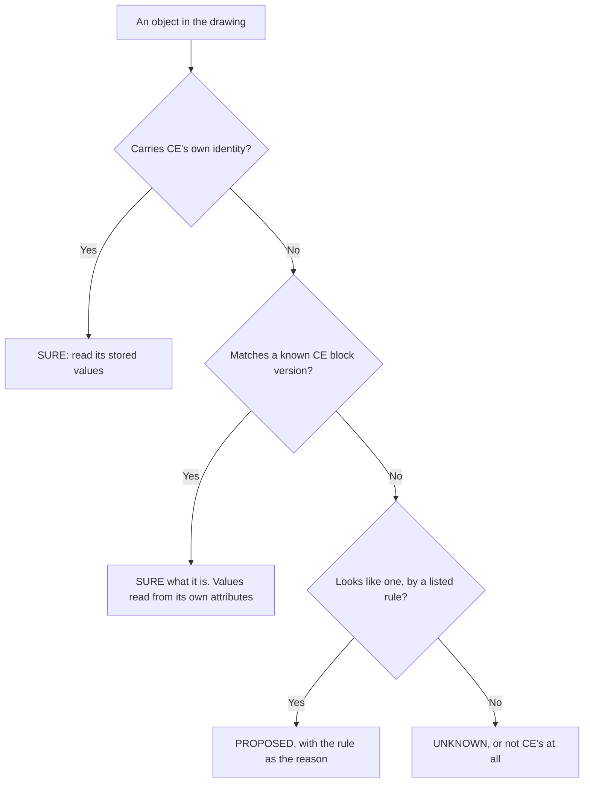

# The fixed-rule reader: recognising every older version of each CE block

**Status: DRAFT design (12 Nov 2026).** Nothing built. Part of area TRUST (`areas\trust-plan.md`).
**Source:** voice talk, 6 Nov: "The reader uses fixed rules with the same answer every time, no AI inside the plugin. It must recognise every older version of each CE block; anything unrecognised shows as Unknown."

---

# FOR TIM

**The reader is a fixed list of "if the drawing has this, it is that". It never uses AI, never looks for "the nearest thing" to decide a fact, and gives the same answer every time on every PC. What it cannot match, it calls Unknown.**

## 1. The four rules it never breaks

1. **Same answer every time.** No settings of the person opening the drawing may change what a thing is. Reaches come from the office setup, in millimetres, adjusted for the drawing's units.
2. **It only reads.** The reader never changes a drawing. Applying anything is Check this drawing's job.
3. **Two possible answers means Unknown.** It never picks the nearer of two.
4. **Every value says where it came from:** stored by CE, read from the block, read from a label, worked out, proposed, or Unknown.

## 2. What it recognises today, version by version

Read from the installed code (Civil 3.0.90). "Known versions" means the code names them. This table is incomplete on purpose: section 4 says how it gets finished.

**Pits**

1. **Version 3 (current):** block "PIT BLOCK 3". Size and type are read from the block itself. May carry a stamp saying its symbol was refreshed.
2. **Version 2:** block "PIT BLOCK 2". Same make-up as version 3.
3. **Version 1 (oldest):** block "PIT BLOCK". **Gap: the plugin ships no master drawing for it,** so what it contains has to be learnt from old jobs.
4. **How sure:** with CE's identity and a stored record, Sure. By block name alone, Sure that it is a pit; its number, levels and pipes come from the next rules.
5. **A pit block under any other name is invisible to CE today.** The reader lists it as Unknown block on a drainage layer rather than ignoring it.

**Pit labels**

1. **Version 2 (current):** "PIT LABEL 2". The number is in the block.
2. **Version 1:** "PIT LABEL". **Same gap: no master drawing shipped.**
3. **Label to pit:** a stored link is Sure. With no link, one pit within reach is Proposed ("label is 600 from P3, the only pit in reach"). Two pits in reach is Unknown.

**Pipes, three forms**

1. **The one-piece CE pipe** (AutoCAD 2027): Sure. Size is in CE's record.
2. **A polyline carrying CE's pipe data** (the older form): Sure. Size, material and inverts are on the line.
3. **A plain polyline on a pipe layer, no CE data:** Proposed as a possible pipe, reason "on layer Stormwater Pipe". Size from its drawn width only if the width, in millimetres, equals a size on your list; otherwise size Unknown.
4. **Pipe layers known today:** stormwater pipe, charged UPVC pipe, suspended pipe, rising main, existing drain. **Gap: layer names an office used in the past are not listed anywhere.**

**Downpipes and other sources**

1. **A CE source:** any block carrying CE's source tag (DP, IO, OF, FO, GIO, trench grate, floor waste, strip drain, AGI, raingarden, generic source, water tank, LPD). Sure, by the tag, whatever the block is called.
2. **An old-style downpipe:** a block named like a downpipe, or text reading DP or DP with a number, with no tag. Proposed, reason given. The code already spots these and reports them as "seen, not registered".
3. **One block name each** for downpipe, inspection opening, overflow, GIO, floor waste and trench grate. No older names are known to the code. **Gap: older names, if any, must come from old jobs.**

**Tanks**

1. **A CE tank:** tagged as a water tank; its size and library name are in CE's record. Sure.
2. **An untagged tank:** not recognised by any rule today. Unknown until old jobs show how they were drawn.

**LPD**

1. **Older form:** one stored record with the pipe end, the pit and the label.
2. **Newer form:** a stored set that can hold several outlets.
3. **Both are read as a proposal for the start point** until Tim confirms it (card TRUST-07).

**Other**

1. **Fall symbols:** two versions known. **Pit Schedule block:** two spellings known. **Flow arrow, spot level:** one each.

**The record itself**

1. **CE's record carries one format number** (2.3 today) for the whole drawing. Individual pits and pipes do not say which CE version wrote them. So the reader tells versions apart by what is on the object, not by a date.

## 2b. The old LISP tools, found 12 Nov (one reader's pass over the LISP source; not re-checked here)

Tim, 12 Nov: the old tools are "on my work pc". They are in the office drafting folder, under "Lisp Files" (subfolders TIM, TIM EXPORT, UPDATED LISP FILES, SUPERSEDED, C DRIVE STUFF). The main one is the old pipe command, CDD.

1. **An old LISP pipe is a plain polyline on a pipe layer.** The same four layer names as today: stormwater pipe, charged UPVC pipe, suspended pipe, rising main. Beside it, parallel lines on "DRAINAGE" or "DRAINAGE HIDDEN".
2. **It stored nothing on the line.** No hidden data of any kind. Everything it knew is in the text next to the pipe.
3. **The text follows a fixed pattern,** which is what makes a fixed rule possible:
   1. pipe text: "150 DIA. UPVC PIPE AT 1 IN 100 MIN." (no "MIN." when both inverts were given);
   2. charged pipe: "100 DIA. UPVC CHARGED PIPE TO WT";
   3. detention pipe: "... PIPE AT 1 IN 200 - 12.5m FOR DETENTION";
   4. invert text: "IL 1.10", on its own, at each end;
   5. pipe text on layer 25TEXT, invert text on 20TEXT, flow arrow block "TIM_CVL_ARROW" on layer ARROW.
4. **Where "100" and "UPVC" come from.** They were the old tool's starting values in its window. Today's fill-in of "100 dia UPVC" copies that habit. In an old LISP drawing a pipe reading "100 DIA. UPVC" in its text is real; a pipe with no text at all has no known size.
5. **Proposed rule for an old LISP pipe:** a plain polyline on a pipe layer, with exactly one pipe text in the fixed pattern lying along it, is Proposed as a pipe of that size, material and grade, reason "read from its label". No such text, or two candidates: size Unknown. Invert text matched the same way, each end.
6. **Pits, pit labels and downpipes had no LISP tool.** They were blocks dragged from the "BLOCKS CIVIL" tool palette. Older palettes are kept in the office drafting folder under "OLD TOOL PALETTES", and an old block library drawing from 2022 is kept under "Superseded Stuff". Those are where the oldest pit and label blocks will be found. Nobody has opened them yet; that needs AutoCAD.
7. **No tank block was found** among the old tools, only the standard detail drawings.

## 3. What the reader hands back

A reading of the drawing, as plain rows. It is what Check this drawing shows and what the test set is marked against.

1. **One row per object:** what it is; which version; Sure, Proposed or Unknown; the reason for anything not Sure.
2. **Each value with its source,** as rule 4 above.
3. **A list of what it met and did not recognise:** block names on drainage layers that match no rule. This list is how missing versions get found instead of being silently ignored.
4. **Totals** that match the opening line.

## 4. How the list of older versions gets finished

The code alone cannot say what every old version looks like. Three sources, in order:

1. **The test-set jobs.** Probe P3 reads each copy and lists every block name, its attributes and its layer on the drainage layers. Needs AutoCAD, copies only, read only.
2. **Tim.** For each unrecognised name the probe finds: "is this an old CE block, and what was it?" One short list, once.
3. **Old block files or LISP tools,** if Tim can point to where the old ones are kept. None were found in the two places looked at on this PC.

Each version then gets one written rule, one example in the test set, and one robot check. **A version is not "recognised" until all three exist.**

## 5. How it gets proven

1. **Against the test set:** the pass rules in `areas\TRUST_TEST_SET_12NOV.md`.
2. **Twice, identical:** two runs on fresh copies match row for row.
3. **On a second Windows login with different personal settings:** identical.
4. **Millimetre and metre copies of the same job:** identical.
5. **Reads only:** the drawing is unchanged after reading.
6. **Broken twins:** a version that picks the nearer of two pits, and one that fills a size, must both fail.

## 6. Decisions for Tim

1. **Plain lines on a pipe layer:** "possible pipe, Proposed", as above, or ignored until you say? (Same question as card TRUST-06, decision 5.) OPEN.
2. **Drawn width as a size:** accept it as Proposed when it equals a listed size? OPEN.
3. **Unrecognised blocks on drainage layers:** listed for you every time, or only once per drawing? Recommended: listed in the check, never on the opening line. OPEN.
4. **Where old block files or LISP tools are kept,** if anywhere. OPEN.

## 7. Not known yet

1. What "PIT BLOCK" and "PIT LABEL" version 1 contain.
2. Whether old jobs used block names the code has never heard of.
3. What old LISP tools stored on objects, if anything.
4. How cover and invert text is told apart from other text on the same layers. Not traced.
5. How raingardens were drawn before they were tagged.
6. Structural blocks. This design covers drainage only.

Facts in section 2 come from one reader's pass over the code on 12 Nov; this chat re-checked the three pit block names, the two shipped label and pit master files, and the absence of a version 1 master.
