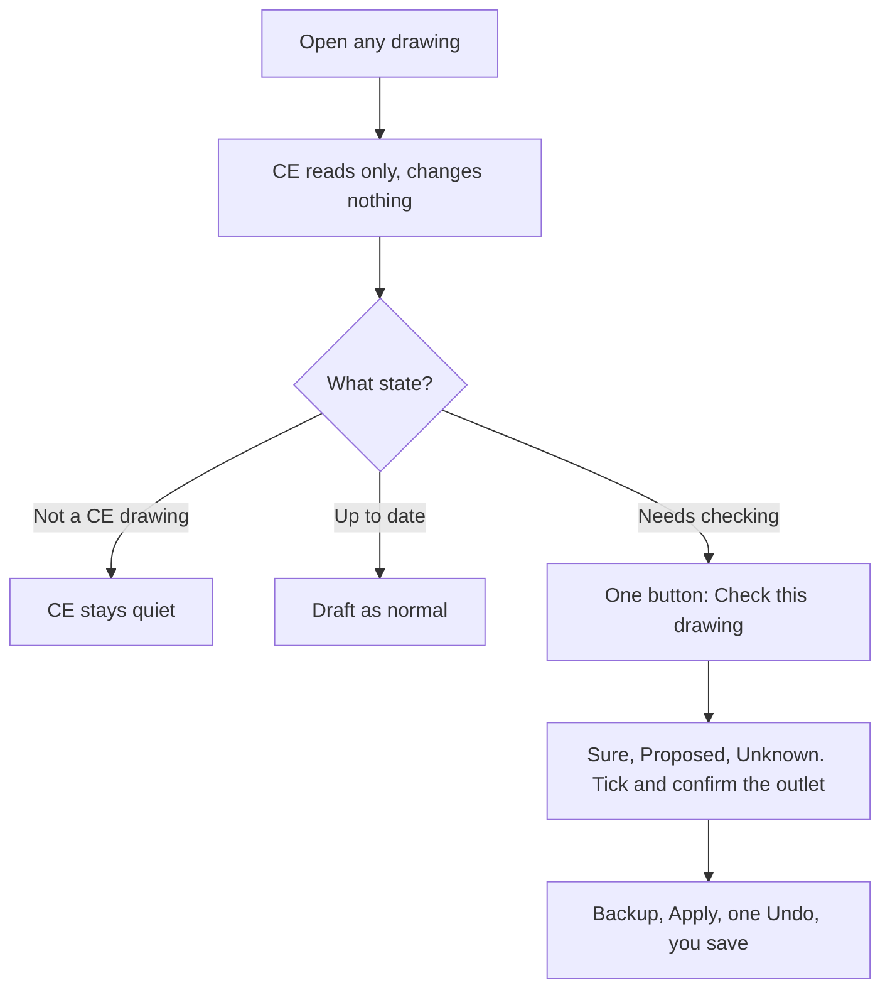

# How we get to a plugin you can trust (overnight check, 5 to 6 Nov 2026)

> **12 Nov 2026: the working plan is now `areas\trust-plan.md` (area TRUST in MASTER_PLAN section B).** This file stays as the 6 Nov proposal and its evidence. Five of its claims were corrected on 12 Nov; see section 4 of the working plan.

**STATUS: PROPOSAL.** Findings come from reading the code on Tim's PC and the plan. Nothing was run in AutoCAD. Nothing below is approved except the small core and Civil first (decisions\2026-11-05_TIM_PLUGIN_STRATEGY_TALK.md). If approved, this becomes a section of the one plan, not a second plan (RULES 9.1).

**Update after the voice talk, 6 Nov (agreed direction; see the decision file):**
1. **First colleague release** now waits for Check this drawing, which sits after the safety fixes. Tim: "I want something that works. If it's going to take time to make that happen, then let's take the time."
2. **Added before that release:** a reader using fixed rules, no AI, that knows every older version of each CE block, and a test set of about 10 real past jobs.
3. **Order of testing:** Codex on the test set, then Tim on real jobs for about 3 days, then Silvia.
4. **Ribbon:** two tabs, CE Drainage and CE Design, both always visible.
5. **Silvia:** no separate fix or warning. Tim, 6 Nov: "forget silvia the clean and save fix is for me".

---

# FOR TIM

**You're right about the front door and the start point. The cure is close to what you described, with one change: don't sync on open. Check on open, show the result, and you press one button.**

## 1. What's really wrong

1. **Nothing checks a drawing when it opens.** Nothing tells you what state it is in.
2. **The sync does run, but in hiding.** It runs inside the first ordinary tool, such as Edit Pit, and reports nothing. About 36 places in the code trigger it. Even tools described as read-only, like CEHEALTH, run it.
3. **So guesses look like facts.** Example: a polyline on the pipe layer with no size goes into the schedule as a 100 dia UPVC pipe. Nobody is told.
4. **Old versions aren't the real cause.** CE doesn't record what version made a drawing. The guessing starts wherever an item has no CE identity.
5. **There is no start point.** Four places hold parts of the outlet. CDRENUMBER asks every time, and forgets.
6. **One reach is dangerous.** Labels are matched within pit width plus 2000, not adjusted for units. In a metre drawing that is 2 km.

## 2. Why colleagues see "random" things

Worst first, by judgement. No colleague PC was read.

1. **The order they work in.** The first tool used decides when the hidden sync lands.
2. **Remembered values.** About 60 last-used values per person, such as pipe size and levels. BUG-743: Enter reused a cover level from another job.
3. **Different build and AutoCAD year.** You have Civil 3.0.90, colleagues 3.0.89. Pipe objects exist only on 2027.
4. **Different settings.** There are about 574, and only a brand-new login gets the colleague starting file. Two colleagues on one build can differ.
5. **Layer names and drawing units.** These change what counts as a pipe and how far CE reaches.

## 3. Is it the foundations?

**Partly.** From 42 bugs read by hand, about 14 to 31 percent trace to this. That is a small sample and one reviewer's reading. The rest are ordinary faults in single tools.

So fixing the foundations won't clear the carpark. It should remove most of what feels random, which is what costs you trust. The small core deals with the rest.

The good pattern already exists: CDFIXPIPEENDS and CDSPINEUPGRADE show a preview first. It just isn't the front door.

## 4. Built, not built, needs fixing

"Works" below means installed and reachable. It does not mean proven in AutoCAD.

1. **Civil (111 lines, standing in for 212 plan items):** 47 work, 8 installed but off, 7 unreachable, 4 only in the next build, 19 not built, 19 need fixing, 7 unknown.
2. **Structural, Manager, shared (110 lines):** 38 work, 18 installed but off, 1 unreachable, 1 only in the next build, 14 not built, 25 need fixing, 13 unknown.
3. **UI and UX (472 items):** 137 connected to something you can reach, 107 with code nothing reaches, 228 with no trace in the code. At least 39 of those with code ship switched off.

**Worst for a drafter:**

1. **Pit Schedule Excel export fails in AutoCAD 2027** (BUG-1255). No fix found.
2. **Pit Schedule leaves out plastic pits without saying** (BUG-1274). The fix is only in C-80.
3. **Cancelling CDFW clears stored pit inverts** (BUG-650).
4. **Bracing schedule rows are wrong** (BUG-497, 498). The fix is only in S-46.
5. **Bracing panel adds BT1 roof trusses to wall totals** (BUG-499).
6. **No New Job button.** CDNEWDWG is typed only.
7. **Structural ribbon still has 298 tools.** Your "about 40 in families" is built but switched off.
8. **Finished work ships off.** Auto-join, labels staying put and pipe-size suggestions are off for everyone. Roof setout, lintels and member schedule are off with no button.
9. **Not built:** Civil sheet set-up and issue, detail library, and the design jobs (detention pit, outfall, pump station).
10. **AutoCAD 2022 to 2024 users get no ribbon,** only the old pull-down menu. I confirmed this in the code. Max's AutoCAD year is still not confirmed.

## 5. The better way

1. **One line on opening:** "Up to date", "Needs checking: 12 items" or "Not a CE drawing".
2. **One command, Check this drawing.** It lists what is Sure, what is Proposed (with the reason), and what stays Unknown. This fits your 4 Nov answer, "ONE ACTION - PROMPT ON OPENING OF DRAWING".
3. **One start point.** You confirm the outlet once. It is stored in the drawing, and every tool reads it from there.
4. **No more hidden sync.** Tools stop changing the record quietly. If the drawing drifts, the line changes to "Needs checking".
5. **16 commands become 5 jobs behind one door.** CDSYNC, CDREBUILD, CDREBUILDLINKS, CDLINKDANGLINGPIPES, CDUPGRADE Merge and the upgrade and fix commands fold in. CDUPGRADE Replace (it wipes the record), CDREFRESHBLOCKS, CDRECOVERINVERTS and CDXREFREPAIR stay separate because of risk or subject. The old typed commands keep working for now.

**Why not sync automatically on open?** It would run the same guessing on every drawing, with no report. That is the fault you are describing, only earlier.

## 6. How you can trust what you're using

Five rules. A tool is only Core when all five are true.

1. **Nothing changes a drawing without showing you first.**
2. **Everyone runs the same thing:** same build, same settings. The release carries your settings, so no one is on a mix.
3. **Guesses are never shown as facts.** Unknown shows as Unknown.
4. **You've used it on real drawings** for about three working days. Robot and Codex evidence comes first but cannot let a tool in.
5. **Each Core tool has a short note:** what it does, what it won't do, and its known faults. When a colleague asks why, the answer is on that note.

## 7. The order to build it, safest first

Each step is its own small card for your OK. The hold stays until you say.

1. **Open line, read only.** Nothing in the drawing changes, and it gives real numbers from your jobs. Undo: one Settings switch.
2. **Core ribbon.** The two tabs from the voice talk, with only what you keep on them (`areas\CIVIL_COMMAND_SORT_06NOV.md`).
3. **Same settings for all.** One setup for you and colleagues. You pick which switched-off features come on.
4. **Core safety fixes.** CLEAN, the unsaved-work reminder, BUG-1255, BUG-1274, then the Structural schedule fixes.
5. **Stop the sync in read-only tools,** and have every sync print one line saying what it did.
6. **Remove the guesses:** "100", "UPVC" and the 2000 reach. Unknown shows as Unknown, and reaches move to Settings in millimetres.
7. **Confirm and store the outlet.**
8. **Check this drawing,** bringing CDSYNC and CDREBUILD behind one door. This one needs your word on the 25 Sep ruling that keeps them as direct commands (UX-REP-01).

**C-80 does not go in whole.** It asks on opening, which helps, but its Upgrade still guesses. Drawings with no CE record (old LISP work) are never asked. It also has nine changes in one build. Its useful parts get lifted out.

## 8. What this check did not cover

1. **Nothing was run.** "Works" is from reading code, so a tool can be reachable and still wrong.
2. **Not literally every item in full.** The plan has no single list of its items, which is a finding in itself. Civil's 212 items were grouped into 111 lines: 59 checked in code, 24 part checked, 28 carried from older documents. All 472 UX items were counted, but "connected" was read from the code, and windows were not seen.
3. **Colleagues' PCs were not read.** Their settings, logs and 3.0.89 itself were not looked at.
4. **Undo was not proven.** How U treats changes made on opening is unknown until tested on a copy.
5. **Real old drawings were not opened,** including LISP-era ones.

## 9. My own checks

I re-read eight claims in the code: the sync in Edit Pit, the sync in CEHEALTH, the "100" fill-in, the 2000 reach, the outlet being forgotten, the pit swap having no discipline check, no ribbon on 2022 to 2024, and the installed versions. All held. The log examples, the 42-bug sample and the rest of the audits are the reviewers' work, not rechecked by me.

**Corrections to what I told you on 5 Nov:** my command counts were from an old copy; the installed figures are 144 Civil, 377 Structural, 12 Manager. I also said no way of hiding buttons was found. That was wrong for both.

**Correction, 6 Nov:** this report first said Civil has no hidden flags. It does: 76 of the 141 listed Civil commands are already marked hidden. The Civil ribbon is one hand-written layout, so a tool comes off it by being left out of that layout.

---

## Detail files

1. `areas\AUDIT_FOUNDATIONS_CIVIL_06NOV.md`: opening old drawings, the 16 commands, the start point, with code references.
2. `areas\AUDIT_V3_CIVIL_06NOV.md`: every Civil line.
3. `areas\AUDIT_V3_STRUC_MGR_06NOV.md`: every Structural, Manager and shared line.
4. `areas\AUDIT_V3_UX_06NOV.md`: every UX item and card.

Code read: Civil and Manager cf059dcf, Structural 8de95c34 (read from the installed DLLs), in read-only copies at C:\CE_WORK\scratch\audit_civil and audit_struc.
