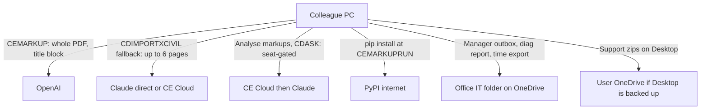

# Off-PC calls audit — what leaves a colleague's PC (9 Oct 2026)

**Desk job:** plan/03, off-pc audit. Read-only Opus helper, code reading only. Nothing was built, run or opened in AutoCAD.

**Code read:**
1. **Structural** at `origin/claude/rel-20261009n` = `24238160` ("Version: Structural 1.0.112 (S-31)").
2. **Civil and Manager** at `origin/claude/rel-20261009l` = `e636e17d` ("Version: Civil 3.0.43 / Manager 1.1.43").
3. **Shared code** (`CE.AI.Core`, `Shared/CE_SHARED`, `Shared/CE.Diagnostics`, `Installer`) at the same commits.

**Method:** searched every shipped C#, XAML, LISP, C++, PowerShell and Python file, plus the config files, for HTTP clients, web requests, browser windows (WebView2), opened links, mail, sockets, DNS or ping, downloads, `pip`, Azure, OpenAI, Anthropic, CE Cloud, SharePoint/OneDrive and IT folder writes. Then I read each hit to find what is sent, when, and what stops it.

**Rules checked against:**
1. **Tim 25 Sep:** markup PDFs go one page at a time, to Claude only, with the title block blanked.
2. **SEC-001:** updates come only through signed approvals in the office OneDrive. V3 never publishes to Azure.
3. **Support zips and fault reports:** they never leave the PC except into the office IT folder, and only coded (no real login, PC name or job names).

---

## Answer first

1. **Off-PC calls found in code:** 4 ways for job data to reach an outside AI service, 2 small CE Cloud calls, 3 internet downloads or links, and 6 routes that copy files out through OneDrive into the office (or a personal) cloud.
2. **The worst one:** Structural's CEMARKUP. It uploads the **whole markup PDF** to **OpenAI**, not Claude, with the title block intact and the file name attached. It never deletes the file from OpenAI afterwards. CEMARKUPBENCH does the same for **every PDF in a folder and all its subfolders**. The only thing that stops it is whether an `OPENAI_API_KEY` environment variable exists on the PC. The "Enable MarkupAI" switch in CE Settings is read by nothing. This breaks all three parts of Tim's 25 Sep rule.
3. **Second worst:** CDIMPORTXCIVIL's "try AI extraction?" fallback. It sends up to **6 whole pages** of the consultant's drawing set to Claude in one go, title blocks included. Pressing Enter means Yes. It only checks that a key is present, not the CE Cloud seat, the approved-provider policy or a project marked Confidential. With only `ANTHROPIC_API_KEY` set, it goes straight to api.anthropic.com.
4. **Updates (SEC-001) hold in the running code.** The Manager stages updates only from the office IT folder. Nothing at runtime talks to Azure. The Azure upload code still ships, but nothing calls it.
5. **Office-folder rule is broken in 3 places.** Civil fault details reach the office IT folder **uncoded**. The CEMANAGERDIAG report has a coded file name but the real login inside its folder paths. Support zips are saved to the **Desktop**, which on a OneDrive-backed PC syncs off the machine.

---

## Ranked list — highest risk to a colleague's job data first

1. **Structural CEMARKUPBENCH — every PDF in a folder tree uploaded to OpenAI (HIGH)**
   1. **Where:** `Modules/Structural/Commands/MarkupAICommands.cs:304-383` (the folder search is `SearchOption.AllDirectories`, line 347). The upload is in `Modules/Structural/Services/MarkupAIVisionParser.cs:106-131` (POST `files`, `purpose=user_data`), then `:133-179` (POST `responses`).
   2. **What is sent:** each whole PDF as bytes, with its **file name**, plus a short prompt "ProjectType=STR…". Nothing is blanked. OpenAI keeps each file because the code has no delete call (no `HttpMethod.Delete` anywhere in Structural).
   3. **When:** on the command. The default source mode is `Hybrid`, which includes the upload (`:339-344`). The default folder is the last markup folder or the Markups folder.
   4. **Switch:** none that works. `MarkupAI.Enabled` (default ON, `Models/MarkupAIModels.cs:224`) is shown in CE Settings but never read before uploading. The command is listed, not hidden, in `Assets/Config/command-registry.json:671`.
   5. **Key:** the environment variable named in Settings (`MarkupAI.OpenAiApiKeyEnvVar`, default `OPENAI_API_KEY`, `MarkupAIVisionParser.cs:45`). It does not come from a file. The address is `MarkupAI.OpenAiBaseUrl` from the settings file (default `https://api.openai.com/v1`, `MarkupAIModels.cs:227`). Editing that file could send the key and the PDFs to any web address.
   6. **Rules:** **breaks Tim 25 Sep on all three counts** (OpenAI not Claude, whole file not one page, title block not blanked). It is a mass upload.

2. **Structural CEMARKUPPARSE and the CEMARKUP window's Parse button — whole markup PDF to OpenAI (HIGH)**
   1. **Where:** `MarkupAICommands.cs:53-88` (command) and `UI/Palette/MarkupAIPanel.xaml.cs:143-146` (button, combo default `Hybrid`, `MarkupAIPanel.xaml:48`). Both go to `Services/MarkupAIWorkflowService.cs:39-62` → `MarkupAIOrchestratorService.cs:64-66` → `MarkupAIVisionParser.Parse`.
   2. **What is sent:** the same as item 1, for one PDF: the whole file, its file name, and the drawing type.
   3. **When:** when the drafter picks a PDF and presses Enter at "Source mode [Bluebeam/Hand/hYbrid] <Hybrid>". Only "Bluebeam" avoids the upload. `MarkupParseRequest.UseVisionParser` also defaults to true (`MarkupAIModels.cs:64`).
   4. **Switch:** none that works (see item 1). If no key is set it skips and says "Set environment variable OPENAI_API_KEY".
   5. **Key:** the environment variable, as in item 1.
   6. **Rules:** **breaks Tim 25 Sep** (OpenAI, whole file, no blanking). The raw OpenAI reply is also saved locally next to the package (`MarkupAIWorkflowService.cs:78-83`).

3. **Structural CEMARKUP "Ask AI" chat — drawing path and markup text to OpenAI (HIGH to MEDIUM)**
   1. **Where:** `UI/Palette/MarkupAIPanel.xaml.cs:280-295` → `Services/MarkupAIChatService.cs:32-83` (POST `responses`). The payload is built at `:200-244`.
   2. **What is sent:** the typed question, the package ID, the **project code** (worked out from the drawing name), the **full drawing path** (`drawing = package.BaseDrawingPath`, line 237). That path normally holds the Windows login and the client or job folder, for example `C:\Users\<login>\OneDrive - …\Projects\<job>\…`. It also sends each markup item's text, layer, command, and up to 10 unresolved items with their raw text.
   3. **When:** on the button.
   4. **Switch:** `MarkupAI.ChatEnabled` ("Enable chat"), **default ON** (`MarkupAIModels.cs:238`). This one is honoured.
   5. **Key:** the environment variable, as in item 1.
   6. **Rules:** OpenAI is not an approved provider under Tim's 25 Sep ruling, and the login and job folder leave the PC in the path.

4. **Civil CDIMPORTXCIVIL "try AI extraction?" fallback — up to 6 consultant pages to Claude (HIGH to MEDIUM)**
   1. **Where:** `Modules/Drainage/Services/XcivilImportService.cs:763` → `XcivilVisionFallbackOrchestrator.cs:61-153` → `XcivilVisionScheduleExtractionService.cs:192-236`. The command is `Commands/LinkCommands.ImportXcivil.cs:29`.
   2. **What is sent:** images of up to 6 **whole PDF pages** of the consultant's drainage set, all in **one** request (`:46`, `:195-198`, `:230-233`). Title blocks, consultant name and job details are left in.
   3. **When:** during CDIMPORTXCIVIL, only when CE's own schedule reading looks poor. The prompt is "try AI extraction? [Yes/No] <Yes>", so **Enter = Yes** (`XcivilVisionFallbackOrchestrator.cs:155-169`).
   4. **Switch:** none in CE Settings. The only check is that a key is present (`:89`). Unlike CDASK, there is **no CE Cloud seat check, no approved-provider policy and no "Confidential project" check**.
   5. **Key:** environment variables, read by `CeAiEndpointResolver.cs:24-30`. If `CE_CLOUD_URL` is set it uses CE Cloud with `CE_CLOUD_AUTH`. Otherwise it goes **direct to api.anthropic.com** with `ANTHROPIC_API_KEY` (`CE.AI.Core/IChatClient.cs:22`, `AnthropicChatClient.cs:120-125`). Not from a file.
   6. **Rules:** Claude is right. **Several pages at once and no title-block blanking break Tim 25 Sep.** It also skips the CE Cloud route the rest of Civil's AI uses. A count of rows (no text) is added to the telemetry queue (`:146-150`).

5. **Civil CDASK "Analyse markups" and "From file…" — screen or PDF pages to Claude via CE Cloud (MEDIUM)**
   1. **Where:** `Controls/CeAssistantControl.xaml.cs:288-304` (screen) and `:320-358` (file) → `Services/MarkupAnalysisService.cs:68-166`.
   2. **What is sent:** either a screenshot of the current AutoCAD view (title block included if it is on screen) or up to **5 PDF pages in one request** (`MarkupFileImageLoader.cs:47`, `MarkupAnalysisService.cs:160-163`).
   3. **When:** on the buttons.
   4. **Switch / gate:** strong. It needs a live CE Cloud seat with R2/W1 access, a project classified Standard (not Confidential), and an egress audit record that saves (`:292-295`, `:324-327`). The seat context only exists in CE Cloud mode (`:684-688`), so in practice this always goes through CE Cloud.
   5. **Key:** environment variables `CE_CLOUD_URL`, `CE_CLOUD_AUTH` and `CE_AI_APPROVED_PROVIDER_POLICY` (`CeAiSeatGrantService.cs:29-37`). Not from a file.
   6. **Rules:** Claude is right. **Multi-page in one go and no title-block blanking break Tim 25 Sep.** The gate is good.

6. **Civil CDASK chat panel — question and project data to Claude via CE Cloud (MEDIUM to LOW)**
   1. **Where:** `CeAssistantControl.xaml.cs:180-215` and `:678-731`. Tools: project network, review design, check project data (`:720-722`).
   2. **What is sent:** the typed question, CE pipe and pit data and geometry from the drawing, and tool results. The egress audit labels it "question,ce-project-data,geometry" (`:714`).
   3. **When:** on Send.
   4. **Switch / gate:** CE Cloud only. Direct-key mode is refused ("direct-key authority is not configured for this release", `:685`). It needs a seat grant, a non-Confidential project, and access re-checked every round. Only Timothy-level authority can mark a project Standard (`:761-777`).
   5. **Key:** the same environment variables as item 5.
   6. **Rules:** in line with the CE Cloud design. Not a markup PDF.

7. **Civil CE Cloud seat check — GET /v1/access (LOW)**
   1. **Where:** `Services/CeAiSeatGrantService.cs:94-117`, called from `CeAssistantControl.xaml.cs:733-738`.
   2. **What is sent:** the seat token in an `x-api-key` header. No drawing data. HTTPS only, redirects refused, and the address must match the approved policy.
   3. **When:** on CDASK Send, Apply and "Project AI access".
   4. **Rules:** fine.

8. **Civil fleet telemetry heartbeat to CE Cloud (LOW)**
   1. **Where:** `Services/FleetTelemetryStartupService.cs:49-64`, started at `PluginInitialization.cs:194`. It posts to `<CE_CLOUD_URL>/v1/telemetry` (`TelemetryQueueService.cs:131-215`).
   2. **What is sent:** install ID, Civil version, AutoCAD release and build type, plus the number of rows from item 4. These are fixed fields with no free text or paths (`TelemetryEvent.cs`).
   3. **When:** at **AutoCAD start-up**, in the background, and only if both `CE_CLOUD_URL` and `CE_CLOUD_AUTH` are set. Otherwise it only queues to `%APPDATA%\CE_CVL_SUITE\telemetry\outbox.jsonl`.
   4. **Switch:** none in CE Settings. The environment variables are the only gate.
   5. **Rules:** no job data. Fine. Note that it runs without any Settings switch.

9. **Manager copies module telemetry to the office IT folder — Civil fault text uncoded (MEDIUM to LOW)**
   1. **Where:** `Modules/Manager/Plugin.cs:137-152` (start-up plus 15 s) and `Commands/PluginManagerCommands.cs:116` (CEMANAGERREFRESH). The copy itself is `Services/CeAdminStorageService.cs:122-135`, into `<IT Admin>\CE Plugin Admin\`.
   2. **What is sent:** usage records, fault records and machine records from the local outbox. In Civil's records the **drawing file name is in clear** (`Modules/Drainage/Services/AdminTelemetryService.cs:324`, `:403`) and the **fault details are the raw error text** (`Details = ex.ToString()`, `:176`). Raw error text can hold full paths with the login and the client folder. Structural scrubs both (`Modules/Structural/Services/AdminTelemetryService.cs:198-209`, `:428`).
   3. **Folder detail:** Civil and Structural write to `%APPDATA%\TIM_CE_CADTOOLS\CE_Admin\outbox` (`Shared/CE_SHARED/Services/CeTelemetryStore.cs:60-68`). The Manager uploads from `%APPDATA%\CE_CADTOOLS\CE_Admin\outbox`. It moves the old folder across only once, when the new one does not exist yet (`CeAdminStorageService.cs:25-43`). So Civil and Structural records likely reach the office folder only once, at that first move. This is a second, functional problem.
   4. **Switch:** none.
   5. **Rules:** the IT folder is the right place, but **Civil fault reports are not coded**. That breaks the support and fault rule.

10. **CEMANAGERDIAG diagnostic report — coded name, real login inside (LOW to MEDIUM)**
    1. **Where:** `Modules/Manager/Services/CeDiagnosticsService.cs:300-311` writes `<IT Admin>\CE Diagnostics\<coded PC>\<time>_<coded login>.txt`, or to `Desktop\CE Diagnostics` when the IT folder is missing.
    2. **What is sent:** versions, hashes and status. It also carries the **full IT Admin path, the OneDriveCommercial path and each loaded DLL path** (`:96-101`, `:236`). These normally include `C:\Users\<login>\…`. The report body is not run through the scrubber.
    3. **When:** on CEMANAGERDIAG.
    4. **Rules:** **not fully coded**. The real login leaks inside the report.

11. **Support zips saved to the Desktop (LOW to MEDIUM)**
    1. **Where:** Manager CESUPPORT, `Modules/Manager/Services/CeSupportBundleService.cs:49-56` (`Desktop\CE Diagnostics`, contents scrubbed of login and PC name). Structural support bundle, `Modules/Structural/Services/SupportBundleService.cs:33-34` (`Desktop\CE_Support_<time>.zip`, logs and failures).
    2. **What leaves:** nothing is uploaded by CE. But company PCs often back the Desktop up to OneDrive. Then the zip, with logs that name drawings and jobs, syncs into the user's OneDrive, not the IT folder.
    3. **When:** on CESUPPORT, or Structural's diagnostics command.
    4. **Rules:** **against "never leave the PC except into the office IT folder"** wherever the Desktop is backed up to OneDrive. I did not check colleague PCs.

12. **Job time logs to the shared Drafting OneDrive, weekly export to the IT folder (LOW to MEDIUM)**
    1. **Where:** Structural `Services/CsvLogger.cs:194-198` writes `<data folder>\Time Logs\users\<user>_<yyyy-MM>.csv` with job number, address, suburb, drawing, client and user. The tracker is created at start-up (`CeToolsInitializer.cs:63`). Civil `Services/JobTimeWeeklyExportService.cs:26-122` is called at start-up (`CivilJobTimeService.cs:33-35`) and mirrors a per-user hours CSV to `<IT Admin>\CE Diagnostics\Time Logs\weekly exports`.
    2. **Folder choice:** Structural finds its data folder at `Services/SettingsManager.cs:182-252`. If no "Creative Engineering" folder is found, the last fallback (`:228-243`) takes **the first folder whose name starts with "OneDrive"**. On a PC with a personal OneDrive, that can be the **personal** one, so job addresses and client names would sync to a private Microsoft account.
    3. **Rules:** office time data in office folders is expected. The personal-OneDrive fallback is not.

13. **Structural CEMARKUPRUN runs `pip install` from the internet (LOW for job data, MEDIUM for security)**
    1. **Where:** `Services/MarkupAIPyAutocadWorkerService.cs:335-355` runs `python -m pip install pyautocad comtypes pywin32`.
    2. **What is sent:** no job data. It downloads and installs code from PyPI with the PC's address and Python version.
    3. **When:** the first time a CEMARKUP batch uses the Python worker and those packages are missing.
    4. **Switch:** `MarkupAI.AutoBootstrapPyAutocadWorker`, **default ON** (`MarkupAIModels.cs:236`).
    5. **Rules:** not covered by Tim's rules. It is an unvetted internet download into a colleague's Python.

14. **Installer downloads the WebView2 runtime from Microsoft (LOW)**
    1. **Where:** `Installer/Program.cs:182-236`, from `https://go.microsoft.com/fwlink/p/?LinkId=2124703`. It runs the file silently with no signature check before running it.
    2. **When:** at install, only if WebView2 is missing.
    3. **Also:** the same installer creates daily and at-logon scheduled tasks that copy from an "update source" (`:349-358`). I did not check whether that path also requires the signed approval (SEC-001).

15. **CDHELP fallback opens `help.creativeeng.com.au/<command>` in the browser (LOW)**
    1. **Where:** `Modules/Drainage/Services/CdHelpService.cs:136-166`, reached from `HelpLauncher.cs:77-80`. The links are in `Modules/Drainage/Assets/Config/command-registry.json` ("helpUrl").
    2. **What is sent:** only the last CE command name, in the web address.
    3. **When:** only when the local `ce_cvl_guide.html` is missing or unsafe.
    4. **Note:** `creativeeng.com.au` is not the company's `creativeengineering.com.au`. I did not check who owns it.

16. **Azure upload code still shipped, nothing calls it (LOW)**
    1. **Where:** `Modules/Manager/Services/CeAzurePublishService.cs:51-69` and `CeAzureBlobService.cs` (read, upload and delete).
    2. **Reachability:** no caller anywhere in the release apart from tests. The shipped `Assets/Config/blob-config.json` read link is blank. A write link could only come from `%APPDATA%\CE_SUITE\blob-config.local.json`, which I only know by file name.
    3. **Rules:** SEC-001 holds at runtime. Removing the dead Azure code would make it hold by construction.

17. **OneDrive "cloud-only" files pulled down (LOW)**
    1. **Where:** `Modules/Structural/Services/CloudFileHelper.cs` (notes, checklists, reports, time logs). Opening a cloud-only file makes OneDrive download it from the company SharePoint.
    2. **Rules:** company storage only. Fine.

---

## Checked and found NOT to leave the PC

1. **AutoCAD 2027 MCP registration:** `Modules/Manager/Services/CeMcpServerService.cs` is a stub. It registers nothing and opens nothing.
2. **Bluebeam markup reader and PDF page renderer (Structural):** they run local Python (`MarkupAIBluebeamParser.cs:161`, `MarkupPdfPageRenderService.cs:75`). `Assets/MarkupAI/pyautocad_worker.py` has no web code.
3. **Civil PDF schedule reader:** local PowerShell with Windows' own PDF and OCR (`Modules/tools/Extract-XcivilPdfSchedule.ps1`). No web calls.
4. **Civil help window and PDF renderer:** WebView2 shows local `file:///` pages only (`CivilHelpGuideView.xaml.cs:94-102`, `MarkupPdfImageRenderer.cs:153-165`).
5. **Civil feedback:** coded drawing and PC name, typed text kept, saved locally and to the IT folder (`FeedbackService.cs:110-154`). Within the rule.
6. **"Share learning data" switch (Structural):** `MarkupAI.LearningDataOptIn`, default ON, is read by nothing. No data is shared, but the label misleads.
7. **No mail, sockets, DNS lookups, ping, licence checks, font downloads or crash upload** anywhere in the shipped C#, LISP, C++, PowerShell or Python.

---

## Suggested fixes, smallest first (for Tim to rule on, not done)

1. **Make CEMARKUP obey its own switch:** read `MarkupAI.Enabled` before any upload, and default it OFF until the Claude route exists. Or hide CEMARKUPPARSE, CEMARKUPBENCH and the Parse and Ask AI buttons for colleagues.
2. **Move CEMARKUP to the 25 Sep rule:** Claude only, one page per call, title block blanked. Delete any provider-side copy.
3. **Gate the CDIMPORTXCIVIL fallback like CDASK:** CE Cloud seat, approved policy, non-Confidential project. Default the prompt to No. Send one page at a time with the title block blanked.
4. **Code Civil fault text:** run `Details` and `Message` through the same scrubber Structural uses. Scrub the CEMANAGERDIAG report body.
5. **Save support zips outside the Desktop:** use a local AppData folder, then copy into the IT folder, coded.
6. **Remove the personal-OneDrive fallback** in Structural's data-folder search.
7. **Turn `AutoBootstrapPyAutocadWorker` OFF by default.**
8. **Delete the dead Azure publish code.**

---

## I did not check

1. **Environment variables on any PC.** I deliberately did not read whether `OPENAI_API_KEY`, `ANTHROPIC_API_KEY`, `CE_CLOUD_URL`, `CE_CLOUD_AUTH` or `CE_AI_APPROVED_PROVIDER_POLICY` exist on Tim's or colleagues' PCs. Items 1 to 5 only fire where they do.
2. **The CE Cloud worker** (`CE.Cloud/worker`): what it forwards to Anthropic, what it stores, and where it is hosted.
3. **What the WebView2 / Edge runtime, AutoCAD itself or Windows send on their own** (SmartScreen, crash reports, Autodesk analytics).
4. **Whether colleagues' Desktops are backed up to OneDrive** (decides item 11), and whether they have a personal OneDrive folder (item 12).
5. **Which installer colleagues actually run for V3**, and whether its scheduled update task honours the signed approvals.
6. **The real order in which the Manager, Civil and Structural start** on a colleague PC (decides how much of item 9 reaches the IT folder).
7. **Whether CEMARKUP appears on the ribbon** in the colleague install profile. I only saw that the registry lists it as not hidden.
8. **Who owns `help.creativeeng.com.au`.**
9. **Behaviour inside third-party DLLs** (NuGet packages such as WebView2, PDFium, Serilog) beyond what CE code asks of them.
10. **Native ARX/DBX and LISP code** beyond keyword search.
11. **Older code on other branches.** For example, the Manager copy on the Structural branch has `CeAzureReleaseBlobStore.cs`, but the Manager ships from the Civil branch.
12. **Nothing was run.** Every finding is from reading code at the two release commits. None was seen happening in AutoCAD.
