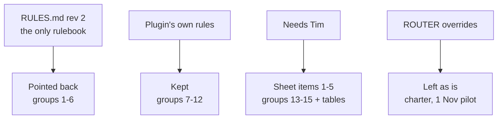

# Area: rules — bringing the plugin's own rule files up to the rulebook (Rules rev 2)

**rev 1, 20 Nov 2026 (Melbourne).** Written by the chat `CE_ACAD / rules / plan / 01` (Opus, high), from the brief
`C:\TimOS\overnight\2026-11-19\HELD_PROMPT_CE_ACAD_PLUGIN.md`, released by Tim's "start the projects" on 20 Nov 2026.
**Rulebook read:** `C:\TimOS\RULES.md` on origin/main, "Rules rev 2 — 20 Nov 2026". `ROUTER.md` on origin/main.
**Status: LOOK ONLY. Nothing has been changed in any rule file. Nothing changes until Tim says "rest agreed".**
After "rest agreed": `MASTER_PLAN.md` section B gets one line pointing at this file (not before).

---

## FOR TIM — the sheet (one answer covers it: "rest agreed", or correct any line first)

**What this is:** the plugin's plan folder has 19 files that carry rules. I sorted every rule in them into 15 groups.
Most already say what your main rulebook says, so they can later shrink to a pointer. A few clash and need you.

**Progress:** 15 of 15 groups sorted. 0 of 15 changed (waiting for you).

### First: the ones that change what you see

1. **Small tables in replies** (RULES 2.2). Eleven plugin files still say "no tables" (seven of them are the old
   prompts in item 5). Your new rulebook allows tables of up to 4 columns, with questions kept as lists.
   **Recommend:** change the four live files to the rulebook's wording. You would sometimes see a small 4-column table, e.g.
   "Pit | Size | Cover level | Status".
2. **The "PERCENTAGES block"** (RULES 4.1). The old desk start prompt tells every desk reply to show a block of
   percentages. Your rulebook says built, tested, installed and accepted are never merged into a percentage.
   **Recommend:** retire the percentages block. You would see four separate counts instead, e.g.
   "Built 6 of 9, Checked 4 of 9, Installed 3 of 9, Accepted 1 of 9".
3. **The "WHERE WE ARE" line at the top of plugin replies** (zero plan R-72). This is the plugin's own form of
   RULES 9.10 and already agrees with it.
   **Recommend:** keep it exactly as it is. Nothing changes on your screen.

### Next: the one that could make a chat do the wrong thing

4. **The zero-plan rule file acts like a second rulebook** (`zero\RULES.md`). It says "where the two disagree, Tim is
   asked which wins". Your rulebook says it is the only one and wins on any clash. Two lines clash today:
   - **Installing** (R-26): "only when I say AutoCAD is closed, deploy". Your install-when-away permission of 30 Oct
     lets a chat install when you are away. A chat reading only R-26 would refuse; one reading only ROUTER would
     install.
   - **New scripts** (R-29): "never without my approval". Your rulebook (10.5) now makes a new script the AI's call,
     recorded and reported.
   **Recommend:** rename it in its own header to "Plugin build rules" (the plugin's own how-we-build lines), keep the
   plugin-only rules (house standards as data, accoreconsole testing, the data and window rules, the AI-in-the-plugin
   rules), and replace every line the rulebook already covers with a pointer. On the two clashes, the rulebook wins,
   with your 30 Oct install permission and its limits named.
5. **Old holiday desk prompts still sit beside the plan.** Ten files from late Sep to Oct (the desk file, the desk,
   Team, release and discussion start prompts) give orders that are now wrong: "never use the question box", "Tim is
   on holiday until 26 Oct", "Max to 100%", "Tim does all testing". A new chat could follow them.
   **Recommend:** move all ten into the plan's `archive\` folder (moved, never deleted; the plan's own rule already
   says old chat prompts belong there), with one line each saying what replaced it.

### Left as they are (no answer needed)

6. **The release chat charter** and **the 1 Nov testing pilot.** Both are listed in ROUTER as your overrides. I have
   not touched their wording.
7. **The engineering rulebook, the Autodesk safety rules and the model routing list.** These are the plugin's own and
   stay. They also hold the data rules (every engineering value lives on Settings), which is your structure-first
   rule (15.11) in plugin form.

### What this does NOT cover

- **Not checked:** the code repository's own instruction files (they are owned by the building chats). Two stale
  lines found there are listed at the bottom for whoever owns them, not changed.
- **Not built, not installed, nothing tested.** No AutoCAD was opened.

---

## How each group was sorted (detail; nothing here needs Tim)

Files read (local copies matched GitHub `main` for every one): `AGENTS.md`, `CLAUDE.md`, `START_HERE.md`,
`ENGINEERING_RULEBOOK.md`, `MODEL_ROUTING.md`, `TIM_DESK.md`, `zero\RULES.md`, `zero\rulings\CHAT_AND_TIM.md`,
`CHAT_PROMPT_DESK_02` to `05`, `CHAT_PROMPT_TEAM_LANE_01`, `CHAT_PROMPT_TEAM_REVIEW_01`, `CHAT_PROMPT_RELEASE_03`,
`CHAT_PROMPT_MANAGER_SETTINGS_TRANSFER_01`, `CHAT_PROMPT_V3_PLAN_DISCUSSION`, `areas\DESK_NEW_CHAT_START_PROMPT.md`,
and the charter at the top of `areas\release-v3-colleagues.md`.

### Pointed back (the rulebook now says it; the project line can later become a pointer) — 6 groups

1. **Talking to Tim** (RULES 1, 2, 3): answer first, drawing terms, real example, clickable choices, own mistakes,
   Australian/metric/Melbourne, FOR TIM above the line, Completed / Not completed / Next. Found in `AGENTS.md` 6,
   `START_HERE` section 0, `TIM_DESK` section 3, `zero\RULES.md` R-03 to R-10, R-58, `CHAT_AND_TIM` items 9 to 14 and
   22 to 25, every `CHAT_PROMPT_*` header.
2. **Testing and acceptance words** (RULES 4, 5, 13.3): four separate facts, zero tests is not success, read back the
   file, never report an unseen check, window needs a look. Found in `START_HERE` 1b and 3, `zero\RULES.md` R-02,
   R-18 to R-24, R-31, `TIM_DESK` 6.6. R-18/R-24/R-31 carry D-089 ("Me, or a robot pass if I am busy"), which the
   rulebook's 4.5 now spells out; no clash left.
3. **Git and plan hygiene** (RULES 6.4, 8.2, 8.3, 9, ROUTER STEP 1b): add files by name, save in the same step, one
   plan, one bug file, decisions in Tim's words, superseded kept, never turn a question into a decision. Found in
   `AGENTS.md` 3 and 4, `START_HERE` section 4, `zero\RULES.md` R-11, R-17, R-30, R-57, R-62, R-71, team prompts.
4. **Privacy** (RULES 11, ROUTER STEP 5): no client name, address or key in a repo; never open
   `C:\CE_DrawingIntelligence`. Found in `AGENTS.md` 5, `START_HERE` 1 (DATA-01), `zero\RULES.md` R-38, `TIM_DESK` 9.3.
5. **One install at a time, combine first, name the undo, read what is installed** (RULES 8.4 to 8.6). Found in
   `zero\RULES.md` R-25, R-27, R-28, `START_HERE` 2. (The install GATE itself is sheet item 4.)
6. **Handoffs and parking** (RULES 7.3 to 7.5, 14): hand over at 85 to 90 percent, parked items brought back. Found in
   `zero\RULES.md` R-17, R-57, R-59, `TIM_DESK` 9.4.

### Kept (genuinely the plugin's own) — 6 groups

7. **Engineering rules** (`ENGINEERING_RULEBOOK.md` R-00 to R-29, council matrix, R-LEARN). Settings-first (R-00) and
   no hard blocks (R-27) are the data design for the plugin (RULES 15.11): keep.
8. **Autodesk API safety rules** (`ENGINEERING_RULEBOOK.md` guardrails 1 to 8, mirrored in `START_HERE` 3).
9. **Three deliverables per change and the "what specifically" test-step rule** (`ENGINEERING_RULEBOOK.md`).
   Note: its "manual checklist for Tim" wording predates 4.5 (AI tests); the checklist still serves the robot and
   Codex. Wording tidy only, after "rest agreed".
10. **Speed and reliability framework** (`ENGINEERING_RULEBOOK.md`, Tim 28 Sep).
11. **Model routing list** (`MODEL_ROUTING.md`; RULES 15.12 already points at it). Its Codex model names predate the
    18 Nov astra / sol 6.2 instruction (D-303); a one-line update, after "rest agreed".
12. **Plugin build, data and window rules** (`zero\RULES.md` R-12 to R-16, R-19, R-32 to R-56, R-65 to R-70, R-72;
    `START_HERE` 3 ownership and engineering lines; build flags `-p:SkipDevBundle=true`). R-32 to R-37 are the data
    design for the plugin (15.11): keep.

### To Tim — 3 groups (sheet items 1, 2, 4, 5)

13. **Tables and percentages** (sheet items 1 and 2). "No tables" lines (11 files): `AGENTS.md` 6, `START_HERE` 0.7, `TIM_DESK`
    3.1, `CHAT_PROMPT_DESK_02` to `05`, `CHAT_PROMPT_V3_PLAN_DISCUSSION`, `areas\DESK_NEW_CHAT_START_PROMPT.md`,
    `CHAT_AND_TIM` 14, `zero\RULES.md` Rulings 2. Percentages: `areas\DESK_NEW_CHAT_START_PROMPT.md` line 3.
14. **`zero\RULES.md` standing as a second rulebook** (sheet item 4): its header line "Also applies ... Tim is asked
    which wins", R-01 (save into AGENTS.md / CLAUDE.md; the rulebook now forbids a copy under those names), R-26,
    R-29. `CHAT_AND_TIM` open item 5 says the same disagreement is still open there.
15. **Old holiday prompts** (sheet item 5): `TIM_DESK.md`, `CHAT_PROMPT_DESK_02` to `05`, `CHAT_PROMPT_TEAM_LANE_01`,
    `CHAT_PROMPT_TEAM_REVIEW_01`, `CHAT_PROMPT_RELEASE_03`, `CHAT_PROMPT_V3_PLAN_DISCUSSION`,
    `areas\DESK_NEW_CHAT_START_PROMPT.md`. `CHAT_PROMPT_MANAGER_SETTINGS_TRANSFER_01` is a build brief for an item,
    not a rule file; it stays where the manager area wants it.

### Left as is (ROUTER overrides; wording untouched)

- The OPERATING CHARTER at the top of `areas\release-v3-colleagues.md` (override 1).
- The 1 Nov testing pilot (override 4).

---

## Found outside this job's files (for the owning chats; not changed)

1. **Plugin repo `AGENTS.md`** line 84: "Tim's normal workday is 8:40 am to 5:30 pm Australia/Sydney time". RULES 1.8
   uses Melbourne time and the 8:30–2:00 / 3:00–5:30 windows. It also says "He does ALL testing in AutoCAD", which
   predates 4.5.
2. **`C:\Lisp Files\CLAUDE.md`** line 53 still points at `~/.claude/rules/common/`, retired 19 Sep 2026; and it says
   "Do not start new work until Tim confirms the previous change is tested", which predates 4.5.
3. **Chat memory** `tim-wants-percentages-every-message` (20 Oct) clashes with RULES 4.1 the same way as sheet item 2.

## How this file is saved

Saved in `C:\CE_PLAN` by file name only (`git add areas/rules.md`), pushed to `main`. What the push sets off: only the
leak-scan pre-push hook (`C:\TimOS\skills\leak-scan\hooks\pre-push`). This repo has no GitHub workflows, so nothing
builds, installs or publishes. Undo: `git revert` of this one commit.

## After "rest agreed" (the order, one save each)

1. One line in `MASTER_PLAN.md` section B naming this area.
2. Groups 1 to 6: replace each covered line with a pointer to its RULES number (one file per save).
3. Group 13: tables wording to RULES 2.2; retire the percentages block.
4. Group 14: retitle `zero\RULES.md` as plugin build rules; rulebook wins on R-01, R-26, R-29.
5. Group 15: move the ten old prompts to `archive\chat-records-2026-10\` with a replaced-by line each.
6. Groups 9 and 11: the two one-line wording tidies.
7. A fresh read-only checker compares every changed file with this sheet (RULES 5.10).
