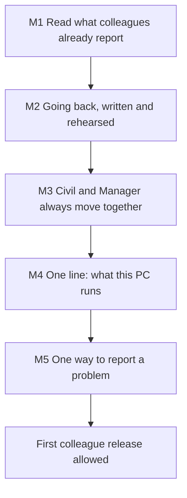

# Area TRUST, Manager part: install, update, going back, seeing what a colleague runs, reporting a problem

**Status: PROPOSAL, written Thu 12 Nov 2026 by chat CE_ACAD / trust plan / plan / 02 Structural + Manager.** Nothing here is built, tested, installed or accepted. Planning only: no code was changed and nothing was run.

**Part of area TRUST** (`areas\trust-plan.md`). It sits beside the release process draft (`areas\TRUST_RELEASE_PROCESS_DRAFT_12NOV.md`) and makes its "going back has been rehearsed" line into steps. It is not a second plan (RULES 9.1).

**Code read:** Manager 1.1.89 and Shared at commit `cf059dcf` (read-only copy `C:\CE_WORK\scratch\audit_civil`). Every claim below is marked **Verified** (this chat read the line itself) or **Carried** (from a code reader's report or an older document, not re-read here).

---

# FOR TIM

**Answer: Manager can safely prepare an update in the background, but nothing in it finishes an install on a colleague's PC. Today every colleague install, update and step back is done by hand, and none of the three has ever been rehearsed on a colleague-style PC.**

**What works, by the code (not proven on any colleague's PC):**

1. **Manager copies a new approved build into a waiting folder** about 15 seconds after AutoCAD starts. It never touches the plugin AutoCAD is running.
2. **It refuses a build that is not signed by you,** and refuses anything that would download from the internet.
3. **Civil always goes first.** If Civil cannot be prepared, Manager is not prepared alone, so the two never split at this stage.
4. **The installer refuses to run while AutoCAD is open** and puts the old plugin back if the swap fails.
5. **A colleague who presses "Updates" sees their own page,** not your company-wide dashboard. The 29 Oct fault (BUG-1247) is fixed in the code.
6. **The support zip stays on the colleague's PC** and has names and drawing paths taken out before it is made.

**What has never been proven on a colleague-style PC:**

1. **A first install.** The colleague pack does it by hand (copy two folders). Never rehearsed.
2. **An update.** Manager prepares it; a person must still run the installer on that PC. Never rehearsed end to end.
3. **Going back a version.** The pack's hand steps have never been tried. Manager's own button is hidden and only you can see it.
4. **That a drawing saved on a newer CE opens cleanly on the older one.**

**Six steps, safest first.** M1 reads only. M2 is a rehearsal with no code. M3 to M5 are small code changes, each behind a switch.

**Decisions for you are straight below** (five, each with a recommendation). Nothing waits on them: the steps are written on the recommended answers, marked DRAFT.

## Decisions for Tim (read these first)

1. **Where the rehearsals happen.** Recommended: **a second Windows login on a spare office PC.** Example: the rehearsal swaps CE back and forth five times; on your own login one slip would leave you without CE on a job morning. OPEN.
2. **Manager's Roll Back button.** Recommended: **stays hidden; going back is by hand** until the hand steps have passed twice and the button has been tried once on the spare login. Example: a colleague who pressed it today would change the approval for the whole office, and still need someone to run the installer. OPEN.
3. **Structural in the same release as Civil, or after.** Recommended: **after,** as its own release, once Civil's first release has had its clean days (matches "civil is main priority"). Example: if Structural rode with Civil and a support block fault appeared, you could not tell colleagues "go back Structural only" because Manager has no Structural-only route. OPEN.
4. **How a problem comes back.** Recommended: **a message to you (Teams or in person) with the CESUPPORT zip,** and the "Send a fault report" button kept quiet until it is checked for names. Example: a colleague sends "C1 put an 89 SHS on the first floor, should be 75" plus the zip; you know which tool and build from the zip. OPEN (same as release process E2).
5. **2022 to 2024 colleagues.** Recommended: **no colleague on 2022 to 2024 in the first release** (your 12 Nov answer A3 was 2027 for the first colleague), and M2 rehearsed on 2027 only. Example: on 2024 nothing on screen says an update is waiting, so a colleague could sit on an old build without knowing. OPEN.

---

## 1. What a colleague's PC goes through today (from the code)

1. **AutoCAD starts.** Manager waits about 15 seconds, then looks in the office IT Admin folder for an approved build newer than what this PC has. **Verified:** `Modules\Manager\Plugin.cs:141-147` ("Thread.Sleep(15_000) ... StageManagedUpdates").
2. **If there is one, it copies it into a waiting folder** on this PC, with no question asked. Civil first; if Civil fails, Manager is skipped with a plain note. **Verified:** `Services\CeApprovedReleaseService.cs:626-647` ("was not staged because CE Civil could not be staged first").
3. **On AutoCAD 2025 to 2027 the ribbon says an update is ready** and to ask your CE administrator. **On 2022 to 2024 nothing tells the colleague.** **Verified:** the status hook is inside a 2025-and-later block, `Plugin.cs:159-161`.
4. **Nothing in Manager runs the installer.** The colleague is told to "ask your CE administrator to finish the install". **Verified:** `Services\CeInstallWords.cs:6-12`.
5. **The installer, run by hand, swaps one plugin per run.** It refuses while AutoCAD is open, keeps a copy of the old plugin, and puts it back if the swap fails. **Verified:** `Installer\SafeBundleInstaller.cs:315-317` (the kept copy), `356-361` (put back), `402` ("AutoCAD is still running"). **Carried:** that the installer has no Civil and Manager pair check of its own.
6. **The old install scripts are retired** and refuse to run. **Verified:** `Installer\Install-CECvlSuite.ps1:9` ("RETIRED ... cannot install CE").
7. **How Manager itself first arrives on a new PC:** no route found in the code. The colleague pack does it by copying folders by hand (`areas\colleague-pack\02_INSTALL_AND_UPDATE.md`, section 2). **Carried** (reader searched; this chat did not re-search).

## 2. Going back a version, as built

1. **Manager's Roll Back button is hidden** unless a small switch file on that PC says otherwise, and only an administrator can press it. **Verified:** `Services\CeOneGlanceStatus.cs:389` (off unless the file says true), `UI\Dialogs\PluginAdminWindow.xaml.cs:22-23`.
2. **Pressing it does not touch any PC directly.** It rewrites the office approval record to the previous version; each PC then prepares the older build at its next start, and a person must still run the installer there. **Verified:** `Services\CeApprovedReleaseService.cs:384-402` (the record is rewritten, marked "Rolled Back").
3. **Only one earlier version is remembered.** Going back swaps the two, so you cannot go back two versions. **Verified:** same lines (the current version becomes the "previous" one).
4. **The older build must still be in the office folder and still pass the signature check.** **Carried.**
5. **Structural has no release route of its own in Manager.** The signed-release profiles are "Coordinated CE", "Standalone Manager" and "Standalone Civil". **Verified:** `Shared\CE.Release\OfficialReleaseGate.cs:160-165`.
6. **The colleague pack says never press Roll Back and go back by hand** (rename folders back). Those hand steps have never been run. **Carried:** `areas\colleague-pack\02_INSTALL_AND_UPDATE.md` section 7, BUG-441, BUG-477.

## 3. Seeing what a colleague is running, as built

1. **Only Manager reports its own version** to the office folder, with a coded user and PC name and AutoCAD's internal version number. **Verified:** `Services\CeAdminTelemetryService.cs:86-104` (the report carries Manager's name only).
2. **Civil and Structural write their own reports, which are never sent by default.** **Verified:** `Services\CeAdminStorageService.cs:438-439` ("usage, machine reports and anything else: never read, never sent").
3. **So your dashboard cannot show which Civil or Structural build a colleague has.** **Carried** (reader's reading of the dashboard; follows from 1 and 2).
4. **CE_VERSION on the colleague's own screen shows all three loaded plugins** and warns if two copies of one are loaded. It shows AutoCAD's internal number, not the year. **Carried.**
5. **CEHEALTH always prints Manager as OK,** and skips the Civil and Manager pair check when it cannot find Civil, so it can say "All checks passed" without checking the pair (BUG-484). **Verified:** `Services\CeHealthChecks.cs:28-29` and `36-39`.
6. **Manager's switches live on each PC separately,** so Manager can behave differently on your PC and a colleague's without anyone seeing it. **Verified:** `Services\CeOneGlanceStatus.cs:345-352`.
7. **Nobody's settings are reported anywhere.** **Carried.**

## 4. Reporting a problem, as built

1. **CESUPPORT makes a zip of the last 14 days of CE logs on the colleague's desktop and stops.** It never sends anything. **Verified:** `Services\CeSupportBundleService.cs:47-50` ("never queued for upload and never copied to the office folder").
2. **Names, PC names and drawing paths are taken out** before the zip is made. **Carried:** `Services\CeSupportBundleScrub.cs:97-112`.
3. **A different button, "Send a fault report", does write straight into the office folder.** So there are two routes with different privacy treatment. **Carried:** `Services\CeDiagnosticsService.cs:303-310`.
4. **Civil's own feedback tool promises a send step that does not exist** (BUG-1215, Civil side). **Carried** from the trust check.

## 5. The steps (safest first)

Each step follows the same gate as the Civil steps (`areas\trust-plan.md` section 1). None needs AutoCAD on your PC during your hours.

### M1: read what colleagues already report (read only)

1. **Goal:** know, before anything is sent, which Manager build and AutoCAD year each colleague has today (plan probe P5).
2. **What you see:** a short list: colleague (coded), PC (coded), Manager build, AutoCAD year, last seen. No names written to any file.
3. **Depends on:** nothing. The reports are already in the office folder.
4. **Proven by:** the list matches the files it was read from (a count check). Codex not needed. You glance at it.
5. **Undo:** nothing to undo; nothing is written to any PC.
6. **Risk: LOW.** The reports only carry Manager's build, so Civil and Structural stay Unknown until M4.
7. **Not allowed:** opening any colleague's drawings or settings, or writing a real name into the plan.

### M2: going back a version, written and rehearsed (no code)

1. **Goal:** one page of going-back steps that has actually been done once, on a PC set up like a colleague's.
2. **What you see:** the steps in drafting words, with pictures of each folder; a short record: "Rehearsed on <date>: newer build in, a drawing saved, older build back, drawing opened, CEHEALTH clean."
3. **Depends on:** a colleague-style PC. **Recommended: a second Windows login on a spare office PC,** never your own login (decision 1). Your PC is only used outside your hours if no spare PC exists.
4. **Proven by:**
   1. **robot:** before and after, the fingerprint of each plugin file matches the build it should be; CE_VERSION reads the right numbers;
   2. **a drawing test:** a made-up drawing saved under the newer build opens under the older one, and the robot reads the same pits, pipes and supports from it;
   3. **Codex:** looks at the ribbon and CEHEALTH after each swap;
   4. **you:** read the one-page record.
5. **Undo:** the rehearsal is itself the undo. Old folders are renamed, never deleted.
6. **Risk: LOW on a spare login.** The one real risk is the settings folders: the pack copies five aside because nobody knows whether the older build reads the newer files. The rehearsal finds out.
7. **What it does NOT use:** Manager's Roll Back button. That stays hidden until M2 has passed twice by hand (decision 2).

### M3: Civil and Manager always move together (small code, switch)

1. **Goal:** a PC can never end up with new Civil and old Manager, which loses the CE ribbon because they share one file.
2. **What you see:** if the installer is asked to swap one without the other, it stops with: "Civil and Manager share a file. Install both from the same release." CEHEALTH says "Civil and Manager pair: not checked (Civil not found)" instead of saying nothing.
3. **Depends on:** M2 (so the rehearsal shows where a split can happen).
4. **Proven by:** robot: a deliberately mixed pair must be refused; a matching pair must pass; CEHEALTH on a PC with no Civil prints the "not checked" line. Codex reads the wording.
5. **Undo:** a switch returns the installer to one-at-a-time.
6. **Risk: LOW to MEDIUM.** It touches the installer, which is the one thing that can leave a PC without CE.

### M4: one line saying what this PC runs (small code, switch; card DRAFT `04_REFERENCE\ux-plan\cards\TRUST-M4_WHAT_EACH_COLLEAGUE_RUNS_CARD_DRAFT_2026-11-12.md`)

1. **Goal:** you can see every colleague's Civil, Structural and Manager build and AutoCAD year, and whether they are on the office setup (from Civil step 3).
2. **What you see:** your dashboard gets one row per PC: "Civil 3.0.90, Structural 1.0.126, Manager 1.1.89, AutoCAD 2027, office setup yes". The colleague sees the same line in CE_VERSION, with the year, not AutoCAD's internal number.
3. **Depends on:** M1; Civil step 3 for the office setup half.
4. **Proven by:** robot on two logins: the row matches what CE_VERSION shows on each. Codex looks at the row. You check your own row is right.
5. **Undo:** a switch stops the extra lines being written.
6. **Risk: LOW.** It adds three version numbers to a report Manager already sends. No names, no drawings.

### M5: one way to report a problem (small code, switch)

1. **Goal:** a colleague has one plain way to tell you something went wrong, and it never sends anything they have not seen.
2. **What you see:** on the recommended answer (decision 4): CESUPPORT makes the zip and opens the folder, with one line: "Send this zip to Tim with the drawing name and what you did." The "Send a fault report" button and the Civil feedback tool say the same thing, and Help stops promising a send step that does not exist.
3. **Depends on:** your choice of route (decision 4).
4. **Proven by:** robot: the zip has no real names or drawing paths (a made-up name planted in a log must come out removed); nothing new appears in the office folder. Codex reads the words.
5. **Undo:** a switch puts the old wording back.
6. **Risk: LOW.**

### M6: first install on a new colleague's PC, rehearsed (no code)

1. **Goal:** the colleague pack's install steps done once on the same spare login as M2, start to finish, with the pictures the pack still lists as owed.
2. **What you see:** the pack's page 2 with every [CHECK] answered and every [SCREENSHOT] taken.
3. **Depends on:** M2 (same PC, same session is fine).
4. **Proven by:** CEHEALTH all OK, CE_VERSION right, the core ribbon present; Codex looks.
5. **Undo:** the M2 steps.
6. **Risk: LOW.**

**What is left out on purpose:** Manager finishing an update by itself when AutoCAD closes. The parts exist but nothing uses them (**Carried:** `Services\CeFinishUpdatePlanner.cs` is used only by tests). Turning that on is a big change to colleagues' PCs and is not needed for the first release; updates stay by hand, by the keeper, as the release process draft proposes.

## 6. Decisions for Tim

Moved to the top of this file, straight after FOR TIM (RULES 2.9).

## 7. What must be true before a colleague release (the Manager half)

1. **M2 and M6 rehearsed and recorded,** on a colleague-style PC, on the AutoCAD year the colleague uses.
2. **M3 in:** Civil and Manager cannot split.
3. **M4 in:** you can see the colleague's builds after the install.
4. **M5 in, or the hand route agreed:** the colleague knows how to report.
5. **The keeper named** (release process E1) and the previous release's folders kept and written in the release note.
6. **The leftover old install scripts and builds in the IT Admin folder moved aside** so nobody runs one over a new install (colleague questions, BUG-483). That counts as touching the office folder, so it needs your word.

## 8. Faults this plan touches

1. **BUG-441, BUG-477:** Roll Back not proven, still live for administrators. Handled by decision 2 and step M2.
2. **BUG-484:** CEHEALTH can say all passed without the pair check. Step M3.
3. **BUG-1247:** fixed in the code at 1.1.89 by a switch that is on unless switched off. **Verified:** `Commands\PluginManagerCommands.cs:103`, `Services\CeOneGlanceStatus.cs:262-281`. Not yet seen in AutoCAD after the fix.
4. **BUG-1261:** the old support zip upload by folder name. The zip no longer uploads (section 4, line 1), so the risk now sits with "Send a fault report". Step M5.
5. **BUG-1166:** Civil and Manager look for the office folders in different places. Not a Manager step here; noted because it decides where M5's reports land.

## 9. Other things found while reading (for later, not in a step)

1. **If the office folder cannot be reached, anyone can make themselves administrator on that PC,** and that local list is later copied to the office folder. **Verified:** `Services\CeAdminPolicyService.cs:245-257` ("is now the CE administrator on this PC only"). Worth a bug entry; not fixed by this plan.
2. **On 2022 to 2024 Manager switches AutoCAD's menu bar on** when no ribbon is drawn, unless a switch says not to. **Verified:** `Services\CeSuiteManagerMenuService.cs:831-832`, `855-861`. A visible change a colleague did not ask for, but harmless.
3. **The same version may be prepared again and again** because the date compared comes from the 2022 to 2024 files while the PC runs the 2027 files. **Carried** (reader's reading of `CePluginInstallerService.cs:211-213`); needs a check before it is called a fault.
4. **Manager's feedback count looks in one fixed folder** instead of the office folder Manager finds elsewhere. **Carried.**

## 10. Not known yet

1. **Which build, AutoCAD year and settings each colleague has today.** M1 answers the Manager half.
2. **Whether a drawing saved on the newer CE opens cleanly on the older one.** M2 answers it.
3. **Whether the older build reads the settings files the newer one wrote.** M2 answers it.
4. **How Manager itself first gets onto a new PC** other than by copying folders. No route found in the code.
5. **Whether a spare office PC exists** for the rehearsals.
6. **What colleagues prefer for reporting.** Nobody has asked them.

## 11. RULES 15.8, the six foundations (Manager)

1. **One fact in one place:** APPLIES. GAP: switches live per PC; the approval record remembers one previous version only.
2. **A restore that has been run:** APPLIES. GAP: no going back has ever been run. M2 is the cure.
3. **Platform watch:** APPLIES in a small way: the plugin carries three AutoCAD lanes (2022 to 2024, 2025 to 2026, 2027). Covered by decision 5.
4. **Tight access:** APPLIES. GAP: the local administrator fallback (section 9 line 1).
5. **Alerts:** APPLIES. GAP: nothing tells you a colleague is behind or split. M3 and M4.
6. **No dead data:** APPLIES. GAP: the "finish at next start" parts and the staged rollout tick list have no caller (**Carried**).

## 12. Status

1. **This document:** PROPOSAL. Built no. Tested no. Installed no. Accepted no.
2. **Steps M1 to M6:** no cards yet. The card for "going back a version, rehearsed" (M2) is next in this lane's queue.
