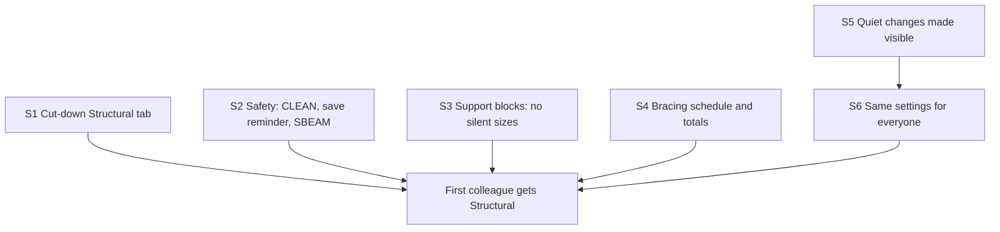

# Area TRUST, Structural part: a small Structural core you can trust

**Status: PROPOSAL, written Thu 12 Nov 2026 by chat CE_ACAD / trust plan / plan / 02 Structural + Manager.** Nothing here is built, tested, installed or accepted. Planning only: no code was changed and nothing was run.

**Part of area TRUST** (`areas\trust-plan.md`). Structural follows Civil (Tim, 5 Nov: "civil is main priority"). It uses the same gate, the same five trust rules and the same stop rule as the Civil steps. It is not a second plan (RULES 9.1).

**Code read:** Structural 1.0.126 at commit `8de95c34` (read-only copy `C:\CE_WORK\scratch\audit_struc`). Paths below are inside `Modules\Structural\`. Every claim is marked **Verified** (this chat read the line itself) or **Carried** (from a code reader's report or the 6 Nov audit, not re-read here).

---

# FOR TIM

**Answer: keep about 30 Structural tools (32 in the full list) on a cut-down tab, in roof-down order, and fix six things first: the bracing schedule, the bracing totals, the column size taken from the schedule, CLEAN's mixed messages, the missing save reminder and the SBEAM crash.**

**The core, in the order you draft (roof down, footings last):**

1. **Roof:** R1 rafter marks, P1 purlin marks, BT1 roof bracing truss.
2. **Upper floors:** the beam tools (typed 1, 2, 4, 5, BDL and BSET), the support blocks DS, DS1, TS1, C1, C2 and their switch versions, FJ1 joist marks.
3. **Walls and ground:** AB and BB wall bracing, the A/B switch, the bracing panel and the bracing schedule.
4. **Footings:** nothing in the first core. Footing tools join later, one at a time.
5. **On every drawing:** CLEAN, Help, Settings.

**Why these:** your own command log (59 days from 3 Jun) shows DS 211, BEAM 211, BB 134, DS1 93, AB 93, C1 60 uses. Nothing else comes close. The log misses some commands, so a tool you use daily that is not here goes back in on your word.

**What a colleague would see that is wrong today** (all read from the installed code):

1. **The bracing schedule is one row short,** so the last brace can be missing, and a brace you erase stays on the schedule.
2. **The wall bracing total counts roof bracing trusses (BT1) as wall bracing,** and a brace with no type is counted as type A.
3. **C1 says "size 89 SHS from the schedule"** even when that row belongs to another floor, and DS1 can say a timber size came from the schedule while drawing 90 x 90.
4. **CLEAN saves (your 5 Nov fix), but its tooltip and the Settings page both say CE never saves.**
5. **No reminder when work has gone unsaved.** Only a small label on the palette.

**Decisions for you are straight below** (ten, each with a recommendation and an example). Nothing waits on them: the steps are written on the recommended answers, marked DRAFT.

## Decisions for Tim (read these first)

1. **When Structural reaches colleagues.** Recommended: **after the Civil core has had its clean days with colleagues.** Example: if C1 put the wrong size on a first-floor plan in the same week as a Civil fault, you could not tell which release caused it. OPEN.
2. **CLEAN meets an object on a locked layer.** Recommended: **leave it alone, list it, carry on and save.** Example: a locked title-block layer no longer stops the whole text clean-up; CE says "1 text on locked layer TITLE left as it was". OPEN.
3. **SBEAM in the first core.** Recommended: **hidden** until the 5 Nov crash has been reproduced on a copy and shown not to happen, and the section list is checked. A guard is written on the held S-46 build; the crash itself is not reproduced or proven fixed. Example: a colleague places a steel section on a deadline and AutoCAD closes, as it did for you on 5 Nov. OPEN.
4. **The same mark on two floors of the schedule.** Recommended: **ask which floor, showing both sizes.** Example: "C1 is 89 SHS on GROUND and 75 SHS on FIRST. Which?" OPEN.
5. **Roof bracing trusses in the wall bracing totals** (engineering). Recommended: **never added to wall totals; shown on their own line.** Example: two 4 m BT1 trusses no longer turn a short wall direction green. OPEN, needs your word.
6. **A brace with no type** (engineering). Recommended: **counted as Unknown, panel amber.** Example: a brace pasted from an older job with its tag cleared stops being counted as type A. OPEN, needs your word.
7. **The core list.** Recommended: **the list in section 1.** Example: CSTIEDOWN stays typed only until it has its own three days. OPEN (your marks on the keep / hide list).
8. **The save reminder: DECIDED, not a question.** Your decision 223 (`decisions\2026-10-29_TIM_ANSWERS.md`, line 830): "c" = both: a "Not saved for 25 minutes" reminder (your 25 Sep ruling) AND timed backup copies of unsaved work to the CE backup folder only, never over your drawing. The record says you named neither number; 25 is from your 25 Sep ruling, a copy every 10 minutes is the desk's default. (Corrected 12 Nov 23:53: this line first recommended 20 minutes, which ignored that decision.)
9. **What decides a button: the core list or the expert mark.** Recommended: **the core list alone; the expert mark keeps its palette meaning** (changed 12 Nov 23:53 to match card TRUST-S1; the earlier recommendation, "expert = typed only", is superseded). Example: STRSCHEDREFRESH is marked expert today but is in the core list, so it goes on the tab once S4 is in. OPEN.
10. **Explaining Structural days roof-down.** Already your standing rule (4 Oct, UX-STRUC-13). Not a question; recorded so the cards follow it.

---

## 1. Which tools are the Structural core, and why

Evidence: Tim's command log on real jobs (`areas\CORE_TICK_LIST_05NOV.md` section 2), the 6 Nov audit, and the installed command list (`Assets\Config\command-registry.json`, 375 rows, **Verified**). No colleague's use is known. Typed commands that never reach the log (CLEAN, SBEAM) are judged from the records.

### Roof

1. **R1 (rafter marks), P1 (purlin marks):** KEEP. Few uses, but every roof needs them. R1 is on the Beams panel; P1 falls to the catch-all Annotate panel because its row has no group. **Verified:** registry line 2651 (R1), line 195 (P1, empty group). Open: bay sizes not reaching the block (BUG-584, fix installed, untested), wrong place in a rotated UCS (BUG-467).
2. **BT1 (roof bracing truss):** KEEP, with S4 first, because its trusses are added to the wall totals today.

### Upper floors

3. **Beam tools 1, 2, 4, 5 and BDL:** KEEP. The log calls these "BEAM" (211 uses); in the build they are typed `1`, `2`, `4`, `5` and `BDL`. **Verified:** registry lines 1987 to 2135. How the log name maps to each number is not known.
4. **BSET, BSETLIST, BSETRESET (beam inside point):** KEEP. Open: tooltip wording (BUG-1077).
5. **DS, DS1, TS1, C1, C2 (support blocks):** KEEP, with S3 first. DS 211, DS1 93, C1 60, C2 12 uses.
6. **SDS, SDS1, STS1, SC1, SC2 (switch a support):** KEEP. Under 10 uses each. Open: a switch can disturb a neighbour's label (BUG-975).
7. **FJ1 (joist marks):** KEEP. Same open fault as R1 (BUG-584).

### Walls and ground

8. **AB, BB (wall bracing) and the A/B switch:** KEEP. BB 134, AB 93 uses. The switch is typed ABS; the name ABSWITCH is hidden as a duplicate when AutoCAD starts. **Verified:** registry lines 2490 (ABS), 2512 (ABSWITCH); the duplicate hiding is **Verified** (`Services\CommandRegistryService.cs:505-539`: any entry whose name is another entry's other name is marked hidden at start-up).
9. **CSBRACINGPANEL (required against provided):** KEEP, with S4 first.
10. **STRSCHEDCREATE, STRSCHEDREFRESH, STRSCHEDSYNC (bracing, pier and tie-down schedules):** KEEP, with S4 first.

### On every drawing

11. **CLEAN:** KEEP, with S2 first. FASTSAVE stays typed only (it is hidden today as a duplicate name of CLEAN, though it runs a lighter clean-up). **Verified:** registry lines 4136-4138 list FASTSAVE as another name of CLEAN, and FASTSAVE has its own entry at line 4157, which the start-up rule above then hides.
12. **CEHELP, CESETTINGS:** KEEP.

### Hidden for the first core (typed still works, nothing deleted)

1. **SBEAM and SBEAMEDIT:** HIDE until the 5 Nov crash (BUG-1275) is reproduced on a copy and shown not to happen (a guard exists on the held S-46 build; the crash itself is not proven fixed), and the section list is checked (BUG-818, 819). CEMEMBER replaces it later.
2. **CSTIEDOWN, CSWINDCLASS, CSSOILREPORT:** HIDE (2 or 3 uses each). Join one at a time.
3. **Every footing tool** (FST, FSF, BP family, CSPIER, stump footings): HIDE for the first core. Footings come last in the drafting order and carry open faults (BUG-300, BUG-536).
4. **The roof-down tools that ship switched off** (roof setout, floor span arrow, lintels, framing legend, member schedule, wall schedule, footing proposals): stay off, as today. **Verified** off by default, for example `Models\UserSettings.cs:1430` (roof setout).
5. **About 340 other commands** (hatches, text codes, legacy details, sheets, markup): HIDE from the colleague tab. The full keep / later / hide list, with ten questions only you can answer: `areas\STRUCTURAL_COMMAND_SORT_12NOV.md`.

## 2. What already exists to cut the tab down, and what does not

1. **A "hidden" mark exists and the ribbon obeys it.** 63 of 375 rows are hidden. **Verified:** count of `"hidden": true` in the registry; the ribbon skips them at `Services\RibbonCommandHubService.cs:176-179`.
2. **An "expert" mark exists, but the ribbon ignores it.** 39 rows are marked expert, and every ribbon builder asks for expert rows too. **Verified:** count of `"expert": true`; `RibbonCommandHubService.cs:178` and `Services\CeStrucRibbonContributor.cs:29` both say "includeExpert: true". The "show expert commands" setting only affects the palette and the help window. **Verified:** its only readers are `UI\Palette\CommandsPanel.xaml.cs:81` and `UI\Dialogs\CommandHelpWindow.xaml.cs:47`.
3. **No "core list" setting exists.** **Verified:** the pinned list is read only by `UI\Palette\CommandsPanel.xaml.cs`; no other list of commands for the ribbon was found by search.
4. **The pull-down menu is a separate list.** It comes from a ready-made menu file, then the menu already installed, and only failing both is it made fresh, from a layout file when that has entries and from the command list otherwise. **Verified:** `Services\WorkspaceMenuInstallerService.cs:40-61`, `Services\CuiMenuGeneratorService.cs:75-86`. The 219-entry count of the layout file is **Carried**. So the ribbon and menu can drift, exactly as on the Civil side.
5. **The tidier ribbon you ruled for on 25 Sep** (about 40 tools in families) is built and switched off. **Verified:** `Models\UserSettings.cs:1164` (one name per tool), `1180` (beam family), `Models\CommandHubTagSettings.cs:16` (tag family), all false.

## 3. Structural "hidden changes" (CE changes the drawing without saying so)

1. **After a MOVE, CE quietly re-sets the anchor point of moved single-line text** when AutoCAD goes idle. No line on screen. **Verified:** `Services\DrawingAutoSaveService.cs:1098-1105` (the repair runs on idle); the file's only command-line message is line 241, an autosave line. What is changed is the text's insertion point or alignment point. **Verified:** lines 959 and 966 of the same file (inside the repair at line 881).
2. **Footing outlines are redrawn after an edit** and the footing schedule is marked out of date, silently when it works. **Verified:** `Services\FoundationService.cs:785` (schedule marked out of date) and `796-798` (redraw with nothing said; a line only when it fails).
3. **Old beam links are converted to the new form when a drawing opens,** with a marker written into the drawing. The message reaches only the log. **Verified:** `Services\LinkMigrationService.cs:29-33` (runs on every open drawing), `78-84` (only when old links exist), line 20 (the marker), and no command-line message anywhere in the file.
4. **CLEAN changes much more than its name suggests:** purge, every Xref onto layer XREF, text onto Arial Narrow, current colour and linetype set to ByLayer, a HATCH 21 layer, then a regen and a save. It prints a summary. **Verified:** `Services\CleanPipelineService.cs:16-19` (XREF, HATCH 21, Arial Narrow), `114` (purge), `136-145` (ByLayer and regen), `468-469` (current colour and linetype), `160-169` (the save). The full per-object list (dimensions, leaders, multileader styles) is **Carried**.
5. **Good model to copy:** when a beam follows its support, CE prints "CE moved ... One U undoes both." **Verified:** `Services\BeamLinkService.ConnectedFollowApply.cs:553`. Every quiet change above should end the same way.

## 4. Structural "guesses shown as facts"

1. **C1 and C2 take their size from the first schedule row with the same mark,** with no floor. The schedule has no floor field at all. The command line then says the size came "from the schedule" and skips the size question (BUG-501). **Verified:** `Commands\SupportBlockCommands.cs:249-255`, `Services\MemberScheduleService.cs:31-44`.
2. **If that schedule size is not a size the block knows** (for example a timber stud pack on DS1), CE quietly draws the default 90 x 90, while the line on screen still names the schedule size. Log only. **Verified:** `Commands\SupportBlockCommands.cs:1470-1480` and the defaults at lines 66 to 69.
3. **A brace with no type is counted as type A.** **Verified:** `Services\ProjectDataService.cs:316-320`.
4. **Roof bracing trusses count as wall bracing.** BT1 inserts the same BRACING block, and the totals pick up every BRACING block by name (BUG-499). **Verified:** `Commands\BracingCommands.cs:318-320` ("BRACING", "WALL BRACING TYPE BT1"), `Services\ProjectDataService.cs:282-283`.
5. **The bracing schedule is one row short when made, and keeps erased braces when refreshed** (BUG-497, BUG-498). **Verified:** `Services\ScheduleService.cs:384` (rows = braces + 1, but title and heading take two), `681-699` (refresh adds rows, never clears leftovers). The pier schedule has the same shape (lines 422, 701 to 723); the tie-down schedule does clear leftovers.
6. **CLEAN says two opposite things.** Its tooltip says "Does not save: save the drawing yourself"; its long description and the code save. The Settings page says "CE never saves". **Verified:** registry lines 4145 to 4146; `UI\Dialogs\CeSettingsDialog.xaml:557`.
7. **CLEAN can report "saved" when it is not sure.** If its own save fails it sends QSAVE and marks the save done without checking. **Verified:** `Services\CleanPipelineService.cs:167-169`.
8. **Drawing units.** CORRECTED 12 Nov 23:43: the code reader said the beam tools had no units check; that was wrong. The beam tools 1, 2 and 4 scale for millimetre, metre and inch drawings and refuse any other units with a plain line (BUG-577). **Verified:** `Services\ConnectedDesign\Host\BeamCommandAutoCadRenderPort.cs:65-75`, caught for 1 and 2 at `BeamCommandAutoCadPromptAdapter.cs:101` and for 4 at `BeamSpecialCommandAutoCadPromptSession.cs:256`. Beam 5 (offset helper) and BDL were not traced. The support blocks, AB, BB, BT1, R1, FJ1, P1 and CEMEMBER stop in a drawing that is not in millimetres. **Verified:** `Commands\SupportBlockCommands.cs:216`, `Commands\BracingCommands.cs:18, 134, 249`, `Commands\RafterJoistCommands.cs:100`, `Commands\CeMemberCommands.cs:40`. SBEAM's command file and the bracing service have no units check that a search could find. Fixed distances such as the 250 link search (`Services\BeamLinkService.cs:340-345`) and the 2000 beam search (`Models\UserSettings.cs:494`) are in drawing units. **Verified.**
9. **The required bracing figures are kept on the PC, not in the drawing,** so the last job's figures show on the next job (BUG-500). **Verified:** `Commands\BracingPanelCommands.cs:93, 123` (read from and saved to the PC's settings).

## 5. The steps (safest first)

Same gate as Civil: card, your approval, built small, robot then Codex on copies, installed with its undo named, about three working days on real jobs, your word. Structural steps start only after the Civil core is accepted, unless you say otherwise (decision 1).

### S1: the Structural tab cut down to the core (layout only)

1. **Goal:** a colleague sees only the core tools, in roof-down order; everything else can still be typed.
2. **What you see:** one Structural tab: Roof (R1, P1, BT1) | Floors (beams, BSET, supports, switches, FJ1) | Bracing (AB, BB, switch, panel, schedules) | Tools (CLEAN, Help, Settings). Today's flat tab stays behind a switch.
3. **Depends on:** your marks on the keep / hide list (next in this lane). Civil step 2, so both tabs use one way of choosing buttons.
4. **How:** a new office core list, read by both the ribbon and the pull-down menu, so they cannot drift. The core list alone decides; the expert mark is not used for it (decision 9). Behind a NEW switch, off by default.
5. **Proven by:** robot reads the ribbon back against the list, button by button, and presses each once on a copy; a list with one button removed must fail; ten hidden commands still run when typed; the menu lists the same tools. Codex looks at the tab at normal and narrow widths. You draft with it for three days.
6. **Undo:** switch off and restart AutoCAD; today's tab is back.
7. **Risk: LOW.** Nothing in a drawing changes. Main risk: a tool you use daily that the log never saw.

### S2: safety fixes (CLEAN, save reminder, SBEAM, Reset)

1. **Goal:** nothing a colleague does can lose work without warning.
2. **What you see:**
   1. **CLEAN:** the tooltip and the Settings page say plainly that CLEAN saves; if the save cannot be confirmed it says "NOT SAVED: save the drawing yourself"; an object on a locked layer is left alone and listed, instead of the whole step failing.
   2. **Save reminder and backup copies (decision 223):** "Not saved for 25 minutes." on the command line, and a backup copy of unsaved work every 10 minutes in the CE backup folder only (BUG-1276, Structural half).
   3. **SBEAM:** the stale-object guard is lifted alone out of the held S-46 build. A guard is added; the 5 Nov crash itself is not reproduced or proven fixed, so SBEAM stays typed only.
   4. **Reset Defaults:** asks first and keeps a copy of the old settings.
3. **Depends on:** nothing. Can run beside S1.
4. **Proven by:** each fix has its robot case and a broken twin that must fail: CLEAN on a copy with one locked object (drawing saved, locked object untouched, line printed); the reminder after a set time on a copy; SBEAM with a deliberately stale object; Reset then the copy restored. Codex reads every new line. You use CLEAN for three days.
5. **Undo:** the previous build, by the install's named backup. Each change also has a switch.
6. **Risk: MEDIUM.** Saving is the thing you can least afford to break; it already broke once, on a real job in the week of 5 Nov.
7. **Waits on:** decision 2 for the locked-layer behaviour.

### S3: support blocks with no silent sizes

1. **Goal:** C1, C2, DS, DS1 and TS1 never draw a size the drafter did not choose or see.
2. **What you see:** if a mark appears on more than one floor of the schedule: "C1 is 89 SHS on GROUND and 75 SHS on FIRST. Which?" If the schedule size is not a block size: "DS1 schedule says '2 No 90 x 45 F17 KDHW'; the block cannot show that. Size?" instead of a quiet 90 x 90.
3. **Depends on:** S2 (so the reminder protects the trial). Decision 4.
4. **Also in this step:** BUG-1139 (a copied beam takes over the original's links), and proving the installed fixes for BUG-437 and BUG-438 (support text Enter and the number question).
5. **Proven by:** robot on a made-up job with the same mark on two floors (must ask), a timber schedule row on DS1 (must ask, never draw 90 x 90 unasked), a copied beam (the original keeps its links); broken twins that take the first row must fail. Codex looks at the questions. You on real jobs.
6. **Undo:** a switch returns today's behaviour.
7. **Risk: MEDIUM.** More questions at first, on exactly the jobs that were quietly wrong.

### S4: the bracing schedule and totals

1. **Goal:** the bracing numbers on a sheet are never overstated.
2. **What you see:** the schedule lists every brace once and drops erased ones on refresh; roof trusses are shown on their own line, not added to wall bracing; a brace with no type shows "type ?" and the panel goes amber, not green.
3. **Depends on:** nothing in S1 to S3. Decision 5 and 6 (engineering: your word).
4. **How:** lift the BUG-497 and BUG-498 fixes alone out of the held S-46 build; BUG-499 and the blank-type rule are new work.
5. **Proven by:** robot on a made-up plan: 4 braces, schedule shows 4; erase one, refresh, shows 3; two BT1 trusses, wall totals unchanged; one brace with its type cleared, panel amber. Each with a broken twin. You check one real job's bracing by hand against the schedule.
6. **Undo:** the previous build; schedules already placed are refreshed again.
7. **Risk: MEDIUM.** Some existing jobs will show less bracing provided than before. That is the honest number.

### S5: the quiet changes made visible

1. **Goal:** when Structural changes the drawing on its own, one line says so; when nothing changed, silence.
2. **What you see:** "CE re-set the anchor of 3 moved texts." / "CE redrew 2 footing outlines; footing schedule needs refreshing." / "CE converted the old beam links in this drawing (12 beams)."
3. **Depends on:** Civil step 5 (same wording rules). One probe first: what one U does after each of these, on a copy.
4. **Proven by:** robot compares the drawing before and after each quiet change and checks the line's numbers match; a broken twin that changes something and prints nothing must fail. Codex reads the lines.
5. **Undo:** a switch silences the lines.
6. **Risk: LOW to MEDIUM.** The lines may show that some of these run more often than expected.

### S6: same settings for everyone (shared with Civil step 3)

1. **Goal:** every colleague runs the office Structural setup.
2. **What you see:** the same "office settings changed" window and CE Health line as Civil step 3.
3. **Why it matters here:** Structural writes its whole settings file the first time it starts, so every login is frozen on the defaults of the build it first ran, even if nobody ever pressed Save. **Verified:** `Services\SettingsService.cs:675-684` (start-up write); the full write is **Verified** (line 928 writes the whole settings object).
4. **Proven by:** as Civil step 3, on two logins.
5. **Undo:** the old settings file is kept beside the new one.
6. **Risk: MEDIUM.**

**Left out on purpose:** CEMEMBER, the sheets and register tools, markup QA, computations, the roof-down proposal tools. Each needs its own card and joins later, one at a time.

## 6. What must be true before a colleague gets Structural

1. **The Civil core is with colleagues and has had its clean days** (unless you decide otherwise, decision 1).
2. **S1 to S4 accepted by you,** each after its own trial. S5 and S6 accepted, or their faults written on the tool notes.
3. **A Structural test set:** about five real past jobs, roof to footings, with the right bracing totals and support sizes written down. Zero wrong values shown as facts.
4. **Every core tool has its one-page note** and passes the five trust rules.
5. **Manager can send Structural on its own and take it back on its own.** Today it cannot: Manager's signed releases cover Civil and Manager, and Structural only as part of the full set (`areas\trust-plan-manager.md`, section 2 line 5).
6. **The colleague's AutoCAD year is known** and the core checked on it. The 2022 to 2024 greyed-tool behaviour (UX-STRUC-12) is part of that check.

## 7. Decisions for Tim

Moved to the top of this file, straight after FOR TIM (RULES 2.9).

## 8. Claims carried from the 6 Nov audit, and which were checked here

1. **BUG-497, 498 (schedule rows):** Verified in code (section 4 line 5).
2. **BUG-499 (BT1 in wall totals):** Verified (section 4 line 4).
3. **BUG-501 (C1 size by mark, no floor):** Verified (section 4 line 1). The mark lookup uses the command name as the mark.
4. **BUG-974 (excluded schedule rows still used):** the fix is in the installed code. **Verified:** `Services\XclmTxtService.cs:303-319` keeps only included rows. The carpark entry may be stale; it needs a robot proof, not a new fix.
5. **Ribbon families off (UX-STRUC-02 to 08):** Verified (section 2 line 5).
6. **Roof-down tools ship off:** **Verified** for all twelve switches: `Models\UserSettings.cs:1207, 1282, 1324, 1430, 1471, 1537, 1677`, `Models\LintelTableSettings.cs:11`, `Models\WallScheduleSettings.cs:13`, `Models\FoundationProposalSettings.cs:18`, `Models\FoundationGripSettings.cs:11` (each "Enabled = false"). The roof point load pair (lines 1585, 1589) is **Carried**.
7. **CLEAN saves (B-178):** Verified.
8. **SBEAM crash guard only in S-46:** no BUG-1275 mark is in the installed code. **Verified** by search. That S-46 holds a guard is **Carried** from the audit; the crash-dump note says the guard does not explain the 5 Nov crash, so nothing here says the crash is fixed.
9. **"Guards for units, layout and locked layer are in the code" for R1, BT1, C1, TS1, AB, BB:** units **Verified** (section 4 line 8); the locked-layer check for supports **Verified** (`Commands\SupportBlockCommands.cs:225-231`). The layout guard was not checked.
10. **No unsaved-work reminder:** the timed save is removed and only a palette label is left. **Verified:** `Services\DrawingAutoSaveService.cs:1112-1118`; palette label `UI\Palette\MainPalette.xaml.cs:1096-1117`.
11. **Reset Defaults wipes all Structural settings (HUNT-MI-04):** Verified: `UI\Dialogs\CeSettingsDialog.xaml.cs:475-478` saves brand-new settings with no question.

## 9. Not known yet

1. **How the log's "BEAM" maps to the typed 1, 2, 4, 5.**
2. **Which Structural tools colleagues use.** No record exists.
3. **Whether the held S-46 fixes lift out cleanly** one at a time onto 1.0.126.
4. **What one U does after each quiet change** (probe in S5).
5. **What the pull-down menu looks like on 2022 to 2024** to a colleague today.
6. **Whether any core tool passes "Cancel leaves everything as it was".** Never robot-checked for Structural.
7. **How many real jobs have blank-type braces or a mark used on two floors.** The Structural test set will show.

## 10. RULES 15.8, the six foundations (Structural)

1. **One fact in one place:** APPLIES. GAP: the member schedule has no floor; ribbon and menu are separate lists.
2. **A restore that has been run:** APPLIES to CE's backup copies. GAP: no restore rehearsed; no timed save.
3. **Platform watch:** covered by the 2022 to 2024 check at each step.
4. **Tight access:** not applicable; no shared store.
5. **Alerts:** APPLIES. GAP: no unsaved-work reminder (S2).
6. **No dead data:** APPLIES. GAP: the autosave interval settings are kept but unused (`DrawingAutoSaveService.cs:1112-1118`).

## 11. Status

1. **This document:** PROPOSAL. Built no. Tested no. Installed no. Accepted no.
2. **Steps S1 to S3:** cards DRAFT in `04_REFERENCE\ux-plan\cards\` (TRUST-S1, TRUST-S2, TRUST-S3). S4 to S6: no cards yet.
3. **Keep / later / hide list:** PROPOSAL, `areas\STRUCTURAL_COMMAND_SORT_12NOV.md`.
