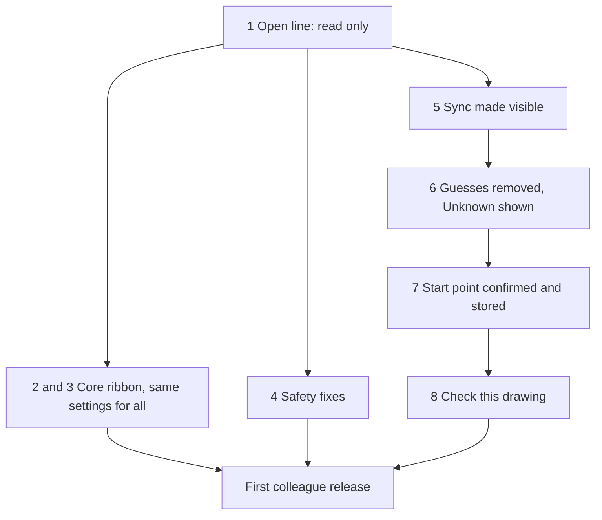
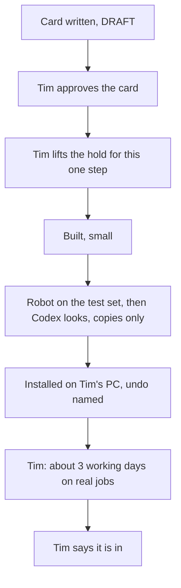

# Area TRUST: a plugin you can trust (the full plan)

**Status: PROPOSAL, written Thu 12 Nov 2026 by chat CE_ACAD / trust plan / plan / 01.** Nothing here is built, tested, installed or accepted. The HOLD stands: no builds, installs or colleague releases until Tim lifts it himself.

**What is decided (Tim's words, `decisions\2026-11-05_TIM_PLUGIN_STRATEGY_TALK.md`):** a small core for colleagues; Civil first; the pilot date is off; "I want something that works. If it's going to take time to make that happen, then let's take the time."; CE tools stay available on every drawing; card UX-OPEN-01's three decisions; and decisions 7 to 13 of 12 Nov (finish line, stop faults, first colleague on 2027, trials, the LPD as the start point, nothing changes on open, the autonomous run).

**Agreed direction, not quoted rulings (6 Nov voice talk, written up by the voice chat):** the first colleague release waits for Check this drawing; testing goes Codex on a test set, then Tim on real jobs for about 3 days, then colleagues; two always-visible tabs, CE Drainage and CE Design. The 5 Nov plan itself is approved by interpretation only (decision 3).

**Reviewed 12 Nov:** an independent review found ten holes; they and the fixes are in `areas\TRUST_PLAN_REVIEW_12NOV.md`. The corrections are folded in below where marked "review".

**What is NOT decided:** everything marked OPEN in `areas\TRUST_PLAN_INTERVIEW_12NOV.md`. Each step below says which open questions it waits on.

**Where this sits in the one plan:** this file is area TRUST in `MASTER_PLAN.md` section B. It replaces `areas\V3_TRUST_PLAN_06NOV.md` as the working plan; that file stays as the 6 Nov proposal and evidence. It is not a second plan (RULES 9.1).

---

# FOR TIM

**Eight steps, safest first. One step at a time. You approve each card before any code. Colleagues get nothing until step 8 has passed on about 10 real past jobs and you have had three clean days on it.**

**What each step gives you, in one line each:**

1. **Open line:** you open a job and one line says "all linked" or "needs checking". Nothing in the drawing changes.
2. **Core ribbon:** two tabs, CE Drainage and CE Design, with only the buttons you keep.
3. **Same settings for all:** you and every colleague run one office setup, so the same clicks give the same result.
4. **Safety fixes:** the faults that lose work or leave things out without saying.
5. **Sync made visible:** the hidden update stops running inside tools that say they only read, and whenever it does run it prints one line saying what it changed.
6. **Guesses removed:** no more made-up "100 dia UPVC". Unknown shows as Unknown.
7. **Start point:** you confirm the outlet once. It is stored in the drawing and every tool reads it from there.
8. **Check this drawing:** one door. It lists what is Sure, what is Proposed (with the reason) and what is Unknown. You tick, it backs up, applies, and one U undoes it.

**Three things run beside the steps and must be ready before step 8 can be proven:**

1. **The test set:** about 10 real past jobs with the right answers written down (`areas\TRUST_TEST_SET_12NOV.md`).
2. **The reader:** fixed rules that recognise every older version of each CE block, with Unknown for the rest (`areas\TRUST_READER_DESIGN_12NOV.md`).
3. **The release process:** who looks after a release, how problems come back, how to go back a version (`areas\TRUST_RELEASE_PROCESS_DRAFT_12NOV.md`).
4. **The Structural part (proposal):** the Structural core in roof-down order and its six steps (`areas\trust-plan-structural.md`).
5. **The Manager part (proposal):** install, update, going back rehearsed, seeing what a colleague runs (`areas\trust-plan-manager.md`).

**How a tool earns its place:** the five trust rules, as a tick list, with a one-page note per tool (`areas\TRUST_RULES_CHECKLIST_12NOV.md`).

---

## 1. How every step runs (the same gate each time)

1. **One trial at a time.** Steps 1, 2 and 3 change nothing in a drawing and share one trial of about 3 working days; steps 4 to 8 each get their own (Tim, 12 Nov, answer A4). A new trial does not go on Tim's PC until he has said the last is in, or has rolled it back.
2. **The four states stay separate.** Every step's status line reads Built / Tested / Installed / Accepted, each yes or no. A green build proves nothing in AutoCAD.
3. **The same check before and after every step (RULES 15.6).** The robot reads all test-set jobs before the step and after it. Anything that read correctly before must read the same after. One item that got worse blocks the step.
4. **The stop rule (Tim, 12 Nov, answer A2).** Four faults take a step or a release off the same day, on Tim's PC or a colleague's: lost work; an AutoCAD crash; a wrong value shown as a fact; CE changing the drawing or its record without telling. The "clean days" count then starts again. The fourth applies from the step that promises it (interpretation, see the interview file).
5. **Every install names its undo** before it happens: where the backup is and the one action to go back (RULES 8.6).
6. **Windows are Codex's work, behaviour is Claude's** (ruling B, 15 Sep). Where a step needs a window, the behaviour side writes the contract first.
7. **AutoCAD 2022 to 2024 is checked at every step,** because those users are in scope and have no ribbon today.

---

## 2. The eight steps

Each step has its own card. Step 1's card is answered; the others are DRAFT in `04_REFERENCE\ux-plan\cards\`.

### Step 0: the measuring stick (added from the review, 12 Nov)

1. **Goal:** have something to measure every later step against, before any step is trialled.
2. **What it is:** the test jobs picked by Tim; an answer sheet for each, taken from the labels on the issued plan or a marked-up print (never from CE's own old schedule, which can repeat CE's old mistakes); and the read-only reader running well enough to produce a reading of each job.
3. **Depends on:** Tim picking the jobs. Until he does, made-up drawings and the existing labelled test copies stand in, and every result says so.
4. **Proven by:** two readings of the same copy are identical; reading changes nothing in the drawing.
5. **Undo:** nothing to undo; it only reads copies.
6. **Risk: LOW.** The risk is in skipping it.

### Cases every card must answer (added from the review, 12 Nov)

1. A drawing that is read-only or open on another PC.
2. A job made by Save As from another job, and pits copied or WBLOCKed between jobs: the copies carry CE's identity and can look Sure when they are wrong.
3. Drawing units not set, or set wrong.
4. Drainage that sits inside an attached drawing (Xref).
5. Paper space: schedules placed on layouts.
6. A colleague typing a hidden command from habit.
7. A drawing last touched by a different CE version, older or newer.
8. CE blocks that were exploded, scaled, mirrored or rotated; other people's blocks named like pits.
9. One job split over several drawings.

### Step 1: the open line (card UX-OPEN-01, decisions answered)

1. **Goal:** tell the drafter the state of a Civil drawing the moment it opens, changing nothing.
2. **What you see:** `CE: 14 pits, 22 pipes, all linked.` or `CE: needs checking. 3 pipes not linked, 2 pits with no object.` Nothing on a non-Civil drawing.
3. **Depends on:** nothing. Before code: time the existing check on copies of large jobs to set the size limit.
4. **Proven by:** robot, 8 cases on copies, including a deliberately broken version that writes to the drawing and must be caught; Codex, one look at the line; Tim, five jobs he knows, one messy job, one Structural drawing.
5. **Undo:** one Settings switch. Nothing to restore, because nothing was written.
6. **Risk: LOW to MEDIUM (raised by the review).** The existing check only looks inside CE's own record. Counting pits and pipe lines that are drawn but not recorded needs a new read-only scan, and so does giving an old no-record job any line at all. Nothing is written either way.
7. **Waits on:** Tim lifting the hold for it. No open question.

### Step 2: the core ribbon (card TRUST-02, DRAFT)

1. **Goal:** colleagues see only what you keep, laid out in drafting order.
2. **What you see:** CE Drainage, left to right: pits, downpipes and tanks, pipes, Check this drawing, schedules, help. CE Design beside it. Hidden tools can still be typed.
3. **Depends on:** your answers to Civil sort questions 3 to 11 and the "CE tools on every drawing" list (interview F3 to F12). Step 1 for the Check button's first job.
4. **Proven by:** robot reads the ribbon back and compares it with the approved list, button by button, and fires each button once; Codex looks at both tabs on 2027; the 2022 to 2024 pull-down menu is checked against the same list; Tim uses it for three days.
5. **Undo (corrected 12 Nov):** the two-tab layout sits behind its own new switch, off by default. Switch it off and restart AutoCAD, and the ribbon is exactly today's, button for button (a test pins all 49). The older "Show the old CE tabs" switch is NOT the way back: it brings up an earlier three-tab layout.
6. **Risk: LOW to MEDIUM.** Nothing in a drawing changes. The risks are a button you rely on going missing, and the 2022 to 2024 menu drifting from the ribbon because it is a separate list today.

### Step 3: same settings for everyone (card TRUST-03, DRAFT)

1. **Goal:** the same clicks give the same result on every PC, and you can tell in one glance whether a colleague is on the office setup.
2. **What you see:** after an update, one short window: "Office settings changed: 6 values. See them / Apply." One line in CE Health: "Office setup: yes" or "Office setup: no, 3 values differ".
3. **Depends on:** your choice of which finished-but-off features come on (D2), what happens to a colleague's own changes (D1), and remembered values (D3).
4. **Proven by:** robot on two Windows logins, one new and one with an old settings file, ends with identical office values (file comparison); the old file is kept as a backup; Codex looks at the window; Tim checks his own setup did not move.
5. **Undo:** the previous settings file is kept beside the new one. One button puts it back.
6. **Risk: MEDIUM.** A wrong office value reaches everyone at once. That is also the point: one place to fix it.

### Step 4: core safety fixes (card TRUST-04, DRAFT)

1. **Goal:** remove the faults that lose work or leave things out silently, before anything else is asked of colleagues.
2. **What you see:** CLEAN saves; a reminder when work has gone unsaved; Pit Schedule exports to Excel on 2027 and says which pits it left out; cancelling CDFW no longer clears pit inverts. Then the Structural schedule fixes.
3. **Depends on:** nothing in steps 1 to 3. Fixes are lifted one at a time out of the held builds (C-79c, C-80, S-46); those builds are not installed whole.
4. **Proven by:** each fix has its own robot case and a broken twin that must fail; Codex looks at anything seen on screen (the reminder, the schedule note, the Excel file opened); Tim on real jobs.
5. **Undo:** the previous build, by the install's named backup.
6. **Risk: MEDIUM.** Each fix is small, but they touch saving and the schedule, which are the things you can least afford to break. BUG-1255 has no fix written yet; its cause is only named in the bug title.

### Step 5: the sync made visible (card TRUST-05, DRAFT)

1. **Goal:** nothing changes CE's record behind your back.
2. **What you see:** CDGRAPH, CE Health, CDDIAG and the dashboard no longer change anything. When any tool does update the record, one line says so: `CE updated its record: 2 pipes added, 1 pit removed, 3 cover levels read from the drawing.` Silence when nothing changed.
3. **Depends on:** step 1 (the same counting). One probe first: how AutoCAD's U treats these changes, on a copy.
4. **Proven by:** robot compares the stored record before and after each "read-only" tool (must be identical) and checks each line's numbers against the real difference; Codex reads the line for plain words; Tim sees whether the lines match what he knows of his jobs.
5. **Undo:** two Settings switches, one for each half.
6. **Risk: MEDIUM.** A tool that leaned on the hidden update may show slightly older information. It must then say "needs checking" rather than update quietly.

### Step 6: guesses removed (card TRUST-06, DRAFT)

1. **Goal:** Unknown shows as Unknown, and CE never reaches further than you would expect.
2. **What you see:** a line on the pipe layer with no size shows "size Unknown" (the schedule shows "?"), not "100 dia UPVC". In a metre drawing CE no longer looks 2 km for a pit label.
3. **Depends on:** step 5 (so each change is reported). Your engineering word on each fill-in: size, material, lid class, pit number, flow direction (card decisions).
4. **Proven by:** robot on the test set: zero invented values, same result in a millimetre and a metre copy of the same job; a broken twin that fills "100" must fail; Tim checks the Unknowns are the ones he would expect.
5. **Undo:** one Settings switch returns the old fill-ins for new readings. Values already written are not changed back by the switch; the pre-step backup is the way back.
6. **Risk: MEDIUM to HIGH.** More "?" appear at first, on exactly the jobs that were quietly wrong. Calculations that meet a blank size have not been traced yet.

### Step 7: the start point, confirmed and stored (card TRUST-07, DRAFT)

1. **Goal:** one start point per network, confirmed once, stored in the drawing, read by every tool.
2. **What you see:** "CE proposes P1 as the outlet because the LPD is drawn at its outlet pipe. Confirm?" After that CDRENUMBER, the schedule, the solver and the long section stop asking, and a marker shows where it is.
3. **Depends on:** step 6 (a proposal must never be a guess presented as fact). The start point is the LPD itself, and pit numbers count up from the first pit upstream of it (Tim, 12 Nov, answer B4). Jobs with two outlets are still a card decision.
4. **Proven by:** robot: confirm once, save, close, reopen, every reader gives the same outlet; two-outlet job; job with no outlet drawn; Codex looks at the question and the marker; Tim on real jobs.
5. **Undo:** the confirmation is one U. A Settings switch sends the readers back to today's behaviour.
6. **Risk: MEDIUM.** Two stored forms of the LPD exist today and each refuses to be written while the other is there. The safe design reads both and migrates neither at first.

### Step 8: Check this drawing (card TRUST-08, DRAFT)

1. **Goal:** one door for bringing any drawing, old or new, into a state you can trust.
2. **What you see:** a list in three groups, Sure, Proposed (each with its reason) and Unknown. You tick what to accept and confirm the outlet. CE backs up, applies, and one U undoes it. CE does not save; you do.
3. **Depends on:** steps 5, 6 and 7, the reader, the test set, and your word on the 25 Sep ruling that keeps CDSYNC and CDREBUILD as direct commands (C1).
4. **Proven by:** Codex and the robot on all test-set jobs against the written answers; then Tim on real jobs for about three days; then colleagues. This is the gate for the first colleague release.
5. **Undo:** one U for an Apply; the backup file made before Apply; the old typed commands stay until this is accepted.
6. **Risk: HIGH.** It writes to real drawings. That is why it is last, built in slices (read-only list first), and proven on copies before any live job.

---

## 3. What must be true before the first colleague release

All of these, none optional. The bar in line 2 is Tim's answer A1 of 12 Nov: zero wrong on all 10 jobs, Unknowns allowed where the drawing lacks the information, plus three clean days. The first colleague is on AutoCAD 2027 (answer A3), so the first release is proven on 2027.

1. **Steps 1 to 8 accepted by Tim,** each after its own trial.
2. **The test set passes:** on every job, nothing wrong shown as a fact; Unknowns within the limit Tim sets (B3).
3. **Three clean working days** for Tim on the whole core: no lost work, no crash, nothing unexplained.
4. **Every core tool passes the five trust rules** and has its one-page note.
5. **The release process is agreed** (who, how problems come back, how to go back) and going back a version has been rehearsed once on a colleague-style PC.
6. **Each first colleague's AutoCAD year is known** (A3), and the core has been checked on that year.

---

## 4. Findings since 6 Nov that change the plan

Read from the installed code (Civil and Manager cf059dcf, Structural 8de95c34) by three readers on 12 Nov. "Checked" means this chat re-read the line itself.

1. **The hidden sync has about 60 ways in, not about 36.** Two different calls reach the same writer; the earlier count mixed them. (Reader's count, not re-counted here.)
2. **The sync reports nothing because it returns nothing.** Its counts exist only in the log, and some changes (cover levels read back, pipes re-joined) are not counted at all. Step 5 has to add the counting, not only print it.
3. **The existing "hold" does not hold everything.** Three tools already keep record changes back until you accept. Link changes made during a sync are not held. Step 8 therefore uses the "work on a copy, then apply once" pattern that CDSPINEUPGRADE uses.
4. **The 5,000 label reach is already a Setting and already unit-safe.** Checked. The 6 Nov audit was wrong on that one. The pit width plus 2000 and plus 2500 reaches are still hard-coded and unit-blind. Checked for 2000.
5. **Two more unit-blind items the audit missed:** the 200 restore distance, and a pipe's size read from its drawn width (a 0.225 wide line in a metre drawing reads as 0, not 225).
6. **CDFIXPIPEENDS defaults to Yes, not No.** Checked. Enter applies the fix. It is not the model of caution the audit called it.
7. **The outlet has two real homes, not four.** CDLPD's record does link to a pipe end and a pit. A second, newer record holds several outlets and is written from Design. Each refuses to be written while the other exists. The other two "homes" are about one pit's outlet pipe, not the network's.
8. **CDRUNSOLVE finds the outlet by looking for a pit whose number contains "LPD".** Checked. It does not read the stored LPD at all.
9. **The oldest pit and pit label symbols have no master drawing in the plugin.** Only PIT BLOCK 2, PIT BLOCK 3 and PIT LABEL 2 ship. Checked. The reader cannot compare the oldest ones against a file.
10. **No old LISP tools were found on this PC** in the two places the readers looked. What the LISP era left in drawings has to be learnt from the test-set jobs themselves.
11. **Saving Settings writes every value.** So anyone who has ever pressed Save is frozen on the values of that day, and later office changes never reach them. Colleague starting values apply only to a login that has never had a settings file. Checked.
12. **There is no way to send one setup to everyone today.** No export, no import, no office file.
13. **The "hidden" mark does not hide a ribbon button.** 76 of 141 Civil commands carry it (checked), but the ribbon ignores it. The ribbon is a hand-written layout.
14. **One tab per plugin today.** Two Civil tabs need a second entry in the tab list; nothing hides tabs by drawing type, so both already show everywhere.
15. **The 2022 to 2024 pull-down menu is a separate list** from the ribbon, so the two can drift. New Job is on neither.
16. **Pit symbols are swapped on opening with no check that the drawing is Civil,** and with no line on screen. Checked.
17. **The backup made before pipe conversion copies the last saved file.** Work since the last save is not in it.

---

## 4b. What AutoCAD showed on the night of 12 to 13 Nov (first real evidence)

From the AutoCAD evidence lane, on the build installed on Tim's PC (Civil 3.0.90), on made-up and test copies only. Full write-up: `areas\TRUST_PROBES_13NOV.md` and `areas\trust-run\OLD_BLOCKS_FOUND.md`. The controller has read both write-ups; it has not repeated the tests.

1. **One U does put CE's stored data back** after CDSYNC, after CDGRAPH and after Edit Pit. Compared before and after, exactly. The Undo worry in steps 5 and 8 is much smaller than feared. Not tested: U after other commands in between, Redo, Edit Pipe, PIT, CD.
2. **One U does nothing for the change made when a drawing opens** (pipes turned into CE pipes). The only way back is the backup file beside the drawing, which misses unsaved work. This is the strongest reason for Tim's 12 Nov answer that nothing changes on open.
3. **The "read-only" tools do write.** CDGRAPH, CDDIAG and the Project Review window update CE's stored data. So does Edit Pit, even when you press Cancel: the update runs before the window opens. CDCHECKCURRENT and CE Health did not change anything.
4. **The made-up values are real.** A plain line on the pipe layer became "100 dia UPVC". A pit block with no label became "P8", 350 x 350, plastic, and left out of the schedule. In a metre drawing the invented pit was 350 (millimetres) beside a real pit of 0.6 (metres).
5. **The check is fast; CDSYNC is slow.** The read-only check took 8 to 65 thousandths of a second, including on a made-up job of 200 pits and 370 pipes. CDSYNC took 4 minutes 6 seconds on that same job. The opening line can run on any size of job and must never call CDSYNC.
6. **The pit symbol swap runs when any drawing opens, Civil or not,** and prints nothing of its own.
7. **The old pit is a block called "Stormwater Pit", and CE does not see it as a pit at all.** It is in the office block drawing the tool palettes pull from, and in every old civil block library that could be opened (2021 and 2022). It has no number built in. There was never a pit label block in the old libraries: pit numbers and levels were plain text or small level blocks. Old pipes were also drawn as "100 DIA. PIPE" style blocks as well as lines. The reader must learn these names; until it does, an old job's pits are invisible to CE.
8. **A downpipe from today's palette carries no data at all;** the old downpipe block carried one value (DP), and the old tank blocks one (WT).

## 5. Probes needed before some cards can be final

**Done 12 to 13 Nov:** P1 (timing) and P2 (Undo, for the cases in 4b). P3 is part done: block names were read from the office block libraries, not yet from old jobs.

These need AutoCAD on copies, so they wait for Tim to lift the hold for them. None changes a real job.

1. **P1, timing:** how long the read-only check takes on the largest jobs (sets step 1's size limit).
2. **P2, Undo:** what one U does after a sync, after an open-time change, and after an Apply from a window. The code cannot answer this. Steps 5 and 8 need it.
3. **P3, old drawings:** open each test-set copy and list every block name and attribute on the drainage layers. This builds the reader's list of older versions.
4. **P4, the 2022 to 2024 menu:** what a colleague on those years actually sees today.
5. **P5, colleague PCs:** which build, which AutoCAD year, and which settings each first colleague has. Never read so far.

---

## 6. Rules and earlier answers this plan touches

Nothing here is changed by this plan. Each needs Tim's word (interview section H and C).

1. **UX-REP-01 (25 Sep):** CDSYNC and CDREBUILD stay direct typed commands. The plan keeps them typed and working; putting them behind a preview needs his word.
2. **Pipe conversion and the pit symbol update on opening:** ANSWERED 12 Nov (B5). Tim chose "Nothing changes on open": opening only reads, and both become rows in Check this drawing. This supersedes 16 Sep "EVERYTIME YOU OPEN AN EXISTING JOB" and 4 Nov "ASK USER WHEN OPENS" for the core. Today's behaviour stays until step 8 slice D can do the job (interpretation).
3. **Rule 15 (AutoCAD never idle), the 17 Oct switch-on ruling, percentages in every message:** in force until he says otherwise. Under this plan, robot and Codex evidence comes first but cannot let a tool into the core.
4. **The plastic pit rule (5 Sep, item 58):** kept. Step 4 only makes the schedule say which pits it left out.
5. **CE never saves for you (UX-STD-03):** kept in every step.
6. **No hard blocks (R-27):** kept. Every step warns and records.
7. **Settings-first (R-00):** steps 6 and 3 move hard-coded values onto Settings.

## 7. RULES 15.8, the six foundations

The plugin does not own the drawings, so most do not apply (15.9). Stated, not skipped:

1. **One fact in one place:** APPLIES and is a GAP. The record, the links, the labels and the outlet can disagree. Steps 5 to 8 are the cure.
2. **A restore that has been run:** APPLIES to CE's own backups. GAP: the pre-conversion backup misses unsaved work, and no restore has been rehearsed. Step 8 proves one.
3. **Platform watch:** not applicable here; AutoCAD years are covered by the 2022 to 2024 check at each step.
4. **Tight access:** not applicable; no browser or shared store.
5. **Alerts:** APPLIES in a small way. GAP: nothing tells Tim a colleague is on a different build or setup. Step 3's health line is the cure.
6. **No dead data:** APPLIES. GAP: one recovery routine has no caller, and the old per-PC project files are still read in rare cases. Noted for step 8.

---

## 8. Status

1. **Step 1:** card answered. Built no. Tested no. Installed no. Accepted no.
2. **Steps 2 to 8:** cards DRAFT. Built no. Tested no. Installed no. Accepted no.
3. **Test set, reader, release process, trust checklist:** DRAFT documents. No jobs picked yet.
4. **Interview:** started 12 Nov. Answered: A1 to A4, B1, B4, B5 and where the old tools are. Everything else is OPEN and queued in `areas\TRUST_PLAN_INTERVIEW_12NOV.md`.
5. **Autonomous run (from 12 Nov 22:45):** five side sessions building and testing under `areas\TRUST_AUTONOMOUS_RUN_12NOV.md`. Nothing is installed or merged. Their status lines are in that file, section 5.

## 9. What this plan has not checked

1. **Nothing was run.** Every behaviour is read from code or a log.
2. **No colleague PC was read.**
3. **No real old drawing was opened.**
4. **The readers' findings** were spot-checked on ten lines (marked "Checked" above and listed in the desk log). The rest is their reading.
5. **Structural and Manager** have only the 6 Nov audit behind them; they follow Civil and have no step cards yet.
6. **The held builds (C-79c, C-80, S-46)** were not re-read for step 4.
