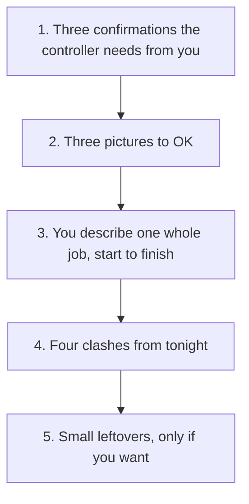

# Next sitting with Tim: what the ask chat will put to him, in order

**Written Sun 15 Nov 2026 about 03:40 PC clock by the ask chat (CE_ACAD / trust plan / ask / 01), after Tim's "im going to bed, keep things moving". A working list, not decisions. Records of what he has already answered: `FOR_TIM_QUEUE.md` and `TIM_INTERVIEW_15NOV.md`.**

## FOR TIM

**About 20 minutes, in this order. Nothing waits on it; defaults are in use.**

### 1. Three confirmations, in the controller chat (queue items 12, 13, 14)

The controller will not act on these from my record alone, because each reverses something you told it yourself. Say them there, in a word each:

1. **Build the simpler layout now, or picture first then build?** (You clicked "build it alongside the ten now" at 03:30.)
2. **May CE act by itself** on levels, sizes, pit numbers, labels and layers, leaving alone what you change by hand? (You clicked yes at 03:31; at 01:57 you had said never.)
3. **May finished jobs be copied from the office Projects folder** for the robot and the evidence study, copies on your PC only, no names anywhere? (You clicked yes at 02:34 and 02:36.)

### 2. Three pictures to OK (queue item 15)

File: `C:\CE_PLAN\04_REFERENCE\mockups\NEW_JOB_STRUCTURAL_TAB_DASHBOARD_15NOV.html`

1. **New Job, type once.**
2. **CE Structural tab:** A (both floor panels, reads roof down) or B (one floors panel, each button once).
3. **Dashboard row per PC.**

### 3. One whole job, in your words (the biggest gap)

You asked "do you understand what a job takes from start to finish?" Honest answer: only the drafting steps, from documents. I will ask you to talk or type through one real Civil job and one real Structural job, no choices put in your mouth, prompted only by:

1. **What lands on your desk first,** from whom, and what state is it in?
2. **What do you decide as the engineer** before anyone draws?
3. **Who draws, who checks,** and what gets caught at checking?
4. **What goes to council or the client,** and what comes back?
5. **What changes after that,** and how many times?
6. **Where does the time go, and where do the mistakes come from?**
7. **Which parts would you hand to CE tomorrow if you trusted it?**

### 4. Four clashes from tonight (interview 13.6), each with a picture first

1. **A pit that has never had a number:** left as "?" (your 02:06 answer) or numbered automatically (03:31)?
2. **Pit numbers after the schedule is on the sheet or the job is issued:** still renumber by themselves?
3. **"This one is mine":** how a value, label or number you changed by hand is marked, and how you hand it back to CE.
4. **Solving levels:** CE fills a blank level by itself; does it also re-work levels already there, or always preview first (your 01:53 answer)?

### 5. Small leftovers (only if you want them)

1. **Queue item 1:** try typing a number in Edit Pipe, More…, Design flow.
2. **Queue item 4:** the Pit Schedule's new top line, when its screenshot exists.
3. **Yours to name:** the first colleague; the machine for the Roll Back proof.
4. **Older questions not yet asked** (defaults in use): Q0, Q4, Q34, Q37, Q38, Q41, Q44, Q45, Q58, Q63, Q68, Q74 to Q77, plus the unasked parts of Q39, Q60, Q64, Q72 and Q78. Several are now overtaken by tonight's answers and will be struck off first, with the reason, rather than asked.
5. **Held for the evidence study, not for your memory:** Q16, Q73, Q80, Q81, Q82.

---

## For the next ask chat (technical)

1. **How to ask:** the clickable question tool, at most 4 at a time, recommended first, a drafting example on every choice.
2. **Pictures:** an in-chat widget did not reach him; write a standalone HTML file under `04_REFERENCE\mockups\`, commit it, send it with the file tool, letter the options, offer "Can't see it".
3. **Check the record before asking.** Tonight one question was asked that the 17 Oct record had already answered, and one was asked with the wrong list. Both are written up in the interview file.
4. **Messages to the controller** are capped at 20 between Tim's own messages; put anything undelivered in the shared notes folder.
5. **The ask chat does not open** `C:\CE_DrawingIntelligence` or the office Projects folder.
