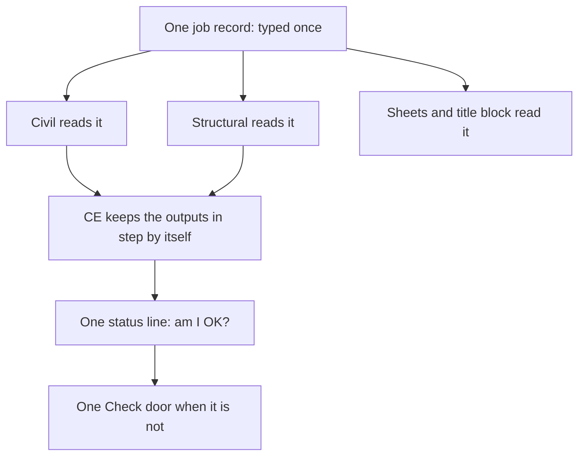

# The whole product, simple for people: a first draft

**DRAFT by the ask chat (CE_ACAD / trust plan / ask / 01), Sun 15 Nov 2026, about 03:30 PC clock. Written because Tim asked: "i want you to do your best first and then interview me". His full words are in `TIM_INTERVIEW_15NOV.md` section 12.3. Nothing here is decided. It is not a second plan: it is a proposal for the controller to fold into the one plan once Tim has answered. His answers are in `TIM_INTERVIEW_15NOV.md` section 13.**

**What this draft rests on:** the plan files read tonight (the one-drafter day of 14 Nov, the 6 Nov Civil command sort, his 15 Nov screen rules) and his answers of this sitting. **What it does not rest on:** a tool-by-tool study of the 145 Civil commands, any look at Structural or Manager in AutoCAD, or his real drawings. Those gaps are named at the end.

---

# FOR TIM

## 1. The problem, in your words and in numbers

**You said:** it "feels complex", "built by ai with no consideration for how its used by humans", and people "dont know what to use and when".

**The numbers agree (6 Nov sort):**

1. **145** Civil commands exist.
2. **47** have a button.
3. **35** are checks and repairs that all do versions of one job.
4. **64** have no button at all.

A drafter does about **7 things** on a job. A tool with 145 commands for 7 things is built around what the code can do, not around what the person is doing.

## 2. The idea in one picture

## 3. Seven rules for the whole product

1. **Type once.** The job's council, address details, rainfall, levels datum, sheet size and revision are entered once, in New Job, and every tool and every sheet reads them. No tool ever asks for something another tool already knows.
2. **The ribbon is the method.** Left to right is the order of the job (you OK'd this for Civil tonight). Structural gets the same idea in your roof-down order. A new starter follows the tab like a checklist.
3. **Few buttons, plain names.** One button per thing the drafter does, named for the thing ("Pit", "Solve a run"), never for the software ("sync", "rebuild").
4. **CE does the housekeeping itself.** Anything that only keeps CE's own record or its outputs in step runs by itself and says so in one line. The drafter is never asked to run a repair to make CE consistent with itself.
5. **One place to look, one place to fix.** The status line answers "am I OK?". One Check door lists what is not, with reasons, and fixes what you tick.
6. **CE never guesses and never surprises.** Unknown stays Unknown. Nothing you can see on the drawing changes without a preview or your action (your answers tonight).
7. **Same everywhere.** Civil, Structural and Manager share one look, one set of words, one way to preview, apply and undo, built from one small kit of parts (your 15 Nov screen rules).

## 4. What would run by itself (the "considered well" part)

The test for automatic: **it changes nothing you drew, it can be undone, and CE says it did it.**

1. **Automatic, silent unless something changed:** keeping CE's record in step with the drawing; linking a pipe to the pit it touches; keeping the Pit Schedule, long section and calculations in step with the plan (your answer tonight); the status line.
2. **Automatic at a moment you chose:** the council check when you place the schedule or plot (your answer tonight).
3. **Offered, never automatic:** anything that sets a level, size, pit number, label position or layer (your "never by itself" list tonight). CE shows a preview and you press Apply.
4. **Gone from the drafter's sight:** about 35 check and repair commands fold into the one Check door. They keep working inside it; nobody has to know their names.

Rough effect on Civil, to be checked tool by tool: from **145** commands a person may need to know, to about **43** buttons in 6 panels, of which a new starter needs about **10** on a simple job.

## 5. Three levels of user, one tool

1. **New starter:** follows the ribbon left to right; every window opens with only the few fields that matter, the rest under "More"; plain words; the status line says what to do next.
2. **Everyday drafter:** the same tool, faster: picks a pit and edits it from the pop-up; last-used sizes remembered (never levels); nothing interrupts while drafting.
3. **You, the engineer:** Settings and the council rulebook hold every number; exceptions are yours to sign; typed commands stay for the rare repair.

No "beginner mode" switch: one tool that shows little by default and more when asked.

## 6. The whole product, three parts

1. **Civil:** the job in six steps (Start, Sources, Network, Levels, Check, Sheet).
2. **Structural:** the same shape in your order: Roof, Upper floors, Ground, Footings, then Check and Sheet. The same job record feeds its title block, member schedule and bracing.
3. **Manager:** almost invisible to a drafter. It keeps everyone on the same CE and the same office setup, tells them when a newer one is approved, and lets a bad release be taken back. Its screens are for you.

## 7. How the work would be done differently (from the page you linked)

The page's point: AI output is generic when the AI "is working blind". Three fixes, applied to CE:

1. **Real references:** your past drawings teach CE and Claude how the office actually draws (the evidence study you approved tonight).
2. **Your rules first:** your 15 Nov screen rules and the Design Guidebook are read before any window or command is touched; one small shared kit of parts.
3. **Check its own work:** a mock-up you OK before the build, then the real screen looked at in AutoCAD before anyone says done.

And one more, from your complaint: **every tool gets a "who uses this, when, and what do they do next" line before it is built or kept.** A tool with no answer does not get a button.

## 8. What I do not know yet

1. **Structural and Manager in use.** This draft is strongest on Civil. I have not seen how you actually move through a Structural job.
2. **Which values you retype today.** "Type once" needs the list of things you currently enter more than once.
3. **Which of the 145 commands can really run by themselves.** The sort gives the groups; nobody has checked each one against the test in section 4.
4. **How this sits with "prove, don't draft".** Much of this is new design, not fixes. Whether it reorders the run is yours to say.
