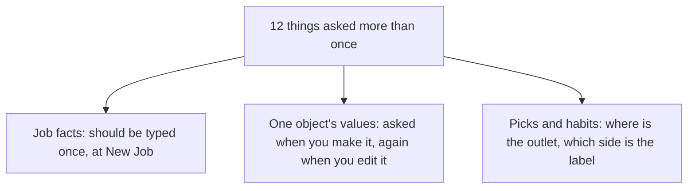

# "Type once": where the same thing is asked for more than once today

**Written Sun 15 Nov 2026 about 03:50 PC clock by the ask chat, for Tim's direction of 03:27: "i want to type or input things once and that is saved everywhere".**

**How far to trust this:** a helper (Haiku, read-only) read the tool notes in `04_REFERENCE\core-tool-notes\` (it reports 86 command notes, 51 Civil and 35 Structural, plus the README) and listed what each note says the tool asks. I have NOT checked its list against the notes one by one, and the notes themselves were written from the code, not from watching the tools run. Treat every line as "the notes say", not "AutoCAD does". Nothing here is a decision or a build.

---

# FOR TIM

**The notes show 12 things asked for by more than one tool.** They fall into three kinds, and only the first is the "type once" you described.

## 1. Job facts (the real "type once" list)

1. **Council.** Asked by CDRULEBOOK ("Council id for this project") and again as free-text boxes in CDDESIGN, where the note says those boxes are "not the council the design uses". Two places, and they do not talk to each other.
2. **Detention volume.** Asked by CDTWL in cubic metres and by CDWT in litres. Same fact, two tools, two units.
3. **Job number, client, address, suburb.** CDNEWDWG already fills the title block from a job record, with nothing typed. This part of "type once" exists today.
4. **Drawn by and revision.** The New Job note does not say where these come from. Not known.
5. **Outlet (the LPD).** Picked again in CDTWL, CDRENUMBER, CDRUNSOLVE, CDTG and CDAGI. Your 12 Nov ruling already makes the LPD the one start point; the notes say five tools still ask.

## 2. One object's values (make it, then edit it)

1. **Cover level:** PIT, PP, Edit Pit, CDTG.
2. **Pit size, lid, type:** PIT, PP, Edit Pit.
3. **Pipe size, material, levels:** New Pipe (CD), Edit Pipe.
4. **Invert levels:** CD, Edit Pipe, CDMA, CDAGI.
5. **Pit number:** Edit Pit, Pit Schedule, CDRENUMBER.

These are the same value seen through different windows, which is fine if every window reads and writes the one record. Whether they all do is the thing to prove tool by tool.

## 3. Picks and habits (Structural mostly)

1. **Inside-of-building point:** BSET, and again in each beam tool (1, 2, 4, 5).
2. **Beam mark text:** each beam tool and BDL.
3. **Support label side:** C1, C2, DS1, TS1 and the four switch tools.
4. **Tag or name text:** fourteen tools across Civil and Structural.

## What your tick at 03:30 said that the notes do not show

You ticked that you retype **job details for the title block** and **the same details across Civil and Structural**. The notes show the Civil title block filled from the job record, and say nothing about Structural reading that record. So either Structural does not read it, or sheets after the first do not, or the notes are missing it. That is worth one look in real AutoCAD before anyone designs around it.

## Gaps the helper reported

1. **Notes that do not list their window's fields:** CDS, Structural Settings, CDCALC, CDRAINFALL, CDMANAGER, CDCHECKCURRENT, CDINSPECTOR. So this list undercounts what the big windows ask.
2. **Rainfall:** the notes say the office rainfall curve is fixed in the code, not on the Settings page. If so, that sits against the settings-first rule; not checked.
3. **CDRUNSOLVE:** the note still says every pit flow is fixed at 0; that note is older than the 14 Nov fix work.
