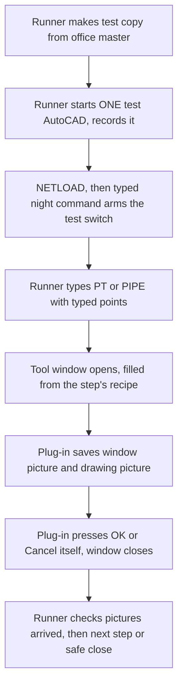

# The route to pictures (how a night run shows what the tools really do, with no mouse over AutoCAD)

**Kept by:** the AutoCAD test room. **Written:** Fri 20 Nov 2026, about 12:10 pm, at the control room's request. **A design page: no code, nothing run.**
**Read for it:** the night scripts on the main line (22993fa), `PitCommand.cs` on the main line, and the build room's branch `team/acad-pictures` (its page `acad\NIGHT_PICTURES.md`), which already builds most of this route and has a HOLD with 5 blockers.
**Verdict in one line:** the control room's four-part proposal is workable and safe if the eight conditions in section 3 hold; nothing in it is impossible; three things in it are unproven in AutoCAD and are proved first, smallest first (section 6).

## 1. The route, step by step

1. **Points are typed, never clicked** (proposal a). The runner sends the command with its points as typed coordinates, to our recorded AutoCAD only, through the checked sender in `ce_safety.ps1`. MOVE, COPY, ERASE, EXPLODE and U are typed the same way, and the part to act on is named by its drawing handle, not picked.
2. **A test-only switch** (proposal b). A typed night command, sent by the runner after NETLOAD, turns it on for that AutoCAD session. Under it, a tool window opens as normal, is filled from a small recipe (the figures a drafter would type for that step), pictures are saved, and the window is left by OK or Cancel as the recipe says.
3. **Pictures saved by the plug-in itself** (proposal c): the window, the drawing view zoomed to the parts while the window is still open (this is the only way to show "live on the drawing", D-357), and the drawing view again after the command ends.
4. **The safety file expects that window and no other** (proposal d). Every other unknown window still halts the night for Tim.
5. **Steps and recipes are data,** one row per step (command, points, recipe, OK or Cancel, picture names), so a new step is a new row and not a rebuild.

## 2. What is impossible or unsafe in the proposal

**Impossible: nothing.** Each part has a known way to do it. **Unsafe unless bounded: three things.**

1. **A switch that presses OK by itself is dangerous if it can ever be on in Tim's AutoCAD.** It would draw without him. See conditions 1 to 3 below.
2. **Teaching the safety file to "expect a CE window" by its title alone is unsafe.** A box that merely carries a similar title would be let through, and the close ladder could then force an AutoCAD that is showing something else. See conditions 4 and 5.
3. **A picture of the whole AutoCAD window by copying the screen is unsafe as a default.** It needs AutoCAD in front and can catch whatever else is on screen (another program, the TimOS bar). See condition 8.

## 3. The eight conditions (what makes it safe)

1. **Memory only.** The switch is turned on only by the typed night command, lives in that AutoCAD session's memory, and dies when it closes. No file, setting, registry entry or environment value can turn it on. Nothing saved is changed.
2. **Test copy only.** The arming command refuses unless the open drawing is the night's test copy in `C:\CE_WORK\civil_tests\`. Every tool run under the switch says so on the command line ("TEST SWITCH ON: window answered by the night recipe").
3. **Not in a release.** The arming commands and the auto-answer are left out of any build that is installed for a drafter. A test proves a release build does not hold them.
4. **Expected by identity, not by title.** When the plug-in opens a window under the switch it writes a small marker (the window's own handle, the step name, the time). The safety file passes over a window of our recorded AutoCAD only when its handle matches a marker for the step in hand and the marker is seconds old. Licence and sign-in words are still tested first and still win.
5. **Expected only while its step runs.** A CE window still open when its step ends, or open with no step in hand, is an unknown window: the night halts, nothing is closed, a note is written. (The branch already says this.)
6. **The window always lets go.** Under the switch the window cancels itself after a short limit (about 20 seconds) if its recipe has not finished, so a fault cannot leave AutoCAD jammed behind an open window.
7. **OK is pressed through the button, not behind it.** The recipe types into the window's own boxes and presses the window's own OK button from inside the plug-in (the button's own "invoke", by its name), not by setting the answer in code. This proves the box takes the figure and the button is there, shown and enabled. It still needs no mouse and no keyboard.
8. **Pictures in a safe order of preference.** First the plug-in's own picture of its window and AutoCAD's own picture of the view. Second, a copy of our own AutoCAD window asked for by its handle, which needs nothing in front. Screen copying is last, only of our window's own rectangle, only while it is already the window in front, never bringing anything forward. All pictures stay in `C:\CE_WORK\civil_tests\pictures\` on this PC and never go into a repository.

## 4. What the check room must verify (before any of it runs)

1. **The switch cannot be on by accident:** conditions 1 to 3, each with a test that fails when the condition is broken.
2. **The window rule:** conditions 4 and 5 in the fake-window tests, including a licence box and a sign-in box showing at the same time as an expected CE window (must halt), a CE-titled window with no marker (must halt), and a stale marker (must halt).
3. **The allow-list of typed text:** only NETLOAD of the test build, the night commands, PT and PIPE with points, and AutoCAD's own MOVE, COPY, ERASE, EXPLODE and U in exact forms. PIT, PP and CD can never be sent. No function keys, shortcuts, key sending or mouse anywhere in the scripts.
4. **No saved setting is touched.** Object snap, the file-dialog setting and dynamic input are left as Tim has them. A typed point carries AutoCAD's own "no snap" word for that one point instead of switching snap off.
5. **The launcher's refusals:** weekday 8:30 am to 5:30 pm, `STOP_ACAD.flag`, Tim's AutoCAD switch file, any AutoCAD already running; exactly one after launch.
6. **The test drawing** is made by the runner each night from the office master copy and the master is unchanged afterwards.
7. **A picture is never counted unless it is real:** made this run, not one flat colour, and of the size the window reports. A missing picture is NOT RUN, never PASS.
8. **Rule 1.9 in full and the D-160 exception** stand in every script note, unchanged.

## 5. What these pictures will still miss (kept for Tim's own hands)

1. **The window's place and size on his screen.** The plug-in's picture is of the window's contents, not of the screen. The night records the window's width and height in figures beside the picture; whether it sits well on his monitor is his to see.
2. **A real mouse on a real button:** the click itself, hover highlights, the order of boxes when he tabs, the feel of typing, a list opened by the mouse.
3. **Clicking a run by eye:** the line that follows the cursor, snapping to a pit, the prompts at the cursor. A typed point is exact; a click near a pit is not.
4. **Grips.** A grip drag cannot be typed. "Grips stretch and adjust" (D-359) stays with Tim, or needs its own ruling for a mouse route.
5. **Picking and double-clicking** an existing pit or pipe to change it, and right-click menus.
6. **Dragging and resizing the window,** and whether the size is remembered next time.
7. **His AutoCAD as he runs it:** the old plug-in loaded beside the new one and the names PIT, PP and CD (never typed by a robot), and how fast it feels.
8. **Anything in the window not drawn by the plug-in itself.** If a preview were ever AutoCAD's own drawing set inside the window, the plug-in's picture would show it blank; only the picture of the whole AutoCAD window would show it.

## 6. Not known until tried in AutoCAD (proved first, smallest first)

1. **Night one of the route:** one PT in Cancel mode only. Does the window picture arrive and show the whole window with its preview drawn; does the window let go; does AutoCAD go idle.
2. **AutoCAD's own picture of the view:** what it gives, whether it shows the new pit, and whether it can be taken while the window is still open. If not, the fall-back is AutoCAD's own typed picture-export command, and whether that asks for a file box when typed this way is itself not known.
3. **A copy of our AutoCAD window by its handle:** whether the drawing area comes out or is blank.
4. **PIPE finding a pit at a typed point,** and a polyline or a part named by its handle being taken by PIPE, MOVE, COPY, ERASE and EXPLODE.
5. **Whether a running object snap pulls a typed point** when the "no snap" word is used.

Until item 1 has passed in pictures this room has looked at, every step of `EVERYDAY_RUN.md` from 3 to 19 is NOT RUN.
